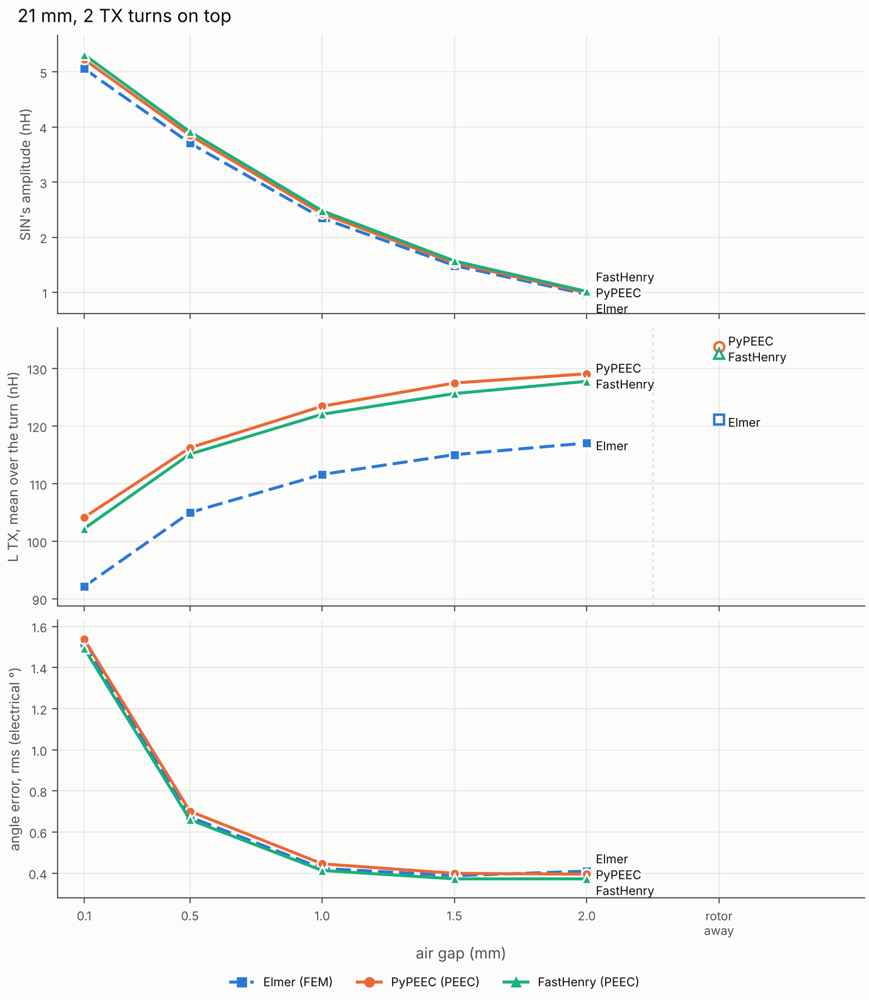
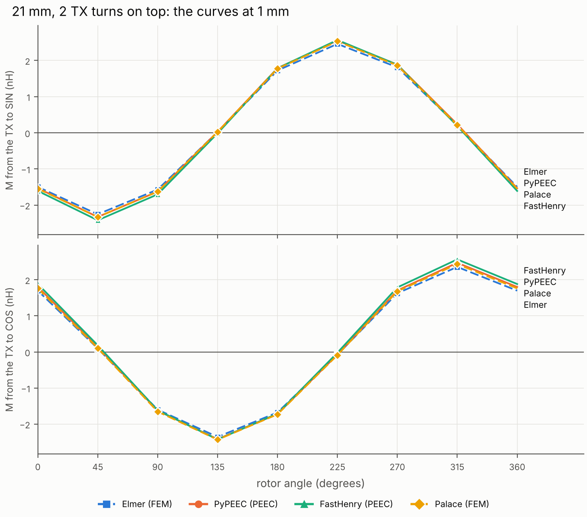

[Solvers comparison](../README.md) › S0 TXtop

# S0_1x_OD21_2L_tiny_TXtop: the solvers compared

**S0 TXtop**: S0 with the TX two turns on the top layer (the generator narrows the RX band to fit them).

| Solver | Gaps finished (of 5) | Solves | Passing their own checks |
|---|---|---|---|
| Elmer | 5 | 40 | 40 |
| PyPEEC | 5 | 40 | 40 |
| FastHenry | 5 | 40 | 40 |
| Palace | 5 | 40 | 40 |
| Theory | worked out from the copper by hand formulas, nothing to solve | — | — |

Against FastHenry, the yardstick (the closest to the reference on the proof boards):

- **Elmer** (FEM): the coupling (SIN's and COS's amplitude) is 5.3 % under FastHenry's on average over the 5 gaps both have finished (−5.7 to −4.8 %); L TX is 8.8 % under (−9.8 to −8.4 %); the rms angle error is within 0.04° of FastHenry's (electrical degrees).
- **PyPEEC** (PEEC): the coupling (SIN's and COS's amplitude) is 2.0 % under FastHenry's on average over the 5 gaps both have finished (−2.4 to −1.6 %); L TX is 1.3 % over (+1.0 to +1.9 %); the rms angle error is within 0.04° of FastHenry's (electrical degrees).
- **Palace** (FEM): the coupling (SIN's and COS's amplitude) is 2.3 % under FastHenry's on average over the 5 gaps both have finished (−2.5 to −2.0 %); L TX is 6.1 % under (−7.1 to −5.7 %); the rms angle error is within 0.03° of FastHenry's (electrical degrees).

Against the hand values (the Theory rows, worked out in [Formulas](#formulas)): with the rotor away, L TX has to lie between about 129.1 nH (all the current at the copper's surface) and 133.0 nH (its DC value, the most it can be at any frequency), and R TX can be no less than its DC resistance, 228.7 mΩ.

- **Elmer**: L TX with the rotor away 121.2 nH, 6.1 % under the high-frequency limit; R TX 259 mΩ, 13.4 % over its DC value.
- **PyPEEC**: L TX with the rotor away 133.7 nH, 0.6 % over the DC value, the most it can be; R TX 282 mΩ, 23.1 % over its DC value.
- **FastHenry**: L TX with the rotor away 132.5 nH, inside the hand values; R TX 244 mΩ, 6.8 % over its DC value.
- **Palace**: L TX with the rotor away 125.1 nH, 3.1 % under the high-frequency limit; R TX 261 mΩ, 14.2 % over its DC value.



*SIN's amplitude, L TX (its mean over the turn, and on the right with the rotor taken away) and the rms angle error against the air gap, one line per solver.*

## At 1 mm



| Solver | SIN amplitude (nH) | COS amplitude (nH) | L TX (nH) | L TX, rotor away (nH) | R TX (mΩ) | Angle error, rms (°) | Angle error, peak (°) | Solves |
|---|---|---|---|---|---|---|---|---|
| **Theory** | no hand formula | no hand formula | ≤ 133.0 | 129.1 to 133.0 | ≥ 228.7 | 0 (ideal) | 0 (ideal) | — |
| Elmer | 2.346 | 2.346 | 111.6 | 121.2 | 265 | 0.423 | 0.579 | 8 |
| PyPEEC | 2.429 | 2.435 | 123.4 | 133.7 | 290 | 0.445 | 0.562 | 8 |
| FastHenry | 2.481 | 2.486 | 122.1 | 132.5 | 254 | 0.413 | 0.517 | 8 |
| Palace | 2.420 | 2.424 | 114.8 | 125.1 | 270 | 0.440 | 0.576 | 8 |

## Every air gap

In the Theory column: L TX can be no more than its DC value and R TX no less than its DC resistance, at any gap; an ideal sensor's angle error is 0; and no hand formula gives the amplitudes (see [Formulas](#formulas)).

**SIN's amplitude (nH)**

| Air gap | Elmer | PyPEEC | FastHenry | Palace | Theory |
|---|---|---|---|---|---|
| 0.1 mm | 5.060 | 5.229 | 5.314 | 5.202 | — |
| 0.5 mm | 3.708 | 3.848 | 3.915 | 3.818 | — |
| 1 mm | 2.346 | 2.429 | 2.481 | 2.420 | — |
| 1.5 mm | 1.486 | 1.533 | 1.570 | 1.534 | — |
| 2 mm | 0.965 | 0.993 | 1.016 | 0.995 | — |

**COS's amplitude (nH)**

| Air gap | Elmer | PyPEEC | FastHenry | Palace | Theory |
|---|---|---|---|---|---|
| 0.1 mm | 5.060 | 5.236 | 5.319 | 5.204 | — |
| 0.5 mm | 3.709 | 3.856 | 3.921 | 3.823 | — |
| 1 mm | 2.346 | 2.435 | 2.486 | 2.424 | — |
| 1.5 mm | 1.485 | 1.537 | 1.574 | 1.537 | — |
| 2 mm | 0.963 | 0.996 | 1.019 | 0.998 | — |

**L TX, mean over the turn (nH)**

| Air gap | Elmer | PyPEEC | FastHenry | Palace | Theory |
|---|---|---|---|---|---|
| 0.1 mm | 92.1 | 104.2 | 102.2 | 95.0 | ≤ 133.0 |
| 0.5 mm | 105.0 | 116.2 | 115.1 | 108.0 | ≤ 133.0 |
| 1 mm | 111.6 | 123.4 | 122.1 | 114.8 | ≤ 133.0 |
| 1.5 mm | 115.0 | 127.5 | 125.6 | 118.5 | ≤ 133.0 |
| 2 mm | 117.1 | 129.1 | 127.8 | 120.5 | ≤ 133.0 |

**R TX, mean over the turn (mΩ)**

| Air gap | Elmer | PyPEEC | FastHenry | Palace | Theory |
|---|---|---|---|---|---|
| 0.1 mm | 291 | 312 | 276 | 295 | ≥ 228.7 |
| 0.5 mm | 271 | 295 | 259 | 276 | ≥ 228.7 |
| 1 mm | 265 | 290 | 254 | 270 | ≥ 228.7 |
| 1.5 mm | 262 | 287 | 251 | 268 | ≥ 228.7 |
| 2 mm | 261 | 286 | 249 | 266 | ≥ 228.7 |

**Angle error, rms (electrical °)**

| Air gap | Elmer | PyPEEC | FastHenry | Palace | Theory |
|---|---|---|---|---|---|
| 0.1 mm | 1.519 | 1.538 | 1.494 | 1.507 | 0 |
| 0.5 mm | 0.673 | 0.701 | 0.660 | 0.685 | 0 |
| 1 mm | 0.423 | 0.445 | 0.413 | 0.440 | 0 |
| 1.5 mm | 0.388 | 0.399 | 0.372 | 0.393 | 0 |
| 2 mm | 0.409 | 0.395 | 0.372 | 0.381 | 0 |

## Against FastHenry, gap by gap

Each solver's value over FastHenry's at the same gap: SIN's amplitude, and in brackets L TX. In the Theory column, in brackets, the most L TX can be (its DC value) over FastHenry's L TX; there is no hand value for the amplitude.

| Air gap | Elmer | PyPEEC | Palace | Theory |
|---|---|---|---|---|
| 0.1 mm | 0.952 (0.902) | 0.984 (1.019) | 0.979 (0.929) | — (≤ 1.301) |
| 0.5 mm | 0.947 (0.912) | 0.983 (1.010) | 0.975 (0.938) | — (≤ 1.155) |
| 1 mm | 0.946 (0.914) | 0.979 (1.011) | 0.975 (0.941) | — (≤ 1.090) |
| 1.5 mm | 0.947 (0.916) | 0.976 (1.015) | 0.977 (0.943) | — (≤ 1.059) |
| 2 mm | 0.950 (0.916) | 0.977 (1.010) | 0.980 (0.943) | — (≤ 1.041) |

## The hand values and the generator's estimates

The Theory row is worked out from the TX copper alone (see [Formulas](#formulas)). The generator's figures come from `Parameters.txt`, formulas rather than field solves: L TX 130 nH with the rotor away and 106 nH with it at 1 mm (which it calls an upper estimate of the drop, so the true value should be above it), and R TX 230 mΩ at DC.

| | L TX, rotor away (nH) | Against the hand values | Over the generator's estimate | L TX at 0.1 mm (nH) | L TX at 1 mm (nH) | R TX, rotor away (mΩ) |
|---|---|---|---|---|---|---|
| **Theory** | 129.1 to 133.0 | — | +2.3 % (DC value) | ≤ 133.0 | ≤ 133.0 | ≥ 228.7 |
| Generator | 130 | — | — | — | ≥ 106 | 230 (DC) |
| Elmer | 121.2 | 6.1 % under the high-frequency limit | −6.8 % | 92.1 | 111.6 | 259 |
| PyPEEC | 133.7 | 0.6 % over the DC value, the most it can be | +2.9 % | 104.2 | 123.4 | 282 |
| FastHenry | 132.5 | inside the hand values | +1.9 % | 102.2 | 122.1 | 244 |
| Palace | 125.1 | 3.1 % under the high-frequency limit | −3.8 % | 95.0 | 114.8 | 261 |

## Time and memory

Each branch records the wall time and the peak memory of every solve. They all ran on machines of the same size (4 cores, 15 GB), often while another solver shared the machine, and each with its own process layout (FastHenry runs several single-threaded solves at once; Palace runs two or four MPI processes per solve, and solved S0d2's five gaps on five such machines at once). Read these as rough.

| Solver | Seconds per solve (median over the gaps) | Range | Peak memory of a solve, as the branch measured it (GB) |
|---|---|---|---|
| Elmer | 178 | 134 to 249 | 13.3 |
| PyPEEC | 281 | 146 to 382 | 1.3 to 2.6 |
| FastHenry | 183 | 86 to 204 | 0.7 |
| Palace | 147 | 117 to 208 | 6.1 to 9.7 |
| Theory | 15 (once for the board: both of Neumann's sums) | — | 1.2 |

## Formulas

How each Theory value is worked out, with this board's numbers. `scripts/theory.py` does the sums; its inputs are the TX copper in the board's `Boards/Stator.kicad_pcb` and the stack-up KESE exported with it (`3D_Geometry/Stator/materials.json`), read from the FastHenry branch (every branch has the same boards).

**1. L TX with the rotor away: Neumann's formula, with the geometric mean distance.**

```math
L = \frac{\mu_0}{4\pi} \oint \oint \frac{d\mathbf{l} \cdot d\mathbf{l}'}{r}
```

over the TX copper's centre line, 92.8 mm of 0.2 mm × 35 µm trace from one terminal end to the other, with the via that joins the layers (the two ends sit stacked at the terminal, and the port closes the loop there at no length, as in E01). Along one stretch of trace (points less than 2 mm apart along the copper), r becomes √(r² + g²), where g is the geometric mean distance (GMD) of the trace's cross-section: a conductor's self-inductance is the mutual inductance of two thin filaments g apart (Rosa; Grover, *Inductance Calculations*). Between separate stretches of copper (neighbouring turns, and the two layers 0.725 mm apart), 1/r is averaged over both cross-sections, to second order. The sum runs over pieces of 0.05 mm with four Gauss points each.

- **DC**, the current spread evenly: g = 0.2235 (w + t) = 0.0525 mm (Grover), so **L = 133.0 nH**.
- **High-frequency limit**, the current all at the copper's surface: g is then the rectangle's logarithmic capacity, 0.0653 mm (from a boundary-element solve of the cross-section, which gives the known 0.25 w for a thin strip and 0.590 a for a square of side a), so **L = 129.1 nH**.

The same code on E01's loop gives 55.571 nH against the textbook 55.590 nH (−0.03 %).

**2. Why these bound the solvers.** With no magnetic material near, a coil's inductance can only fall, and its resistance only rise, as the frequency goes up; and copper brought near it (the rotor) only lowers L and adds loss. So at 3.5 MHz and at every air gap, L TX ≤ 133.0 nH and R TX ≥ 228.7 mΩ; with the rotor away, L TX lies between about 129.1 and 133.0 nH. The skin depth at 3.5 MHz,

```math
\delta = \frac{1}{\sqrt{\pi f \mu_0 \sigma}} = 35.3\ \mu\mathrm{m},
```

is the copper's own thickness, so the true value lies inside that range, not at either end. The lower end counts each trace on its own; the turns pushing each other's current about at high frequency would lower it by well under 1 %.

**3. R TX at DC.**

```math
R = \frac{\ell}{\sigma w t} = \frac{92.8\ \mathrm{mm}}{58\ \mathrm{MS/m} \times 0.2\ \mathrm{mm} \times 35\ \mu\mathrm{m}} = 228.7\ \mathrm{m}\Omega
```

The via adds well under 1 mΩ.

**4. Angle error 0.** The receivers are drawn so that SIN and COS follow the sine and cosine of the rotor angle exactly, and an ideal sensor's angle error is zero. It is the design's target, not a bound: a solver's error is the real board's departure from it plus the solver's own.

**5. No hand value for the amplitudes.** How much of the TX field reaches SIN and COS depends on the eddy currents in the rotor's copper, and no closed formula gives those: only a field solve does. The generator's note that the signal falls about as exp(−2π gap / period), with a period of 27.3 mm here, would keep SIN's amplitude at 2 mm at 65 % of its value at 0.1 mm; FastHenry finds 19 %. It is a rule of thumb, and is not used here.

**6. The generator's estimates.** L TX 130 nH with the rotor away, from its own formula (the DC value above is 2.3 % over it); 106 nH with the rotor at 1 mm, which it calls an upper estimate of the drop, so the true value should be above it (every solver's is); and R TX 230 mΩ at DC, rounded (the copper's 92.8 mm give 228.7 mΩ).

---

The proof boards, why the solvers differ, the data files and how to run it again are in the [branch's README](../README.md). The boards are the Sinusoidal Coil Generator's, for non-commercial use: see [LICENSE.md](../LICENSE.md).
