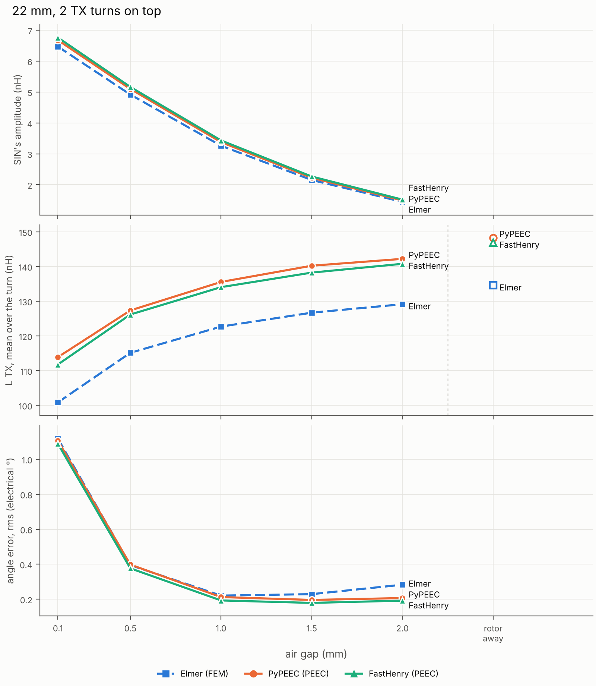
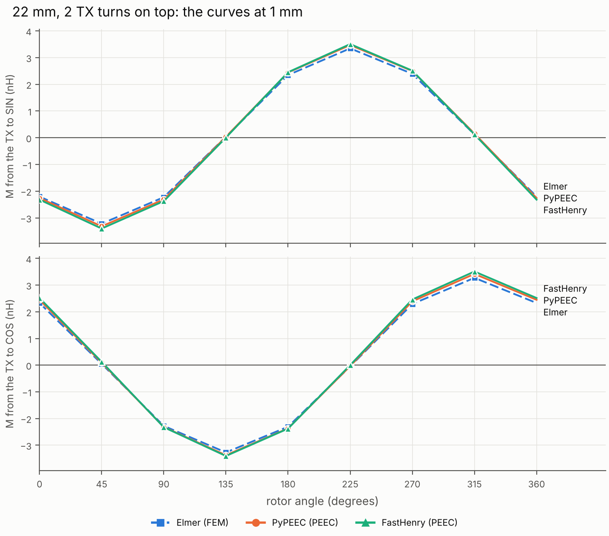

[Solvers comparison](../README.md) › OD22 TXtop

# S0_1x_OD22_2L_tiny_TXtop: the solvers compared

**OD22 TXtop**: the TX two turns on the top layer around S0's own RX coils, the board grown to 22.2 mm.

| Solver | Gaps finished (of 5) | Solves | Passing their own checks |
|---|---|---|---|
| Elmer | 5 | 40 | 40 |
| PyPEEC | 5 | 40 | 40 |
| FastHenry | 5 | 40 | 40 |
| Palace | 5 | 40 | 40 |

Against FastHenry, the yardstick (the closest to the reference on the proof boards):

- **Elmer** (FEM): the coupling (SIN's and COS's amplitude) is 4.9 % under FastHenry's on average over the 5 gaps both have finished (−5.2 to −4.3 %); L TX is 8.7 % under (−9.8 to −8.3 %); the rms angle error is within 0.09° of FastHenry's (electrical degrees).
- **PyPEEC** (PEEC): the coupling (SIN's and COS's amplitude) is 1.6 % under FastHenry's on average over the 5 gaps both have finished (−1.9 to −1.2 %); L TX is 1.3 % over (+0.9 to +1.9 %); the rms angle error is within 0.02° of FastHenry's (electrical degrees).
- **Palace** (FEM): the coupling (SIN's and COS's amplitude) is 1.7 % under FastHenry's on average over the 5 gaps both have finished (−1.9 to −1.5 %); L TX is 6.0 % under (−7.0 to −5.6 %); the rms angle error is within 0.01° of FastHenry's (electrical degrees).

*SIN's amplitude, L TX (its mean over the turn, and on the right with the rotor taken away) and the rms angle error against the air gap, one line per solver.*

## At 1 mm

| Solver | SIN amplitude (nH) | COS amplitude (nH) | L TX (nH) | L TX, rotor away (nH) | R TX (mΩ) | Angle error, rms (°) | Angle error, peak (°) | Solves |
|---|---|---|---|---|---|---|---|---|
| Elmer | 3.261 | 3.263 | 122.7 | 134.6 | 286 | 0.221 | 0.374 | 8 |
| PyPEEC | 3.377 | 3.383 | 135.6 | 148.2 | 312 | 0.212 | 0.298 | 8 |
| FastHenry | 3.433 | 3.439 | 134.1 | 146.9 | 274 | 0.193 | 0.268 | 8 |
| Palace | 3.369 | 3.374 | 126.2 | 138.9 | 292 | 0.197 | 0.269 | 8 |

## Every air gap

**SIN's amplitude (nH)**

| Air gap | Elmer | PyPEEC | FastHenry | Palace |
|---|---|---|---|---|
| 0.1 mm | 6.470 | 6.680 | 6.764 | 6.659 |
| 0.5 mm | 4.916 | 5.098 | 5.164 | 5.069 |
| 1 mm | 3.261 | 3.377 | 3.433 | 3.369 |
| 1.5 mm | 2.153 | 2.223 | 2.265 | 2.226 |
| 2 mm | 1.445 | 1.490 | 1.518 | 1.495 |

**COS's amplitude (nH)**

| Air gap | Elmer | PyPEEC | FastHenry | Palace |
|---|---|---|---|---|
| 0.1 mm | 6.471 | 6.684 | 6.769 | 6.661 |
| 0.5 mm | 4.919 | 5.104 | 5.171 | 5.074 |
| 1 mm | 3.263 | 3.383 | 3.439 | 3.374 |
| 1.5 mm | 2.153 | 2.228 | 2.271 | 2.230 |
| 2 mm | 1.443 | 1.494 | 1.522 | 1.498 |

**L TX, mean over the turn (nH)**

| Air gap | Elmer | PyPEEC | FastHenry | Palace |
|---|---|---|---|---|
| 0.1 mm | 100.9 | 113.9 | 111.8 | 104.0 |
| 0.5 mm | 115.2 | 127.4 | 126.2 | 118.5 |
| 1 mm | 122.7 | 135.6 | 134.1 | 126.2 |
| 1.5 mm | 126.7 | 140.2 | 138.3 | 130.5 |
| 2 mm | 129.1 | 142.2 | 140.8 | 133.0 |

**R TX, mean over the turn (mΩ)**

| Air gap | Elmer | PyPEEC | FastHenry | Palace |
|---|---|---|---|---|
| 0.1 mm | 313 | 336 | 298 | 318 |
| 0.5 mm | 293 | 318 | 280 | 298 |
| 1 mm | 286 | 312 | 274 | 292 |
| 1.5 mm | 283 | 310 | 271 | 289 |
| 2 mm | 281 | 308 | 270 | 287 |

**Angle error, rms (electrical °)**

| Air gap | Elmer | PyPEEC | FastHenry | Palace |
|---|---|---|---|---|
| 0.1 mm | 1.119 | 1.107 | 1.089 | 1.079 |
| 0.5 mm | 0.395 | 0.398 | 0.376 | 0.376 |
| 1 mm | 0.221 | 0.212 | 0.193 | 0.197 |
| 1.5 mm | 0.229 | 0.196 | 0.179 | 0.180 |
| 2 mm | 0.283 | 0.207 | 0.192 | 0.187 |

## Against FastHenry, gap by gap

Each solver's value over FastHenry's at the same gap: SIN's amplitude, and in brackets L TX.

| Air gap | Elmer | PyPEEC | Palace |
|---|---|---|---|
| 0.1 mm | 0.957 (0.902) | 0.988 (1.019) | 0.984 (0.930) |
| 0.5 mm | 0.952 (0.913) | 0.987 (1.009) | 0.982 (0.939) |
| 1 mm | 0.950 (0.915) | 0.984 (1.011) | 0.981 (0.942) |
| 1.5 mm | 0.950 (0.917) | 0.981 (1.014) | 0.983 (0.944) |
| 2 mm | 0.952 (0.917) | 0.982 (1.010) | 0.985 (0.944) |

## The generator's estimates

The generator's own figures from `Parameters.txt`, formulas rather than field solves: L TX 144 nH with the rotor away and 116 nH with it (which it calls an upper estimate of the drop), and R TX 250 mΩ at DC.

| Solver | L TX, rotor away (nH) | Over the estimate | L TX at 0.1 mm (nH) | L TX at 1 mm (nH) |
|---|---|---|---|---|
| Elmer | 134.6 | −6.5 % | 100.9 | 122.7 |
| PyPEEC | 148.2 | +2.9 % | 113.9 | 135.6 |
| FastHenry | 146.9 | +2.0 % | 111.8 | 134.1 |
| Palace | 138.9 | −3.6 % | 104.0 | 126.2 |

## Time and memory

Each branch records the wall time and the peak memory of every solve. They all ran on the same machine (4 cores, 15 GB), often while another solver shared it, and each with its own process layout (FastHenry runs several single-threaded solves at once; Palace runs two or four MPI processes per solve). Read these as rough.

| Solver | Seconds per solve (median over the gaps) | Range | Peak memory of a solve, as the branch measured it (GB) |
|---|---|---|---|
| Elmer | 176 | 145 to 319 | 13.3 |
| PyPEEC | 276 | 152 to 474 | 1.4 to 3.0 |
| FastHenry | 212 | 164 to 252 | 0.7 |
| Palace | 161 | 119 to 210 | 6.4 to 10.0 |

---

The proof boards, why the solvers differ, the data files and how to run it again are in the [branch's README](../README.md). The boards are the Sinusoidal Coil Generator's, for non-commercial use: see [LICENSE.md](../LICENSE.md).
