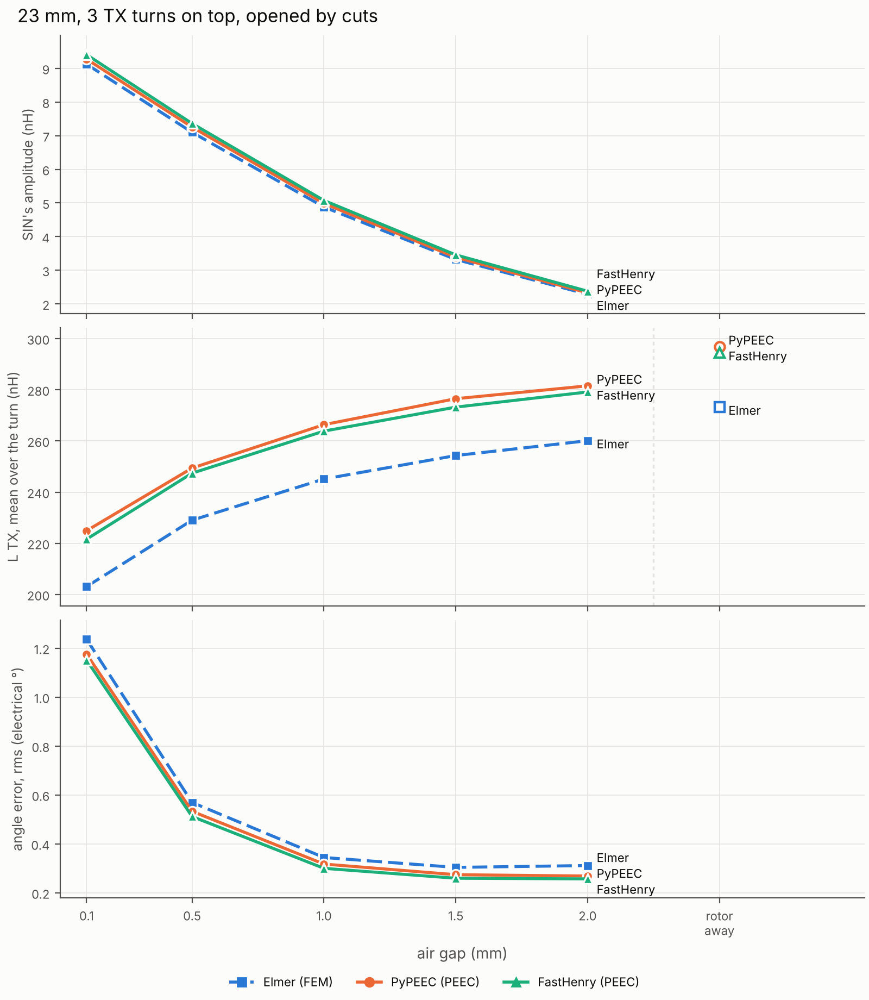
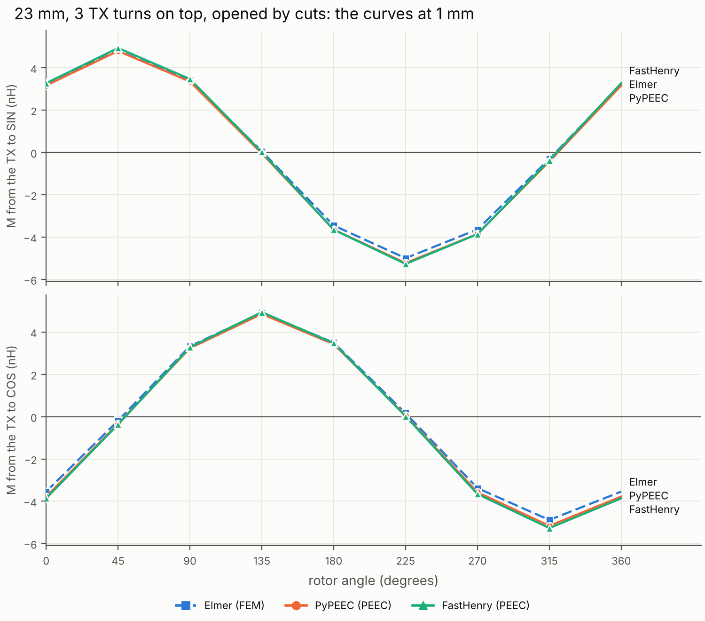

[Solvers comparison](../README.md) › OD23 Cut

# S0_1x_OD23_2L_tiny_TX3top_Cut: the solvers compared

**OD23 Cut**: the TX three turns on the top layer around S0's RX coils, 23.4 mm, opened by cuts.

| Solver | Gaps finished (of 5) | Solves | Passing their own checks |
|---|---|---|---|
| Elmer | 5 | 40 | 40 |
| PyPEEC | 5 | 40 | 40 |
| FastHenry | 5 | 40 | 40 |
| Palace | 0 (still solving) | 0 | 0 |

Against FastHenry, the yardstick (the closest to the reference on the proof boards):

- **Elmer** (FEM): the coupling (SIN's and COS's amplitude) is 3.7 % under FastHenry's on average over the 5 gaps both have finished (−4.0 to −3.0 %); L TX is 7.3 % under (−8.4 to −6.8 %); the rms angle error is within 0.09° of FastHenry's (electrical degrees).
- **PyPEEC** (PEEC): the coupling (SIN's and COS's amplitude) is 1.8 % under FastHenry's on average over the 5 gaps both have finished (−2.2 to −1.4 %); L TX is 1.1 % over (+0.8 to +1.5 %); the rms angle error is within 0.02° of FastHenry's (electrical degrees).
- **Palace** has not finished a gap of this board yet; it is still solving.

*SIN's amplitude, L TX (its mean over the turn, and on the right with the rotor taken away) and the rms angle error against the air gap, one line per solver.*

## At 1 mm

| Solver | SIN amplitude (nH) | COS amplitude (nH) | L TX (nH) | L TX, rotor away (nH) | R TX (mΩ) | Angle error, rms (°) | Angle error, peak (°) | Solves |
|---|---|---|---|---|---|---|---|---|
| Elmer | 4.879 | 4.882 | 245.1 | 273.3 | 455 | 0.344 | 0.560 | 8 |
| PyPEEC | 4.984 | 4.986 | 266.4 | 296.7 | 493 | 0.318 | 0.489 | 8 |
| FastHenry | 5.074 | 5.081 | 263.8 | 294.6 | 436 | 0.300 | 0.418 | 8 |

## Every air gap

**SIN's amplitude (nH)**

| Air gap | Elmer | PyPEEC | FastHenry |
|---|---|---|---|
| 0.1 mm | 9.123 | 9.276 | 9.407 |
| 0.5 mm | 7.099 | 7.255 | 7.361 |
| 1 mm | 4.879 | 4.984 | 5.074 |
| 1.5 mm | 3.321 | 3.386 | 3.457 |
| 2 mm | 2.286 | 2.329 | 2.377 |

**COS's amplitude (nH)**

| Air gap | Elmer | PyPEEC | FastHenry |
|---|---|---|---|
| 0.1 mm | 9.125 | 9.276 | 9.410 |
| 0.5 mm | 7.101 | 7.256 | 7.367 |
| 1 mm | 4.882 | 4.986 | 5.081 |
| 1.5 mm | 3.324 | 3.387 | 3.462 |
| 2 mm | 2.287 | 2.330 | 2.382 |

**L TX, mean over the turn (nH)**

| Air gap | Elmer | PyPEEC | FastHenry |
|---|---|---|---|
| 0.1 mm | 203.1 | 224.9 | 221.6 |
| 0.5 mm | 229.0 | 249.4 | 247.4 |
| 1 mm | 245.1 | 266.4 | 263.8 |
| 1.5 mm | 254.3 | 276.5 | 273.2 |
| 2 mm | 260.1 | 281.5 | 279.1 |

**R TX, mean over the turn (mΩ)**

| Air gap | Elmer | PyPEEC | FastHenry |
|---|---|---|---|
| 0.1 mm | 498 | 532 | 472 |
| 0.5 mm | 467 | 504 | 446 |
| 1 mm | 455 | 493 | 436 |
| 1.5 mm | 449 | 487 | 430 |
| 2 mm | 446 | 483 | 426 |

**Angle error, rms (electrical °)**

| Air gap | Elmer | PyPEEC | FastHenry |
|---|---|---|---|
| 0.1 mm | 1.236 | 1.175 | 1.151 |
| 0.5 mm | 0.569 | 0.533 | 0.512 |
| 1 mm | 0.344 | 0.318 | 0.300 |
| 1.5 mm | 0.304 | 0.274 | 0.260 |
| 2 mm | 0.311 | 0.269 | 0.257 |

## Against FastHenry, gap by gap

Each solver's value over FastHenry's at the same gap: SIN's amplitude, and in brackets L TX.

| Air gap | Elmer | PyPEEC |
|---|---|---|
| 0.1 mm | 0.970 (0.916) | 0.986 (1.015) |
| 0.5 mm | 0.964 (0.926) | 0.986 (1.008) |
| 1 mm | 0.962 (0.929) | 0.982 (1.010) |
| 1.5 mm | 0.961 (0.931) | 0.980 (1.012) |
| 2 mm | 0.962 (0.932) | 0.980 (1.009) |

## The generator's estimates

The generator's own figures from `Parameters.txt`, formulas rather than field solves: L TX 292 nH with the rotor away and 226 nH with it (which it calls an upper estimate of the drop), and R TX 380 mΩ at DC.

| Solver | L TX, rotor away (nH) | Over the estimate | L TX at 0.1 mm (nH) | L TX at 1 mm (nH) |
|---|---|---|---|---|
| Elmer | 273.3 | −6.4 % | 203.1 | 245.1 |
| PyPEEC | 296.7 | +1.6 % | 224.9 | 266.4 |
| FastHenry | 294.6 | +0.9 % | 221.6 | 263.8 |

## Time and memory

Each branch records the wall time and the peak memory of every solve. They all ran on the same machine (4 cores, 15 GB), often while another solver shared it, and each with its own process layout (FastHenry runs several single-threaded solves at once; Palace runs two or four MPI processes per solve). Read these as rough.

| Solver | Seconds per solve (median over the gaps) | Range | Peak memory of a solve, as the branch measured it (GB) |
|---|---|---|---|
| Elmer | 279 | 160 to 392 | 13.3 |
| PyPEEC | 384 | 212 to 639 | 1.6 to 3.4 |
| FastHenry | 143 | 142 to 145 | 0.9 |

A receiver whose plus terminal sits on the other side in one branch comes out turned over; here Elmer COS, PyPEEC COS is turned back to match FastHenry. Amplitudes and angle errors are the same either way.

---

The proof boards, why the solvers differ, the data files and how to run it again are in the [branch's README](../README.md). The boards are the Sinusoidal Coil Generator's, for non-commercial use: see [LICENSE.md](../LICENSE.md).
