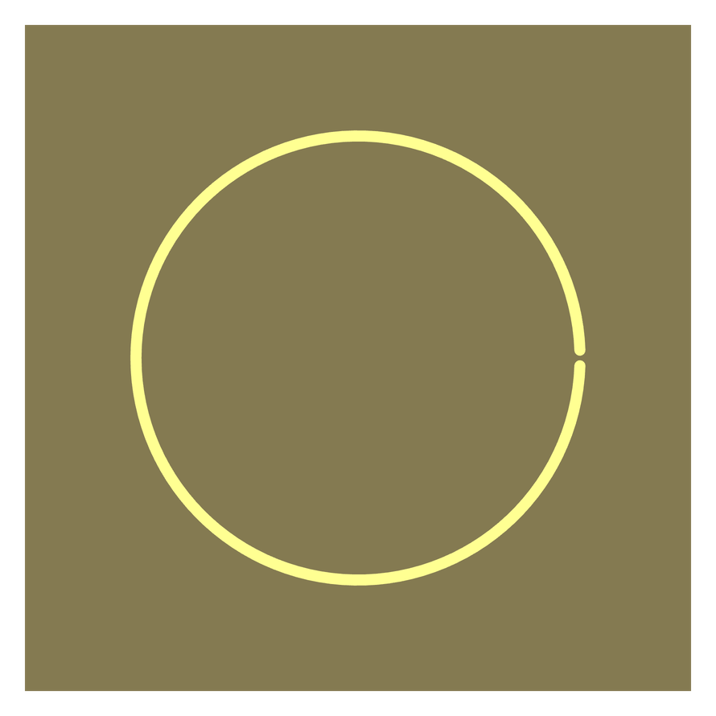

# E01 Circular Loop

The first proof board of the PyPEEC bridge: one circular trace, opened by a small gap for its terminals, so that
every part of the chain (KESE's export, the slabs, the voxels, the terminals, PyPEEC's sources and the read-back) is
checked against an inductance and a resistance known without any solver.

| Top | Bottom |
|:---:|:---:|
|  |  |

Rendered by KESE's static renderer from the board's own export.

## The Board

| Item | Value |
|---|---|
| Board | 30 mm × 30 mm, two copper layers, 1.6 mm, no stack-up |
| Copper | one trace on F.Cu, net `LOOP`: a circle of 10 mm radius to its centre line, 0.5 mm wide, 35 µm thick, opened at +x by a 0.2 mm gap between its two round ends |
| B.Cu | empty |
| Made by | `make_board.py`, with [`../kicad_writer.py`](../kicad_writer.py) |

The gap is where the terminals sit: the bridge takes the loop's voxels that share a face with the gap, one group on
each round end, as the two terminals; PyPEEC drives 1 A into one and holds the other at 0 V.

## What PyPEEC Checks

| Check | How | Reference |
|---|---|---|
| L at 10 kHz | Im(V / I) / ω of the loop; the skin depth (0.66 mm) is far above the copper's 35 µm, so the current is uniform | Grover's ring formula μ0 R (ln(8R / g) − 2) with the rectangle's geometric mean distance g = 0.2235 (w + t), times the share of the circle the copper covers (0.989): 55.99 nH. That share stops the current at the round ends' centres; taken to the gap's faces it gives 56.44 nH, so the open loop's L lies between the two |
| L from the stored energy | 4W / \|I\|² from PyPEEC's magnetic energy | the same L, as a check on the terminals' read-back |
| R at 10 kHz | Re(V / I) | the DC resistance of an annular sector, θ / (σ t ln(r_out / r_in)): 61.20 mΩ |
| R from the losses | 2P / \|I\|² from PyPEEC's losses | the same R |
| L and R at 3.5 MHz | as above, at the coil boards' frequency, where the skin depth (35 µm) equals the copper's thickness | no exact reference: Grover's formula with the thin strip's high-frequency GMD w / 4 gives 55.44 nH, an estimate |
| The voxels | the same at voxels of 100, 50, 25 and 12.5 µm in the board's plane, one voxel (35 µm) through the copper | L and R should settle as the voxels shrink: the trace's round edges are drawn as steps, the finer the closer |

## How It Runs

```bash
python simulation.py                      # the voxel ladder at both frequencies
python simulation.py --voxels 0.05        # one voxel size only
python simulation.py --voxels 0.025 --n-cu 2 --results results_cu2.json
                                          # two voxel layers through the copper (17.5 um each), to its own file
python simulation.py --voxels-only        # draw the voxels and print how many, solve nothing
```

Every setting is in `SETTINGS` at the top of `simulation.py`:

| Setting | Value | Why |
|---|---|---|
| Frequencies | 10 kHz and 3.5 MHz | uniform current, and the coil boards' frequency |
| Voxels | 100, 50, 25 and 12.5 µm across, 35 µm through the copper (one layer) | the coil boards use 50 µm; the ladder says what that costs in accuracy |
| Air | none: PyPEEC needs no air and no outer boundary, the field of every voxel reaches every other | |
| Solver | PyPEEC 5.8.0's defaults (`../../bridge/tolerance.yaml`): GMRES with its own preconditioner, SciPy's FFT and SuperLU | MKL, PARDISO and CUDA are not free software, so they are not used |
| Threads | 4 | |

## Results

See [results.md](results.md): expected against what came out, and the voxel ladder.

## Licence

GPL-3.0, as the rest of this branch.
