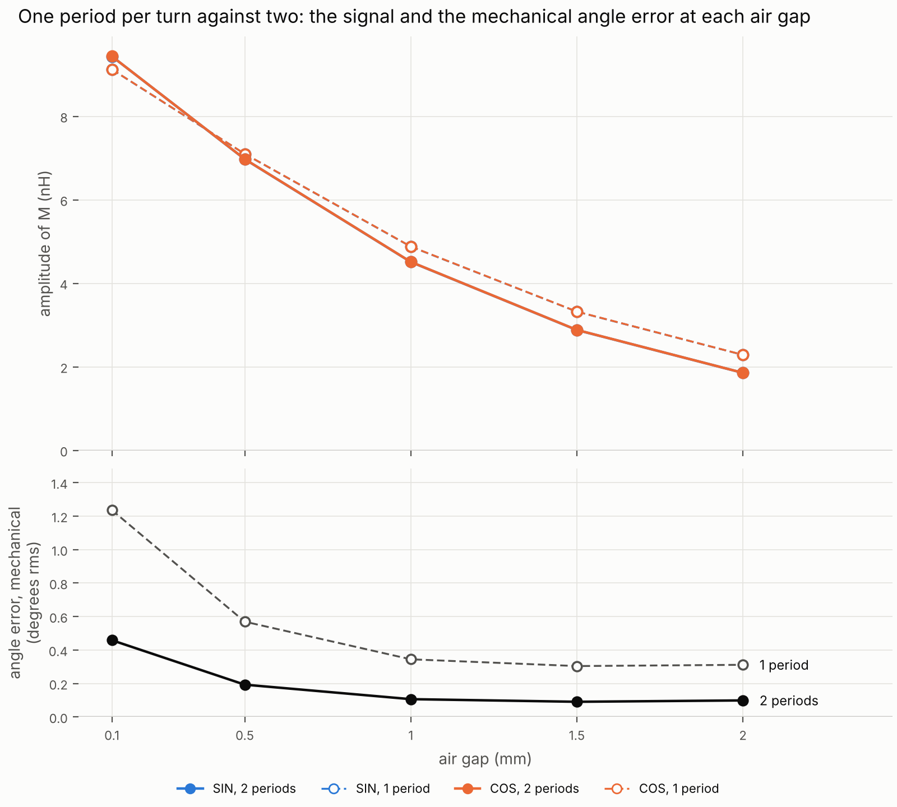

# Comparisons

Each board folder beside this one stands on its own and holds the same files: its boards, its geometry, the same five scripts, and its own results. This folder is extra, for our own understanding: it sets the boards side by side. Nothing here is solved; the four scripts read each board's `Results/` and print the tables below, and three of them draw the charts.

The signal is each receiver's mutual inductance from the TX, M = V / (jωI), with 1 A at 3.5 MHz in the TX, so 1 nH is 22 mV of EMF. Every solve is FastHenry's, with each track split into three filaments across its width (the filament study is in [the boards' README](../README.md#what-this-branch-checks)). A solve is **readable** when M from the TX to each receiver and M from the receiver back to the TX agree within 1 % of the larger receiver's M, and R TX is positive (`readable()` in the boards' `make_charts.py`). FastHenry's direct solve makes the two agree to the last digit, and every solve here is readable. Every chart runs over the whole turn, 0 to 360°.

| Board | What it is |
|---|---|
| [S0_1x_OD21_2L_tiny](../S0_1x_OD21_2L_tiny/) | S0: 21 mm across, the TX one turn on each layer, SIN and COS opened at a left-out via |
| [S0_1x_OD21_2L_tiny_TXtop](../S0_1x_OD21_2L_tiny_TXtop/) | S0 with the TX two turns on the top layer; the generator narrows the RX band to fit them |
| [S0_1x_OD22_2L_tiny_TXtop](../S0_1x_OD22_2L_tiny_TXtop/) | the TX two turns on the top layer around S0's own RX coils, the board grown to 22.2 mm |
| [S0_1x_OD22_2L_tiny_TXtop_Cut](../S0_1x_OD22_2L_tiny_TXtop_Cut/) | the 22 mm board with SIN and COS opened by a 0.2 mm cut in a top trace instead of a left-out via |
| [S0_1x_OD23_2L_tiny_TX3top_Cut](../S0_1x_OD23_2L_tiny_TX3top_Cut/) | the TX three turns on the top layer around S0's RX coils, 23.4 mm, opened by the same cuts |
| [S0d2_1x_OD23_2L_tiny_TX3top_Cut](../S0d2_1x_OD23_2L_tiny_TX3top_Cut/) | the three-turn board with two periods per turn instead of one: the RX coils and a rotor of two sectors, opened by cuts, solved at 16 angles over the whole turn |

## The TX on the top layer against S0

`python compare_boards.py` prints this table first. The amplitude is each board's best sine through all its solves, as on its own results page.

| Air gap | Board | Angles | Amplitude SIN / COS | Angle error | SIN to COS | L TX over the turn | Reciprocity | Not readable |
|---|---|---|---|---|---|---|---|---|
| 2 mm | S0 (21 mm, TX one turn on each layer) | 8 of 8 | 1.25 / 1.26 nH (28 / 28 mV) | 0.1° rms, 0.1° peak | 90.0° | 131.0 to 131.1 nH | exact | 0 of 8 |
| 2 mm | 21 mm, 2 TX turns on top | 8 of 8 | 1.02 / 1.02 nH (22 / 22 mV) | 0.4° rms, 0.5° peak | 89.9° | 127.7 to 127.8 nH | exact | 0 of 8 |
| 2 mm | 22 mm, 2 TX turns on top, S0's RX | 8 of 8 | 1.52 / 1.52 nH (33 / 33 mV) | 0.2° rms, 0.2° peak | 90.0° | 140.8 to 140.8 nH | exact | 0 of 8 |
| 1.5 mm | S0 (21 mm, TX one turn on each layer) | 8 of 8 | 1.91 / 1.92 nH (42 / 42 mV) | 0.1° rms, 0.1° peak | 90.0° | 129.2 to 129.3 nH | exact | 0 of 8 |
| 1.5 mm | 21 mm, 2 TX turns on top | 8 of 8 | 1.57 / 1.57 nH (35 / 35 mV) | 0.4° rms, 0.5° peak | 90.0° | 125.6 to 125.7 nH | exact | 0 of 8 |
| 1.5 mm | 22 mm, 2 TX turns on top, S0's RX | 8 of 8 | 2.27 / 2.27 nH (50 / 50 mV) | 0.2° rms, 0.2° peak | 90.0° | 138.2 to 138.3 nH | exact | 0 of 8 |
| 1 mm | S0 (21 mm, TX one turn on each layer) | 8 of 8 | 2.99 / 3.00 nH (66 / 66 mV) | 0.1° rms, 0.1° peak | 90.0° | 126.3 to 126.4 nH | exact | 0 of 8 |
| 1 mm | 21 mm, 2 TX turns on top | 8 of 8 | 2.48 / 2.49 nH (55 / 55 mV) | 0.4° rms, 0.5° peak | 90.0° | 122.0 to 122.1 nH | exact | 0 of 8 |
| 1 mm | 22 mm, 2 TX turns on top, S0's RX | 8 of 8 | 3.43 / 3.44 nH (75 / 76 mV) | 0.2° rms, 0.3° peak | 90.0° | 134.0 to 134.2 nH | exact | 0 of 8 |
| 0.5 mm | S0 (21 mm, TX one turn on each layer) | 8 of 8 | 4.72 / 4.73 nH (104 / 104 mV) | 0.1° rms, 0.1° peak | 90.0° | 121.0 to 121.1 nH | exact | 0 of 8 |
| 0.5 mm | 21 mm, 2 TX turns on top | 8 of 8 | 3.91 / 3.92 nH (86 / 86 mV) | 0.7° rms, 0.8° peak | 90.0° | 115.0 to 115.3 nH | exact | 0 of 8 |
| 0.5 mm | 22 mm, 2 TX turns on top, S0's RX | 8 of 8 | 5.16 / 5.17 nH (114 / 114 mV) | 0.4° rms, 0.5° peak | 90.0° | 126.1 to 126.3 nH | exact | 0 of 8 |
| 0.1 mm | S0 (21 mm, TX one turn on each layer) | 8 of 8 | 6.56 / 6.57 nH (144 / 144 mV) | 0.5° rms, 0.7° peak | 90.0° | 110.9 to 111.1 nH | exact | 0 of 8 |
| 0.1 mm | 21 mm, 2 TX turns on top | 8 of 8 | 5.31 / 5.32 nH (117 / 117 mV) | 1.5° rms, 1.8° peak | 90.0° | 102.1 to 102.4 nH | exact | 0 of 8 |
| 0.1 mm | 22 mm, 2 TX turns on top, S0's RX | 8 of 8 | 6.76 / 6.77 nH (149 / 149 mV) | 1.1° rms, 1.3° peak | 90.0° | 111.6 to 111.9 nH | exact | 0 of 8 |

* **Every solve on all three boards is readable**, and every curve is close to a sine and cosine: SIN and COS within 0.4 % of each other in amplitude and 89.9° to 90.0° apart.
* **On S0's 21 mm board, moving the TX to the top layer costs 17 to 19 % of the signal.** Where the generator narrows the RX band to make room, SIN is 0.81 to 0.83 times S0's at every gap (2.48 nH against 2.99 at 1 mm), with more angle error of 0.4° rms from 1 to 2 mm, against 0.1° on S0.
* **Where S0's RX coils are kept and the board grows to 22 mm, the signal rises,** to 1.03 times S0's at 0.1 mm and 1.21 times at 2 mm (3.43 nH against 2.99 at 1 mm, 75 mV of EMF at 1 A), with 0.2° to 0.4° rms of angle error from 0.5 to 2 mm.
* **S0 has the cleanest curves:** 0.1° rms of angle error from 0.5 to 2 mm.
* **At 0.1 mm the angle error rises on every board** (0.5°, 1.5° and 1.1° rms) and alternates in sign from one angle to the next: a ripple at four periods per turn. That is the fourth harmonic two-coil sensors typically show, which the third and fifth harmonics of the sine and cosine both give (Kuntz, Gerlach and Fella, arXiv 2503.14627), and it fades with the gap faster than the sine itself.

## The cut against the via

The 22 mm board opened two ways: [`S0_1x_OD22_2L_tiny_TXtop`](../S0_1x_OD22_2L_tiny_TXtop/) leaves out one layer-change via of each receiver, and [`S0_1x_OD22_2L_tiny_TXtop_Cut`](../S0_1x_OD22_2L_tiny_TXtop_Cut/) cuts a 0.2 mm gap across a top trace instead, as the real board is opened, and keeps the via. Same boards, same filaments, same TX port. `python compare_ports.py` prints the table and draws the chart.

*Solve by solve: the cut solid and filled, the via dashed and hollow. Which side of a port counts as plus is a convention, so the via board's SIN and COS are drawn with the sign turned, which moves each curve by half a turn and changes nothing else. A ring would mark a solve that is not readable (none is).*

| Air gap | Port | Amplitude SIN / COS, all solves | The same, readable solves only | Angle error | SIN to COS | L TX over the turn | Not readable | Cut against via, where both are readable |
|---|---|---|---|---|---|---|---|---|
| 2 mm | via (left out) | 1.52 / 1.52 nH (33 / 33 mV) | 1.52 / 1.52 nH (8 solves) | 0.2° rms, 0.2° peak | 90.0° | 140.8 to 140.8 nH | 0 of 8 |  |
| 2 mm | cut | 1.50 / 1.51 nH (33 / 33 mV) | 1.50 / 1.51 nH (8 solves) | 0.2° rms, 0.2° peak | 90.0° | 140.8 to 140.8 nH | 0 of 8 | 8 angles; mean difference SIN 3.5 %, COS 3.5 % of the amplitude |
| 1.5 mm | via (left out) | 2.27 / 2.27 nH (50 / 50 mV) | 2.27 / 2.27 nH (8 solves) | 0.2° rms, 0.2° peak | 90.0° | 138.2 to 138.3 nH | 0 of 8 |  |
| 1.5 mm | cut | 2.25 / 2.25 nH (49 / 50 mV) | 2.25 / 2.25 nH (8 solves) | 0.1° rms, 0.2° peak | 90.0° | 138.2 to 138.3 nH | 0 of 8 | 8 angles; mean difference SIN 2.4 %, COS 2.4 % of the amplitude |
| 1 mm | via (left out) | 3.43 / 3.44 nH (75 / 76 mV) | 3.43 / 3.44 nH (8 solves) | 0.2° rms, 0.3° peak | 90.0° | 134.0 to 134.2 nH | 0 of 8 |  |
| 1 mm | cut | 3.40 / 3.41 nH (75 / 75 mV) | 3.40 / 3.41 nH (8 solves) | 0.2° rms, 0.2° peak | 90.0° | 134.0 to 134.2 nH | 0 of 8 | 8 angles; mean difference SIN 1.7 %, COS 1.7 % of the amplitude |
| 0.5 mm | via (left out) | 5.16 / 5.17 nH (114 / 114 mV) | 5.16 / 5.17 nH (8 solves) | 0.4° rms, 0.5° peak | 90.0° | 126.1 to 126.3 nH | 0 of 8 |  |
| 0.5 mm | cut | 5.12 / 5.12 nH (113 / 113 mV) | 5.12 / 5.12 nH (8 solves) | 0.3° rms, 0.5° peak | 90.0° | 126.1 to 126.3 nH | 0 of 8 | 8 angles; mean difference SIN 1.3 %, COS 1.3 % of the amplitude |
| 0.1 mm | via (left out) | 6.76 / 6.77 nH (149 / 149 mV) | 6.76 / 6.77 nH (8 solves) | 1.1° rms, 1.3° peak | 90.0° | 111.6 to 111.9 nH | 0 of 8 |  |
| 0.1 mm | cut | 6.70 / 6.70 nH (147 / 147 mV) | 6.70 / 6.70 nH (8 solves) | 1.0° rms, 1.3° peak | 90.0° | 111.6 to 111.9 nH | 0 of 8 | 8 angles; mean difference SIN 1.2 %, COS 1.2 % of the amplitude |

* **The two ports give the same curves within 5 %, with the via a little higher.** Its amplitude is 0.8 to 1.0 % above the cut's at every gap; solve by solve they differ by 0.07 to 0.15 nH at most, which is 2.2 % of the amplitude at 0.1 mm and 4.4 % at 2 mm, since part of the difference is a small offset that stays as the signal falls.
* **SIN to COS is 90.0° on both,** the angle error is the same within 0.1° at every gap, and L TX is the same: 146.9 nH with the rotor away on both.
* **Most of the difference is an offset from the TX itself.** With the rotor away, SIN reads −0.129 nH on the cut board and −0.075 nH on the via board, and COS −0.122 and −0.068 nH; over the turn the two boards' curves are 0.05 to 0.08 nH apart on average, the rest the small difference in amplitude. In FastHenry a port is a pair of nodes, and an open receiver's voltage is the sum of what the currents induce along its copper from one node to the other; the opening itself adds nothing. The via board leaves out the via's bar, straight down through the board, along which the flat TX and rotor, whose currents all run sideways, induce almost nothing. The cut board leaves out 0.2 mm of a top trace, along which the TX's field does induce a little, which would give such an offset. The real board's reading also includes its leads, which neither model has.

## Three TX turns against two

[`S0_1x_OD23_2L_tiny_TX3top_Cut`](../S0_1x_OD23_2L_tiny_TX3top_Cut/) against the two-turn board it grew from, [`S0_1x_OD22_2L_tiny_TXtop_Cut`](../S0_1x_OD22_2L_tiny_TXtop_Cut/): the same RX coils and the same cuts, one more TX turn on the top layer, and the board 23.4 mm across instead of 22.2. `python compare_turns.py` prints the table and the ratios and draws the chart.

*Above, the amplitude of SIN and COS at each air gap; below, the TX inductance over the turn. Three turns solid and filled, two turns dashed and hollow. Each amplitude is the best sine through the readable solves, all eight on both boards at every gap. Diamonds: L TX with the rotor away.*

| Air gap | TX | Amplitude SIN / COS | Fitted through | Angle error | L TX over the turn | Not readable |
|---|---|---|---|---|---|---|
| 2 mm | 2 turns | 1.50 / 1.51 nH (33 / 33 mV) | the readable solves | 0.2° rms, 0.2° peak | 140.8 to 140.8 nH | 0 of 8 |
| 2 mm | 3 turns | 2.38 / 2.38 nH (52 / 52 mV) | the readable solves | 0.3° rms, 0.3° peak | 279.1 to 279.2 nH | 0 of 8 |
| 1.5 mm | 2 turns | 2.25 / 2.25 nH (49 / 50 mV) | the readable solves | 0.1° rms, 0.2° peak | 138.2 to 138.3 nH | 0 of 8 |
| 1.5 mm | 3 turns | 3.46 / 3.46 nH (76 / 76 mV) | the readable solves | 0.3° rms, 0.3° peak | 273.1 to 273.4 nH | 0 of 8 |
| 1 mm | 2 turns | 3.40 / 3.41 nH (75 / 75 mV) | the readable solves | 0.2° rms, 0.2° peak | 134.0 to 134.2 nH | 0 of 8 |
| 1 mm | 3 turns | 5.07 / 5.08 nH (112 / 112 mV) | the readable solves | 0.3° rms, 0.4° peak | 263.7 to 264.0 nH | 0 of 8 |
| 0.5 mm | 2 turns | 5.12 / 5.12 nH (113 / 113 mV) | the readable solves | 0.3° rms, 0.5° peak | 126.1 to 126.3 nH | 0 of 8 |
| 0.5 mm | 3 turns | 7.36 / 7.37 nH (162 / 162 mV) | the readable solves | 0.5° rms, 0.7° peak | 247.2 to 247.7 nH | 0 of 8 |
| 0.1 mm | 2 turns | 6.70 / 6.70 nH (147 / 147 mV) | the readable solves | 1.0° rms, 1.3° peak | 111.6 to 111.9 nH | 0 of 8 |
| 0.1 mm | 3 turns | 9.41 / 9.41 nH (207 / 207 mV) | the readable solves | 1.2° rms, 1.4° peak | 221.4 to 222.0 nH | 0 of 8 |

* **The third turn raises the signal by 1.41 times at 0.1 mm, and more as the gap grows, to 1.58 times at 2 mm:** 9.41 nH against 6.70 at 0.1 mm, 5.07 against 3.40 at 1 mm, and 2.38 against 1.50 at 2 mm (52 mV of EMF at 1 A against 33).
* **L TX doubles:** 1.96 to 1.98 times the two-turn board's at every gap, and 294.6 nH against 146.9 nH with the rotor away.
* **So per ampere in the TX the signal grows, but per volt across it, it shrinks:** at a fixed TX voltage the current falls with L (V = 2πf L I), so the EMF goes with M / L, 0.71 of the two-turn board's at 0.1 mm and 0.80 at 2 mm. Which of the two counts depends on what the drive holds fixed.
* **Both boards' curves are clean at every gap:** three turns 0.3° rms of angle error from 1 to 2 mm, 0.5° at 0.5 mm and 1.2° at 0.1 mm; two turns 0.1° to 0.2° rms of angle error from 1 to 2 mm, 0.3° at 0.5 mm and 1.0° at 0.1 mm.

## Two periods per turn against one

[`S0d2_1x_OD23_2L_tiny_TX3top_Cut`](../S0d2_1x_OD23_2L_tiny_TX3top_Cut/) against [`S0_1x_OD23_2L_tiny_TX3top_Cut`](../S0_1x_OD23_2L_tiny_TX3top_Cut/): the same TX of three turns on the top layer and the same 23.4 mm board, both opened by cuts, but the RX coils have two periods per turn instead of one, and the rotor two copper sectors, so its period is 180°. The two-period board is solved at 16 angles over the whole turn, eight per period, so that both boards have the same eight points per period. `python compare_periods.py` prints the table and the ratios and draws the chart.

*Above, the amplitude of SIN and COS at each air gap (SIN lies under COS: the two match within 0.2 %); below, the angle error in mechanical degrees. Two periods solid and filled, one period dashed and hollow. Each amplitude is the best sine through the readable solves: all 16 on the two-period board and all eight on the other, at every gap.*

| Air gap | Periods per turn | Amplitude SIN / COS | Angle error, electrical | Angle error, mechanical | L TX over the turn | Not readable |
|---|---|---|---|---|---|---|
| 2 mm | 1 | 2.38 / 2.38 nH (52 / 52 mV) | 0.3° rms, 0.3° peak | 0.26° rms, 0.32° peak | 279.1 to 279.2 nH | 0 of 8 |
| 2 mm | 2 | 1.95 / 1.95 nH (43 / 43 mV) | 0.1° rms, 0.3° peak | 0.06° rms, 0.13° peak | 282.1 to 282.2 nH | 0 of 16 |
| 1.5 mm | 1 | 3.46 / 3.46 nH (76 / 76 mV) | 0.3° rms, 0.3° peak | 0.26° rms, 0.35° peak | 273.1 to 273.4 nH | 0 of 8 |
| 1.5 mm | 2 | 3.03 / 3.03 nH (67 / 67 mV) | 0.1° rms, 0.3° peak | 0.07° rms, 0.14° peak | 277.3 to 277.5 nH | 0 of 16 |
| 1 mm | 1 | 5.07 / 5.08 nH (112 / 112 mV) | 0.3° rms, 0.4° peak | 0.30° rms, 0.42° peak | 263.7 to 264.0 nH | 0 of 8 |
| 1 mm | 2 | 4.73 / 4.74 nH (104 / 104 mV) | 0.2° rms, 0.3° peak | 0.09° rms, 0.17° peak | 269.5 to 269.8 nH | 0 of 16 |
| 0.5 mm | 1 | 7.36 / 7.37 nH (162 / 162 mV) | 0.5° rms, 0.7° peak | 0.51° rms, 0.69° peak | 247.2 to 247.7 nH | 0 of 8 |
| 0.5 mm | 2 | 7.28 / 7.28 nH (160 / 160 mV) | 0.3° rms, 0.5° peak | 0.17° rms, 0.26° peak | 255.6 to 256.1 nH | 0 of 16 |
| 0.1 mm | 1 | 9.41 / 9.41 nH (207 / 207 mV) | 1.2° rms, 1.4° peak | 1.15° rms, 1.42° peak | 221.4 to 222.0 nH | 0 of 8 |
| 0.1 mm | 2 | 9.76 / 9.77 nH (215 / 215 mV) | 0.9° rms, 1.1° peak | 0.43° rms, 0.56° peak | 233.0 to 233.6 nH | 0 of 16 |

* **The signal is about the same up close and falls faster with the gap:** two periods give 1.04 times the one-period signal at 0.1 mm, 0.93 times at 1 mm and 0.82 times at 2 mm (1.95 nH against 2.38). A pattern with twice the periods is finer, and a finer field pattern fades faster with distance.
* **In mechanical degrees, the angle error is 0.24 to 0.30 times the one-period board's from 1 to 2 mm:** 0.43° rms against 1.15° at 0.1 mm, and 0.06 to 0.09° against 0.26 to 0.30° from 1 to 2 mm. In electrical degrees it is 0.1° to 0.2° against 0.3° from 1 to 2 mm, and each electrical degree is half a mechanical one.
* **The TX hardly changes:** L TX is 1.01 to 1.05 times the one-period board's.
* **What two periods give up:** the reading repeats every 180°, so the sensor alone cannot tell which half of the turn the rotor is in. What they should gain beyond these centred solves: a rotor off-centre moves a one-period board's curves directly, while with two periods that first-order effect cancels.

## The signal on every board

`python compare_boards.py` prints this table second. Here the amplitude is the best sine through the readable solves where at least five are readable; where fewer are it goes through all of them and is marked with ?. Every solve is readable, so none is marked.

| Board | SIN at 0.1 mm | SIN at 0.5 mm | SIN at 1 mm | SIN at 1.5 mm | SIN at 2 mm |
|---|---|---|---|---|---|
| [S0](../S0_1x_OD21_2L_tiny/) | 6.56 nH | 4.72 nH | 2.99 nH | 1.91 nH | 1.25 nH |
| [21 mm, 2 TX turns on top](../S0_1x_OD21_2L_tiny_TXtop/) | 5.31 nH | 3.91 nH | 2.48 nH | 1.57 nH | 1.02 nH |
| [22 mm, 2 TX turns on top](../S0_1x_OD22_2L_tiny_TXtop/) | 6.76 nH | 5.16 nH | 3.43 nH | 2.27 nH | 1.52 nH |
| [22 mm, 2 TX turns on top, opened by cuts](../S0_1x_OD22_2L_tiny_TXtop_Cut/) | 6.70 nH | 5.12 nH | 3.40 nH | 2.25 nH | 1.50 nH |
| [23 mm, 3 TX turns on top, opened by cuts](../S0_1x_OD23_2L_tiny_TX3top_Cut/) | 9.41 nH | 7.36 nH | 5.07 nH | 3.46 nH | 2.38 nH |
| [23 mm, 3 TX turns on top, opened by cuts, 2 periods per turn](../S0d2_1x_OD23_2L_tiny_TX3top_Cut/) | 9.76 nH | 7.28 nH | 4.73 nH | 3.03 nH | 1.95 nH |

The two three-turn boards give the most signal. With one period per turn it is 1.43 times S0's at 0.1 mm and 1.89 times at 2 mm, the most at every gap from 0.5 mm out; with two periods it is a little more at 0.1 mm (9.76 nH) and falls faster after that, to 1.95 nH at 2 mm. The 21 mm board with the TX on top gives the least.

## Running it

From this folder, with the boards' results in place:

    python compare_boards.py       # the TX on top against S0, and every board's SIN amplitude
    python compare_ports.py        # the cut against the via: the table and SINCOS_cut_vs_via.webp
    python compare_turns.py        # three TX turns against two: the table, the ratios and SINCOS_2_vs_3_turns.webp
    python compare_periods.py      # two periods per turn against one: the table, the ratios and SINCOS_1_vs_2_periods.webp

`compare_ports.py`, `compare_turns.py` and `compare_periods.py` borrow the sine fit and the chart style from a board's `FastHenry Simulation/angle_error.py` and `make_charts.py`, so the charts look like the boards' own.

## Licence

This branch's GPL-3.0 covers the four scripts here. The boards they read are output of the Sinusoidal Coil Generator, for non-commercial use only; see [../LICENSE.md](../LICENSE.md).
