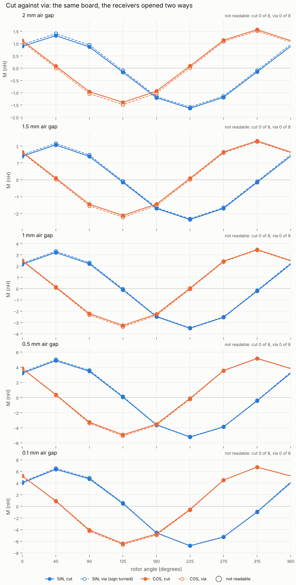
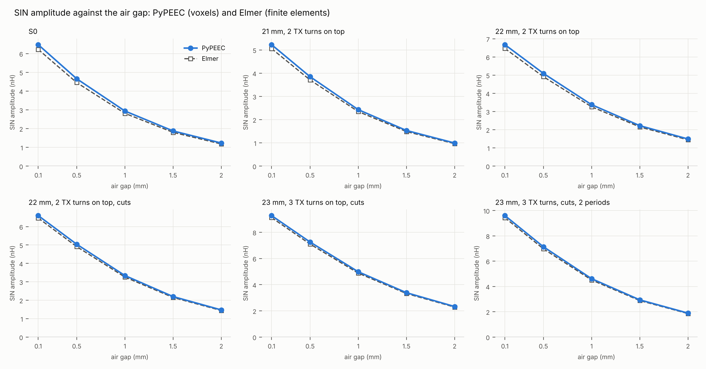

# Comparisons

Each board folder beside this one stands on its own and holds the same files: its boards, its geometry, the same five scripts, and its own results. This folder is extra, for our own understanding: it sets the boards side by side, and sets PyPEEC beside Elmer. Nothing here is solved; the five scripts read each board's `Results/` (and, for the last, the Elmer branch's) and print the tables below, and four of them draw the charts.

The signal is each receiver's mutual inductance from the TX, M = V / (jωI), with 1 A at 3.5 MHz in the TX, so 1 nH is 22 mV of EMF. Every solve is PyPEEC's, on voxels of 50 µm. A solve is **readable** when the TX's L and R from its voltage agree with the L from the stored energy and the R from the losses within 1 % (`readable()` in the boards' `make_charts.py`); every solve here does, within 0.001 %. Every chart runs over the whole turn, 0 to 360°.

| Board | What it is |
|---|---|
| [S0_1x_OD21_2L_tiny](../S0_1x_OD21_2L_tiny/) | S0: 21 mm across, the TX one turn on each layer, SIN and COS opened at a left-out via |
| [S0_1x_OD21_2L_tiny_TXtop](../S0_1x_OD21_2L_tiny_TXtop/) | S0 with the TX two turns on the top layer; the generator narrows the RX band to fit them |
| [S0_1x_OD22_2L_tiny_TXtop](../S0_1x_OD22_2L_tiny_TXtop/) | the TX two turns on the top layer around S0's own RX coils, the board grown to 22.2 mm |
| [S0_1x_OD22_2L_tiny_TXtop_Cut](../S0_1x_OD22_2L_tiny_TXtop_Cut/) | the 22 mm board with SIN and COS opened by a 0.2 mm cut in a top trace instead of a left-out via |
| [S0_1x_OD23_2L_tiny_TX3top_Cut](../S0_1x_OD23_2L_tiny_TX3top_Cut/) | the TX three turns on the top layer around S0's RX coils, 23.4 mm, opened by the same cuts |
| [S0d2_1x_OD23_2L_tiny_TX3top_Cut](../S0d2_1x_OD23_2L_tiny_TX3top_Cut/) | the three-turn board with two periods per turn instead of one: the RX coils and a rotor of two sectors, opened by cuts, solved at 16 angles over the whole turn |

The three boards opened at a via were solved twice. The first time, each receiver's terminals were the pads' whole inner rings, the voxels that border the drill hole; that let current circle through the ring and its terminal, which loaded the TX (L TX swung by up to 2.5 nH over the turn at 0.1 mm) and read M 1.5 to 6 % low. Now each pad is filled over the drill hole and its one voxel on the via's axis is the terminal, and everything below is from those solves.

## The TX on the top layer against S0

`python compare_boards.py` prints this table first. The amplitude is each board's best sine through all eight solves, as on its own results page.

| Air gap | Board | Angles | Amplitude SIN / COS | Angle error | SIN to COS | L TX over the turn | L and R checks | Not readable |
|---|---|---|---|---|---|---|---|---|
| 2 mm | S0 (21 mm, TX one turn on each layer) | 8 of 8 | 1.23 / 1.23 nH (27 / 27 mV) | 0.1° rms, 0.2° peak | 90.0° | 132.3 to 132.4 nH | within 0.000 % | 0 of 8 |
| 2 mm | 21 mm, 2 TX turns on top | 8 of 8 | 0.99 / 1.00 nH (22 / 22 mV) | 0.4° rms, 0.5° peak | 90.0° | 129.0 to 129.1 nH | within 0.000 % | 0 of 8 |
| 2 mm | 22 mm, 2 TX turns on top, S0's RX | 8 of 8 | 1.49 / 1.49 nH (33 / 33 mV) | 0.2° rms, 0.3° peak | 90.0° | 142.2 to 142.2 nH | within 0.000 % | 0 of 8 |
| 1.5 mm | S0 (21 mm, TX one turn on each layer) | 8 of 8 | 1.87 / 1.88 nH (41 / 41 mV) | 0.1° rms, 0.2° peak | 90.0° | 131.0 to 131.1 nH | within 0.001 % | 0 of 8 |
| 1.5 mm | 21 mm, 2 TX turns on top | 8 of 8 | 1.53 / 1.54 nH (34 / 34 mV) | 0.4° rms, 0.5° peak | 90.0° | 127.4 to 127.5 nH | within 0.000 % | 0 of 8 |
| 1.5 mm | 22 mm, 2 TX turns on top, S0's RX | 8 of 8 | 2.22 / 2.23 nH (49 / 49 mV) | 0.2° rms, 0.3° peak | 90.0° | 140.2 to 140.3 nH | within 0.001 % | 0 of 8 |
| 1 mm | S0 (21 mm, TX one turn on each layer) | 8 of 8 | 2.94 / 2.94 nH (65 / 65 mV) | 0.1° rms, 0.1° peak | 90.0° | 127.7 to 127.8 nH | within 0.000 % | 0 of 8 |
| 1 mm | 21 mm, 2 TX turns on top | 8 of 8 | 2.43 / 2.44 nH (53 / 54 mV) | 0.4° rms, 0.6° peak | 90.0° | 123.3 to 123.5 nH | within 0.000 % | 0 of 8 |
| 1 mm | 22 mm, 2 TX turns on top, S0's RX | 8 of 8 | 3.38 / 3.38 nH (74 / 74 mV) | 0.2° rms, 0.3° peak | 90.0° | 135.4 to 135.6 nH | within 0.000 % | 0 of 8 |
| 0.5 mm | S0 (21 mm, TX one turn on each layer) | 8 of 8 | 4.66 / 4.67 nH (102 / 103 mV) | 0.1° rms, 0.2° peak | 90.0° | 122.0 to 122.2 nH | within 0.000 % | 0 of 8 |
| 0.5 mm | 21 mm, 2 TX turns on top | 8 of 8 | 3.85 / 3.86 nH (85 / 85 mV) | 0.7° rms, 0.9° peak | 90.0° | 116.1 to 116.4 nH | within 0.000 % | 0 of 8 |
| 0.5 mm | 22 mm, 2 TX turns on top, S0's RX | 8 of 8 | 5.10 / 5.10 nH (112 / 112 mV) | 0.4° rms, 0.5° peak | 90.0° | 127.2 to 127.5 nH | within 0.001 % | 0 of 8 |
| 0.1 mm | S0 (21 mm, TX one turn on each layer) | 8 of 8 | 6.48 / 6.49 nH (142 / 143 mV) | 0.5° rms, 0.7° peak | 90.0° | 113.0 to 113.2 nH | within 0.000 % | 0 of 8 |
| 0.1 mm | 21 mm, 2 TX turns on top | 8 of 8 | 5.23 / 5.24 nH (115 / 115 mV) | 1.5° rms, 1.8° peak | 90.0° | 104.0 to 104.3 nH | within 0.000 % | 0 of 8 |
| 0.1 mm | 22 mm, 2 TX turns on top, S0's RX | 8 of 8 | 6.68 / 6.68 nH (147 / 147 mV) | 1.1° rms, 1.3° peak | 90.0° | 113.7 to 114.0 nH | within 0.001 % | 0 of 8 |

* **Every solve on all three boards is readable**, and every curve is close to a sine and cosine: SIN and COS within 0.3 % of each other in amplitude and 90.0° apart.
* **On S0's 21 mm board, moving the TX to the top layer costs about a sixth of the signal.** Where the generator narrows the RX band to make room, SIN is 0.81 to 0.83 times S0's at every gap (2.43 nH against 2.94 at 1 mm), with more angle error (0.4° rms from 1 to 2 mm, against 0.1°).
* **Where S0's RX coils are kept and the board grows to 22 mm, the signal rises,** from 1.03 times S0's at 0.1 mm to 1.21 times at 2 mm (3.38 nH against 2.94 at 1 mm, 74 mV of EMF at 1 A), with 0.2° to 0.4° rms of angle error from 0.5 to 2 mm.
* **S0 has the cleanest curves:** 0.1° rms of angle error from 0.5 to 2 mm.
* **At 0.1 mm the angle error rises on every board** (0.5°, 1.5° and 1.1° rms) and alternates in sign from one angle to the next: a ripple at four periods per turn. That is the fourth harmonic two-coil sensors typically show, which the third and fifth harmonics of the sine and cosine both give (Kuntz, Gerlach and Fella, arXiv 2503.14627), and it fades with the gap faster than the sine itself. Elmer finds the same ripple at the same size.

## The cut against the via

The 22 mm board opened two ways: [`S0_1x_OD22_2L_tiny_TXtop`](../S0_1x_OD22_2L_tiny_TXtop/) leaves out one layer-change via of each receiver, and [`S0_1x_OD22_2L_tiny_TXtop_Cut`](../S0_1x_OD22_2L_tiny_TXtop_Cut/) cuts a 0.2 mm gap across a top trace instead, as the real board is opened, and keeps the via. Same boards, same voxels, same TX port. `python compare_ports.py` prints the table and draws the chart.

*Solve by solve: the cut solid and filled, the via dashed and hollow. Which cut face counts as plus is a convention, so the via board's SIN is drawn with its sign turned, which moves its curve by half a turn and changes nothing else. A ring would mark a solve that is not readable (none is).*

| Air gap | Port | Amplitude SIN / COS, all solves | The same, readable solves only | Angle error | SIN to COS | L TX over the turn | Not readable | Cut against via, where both are readable |
|---|---|---|---|---|---|---|---|---|
| 2 mm | via (left out) | 1.49 / 1.49 nH (33 / 33 mV) | 1.49 / 1.49 nH (8 solves) | 0.2° rms, 0.3° peak | 90.0° | 142.2 to 142.2 nH | 0 of 8 |  |
| 2 mm | cut | 1.47 / 1.48 nH (32 / 32 mV) | 1.47 / 1.48 nH (8 solves) | 0.2° rms, 0.3° peak | 89.9° | 142.1 to 142.2 nH | 0 of 8 | 8 angles; mean difference SIN 4.3 %, COS 4.6 % of the amplitude |
| 1.5 mm | via (left out) | 2.22 / 2.23 nH (49 / 49 mV) | 2.22 / 2.23 nH (8 solves) | 0.2° rms, 0.3° peak | 90.0° | 140.2 to 140.3 nH | 0 of 8 |  |
| 1.5 mm | cut | 2.20 / 2.20 nH (48 / 48 mV) | 2.20 / 2.20 nH (8 solves) | 0.2° rms, 0.3° peak | 89.9° | 140.1 to 140.3 nH | 0 of 8 | 8 angles; mean difference SIN 3.0 %, COS 3.2 % of the amplitude |
| 1 mm | via (left out) | 3.38 / 3.38 nH (74 / 74 mV) | 3.38 / 3.38 nH (8 solves) | 0.2° rms, 0.3° peak | 90.0° | 135.4 to 135.6 nH | 0 of 8 |  |
| 1 mm | cut | 3.34 / 3.34 nH (73 / 73 mV) | 3.34 / 3.34 nH (8 solves) | 0.2° rms, 0.3° peak | 89.9° | 135.4 to 135.6 nH | 0 of 8 | 8 angles; mean difference SIN 2.1 %, COS 2.3 % of the amplitude |
| 0.5 mm | via (left out) | 5.10 / 5.10 nH (112 / 112 mV) | 5.10 / 5.10 nH (8 solves) | 0.4° rms, 0.5° peak | 90.0° | 127.2 to 127.5 nH | 0 of 8 |  |
| 0.5 mm | cut | 5.04 / 5.04 nH (111 / 111 mV) | 5.04 / 5.04 nH (8 solves) | 0.3° rms, 0.5° peak | 90.0° | 127.2 to 127.5 nH | 0 of 8 | 8 angles; mean difference SIN 1.6 %, COS 1.7 % of the amplitude |
| 0.1 mm | via (left out) | 6.68 / 6.68 nH (147 / 147 mV) | 6.68 / 6.68 nH (8 solves) | 1.1° rms, 1.3° peak | 90.0° | 113.7 to 114.0 nH | 0 of 8 |  |
| 0.1 mm | cut | 6.60 / 6.60 nH (145 / 145 mV) | 6.60 / 6.60 nH (8 solves) | 1.0° rms, 1.3° peak | 90.0° | 113.7 to 114.0 nH | 0 of 8 | 8 angles; mean difference SIN 1.4 %, COS 1.4 % of the amplitude |

* **The two ports give the same curves within a few percent, with the via a little higher.** Its amplitude is 1.2 to 1.4 % above the cut's at every gap; solve by solve they differ by 0.08 to 0.18 nH at most, which is 2.7 % of the amplitude at 0.1 mm and 6 % at 2 mm, since part of the difference is a small offset that stays as the signal falls.
* **SIN to COS is 89.9° to 90.0° on both,** the angle error is the same within 0.1° at every gap, and L TX is the same: 148.21 nH with the rotor away on both.
* **Elmer finds the two ports within 0.5 % of each other.** In PyPEEC a terminal is a set of voxels held at one potential, and where those voxels sit moves the port's voltage by a percent or more: the via's two axis voxels, 0.8 mm apart through the board, close the receiver's loop differently from the cut's two faces, 0.2 mm apart along the top. The pads' whole rings, the first terminals, read 1.5 to 6 % lower than the axis voxels, and below the cut too (3.23 nH at 1 mm against the cut's 3.34). So the cut, the way the real board is opened, is the port to trust, and the via boards' signals carry a percent or so of uncertainty from the port alone.

## Three TX turns against two

[`S0_1x_OD23_2L_tiny_TX3top_Cut`](../S0_1x_OD23_2L_tiny_TX3top_Cut/) against the two-turn board it grew from, [`S0_1x_OD22_2L_tiny_TXtop_Cut`](../S0_1x_OD22_2L_tiny_TXtop_Cut/): the same RX coils and the same cuts, one more TX turn on the top layer, and the board 23.4 mm across instead of 22.2. `python compare_turns.py` prints the table and the ratios and draws the chart.

*Above, the amplitude of SIN and COS at each air gap; below, the TX inductance over the turn. Three turns solid and filled, two turns dashed and hollow. Each amplitude is the best sine through the readable solves, all eight on both boards at every gap. Diamonds: L TX with the rotor away.*

| Air gap | TX | Amplitude SIN / COS | Fitted through | Angle error | L TX over the turn | Not readable |
|---|---|---|---|---|---|---|
| 2 mm | 2 turns | 1.47 / 1.48 nH (32 / 32 mV) | the readable solves | 0.2° rms, 0.3° peak | 142.1 to 142.2 nH | 0 of 8 |
| 2 mm | 3 turns | 2.33 / 2.33 nH (51 / 51 mV) | the readable solves | 0.3° rms, 0.4° peak | 281.4 to 281.6 nH | 0 of 8 |
| 1.5 mm | 2 turns | 2.20 / 2.20 nH (48 / 48 mV) | the readable solves | 0.2° rms, 0.3° peak | 140.1 to 140.3 nH | 0 of 8 |
| 1.5 mm | 3 turns | 3.39 / 3.39 nH (74 / 74 mV) | the readable solves | 0.3° rms, 0.4° peak | 276.4 to 276.6 nH | 0 of 8 |
| 1 mm | 2 turns | 3.34 / 3.34 nH (73 / 73 mV) | the readable solves | 0.2° rms, 0.3° peak | 135.4 to 135.6 nH | 0 of 8 |
| 1 mm | 3 turns | 4.98 / 4.99 nH (110 / 110 mV) | the readable solves | 0.3° rms, 0.5° peak | 266.2 to 266.5 nH | 0 of 8 |
| 0.5 mm | 2 turns | 5.04 / 5.04 nH (111 / 111 mV) | the readable solves | 0.3° rms, 0.5° peak | 127.2 to 127.5 nH | 0 of 8 |
| 0.5 mm | 3 turns | 7.25 / 7.26 nH (160 / 160 mV) | the readable solves | 0.5° rms, 0.7° peak | 249.1 to 249.7 nH | 0 of 8 |
| 0.1 mm | 2 turns | 6.60 / 6.60 nH (145 / 145 mV) | the readable solves | 1.0° rms, 1.3° peak | 113.7 to 114.0 nH | 0 of 8 |
| 0.1 mm | 3 turns | 9.28 / 9.28 nH (204 / 204 mV) | the readable solves | 1.2° rms, 1.5° peak | 224.6 to 225.3 nH | 0 of 8 |

* **The third turn raises the signal by 1.41 times at 0.1 mm, and more as the gap grows, to 1.58 times at 2 mm:** 9.28 nH against 6.60 at 0.1 mm, 4.98 against 3.34 at 1 mm, and 2.33 against 1.47 at 2 mm (51 mV of EMF at 1 A against 32).
* **L TX doubles:** 1.96 to 1.98 times the two-turn board's at every gap, and 296.7 nH against 148.2 nH with the rotor away.
* **So per ampere in the TX the signal grows by a half or more, but per volt across it, it shrinks:** at a fixed TX voltage the current falls with L (V = 2πf L I), so the EMF goes with M / L, 0.71 of the two-turn board's at 0.1 mm and 0.80 at 2 mm. Which of the two counts depends on what the drive holds fixed.
* **Both boards' curves are clean at every gap:** three turns 0.3° rms of angle error from 1 to 2 mm, 0.5° at 0.5 mm and 1.2° at 0.1 mm; two turns 0.2° from 1 to 2 mm, 0.3° at 0.5 mm and 1.0° at 0.1 mm.

## Two periods per turn against one

[`S0d2_1x_OD23_2L_tiny_TX3top_Cut`](../S0d2_1x_OD23_2L_tiny_TX3top_Cut/) against [`S0_1x_OD23_2L_tiny_TX3top_Cut`](../S0_1x_OD23_2L_tiny_TX3top_Cut/): the same TX of three turns on the top layer and the same 23.4 mm board, both opened by cuts, but the RX coils have two periods per turn instead of one, and the rotor two copper sectors, so its period is 180°. The two-period board is solved at 16 angles over the whole turn, every 22.5°: its second half turn repeats the first to the last digit, because the rotor turned by 180° falls on the very same voxels. `python compare_periods.py` prints the table and the ratios and draws the chart.

*Above, the amplitude of SIN and COS at each air gap (SIN lies under COS: the two match within 0.4 %); below, the angle error in mechanical degrees. Two periods solid and filled, one period dashed and hollow. Each amplitude is the best sine through the readable solves: all 16 on the two-period board and all eight on the other, at every gap.*

| Air gap | Periods per turn | Amplitude SIN / COS | Angle error, electrical | Angle error, mechanical | L TX over the turn | Not readable |
|---|---|---|---|---|---|---|
| 2 mm | 1 | 2.33 / 2.33 nH (51 / 51 mV) | 0.3° rms, 0.4° peak | 0.27° rms, 0.41° peak | 281.4 to 281.6 nH | 0 of 8 |
| 2 mm | 2 | 1.89 / 1.90 nH (42 / 42 mV) | 0.2° rms, 0.3° peak | 0.08° rms, 0.17° peak | 284.1 to 284.3 nH | 0 of 16 |
| 1.5 mm | 1 | 3.39 / 3.39 nH (74 / 74 mV) | 0.3° rms, 0.4° peak | 0.27° rms, 0.43° peak | 276.4 to 276.6 nH | 0 of 8 |
| 1.5 mm | 2 | 2.94 / 2.95 nH (65 / 65 mV) | 0.2° rms, 0.4° peak | 0.09° rms, 0.19° peak | 280.1 to 280.4 nH | 0 of 16 |
| 1 mm | 1 | 4.98 / 4.99 nH (110 / 110 mV) | 0.3° rms, 0.5° peak | 0.32° rms, 0.49° peak | 266.2 to 266.5 nH | 0 of 8 |
| 1 mm | 2 | 4.61 / 4.63 nH (101 / 102 mV) | 0.2° rms, 0.4° peak | 0.11° rms, 0.22° peak | 271.5 to 272.0 nH | 0 of 16 |
| 0.5 mm | 1 | 7.25 / 7.26 nH (160 / 160 mV) | 0.5° rms, 0.7° peak | 0.53° rms, 0.73° peak | 249.1 to 249.7 nH | 0 of 8 |
| 0.5 mm | 2 | 7.14 / 7.16 nH (157 / 157 mV) | 0.4° rms, 0.7° peak | 0.19° rms, 0.33° peak | 257.1 to 257.7 nH | 0 of 16 |
| 0.1 mm | 1 | 9.28 / 9.28 nH (204 / 204 mV) | 1.2° rms, 1.5° peak | 1.18° rms, 1.48° peak | 224.6 to 225.3 nH | 0 of 8 |
| 0.1 mm | 2 | 9.60 / 9.62 nH (211 / 212 mV) | 0.9° rms, 1.3° peak | 0.45° rms, 0.64° peak | 235.7 to 236.6 nH | 0 of 16 |

* **The signal is about the same up close and falls faster with the gap:** two periods give 1.04 times the one-period signal at 0.1 mm, 0.93 times at 1 mm and 0.81 times at 2 mm (1.89 nH against 2.33). A pattern with twice the periods is finer, and a finer field pattern fades faster with distance.
* **In mechanical degrees, the angle error is about a third:** 0.45° rms against 1.18° at 0.1 mm, and 0.08 to 0.11° against 0.27 to 0.32° from 1 to 2 mm, 0.29 to 0.38 times the one-period board's. In electrical degrees it is a little lower as well (0.2° against 0.3° from 1 to 2 mm), and each electrical degree is half a mechanical one.
* **The TX hardly changes:** L TX is 1.01 to 1.05 times the one-period board's.
* **What two periods give up:** the reading repeats every 180°, so the sensor alone cannot tell which half of the turn the rotor is in. What they should gain beyond these centred solves: a rotor off-centre moves a one-period board's curves directly, while with two periods that first-order effect cancels.

## The signal on every board

`python compare_boards.py` prints this table second. Here the amplitude is the best sine through the readable solves where at least five are readable; where fewer are it goes through all of them and is marked with ?. Every solve is readable, so none is marked.

| Board | SIN at 0.1 mm | SIN at 0.5 mm | SIN at 1 mm | SIN at 1.5 mm | SIN at 2 mm |
|---|---|---|---|---|---|
| [S0](../S0_1x_OD21_2L_tiny/) | 6.48 nH | 4.66 nH | 2.94 nH | 1.87 nH | 1.23 nH |
| [21 mm, 2 TX turns on top](../S0_1x_OD21_2L_tiny_TXtop/) | 5.23 nH | 3.85 nH | 2.43 nH | 1.53 nH | 0.99 nH |
| [22 mm, 2 TX turns on top](../S0_1x_OD22_2L_tiny_TXtop/) | 6.68 nH | 5.10 nH | 3.38 nH | 2.22 nH | 1.49 nH |
| [22 mm, 2 TX turns on top, opened by cuts](../S0_1x_OD22_2L_tiny_TXtop_Cut/) | 6.60 nH | 5.04 nH | 3.34 nH | 2.20 nH | 1.47 nH |
| [23 mm, 3 TX turns on top, opened by cuts](../S0_1x_OD23_2L_tiny_TX3top_Cut/) | 9.28 nH | 7.25 nH | 4.98 nH | 3.39 nH | 2.33 nH |
| [23 mm, 3 TX turns on top, opened by cuts, 2 periods per turn](../S0d2_1x_OD23_2L_tiny_TX3top_Cut/) | 9.60 nH | 7.14 nH | 4.61 nH | 2.94 nH | 1.89 nH |

The two three-turn boards give the most signal. With one period per turn it is 1.43 times S0's at 0.1 mm and 1.89 times at 2 mm, the most at every gap from 0.5 mm out; with two periods it is a little more at 0.1 mm (9.60 nH) and falls faster after that, to 1.89 nH at 2 mm. The 21 mm board with the TX on top gives the least.

## PyPEEC against Elmer

The [Elmer branch](https://github.com/RolandThsive/KiCad-EM-Stackup-Exporter-KESE/tree/Elmer_Integration/Examples/Inductive%20Coils) solves the same six boards from the same KESE export, at the same angles and gaps, with the same ports, by finite elements in a meshed air box (a direct MUMPS solve, mesh level 0.25). `python compare_solvers.py --chart` prints the two tables and draws the chart; it reads the Elmer results from git.

*SIN's amplitude at each air gap on every board: PyPEEC solid and filled, Elmer dashed and hollow.*

| Board | Air gap | Angles PyPEEC / Elmer | SIN amplitude PyPEEC / Elmer | COS amplitude PyPEEC / Elmer | Angle error rms PyPEEC / Elmer | L TX over the turn PyPEEC / Elmer |
|---|---|---|---|---|---|---|
| [S0](../S0_1x_OD21_2L_tiny/) | 2 mm | 8 / 8 | 1.23 / 1.18 nH (+4.4 %) | 1.23 / 1.18 nH (+4.2 %) | 0.1° / 0.3° | 132.3 / 118.8 nH (+11.4 %) |
| [S0](../S0_1x_OD21_2L_tiny/) | 1.5 mm | 8 / 8 | 1.87 / 1.80 nH (+4.2 %) | 1.88 / 1.80 nH (+4.1 %) | 0.1° / 0.2° | 131.1 / 117.1 nH (+12.0 %) |
| [S0](../S0_1x_OD21_2L_tiny/) | 1 mm | 8 / 8 | 2.94 / 2.81 nH (+4.4 %) | 2.94 / 2.82 nH (+4.4 %) | 0.1° / 0.1° | 127.8 / 114.3 nH (+11.8 %) |
| [S0](../S0_1x_OD21_2L_tiny/) | 0.5 mm | 8 / 8 | 4.66 / 4.45 nH (+4.6 %) | 4.67 / 4.46 nH (+4.6 %) | 0.1° / 0.1° | 122.1 / 109.2 nH (+11.8 %) |
| [S0](../S0_1x_OD21_2L_tiny/) | 0.1 mm | 8 / 8 | 6.48 / 6.22 nH (+4.1 %) | 6.49 / 6.23 nH (+4.1 %) | 0.5° / 0.5° | 113.1 / 99.4 nH (+13.8 %) |
| [21 mm, 2 TX turns on top](../S0_1x_OD21_2L_tiny_TXtop/) | 2 mm | 8 / 8 | 0.99 / 0.96 nH (+2.9 %) | 1.00 / 0.96 nH (+3.5 %) | 0.4° / 0.4° | 129.1 / 117.1 nH (+10.3 %) |
| [21 mm, 2 TX turns on top](../S0_1x_OD21_2L_tiny_TXtop/) | 1.5 mm | 8 / 8 | 1.53 / 1.49 nH (+3.1 %) | 1.54 / 1.49 nH (+3.5 %) | 0.4° / 0.4° | 127.5 / 115.0 nH (+10.8 %) |
| [21 mm, 2 TX turns on top](../S0_1x_OD21_2L_tiny_TXtop/) | 1 mm | 8 / 8 | 2.43 / 2.35 nH (+3.5 %) | 2.44 / 2.35 nH (+3.8 %) | 0.4° / 0.4° | 123.4 / 111.6 nH (+10.6 %) |
| [21 mm, 2 TX turns on top](../S0_1x_OD21_2L_tiny_TXtop/) | 0.5 mm | 8 / 8 | 3.85 / 3.71 nH (+3.8 %) | 3.86 / 3.71 nH (+4.0 %) | 0.7° / 0.7° | 116.2 / 105.0 nH (+10.7 %) |
| [21 mm, 2 TX turns on top](../S0_1x_OD21_2L_tiny_TXtop/) | 0.1 mm | 8 / 8 | 5.23 / 5.06 nH (+3.3 %) | 5.24 / 5.06 nH (+3.5 %) | 1.5° / 1.5° | 104.2 / 92.1 nH (+13.0 %) |
| [22 mm, 2 TX turns on top](../S0_1x_OD22_2L_tiny_TXtop/) | 2 mm | 8 / 8 | 1.49 / 1.44 nH (+3.2 %) | 1.49 / 1.44 nH (+3.5 %) | 0.2° / 0.3° | 142.2 / 129.1 nH (+10.1 %) |
| [22 mm, 2 TX turns on top](../S0_1x_OD22_2L_tiny_TXtop/) | 1.5 mm | 8 / 8 | 2.22 / 2.15 nH (+3.3 %) | 2.23 / 2.15 nH (+3.5 %) | 0.2° / 0.2° | 140.2 / 126.7 nH (+10.7 %) |
| [22 mm, 2 TX turns on top](../S0_1x_OD22_2L_tiny_TXtop/) | 1 mm | 8 / 8 | 3.38 / 3.26 nH (+3.5 %) | 3.38 / 3.26 nH (+3.7 %) | 0.2° / 0.2° | 135.6 / 122.7 nH (+10.5 %) |
| [22 mm, 2 TX turns on top](../S0_1x_OD22_2L_tiny_TXtop/) | 0.5 mm | 8 / 8 | 5.10 / 4.92 nH (+3.7 %) | 5.10 / 4.92 nH (+3.8 %) | 0.4° / 0.4° | 127.4 / 115.2 nH (+10.6 %) |
| [22 mm, 2 TX turns on top](../S0_1x_OD22_2L_tiny_TXtop/) | 0.1 mm | 8 / 8 | 6.68 / 6.47 nH (+3.2 %) | 6.68 / 6.47 nH (+3.3 %) | 1.1° / 1.1° | 113.9 / 100.9 nH (+12.9 %) |
| [22 mm, 2 TX turns on top, cuts](../S0_1x_OD22_2L_tiny_TXtop_Cut/) | 2 mm | 8 / 8 | 1.47 / 1.44 nH (+2.2 %) | 1.48 / 1.45 nH (+2.0 %) | 0.2° / 0.3° | 142.2 / 129.1 nH (+10.1 %) |
| [22 mm, 2 TX turns on top, cuts](../S0_1x_OD22_2L_tiny_TXtop_Cut/) | 1.5 mm | 8 / 8 | 2.20 / 2.15 nH (+2.3 %) | 2.20 / 2.16 nH (+2.0 %) | 0.2° / 0.2° | 140.2 / 126.7 nH (+10.7 %) |
| [22 mm, 2 TX turns on top, cuts](../S0_1x_OD22_2L_tiny_TXtop_Cut/) | 1 mm | 8 / 8 | 3.34 / 3.26 nH (+2.5 %) | 3.34 / 3.27 nH (+2.3 %) | 0.2° / 0.2° | 135.6 / 122.7 nH (+10.5 %) |
| [22 mm, 2 TX turns on top, cuts](../S0_1x_OD22_2L_tiny_TXtop_Cut/) | 0.5 mm | 8 / 8 | 5.04 / 4.91 nH (+2.6 %) | 5.04 / 4.92 nH (+2.4 %) | 0.3° / 0.4° | 127.4 / 115.2 nH (+10.6 %) |
| [22 mm, 2 TX turns on top, cuts](../S0_1x_OD22_2L_tiny_TXtop_Cut/) | 0.1 mm | 8 / 8 | 6.60 / 6.47 nH (+2.1 %) | 6.60 / 6.48 nH (+1.9 %) | 1.0° / 1.1° | 113.9 / 100.9 nH (+12.9 %) |
| [23 mm, 3 TX turns on top, cuts](../S0_1x_OD23_2L_tiny_TX3top_Cut/) | 2 mm | 8 / 8 | 2.33 / 2.29 nH (+1.9 %) | 2.33 / 2.29 nH (+1.9 %) | 0.3° / 0.3° | 281.5 / 260.1 nH (+8.2 %) |
| [23 mm, 3 TX turns on top, cuts](../S0_1x_OD23_2L_tiny_TX3top_Cut/) | 1.5 mm | 8 / 8 | 3.39 / 3.32 nH (+1.9 %) | 3.39 / 3.32 nH (+1.9 %) | 0.3° / 0.3° | 276.5 / 254.3 nH (+8.7 %) |
| [23 mm, 3 TX turns on top, cuts](../S0_1x_OD23_2L_tiny_TX3top_Cut/) | 1 mm | 8 / 8 | 4.98 / 4.88 nH (+2.1 %) | 4.99 / 4.88 nH (+2.1 %) | 0.3° / 0.3° | 266.4 / 245.1 nH (+8.7 %) |
| [23 mm, 3 TX turns on top, cuts](../S0_1x_OD23_2L_tiny_TX3top_Cut/) | 0.5 mm | 8 / 8 | 7.25 / 7.10 nH (+2.2 %) | 7.26 / 7.10 nH (+2.2 %) | 0.5° / 0.6° | 249.4 / 229.0 nH (+8.9 %) |
| [23 mm, 3 TX turns on top, cuts](../S0_1x_OD23_2L_tiny_TX3top_Cut/) | 0.1 mm | 8 / 8 | 9.28 / 9.12 nH (+1.7 %) | 9.28 / 9.12 nH (+1.7 %) | 1.2° / 1.2° | 224.9 / 203.1 nH (+10.8 %) |
| [23 mm, 3 TX turns, cuts, 2 periods](../S0d2_1x_OD23_2L_tiny_TX3top_Cut/) | 2 mm | 16 / 8 | 1.89 / 1.86 nH (+1.9 %) | 1.90 / 1.85 nH (+2.4 %) | 0.2° / 0.2° | 284.2 / 262.6 nH (+8.2 %) |
| [23 mm, 3 TX turns, cuts, 2 periods](../S0d2_1x_OD23_2L_tiny_TX3top_Cut/) | 1.5 mm | 16 / 8 | 2.94 / 2.88 nH (+2.0 %) | 2.95 / 2.88 nH (+2.4 %) | 0.2° / 0.2° | 280.3 / 257.9 nH (+8.7 %) |
| [23 mm, 3 TX turns, cuts, 2 periods](../S0d2_1x_OD23_2L_tiny_TX3top_Cut/) | 1 mm | 16 / 8 | 4.61 / 4.51 nH (+2.3 %) | 4.63 / 4.51 nH (+2.6 %) | 0.2° / 0.2° | 271.8 / 250.3 nH (+8.6 %) |
| [23 mm, 3 TX turns, cuts, 2 periods](../S0d2_1x_OD23_2L_tiny_TX3top_Cut/) | 0.5 mm | 16 / 8 | 7.14 / 6.97 nH (+2.3 %) | 7.16 / 6.97 nH (+2.6 %) | 0.4° / 0.4° | 257.4 / 236.6 nH (+8.8 %) |
| [23 mm, 3 TX turns, cuts, 2 periods](../S0d2_1x_OD23_2L_tiny_TX3top_Cut/) | 0.1 mm | 16 / 8 | 9.60 / 9.44 nH (+1.8 %) | 9.62 / 9.43 nH (+2.0 %) | 0.9° / 0.9° | 236.1 / 213.6 nH (+10.6 %) |

| Board | L TX, rotor away: PyPEEC | Elmer | PyPEEC against Elmer | The generator's estimate |
|---|---|---|---|---|
| [S0](../S0_1x_OD21_2L_tiny/) | 136.5 nH | 122.6 nH | +11.3 % | 132 nH |
| [21 mm, 2 TX turns on top](../S0_1x_OD21_2L_tiny_TXtop/) | 133.7 nH | 121.2 nH | +10.4 % | 130 nH |
| [22 mm, 2 TX turns on top](../S0_1x_OD22_2L_tiny_TXtop/) | 148.2 nH | 134.6 nH | +10.1 % | 144 nH |
| [22 mm, 2 TX turns on top, cuts](../S0_1x_OD22_2L_tiny_TXtop_Cut/) | 148.2 nH | 134.6 nH | +10.1 % | 144 nH |
| [23 mm, 3 TX turns on top, cuts](../S0_1x_OD23_2L_tiny_TX3top_Cut/) | 296.7 nH | 273.3 nH | +8.6 % | 292 nH |
| [23 mm, 3 TX turns, cuts, 2 periods](../S0d2_1x_OD23_2L_tiny_TX3top_Cut/) | 296.4 nH | 274.2 nH | +8.1 % | 292 nH |

* **The curves agree in shape everywhere:** SIN and COS 90° apart in both, and the same angle error within 0.1° rms at every gap on five boards (on S0 from 1.5 mm out, Elmer's is 0.2° to 0.3° and PyPEEC's 0.1°), the fourth-harmonic ripple at 0.1 mm included.
* **PyPEEC's signal is a few percent higher.** On the three boards opened by a cut, where both solvers take the voltage across the same small gap, SIN's amplitude is 1.7 to 2.6 % higher than Elmer's at every gap. On the three opened at a via it is 2.9 to 4.6 % higher; the extra percent or so is the via port in PyPEEC (see "The cut against the via").
* **L TX is 8 to 14 % higher in PyPEEC at every gap,** and 8 to 11 % higher with the rotor away. On S0 a hand calculation settles which is nearer: two coaxial rings of 7.2 mm radius 0.765 mm apart, in series, have 132.5 nH by Grover's and Maxwell's formulas, before the leads to the terminal add theirs. PyPEEC's 136.5 nH is 3.0 % over that, Elmer's 122.6 nH 7.5 % under it. The generator's own estimates with the rotor away (130 to 292 nH) sit 1.5 to 3.5 % under PyPEEC's on every board, and 6.5 to 8 % over Elmer's.
* **A separate study of other solvers on these boards points the same way.** Against exact references (Maxwell's formula, Dodd and Deeds, an axisymmetric solve of a rotor ring), it found the PEEC codes within 0.1 to 1.6 % and the finite-element codes 0.9 to 4 % off, limited by the air's mesh, with their TX inductance 4 to 10 % low against theory. On the 22 mm board at 1 mm, FastHenry, a second PEEC code, gives a SIN amplitude of 3.46 nH, PyPEEC here 3.38 nH and Elmer 3.26 nH.
* **S0d2 is compared over Elmer's first half turn**, 0 to 157.5°, the 8 angles the Elmer branch has so far; PyPEEC's second half turn repeats its first exactly, so the comparison stands as it is.

## Running it

From this folder, with the boards' results in place:

    python compare_boards.py       # the TX on top against S0, and every board's SIN amplitude
    python compare_ports.py        # the cut against the via: the table and SINCOS_cut_vs_via.webp
    python compare_turns.py        # three TX turns against two: the table, the ratios and SINCOS_2_vs_3_turns.webp
    python compare_periods.py      # two periods per turn against one: the table, the ratios and SINCOS_1_vs_2_periods.webp
    python compare_solvers.py --chart   # PyPEEC against Elmer: the tables and SINCOS_PyPEEC_vs_Elmer.webp

`compare_solvers.py` takes the Elmer results from git (`origin/Elmer_Integration`), or from a checkout of that branch with `--elmer <folder>`. The others borrow the sine fit and the chart style from a board's `PyPEEC Simulation/angle_error.py` and `make_charts.py`, so the charts look like the boards' own.

## Licence

This branch's GPL-3.0 covers the five scripts here. The boards they read are output of the Sinusoidal Coil Generator, for non-commercial use only; see [../LICENSE.md](../LICENSE.md).
