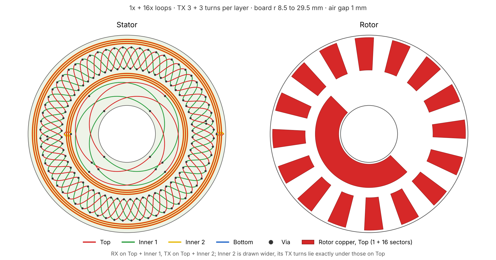

# D3_1x16x_OD59_fitted_bands

Coil board 8 of 10 in this branch's order. Dual coil set board. 1x + 16x, OD 59, bands fitted between the edges, TX 3 + 3.

## The board

Outline 59.0 mm, bore 17.0 mm, 4 copper layers, board 1.6 mm, air gap 1.0 mm. Stator copper: 3.07 m of trace in all. Two coil sets: set 1 inside, set 2 outside, each a TX coil and two RX coils, SIN and COS. The rotor, a second board with copper sectors, sits 1.0 mm above the stator, copper to copper, and its eddy currents make the TX to RX coupling follow the sine and cosine of its angle.



| Coil set | TX | SIN | COS | Frequency | Periods per revolution (N) | Electrical period |
|---|---|---|---|---|---|---|
| 1 | TX_1 | SIN_1 | COS_1 | 3 MHz | 1 | 360° mechanical |
| 2 | TX_2 | SIN_2 | COS_2 | 4.3 MHz | 16 | 22.5° mechanical |

| Rotor copper ring | Sectors | Metal fraction |
|---|---|---|
| 9.03 to 16.05 mm | 1 | 0.50 |
| 19.05 to 28.8 mm | 16 | 0.50 |

Where each coil is opened for its terminals (KiCad coordinates, mm; the rotation axis is at (100, 100)):

| Net | Kind | Where | Terminals |
|---|---|---|---|
| `TX_1` (TX_1) | TX ends | (81.35, 100), F.Cu and In2.Cu | the two coil ends, stacked at one point on two layers: their end faces are the terminals |
| `TX_2` (TX_2) | TX ends | (128.8, 100), F.Cu and In2.Cu | the two coil ends, stacked at one point on two layers: their end faces are the terminals |
| `SIN_1` (SIN_1) | RX cut | (90.2616, 102.972), F.Cu | the trace is cut there with a 0.2 mm gap: the two cut faces are the terminals |
| `COS_1` (COS_1) | RX cut | (87.5881, 106.717), F.Cu | the trace is cut there with a 0.2 mm gap: the two cut faces are the terminals |
| `SIN_2` (SIN_2) | RX via (fallback) | via at (123.469, 96.101) | no cut spot on this board: the via is left out, and its two pads are the terminals |
| `COS_2` (COS_2) | RX via (fallback) | via at (76.2618, 101.58) | no cut spot on this board: the via is left out, and its two pads are the terminals |

Both boards are built by KESE with solder mask on both faces, stator and rotor: 20 µm, εr 3.8, tan δ 0.02, vias tented (`test_spec.json` → `solder_mask`). These KiCad stack-ups set no mask, so the bridge sets it.

## Why it is here

The October board A rebuilt with the current generator.

Elmer is the main solver of these encoder boards: at 3 to 5 MHz the boards are about 1/2000 of a wavelength across, so the physics is magneto-quasi-static, which is exactly what Elmer's time-harmonic A-V solver does.

## What the solver checks

Elmer, magnetic (WhitneyAVHarmonicSolver with edge elements), every coil a massive coil of the circuit module: the driven TX carries 1 A, every other coil is open. One solve gives the TX's impedance (L and R, with skin, proximity and the rotor's loss) and each open coil's voltage, so its mutual inductance M. The rotor's 35 µm copper is meshed through its thickness (the skin depth at these frequencies is 32 to 38 µm).

Solves: 18. Per coil set, the rotor away (C1, C3), the rotor at the eight angles of C4 (set 1: 0, 45, 90, 135, 180, 225, 270, 315° mechanical) (set 2: 0, 2.8125, 5.625, 8.4375, 11.25, 14.0625, 16.875, 19.6875° mechanical) (C2, C4 to C6, C10). The rotor repeats itself after 360/N, so the coupling's period is exact by construction and needs no solve of its own. The stator's mesh is the same in every solve; only the air between the boards is meshed again for each angle.

The checks are the Elmer brief's (`../Things to test in ELMER.md`, section 5), with the five pass marks reviewed on 16 November (see `../README.md`): C0 (the mesh study, on S1), C1 to C6, C7 on the dual boards, and C10. C9 (air gap sweep), C11 (rotor off-centre and tilted) and C12 (surface-impedance rotor) are optional.

Size: about 190 GB of memory with the iterative solver, S2's measured mesh scaled by this stator's 3.07 m of copper (about 61 GB per metre). It is held for a PC with 256 GB.

## Results

Not run yet. When it runs, `results.md` in this folder gets every number, the runs' CSV and the plots, and this table gets the Got and Pass columns.

| Check | Quantity | Expected | Got | Pass |
|---|---|---|---|---|
| C1 | TX_1: L, rotor away | 2.609 µH (reference; generator 2.612 µH) | | within 3 % |
| C2 | TX_1: L with the rotor at 0°, and the drop | 2.426 µH, -7.0 % (reference); 2.077 µH, -20.5 % (generator) | | reported: the open question |
| C2 | TX_1: spread of L over the eight C4 angles | none, by symmetry | | within 0.5 % of their mean |
| C3 | TX_1: M0 to SIN / COS, rotor away | -0.031 nH / -0.042 nH | | M0 / A below 3 %; the sign judged only where resolved |
| C4 | TX_1: amplitude A to SIN / COS | 37.04 / 37.04 nH | | within 15 % |
| C4 | TX_1: even harmonic h2 (SIN / COS) | below 1 % of A | | below 1 % of A |
| C4 | TX_1: third harmonic h3 (SIN / COS) | 2.21 % / 2.21 % | | within 2×, or within 0.3 % of A |
| C5 | TX_1: phase difference SIN − COS | +90.0° (either sign) | | 90 ± 1° |
| C5 | TX_1: amplitude ratio SIN / COS | 1.000 | | 1.00 ± 0.02 |
| C6 | TX_1: peak angle error, offsets removed (raw) | 1.33 (1.36) electrical degrees | | within 3×, or below 0.5° |
| C10 | TX_1: resistance, DC / at 3 MHz rotor away / with the rotor; rotor loss | 1.62 Ω DC; the generator says up to about 2× at 3 MHz | | reported |
| C1 | TX_2: L, rotor away | 4.695 µH (reference; generator 4.702 µH) | | within 3 % |
| C2 | TX_2: L with the rotor at 0°, and the drop | 4.477 µH, -4.6 % (reference); 3.721 µH, -20.9 % (generator) | | reported: the open question |
| C2 | TX_2: spread of L over the eight C4 angles | none, by symmetry | | within 0.5 % of their mean |
| C3 | TX_2: M0 to SIN / COS, rotor away | +0.026 nH / -0.009 nH | | M0 / A below 3 %; the sign judged only where resolved |
| C4 | TX_2: amplitude A to SIN / COS | 59.86 / 59.86 nH | | within 15 % |
| C4 | TX_2: even harmonic h2 (SIN / COS) | below 1 % of A | | below 1 % of A |
| C4 | TX_2: third harmonic h3 (SIN / COS) | 0.12 % / 0.12 % | | within 2×, or within 0.3 % of A |
| C5 | TX_2: phase difference SIN − COS | +90.0° (either sign) | | 90 ± 1° |
| C5 | TX_2: amplitude ratio SIN / COS | 1.000 | | 1.00 ± 0.02 |
| C6 | TX_2: peak angle error, offsets removed (raw) | 0.08 (0.10) electrical degrees | | within 3×, or below 0.5° |
| C10 | TX_2: resistance, DC / at 4.3 MHz rotor away / with the rotor; rotor loss | 2.57 Ω DC; the generator says up to about 2× at 4.3 MHz | | reported |
| C7 | Crosstalk: TX_1 into set 2's RX / TX_2 into set 1's RX | 20.87 / 16.29 nH | | reported |

Expected numbers: the generator pack's quasi-static reference (`tools/quasistatic_reference.py` of the generator pack: Neumann integrals and a thin-sheet eddy-current model of the rotor) and the generator's own estimates, from `test_spec.json` → `expected` and `expected_results.json`. The sign of the phase difference depends on the rotation sense; either is right if consistent.

## How to run

```
python run_simulation.py "Examples/Inductive Coils/D3_1x16x_OD59_fitted_bands"
```

## Files

| File | What it is |
|---|---|
| `Stator.kicad_pcb`, `Rotor.kicad_pcb` (and their `.kicad_pro`) | the two boards, KiCad 7 format, as the generator wrote them |
| `test_spec.json` | what the bridge reads: stack-up, rotor placement and angles, solder mask, terminals, expected values |
| `expected_results.json`, `expected_results.txt`, `expected_coupling.png` | every predicted number, with the coupling curves against the rotor angle |
| `Parameters.txt`, `parameter_files/`, `run_log.txt` | the generator's full record of this board |
| `D3_1x16x_OD59_fitted_bands_stator_and_rotor.png`, `*_Actual.svg`, `*_Representative.svg` | pictures of the board and its coils |

## Licence

This board is output of the [Sinusoidal Coil Generator](https://github.com/RolandThsive/Sinusoidal-Inductive-Encoders-Coil-Generator), for non-commercial use only; see `../LICENSE.md`. It is not covered by this branch's GPL-3.0.
