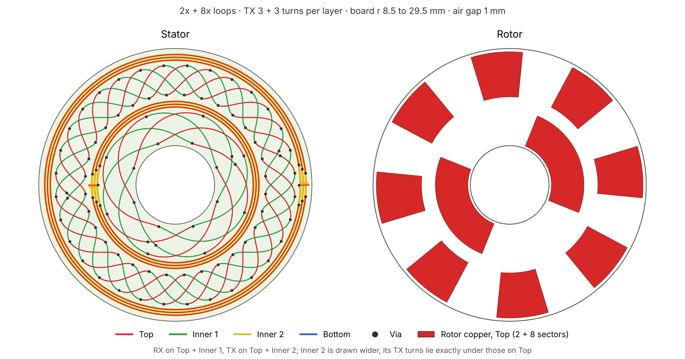

# D4_2x8x_OD59_parallel_TX

Coil board 9 of 10 in this branch's order. Dual coil set board. 2x + 8x, OD 59, parallel TX on both sets.

## The board

Outline 59.0 mm, bore 17.0 mm, 4 copper layers, board 1.6 mm, air gap 1.0 mm. Stator copper: 2.74 m of trace in all. Two coil sets: set 1 inside, set 2 outside, each a TX coil and two RX coils, SIN and COS. The rotor, a second board with copper sectors, sits 1.0 mm above the stator, copper to copper, and its eddy currents make the TX to RX coupling follow the sine and cosine of its angle.



| Coil set | TX | SIN | COS | Frequency | Periods per revolution (N) | Electrical period |
|---|---|---|---|---|---|---|
| 1 | TX_1 | SIN_1 | COS_1 | 3 MHz | 2 | 180° mechanical |
| 2 | TX_2 | SIN_2 | COS_2 | 4.3 MHz | 8 | 45° mechanical |

| Rotor copper ring | Sectors | Metal fraction |
|---|---|---|
| 9.03 to 16.05 mm | 2 | 0.50 |
| 19.05 to 28.8 mm | 8 | 0.50 |

Where each coil is opened for its terminals (KiCad coordinates, mm; the rotation axis is at (100, 100)):

| Net | Kind | Where | Terminals |
|---|---|---|---|
| `TX_1` (TX_1) | TX ends | (81.35, 100), F.Cu and In2.Cu | the two coil ends, stacked at one point on two layers: their end faces are the terminals |
| `TX_2` (TX_2) | TX ends | (128.8, 100), F.Cu and In2.Cu | the two coil ends, stacked at one point on two layers: their end faces are the terminals |
| `SIN_1` (SIN_1) | RX cut | (88.0867, 97.4422), F.Cu | the trace is cut there with a 0.2 mm gap: the two cut faces are the terminals |
| `COS_1` (COS_1) | RX cut | (86.327, 103.567), F.Cu | the trace is cut there with a 0.2 mm gap: the two cut faces are the terminals |
| `SIN_2` (SIN_2) | RX cut | (121.796, 101.174), F.Cu | the trace is cut there with a 0.2 mm gap: the two cut faces are the terminals |
| `COS_2` (COS_2) | RX cut | (121.767, 97.0046), F.Cu | the trace is cut there with a 0.2 mm gap: the two cut faces are the terminals |

TX wiring: parallel: each TX is two layers in parallel; drive both layers from the same terminal pair. The reference gives no L for it (use the generator's value), and its coupling assumes an equal current split.

Both boards are built by KESE with solder mask on both faces, stator and rotor: 20 µm, εr 3.8, tan δ 0.02, vias tented (`test_spec.json` → `solder_mask`). These KiCad stack-ups set no mask, so the bridge sets it.

## Why it is here

Parallel TX wiring (two layers in parallel) and a 2-period coarse set.

openEMS's job on these boards is the part Elmer cannot do: the coils' self resonance and stray capacitance (C8). An eddy-current solve has no displacement current, so only a full-wave solver sees them.

## What the solver checks

openEMS, FDTD, excited by a Gaussian pulse up to 400 MHz: each TX driven through a 500 Ω lumped port between its two ends, every RX loaded with 1 kΩ (nearly open). Copper as 35 µm conducting solids (5.8e7 S/m), FR-4 at εr 4.4 and tan δ 0.02, solder mask at εr 3.8 and tan δ 0.02. The run ends when the energy has fallen by 50 dB. Then f_SRF is the first frequency where Im(Z11) crosses zero, and C_self = 1 / ((2π f_SRF)² L_TX).

The checks are the openEMS brief's (`../Things to test in OpenEMS.md`, section 6): C8 on every board; C1 to C7 as a cross-check with Elmer only on S2 and D2, where a run is affordable.

Size: about 74 million cells at 0.05 mm (the pack's dry run), so about 4.4 GB with openEMS's new CPU engine, and about 16 hours a run on the 4-core test machine (701 million cell updates a second, measured). It fits an 8 GB PC (such as an i9-14900K with 8 GB) and the 16 GB test machine; runs of this length are held until a machine can run them unattended.

## Results

Not run yet. When it runs, `results.md` in this folder gets every number, the runs' CSV and the plots, and this table gets the Got and Pass columns.

| Check | Quantity | Expected | Got | Pass |
|---|---|---|---|---|
| C8 | TX_1: self resonance f_SRF, rotor away | none from the pack (the generator models no capacitance) | | at least 15 MHz (5 × 3 MHz) |
| C8 | TX_1: its own capacitance C_self = 1 / ((2π f_SRF)² L) | none | | reported |
| C8 | TX_1: f_SRF shift with the rotor at 0° | lower, by the rotor's capacitance | | reported |
| C8 | TX_1: capacitive coupling to SIN / COS, 5 to 50 MHz | small against ωM | | reported |
| C8 | TX_2: self resonance f_SRF, rotor away | none from the pack (the generator models no capacitance) | | at least 21.5 MHz (5 × 4.3 MHz) |
| C8 | TX_2: its own capacitance C_self = 1 / ((2π f_SRF)² L) | none | | reported |
| C8 | TX_2: f_SRF shift with the rotor at 0° | lower, by the rotor's capacitance | | reported |
| C8 | TX_2: capacitive coupling to SIN / COS, 5 to 50 MHz | small against ωM | | reported |
| C8 | Each RX coil's self resonance (one run per RX coil) | far above the operating frequency | | reported |
| C8 | TX_1 to TX_2 coupling above 20 MHz | none | | reported |

Expected numbers: the generator pack's quasi-static reference (`tools/quasistatic_reference.py` of the generator pack: Neumann integrals and a thin-sheet eddy-current model of the rotor) and the generator's own estimates, from `test_spec.json` → `expected` and `expected_results.json`. The sign of the phase difference depends on the rotation sense; either is right if consistent.

## How to run

```
python run_simulation.py "Examples/Inductive Coils/D4_2x8x_OD59_parallel_TX"
```

## Files

| File | What it is |
|---|---|
| `Stator.kicad_pcb`, `Rotor.kicad_pcb` (and their `.kicad_pro`) | the two boards, KiCad 7 format, as the generator wrote them |
| `test_spec.json` | what the bridge reads: stack-up, rotor placement and angles, solder mask, terminals, expected values |
| `expected_results.json`, `expected_results.txt`, `expected_coupling.png` | every predicted number, with the coupling curves against the rotor angle |
| `Parameters.txt`, `parameter_files/`, `run_log.txt` | the generator's full record of this board |
| `D4_2x8x_OD59_parallel_TX_stator_and_rotor.png`, `*_Actual.svg`, `*_Representative.svg` | pictures of the board and its coils |

## Licence

This board is output of the [Sinusoidal Coil Generator](https://github.com/RolandThsive/Sinusoidal-Inductive-Encoders-Coil-Generator), for non-commercial use only; see `../LICENSE.md`. It is not covered by this branch's GPL-3.0.
