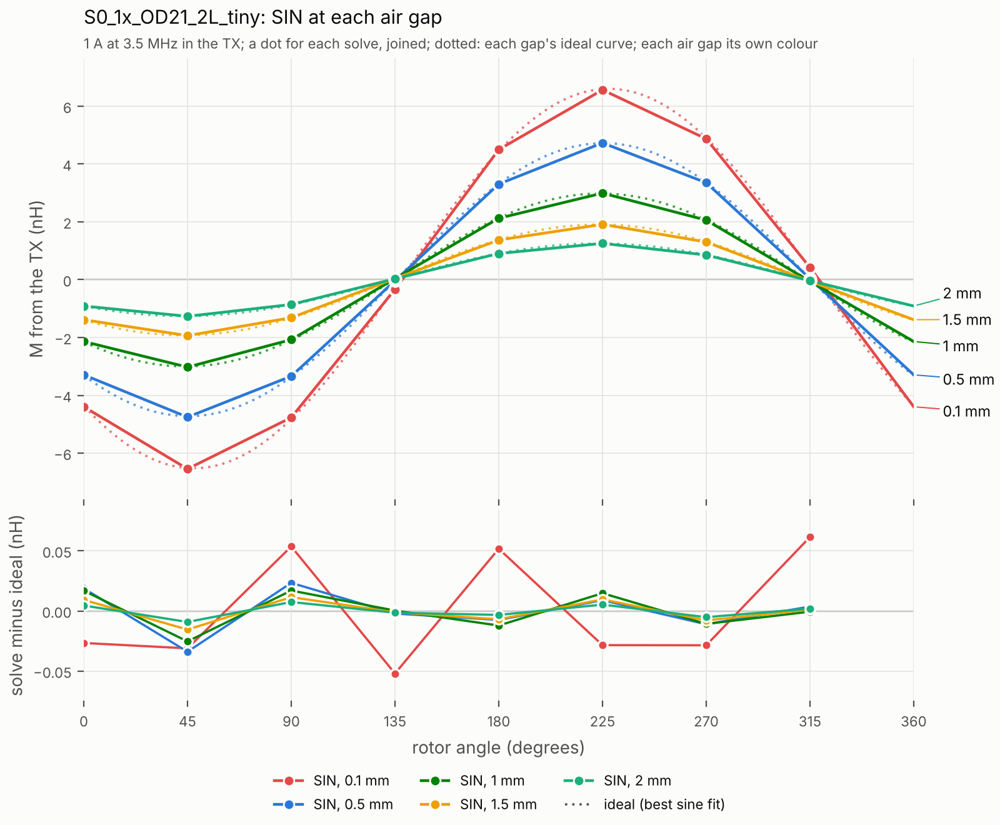
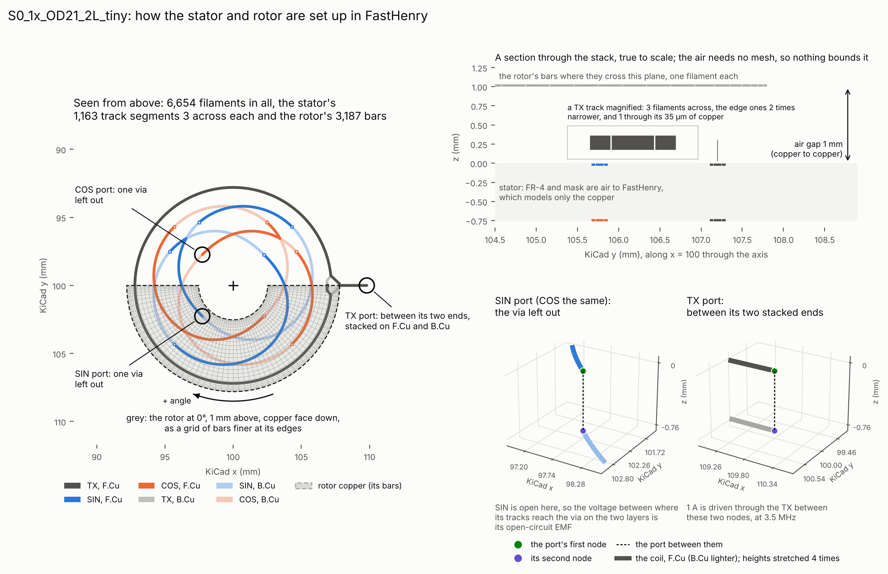

# S0_1x_OD21_2L_tiny

The smallest coil set that is still a whole angle sensor, made with the [Sinusoidal Coil Generator](https://github.com/RolandThsive/Sinusoidal-Inductive-Encoders-Coil-Generator) for one job: the SIN and COS curves over a full turn of the rotor, at any air gap, on a small machine. It is not one of the ten boards of the brief, and it is not meant to be built: its TX is too small for the IPS2550's tank (the generator warns about it, see below).

The curves, the fits and the angle error are in [Results/SINCOS_Results.md](Results/SINCOS_Results.md), one page for every air gap solved.

## Results at each air gap

| Air gap | Amplitude SIN / COS | Angle error | Solves passing the checks | L TX over the turn |
|---|---|---|---|---|
| 2 mm | 1.25 / 1.26 nH (28 / 28 mV) | 0.1° rms, 0.1° peak | 8 of 8 | 131.0 to 131.1 nH |
| 1.5 mm | 1.91 / 1.92 nH (42 / 42 mV) | 0.1° rms, 0.1° peak | 8 of 8 | 129.2 to 129.3 nH |
| 1 mm | 2.99 / 3.00 nH (66 / 66 mV) | 0.1° rms, 0.1° peak | 8 of 8 | 126.3 to 126.4 nH |
| 0.5 mm | 4.72 / 4.73 nH (104 / 104 mV) | 0.1° rms, 0.1° peak | 8 of 8 | 121.0 to 121.1 nH |
| 0.1 mm | 6.56 / 6.57 nH (144 / 144 mV) | 0.5° rms, 0.7° peak | 8 of 8 | 110.9 to 111.1 nH |

*SIN at each air gap, one dot per solve; a ring would mark a solve that fails the checks under "What the solver does" (none does). [`SINCOS_gaps_COS.webp`](Results/SINCOS_gaps_COS.webp) is the same for COS, and [`SINCOS_gaps.webp`](Results/SINCOS_gaps.webp) has both.*

Every solve is reciprocal: M from the TX to each receiver and M from the receiver back to the TX agree to the last digit FastHenry writes, as a direct solve of its symmetric matrix must. At every gap SIN and COS are within 0.3 % of each other in amplitude and 90.0° apart, and the angle error is 0.1° to 0.5° rms over the gaps. At 0.1 mm the angle error alternates in sign from one angle to the next: a ripple at four periods per electrical period, the fastest the angles can show, which third or fifth harmonics of the coupling would give, and those fade faster with the gap than the sine itself. SIN's amplitude is 6.56 nH at 0.1 mm, 4.72 nH at 0.5 mm, 2.99 nH at 1 mm, 1.91 nH at 1.5 mm and 1.25 nH at 2 mm (144 down to 28 mV of EMF at 1 A). L TX moves by 0.2 nH at most over the turn, and rises from 111.0 nH at 0.1 mm to 131.0 nH at 2 mm; with the rotor away it is 135.3 nH, where the generator estimated 109 nH with the rotor and 132 nH without. Each model has 6,654 filaments, and each solve took 1.3 to 2.3 min and 0.7 GB on one core.

## The folder

This layout is the template: [`../new_coil.py`](../new_coil.py) makes the same folders for any other single coil set from the generator (`3D_Geometry/` is filled by the first run), and the scripts in `FastHenry Simulation/` run it without a change.

| Folder | What is in it |
|---|---|
| [`Boards/`](Boards/) | straight from the generator: the stator and rotor boards, `Parameters.txt`, the pictures and the parameter files it was run with |
| [`3D_Geometry/`](3D_Geometry/) | KESE's export of the stator and rotor (STL solids, `materials.json`, STEP, KESE's report), written by the first run; `source.json` records the board's hash, so a changed board is exported again (the layers' heights and the copper's thickness are read from it) |
| [`FastHenry Simulation/`](FastHenry%20Simulation/) | `test_spec.json` (every board fact the simulation needs), `simulation.py`, `angle_error.py`, `make_charts.py`, `rig_picture.py` and `angle_setup.py`: `simulation.py` builds the filaments and solves each angle and writes the results, [`RotorStator_AngleSetup/`](FastHenry%20Simulation/RotorStator_AngleSetup/) (the rotor over the stator at each angle), and the runs under `case/`, which git ignores |
| [`Results/`](Results/) | `expected_results.json` (the generator's estimates), [`SINCOS_Results.md`](Results/SINCOS_Results.md) with every gap on one page, the charts of every gap together (`SINCOS_gaps.webp`, and `_SIN` and `_COS` apart), and a folder for each air gap (`0d1mm_AirGap`, `0d5mm_AirGap`, `1mm_AirGap`, `1d5mm_AirGap`, `2mm_AirGap`, the point written as d) with the runs' `results_gap<gap>mm.json`, `.csv` and `.webp` |

Beside this README, `S0_1x_OD21_2L_tiny_stator_and_rotor.webp` is the generator's picture of the boards and `S0_1x_OD21_2L_tiny_fasthenry_setup.webp` shows how they sit in FastHenry.

## The board

Outline 21.0 mm, bore 4.0 mm, 2 copper layers, board 0.8 mm, air gap 1.0 mm by default (any other with `--gap`). One coil set: a TX of one turn on each layer in series, and two RX coils, SIN and COS, of one period per turn. The rotor is a half ring of copper, so a full turn of it gives one period of each curve: SIN follows the sine of the rotor's angle and COS its cosine.

*Drawn by the generator: its `Boards/Coil_2_10.5_1_1_1_Series_SteppedDiagonal_Representative.svg`, as a WebP. `Boards/..._Actual.svg` is the copper at its true size.*

| Coil set | TX | SIN | COS | Frequency | Periods per revolution (N) | Electrical period |
|---|---|---|---|---|---|---|
| 1 | TX, 1 + 1 turns, r = 7.2 mm | SIN (net `2`) | COS (net `1`) | 3.5 MHz | 1 | 360° mechanical |

| RX band | Rotor copper ring | Sectors | Metal fraction |
|---|---|---|---|
| 3.2 to 6.1 mm | 2.52 to 7.8 mm | 1 | 0.50 |

Where each coil is opened for its terminals (KiCad coordinates, mm; the rotation axis is at (100, 100)):

| Net | Kind | Where | Terminals |
|---|---|---|---|
| `TX` (TX) | TX ends | (109.8, 100), F.Cu and B.Cu | the two coil ends, stacked at one point on two layers |
| `2` (SIN) | RX via (fallback) | via at (97.737, 102.263) | the generator found no cut spot: the via is left out, and its two pads are the terminals |
| `1` (COS) | RX via (fallback) | via at (97.737, 97.737) | as for SIN |

The fallback via of each RX coil is its layer-change via farthest from the TX copper (4.0 mm, on the inner edge of the band), of the two such on the side away from the TX terminal.

## How it was made

The generator at commit `32bf9cb`, S2's parameter files with five values changed (the files used are in [`Boards/parameter_files`](Boards/parameter_files/), and [`Boards/Parameters.txt`](Boards/Parameters.txt) is the generator's record of the run):

| Parameter | S2 | S0 | Why |
|---|---|---|---|
| `LOOPS` | 4 | 1 | one period per turn: the curves over a full turn are one sine and one cosine |
| `TX_TURNS` | 3 | 1 | less copper; the TX's turns add little to the coupling's shape |
| `INNER_EDGE_RADIUS_MM` | 10.0 | 2.0 | a small board |
| `OUTER_EDGE_RADIUS_MM` | 20.0 | 10.5 | 10.0 left a via 0.11 mm from other copper; 10.5 gives 0.274 mm (at least 0.2) |
| `PCB_THICKNESS_MM` | 1.6 | 0.8 | two fewer wedge layers through the board |

The generator's two warnings, both expected: the TX tank's parallel resistance would be about 12 Ω where the IPS2550 needs 250 Ω (more TX turns would fix it), and it found no spot with room for the two lead vias of each RX coil (so each RX coil is opened at a via instead).

## What the solver does

FastHenry (M.I.T.'s, in FastFieldSolvers' release 3.0.1), magneto-quasi-static: only the copper is discretised, into straight filaments that each carry a uniform current along their length, and every filament couples to every other through its partial inductance, worked out exactly; the air takes nothing. The TX's port is driven and SIN's and COS's are open, and FastHenry gives the matrix of open-circuit impedances between the three ports: Z[SIN][TX] / (jω) is the mutual inductance M from the TX to SIN. The EMF is 2πfM × 1 A: 1 nH is 22 mV at 3.5 MHz.

*How the boards are set up in FastHenry, drawn by [`rig_picture.py`](FastHenry%20Simulation/rig_picture.py) from the segments simulation.py solves. The rotor sits over the stator copper side down, its copper 1 mm above the stator's top copper, and turns about the board's centre. Each track is a segment at the middle of its copper layer, as wide as the track and 35 µm thick, split into three filaments across its width; a via is a vertical bar between its two layer nodes; the rotor is a polar grid of bars. No trace is cut: the generator found no spot on this small board to cut a receiver's trace, so each receiver is opened by leaving out one of its layer-change vias, the one farthest from the TX copper, and its port is between that via's two layer nodes. The TX is opened where its two ends lie stacked on the two layers, and its port is between them. FR-4 and solder mask are air to this solve, and the air needs nothing.*

Each track is a segment between nodes at its ends, at the middle of its copper layer, as wide as the track and as thick as the copper, split into three filaments across its width (the two edge ones half as wide as the middle one, so the current can crowd to the edges) and one through its thickness; an arc is cut into chords of at most 5° and 0.5 mm. A via is a vertical bar between its node on each layer, a square of the plated barrel's copper section (the pads, a fraction of a square millimetre each, are left out). The rotor's copper is a polar grid of bars, 0.05 mm wide at its four edges and growing to 0.3 mm in its middle, each bar as wide as the cell it stands for, turned to each angle. Each solve is FastHenry's dense direct solve (`-s ludecomp -m direct`, its multipole refinement off), so it is the exact answer of the filament model, and its impedance matrix is symmetric to the last digit: the M from each receiver back to the TX equals the M from the TX to it (reciprocity), which every solve is checked for.

One solve per rotor angle, 0 to 315° in 45° steps by default (8 angles; `--step 10` for every 10°), and one with the rotor away (with the 1 mm results). The stator's filaments stay where they are and only the rotor's grid turns, so there is no meshing noise between angles. The best sine fit and the rms of what it leaves are written with the results.

| Air gap | Filaments | Rotor bars | Memory a solve | Time a solve |
|---|---|---|---|---|
| 0.1 mm | 6,654 | 3,187 | 0.7 GB | 1.4 to 2.3 min |
| 0.5 mm | 6,654 | 3,187 | 0.7 GB | 1.3 to 1.5 min |
| 1 mm | 6,654 | 3,187 | 0.7 GB | 1.4 to 1.6 min |
| 1.5 mm | 6,654 | 3,187 | 0.7 GB | 1.3 to 1.5 min |
| 2 mm | 6,654 | 3,187 | 0.7 GB | 1.3 to 1.4 min |

How fine the filaments need to be was measured on S0_1x_OD22_2L_tiny_TXtop at 1 mm and 0°. One filament across each track instead of three moves M SIN and M COS by 0.2 % and L TX by 0.04 %; five instead of three move them by 0.03 % and 0.01 %, and two through the copper's thickness instead of one by 0.01 % and 0.1 %. A finer rotor grid, 0.025 to 0.2 mm bars instead of 0.05 to 0.3 mm, moves M by 0.04 %. So M and L TX are settled to a few hundredths of a percent with three filaments across. R TX is the one number that still moves: 274.5 mΩ with three filaments across and 278.6 mΩ with five (1.5 % more), because at 3.5 MHz the skin depth (35 µm) is the copper's thickness and the current crowds to each track's edges more finely than three filaments follow. On the proof boards, FastHenry's M between two coaxial loops is 0.024 % over Neumann's integral ([E02](../../E02_coaxial_loops/README.md)).

## Running it

    cd "FastHenry Simulation"
    python simulation.py                        # the rotor away, then 0, 45, 90, 135, 180, 225, 270, 315 degrees, at a 1 mm gap
    python simulation.py --gap 0.5              # the same at a 0.5 mm air gap
    python simulation.py --step 10              # every 10 degrees
    python simulation.py --jobs 3               # three solves at once, one core each
    python simulation.py --nwinc 5 --trial w5   # five filaments across each track, kept in case/
    python simulation.py --model-only           # build the filaments and say how many, solve nothing
    python simulation.py --plot                 # redraw the table, the curves and SINCOS_Results.md
    python angle_error.py                       # print the angle error at each angle, and rewrite SINCOS_Results.md
    python make_charts.py                       # redraw every chart (WebP) and rewrite SINCOS_Results.md
    python rig_picture.py                       # redraw how the boards sit in FastHenry
    python angle_setup.py                       # redraw the rotor at each angle

Use the Python of the branch's `.venv` (`bash bridge/setup_machine.sh` makes it, and installs what FastHenry needs). Each gap writes into its own folder in `Results/`, named for the gap with the point written as d (`1mm_AirGap`, `0d5mm_AirGap`): `results_gap<gap>mm.json` (every solve, the fit, the angle error), `results_gap<gap>mm.csv` (angle, M of SIN and COS in nH, the TX's L, and the EMFs in mV) and `results_gap<gap>mm.webp` (the chart, drawn by [`make_charts.py`](FastHenry%20Simulation/make_charts.py): a dot for each solve, a solid line joining them, and dots for the ideal sine and cosine). [`SINCOS_Results.md`](Results/SINCOS_Results.md) puts every gap on one page: each graph with a caption, the fit, the angle error at each angle, every solve and the generator's expectation, and once two gaps are solved, a chart with both. An angle already in the results is skipped, so a stopped sweep picks up where it was; `--merge` adds the solves of the same gap from other machines' results files.

## The angle error

[`angle_error.py`](FastHenry%20Simulation/angle_error.py) works it out after every solve, and `simulation.py` writes it into `SINCOS_Results.md`. Each channel gets its best sine over the rotor's period, M = offset + amplitude × sin(θ + phase). Each channel's offset is taken out and it is divided by its amplitude, so both swing between −1 and +1, as a decoder chip's offset and gain calibration does. The angle is read back as atan2(SIN, COS). The error at each angle is that reading less the true angle, less the average of all of them, since a fixed offset only moves where zero is; the rms and the worst of them are the angle error, in electrical degrees (the same as mechanical here, with one period per turn). The fit uses the same points as the error, so it measures how far the solves are from a perfect sine and cosine pair.

## The workflow for any generated coil

Any coil set from the generator's Single Coil Set Generator goes through the same five steps, and S0 was made this way. [`../new_coil.py`](../new_coil.py) does the setting up, and this folder's scripts run every board it sets up without a change, because they read each board fact from `test_spec.json`.

1. **Make the coil.** In the generator's checkout, set the parameters in `Generators/Single Coil Set Generator/Parameters/` (S0's are in [`Boards/parameter_files`](Boards/parameter_files/)) and run `python Generator/Run/RunCoilGenerator.py` from `Generators/Single Coil Set Generator`. It writes `Output/Coil_<...>/`: the two boards, `Parameters.txt` and two pictures. `Generators/resources` must sit beside it, as it does in a full checkout, or the lead-cutting suggestion and the pictures are missing. Read the warnings it prints: a via too close to other copper means the board is not right yet (S0 needed `OUTER_EDGE_RADIUS_MM` 10.5 for that), while the TX tank warning does not matter to the simulation.
2. **Set it up for FastHenry.** In this folder's parent:

       python new_coil.py "<checkout>/Generators/Single Coil Set Generator/Output/Coil_..." S6_my_board

   It makes `S6_my_board/` laid out as this folder: `Boards/` with the boards, `Parameters.txt`, the parameter files and the pictures; `FastHenry Simulation/` with `test_spec.json`, `simulation.py`, `angle_error.py`, `make_charts.py`, `rig_picture.py` and `angle_setup.py`; `Results/` with `expected_results.json`; and a README beside them. The first run fills `3D_Geometry/` with KESE's export of the two boards. Then it builds the filaments at one angle and prints how many and the memory a solve needs. `--angles 16` gives more angles over the rotor's period, and `--no-estimate` skips the count.
3. **Check it.** FastHenry's direct solve holds the dense matrix of the filaments' couplings, so its memory grows as the square of the filaments: S0's models of about 6,500 to 7,500 filaments took 0.6 to 0.8 GB. If the estimate is too big, make the coil smaller or the rotor's grid coarser (`--rotor-edge`, `--rotor-max`). Then check the terminals in the new README against the picture. The TX is opened at its two stacked ends. Each RX coil is opened at one of its layer-change vias: the one nearest the generator's suggested cut, or, where it found no cut spot, the one farthest from the TX copper.
4. **Run it.** `python simulation.py` in the new folder's `FastHenry Simulation/` solves the rotor away, then each angle of `test_spec.json`. `--gap 0.5` sets another air gap and `--step 10` solves every 10 degrees over the whole turn. A stopped sweep picks up where it was. An angle of S0's size takes 1 to 3 minutes on one core.
5. **Read the results.** In `Results/<gap>_AirGap/`, `results_gap<gap>mm.json` has every solve, the best sine fit and the angle error, `.csv` the curves in nH and mV, and `.webp` the chart, with a dot for each solve, a solid line joining them and dots for the ideal sine and cosine. `SINCOS_Results.md` gathers all of it, every gap on one page, and is rewritten after every solve. `python simulation.py --plot` or `python make_charts.py` redraws them. Commit the folder without `case/`, which git ignores.

The limits: single coil sets only, since a `DualCoil_` board has two sets. `new_coil.py` also sets up S1 to S5 (two and four layers) with their TX ends found where their own specs have them, but none of those has been solved this way yet.

## Licence

These boards are output of the Sinusoidal Coil Generator, for non-commercial use only. See [../LICENSE.md](../LICENSE.md); this branch's GPL-3.0 covers `simulation.py`, `angle_error.py`, `make_charts.py`, `rig_picture.py` and `angle_setup.py` only.
