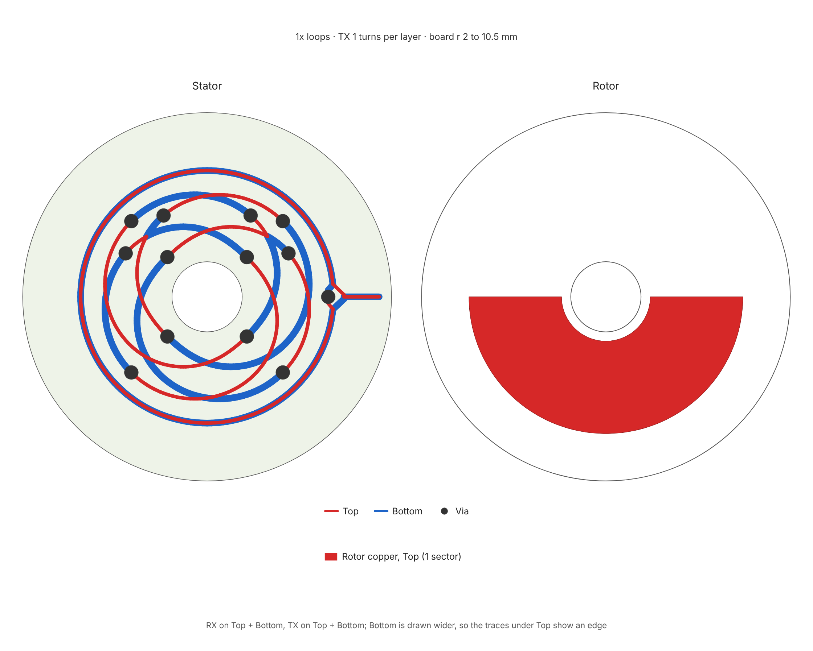
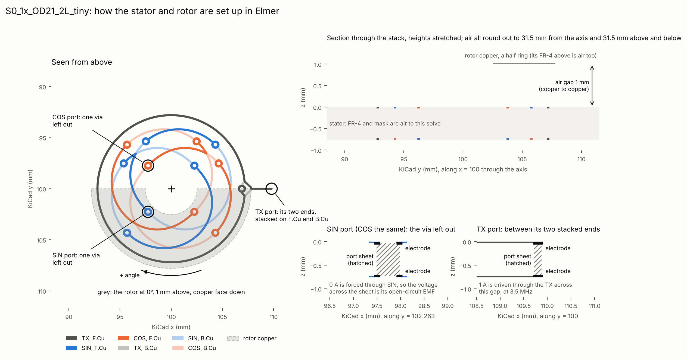

# S0_1x_OD21_2L_tiny

The smallest coil set that is still a whole angle sensor, made with the [Sinusoidal Coil Generator](https://github.com/RolandThsive/Sinusoidal-Inductive-Encoders-Coil-Generator) for one job: the SIN and COS curves over a full turn of the rotor, at any air gap, on a machine with 16 GB. It is not one of the ten boards of the brief, and it is not meant to be built: its TX is too small for the IPS2550's tank (the generator warns about it, see below).

The curves, the fits and the angle error are in [Results/SINCOS_Results.md](Results/SINCOS_Results.md), one page for every air gap solved.

## The folder

This layout is the template: [`../new_coil.py`](../new_coil.py) makes the same three folders for any other single coil set from the generator, and the scripts in `Elmer Simulation/` run it without a change.

| Folder | What is in it |
|---|---|
| [`Boards/`](Boards/) | straight from the generator: `Stator.kicad_pcb` and `Rotor.kicad_pcb` with their `.kicad_pro` files, `Parameters.txt` (its record of the run), its two pictures (`_Representative.svg` and `_Actual.svg`), and [`parameter_files/`](Boards/parameter_files/), the six files it was run with |
| [`Elmer Simulation/`](Elmer%20Simulation/) | [`test_spec.json`](Elmer%20Simulation/test_spec.json) (every board fact the simulation needs: layers, gap, terminals, angles), [`simulation.py`](Elmer%20Simulation/simulation.py) (meshes and solves each angle and writes the results), [`angle_error.py`](Elmer%20Simulation/angle_error.py) (the angle error at each angle) [`make_charts.py`](Elmer%20Simulation/make_charts.py) (the charts, as WebP) and [`rig_picture.py`](Elmer%20Simulation/rig_picture.py), which draws the picture of how the boards are set up in Elmer. The runs go under `case/` here, which git ignores |
| [`Results/`](Results/) | [`expected_results.json`](Results/expected_results.json) (the generator's estimates), [`SINCOS_Results.md`](Results/SINCOS_Results.md) gathering every gap on one page, and a folder for each air gap ([`1mm_AirGap/`](Results/1mm_AirGap/), [`0d5mm_AirGap/`](Results/0d5mm_AirGap/)) with the runs' `results_gap<gap>mm.json` (every solve and the fit), `.csv` (the curves in nH and mV) and `.webp` (the chart) |

Beside this README, `S0_1x_OD21_2L_tiny_stator_and_rotor.webp` is the generator's Representative SVG as a lossless WebP (the picture below), and `S0_1x_OD21_2L_tiny_elmer_setup.webp` shows how the stator, rotor and terminals are set up in Elmer (under "What the solver does").

## The board

Outline 21.0 mm, bore 4.0 mm, 2 copper layers, board 0.8 mm, air gap 1.0 mm by default (any other with `--gap`). One coil set: a TX of one turn on each layer in series, and two RX coils, SIN and COS, of one period per turn. The rotor is a half ring of copper, so a full turn of it gives one period of each curve: SIN follows the sine of the rotor's angle and COS its cosine.

*Drawn by the generator: its `Boards/Coil_2_10.5_1_1_1_Series_SteppedDiagonal_Representative.svg`, as a WebP. `Boards/..._Actual.svg` is the copper at its true size.*

| Coil set | TX | SIN | COS | Frequency | Periods per revolution (N) | Electrical period |
|---|---|---|---|---|---|---|
| 1 | TX, 1 + 1 turns, r = 7.2 mm | SIN (net `2`) | COS (net `1`) | 3.5 MHz | 1 | 360° mechanical |

| RX band | Rotor copper ring | Sectors | Metal fraction |
|---|---|---|---|
| 3.2 to 6.1 mm | 2.52 to 7.8 mm | 1 | 0.50 |

Where each coil is opened for its terminals (KiCad coordinates, mm; the rotation axis is at (100, 100)):

| Net | Kind | Where | Terminals |
|---|---|---|---|
| `TX` (TX) | TX ends | (109.8, 100), F.Cu and B.Cu | the two coil ends, stacked at one point on two layers |
| `2` (SIN) | RX via (fallback) | via at (97.737, 102.263) | the generator found no cut spot: the via is left out, and its two pads are the terminals |
| `1` (COS) | RX via (fallback) | via at (97.737, 97.737) | as for SIN |

The fallback via of each RX coil is its layer-change via farthest from the TX copper (4.0 mm, on the inner edge of the band), of the two such on the side away from the TX terminal.

## How it was made

The generator at commit `32bf9cb`, S2's parameter files with five values changed (the files used are in [`Boards/parameter_files`](Boards/parameter_files/), and [`Boards/Parameters.txt`](Boards/Parameters.txt) is the generator's record of the run):

| Parameter | S2 | S0 | Why |
|---|---|---|---|
| `LOOPS` | 4 | 1 | one period per turn: the curves over a full turn are one sine and one cosine |
| `TX_TURNS` | 3 | 1 | less copper; the TX's turns add little to the coupling's shape |
| `INNER_EDGE_RADIUS_MM` | 10.0 | 2.0 | a small board |
| `OUTER_EDGE_RADIUS_MM` | 20.0 | 10.5 | 10.0 left a via 0.11 mm from other copper; 10.5 gives 0.274 mm (at least 0.2) |
| `PCB_THICKNESS_MM` | 1.6 | 0.8 | two fewer wedge layers through the board |

The generator's two warnings, both expected: the TX tank's parallel resistance would be about 12 Ω where the IPS2550 needs 250 Ω (more TX turns would fix it, at more mesh), and it found no spot with room for the two lead vias of each RX coil (so each RX coil is opened at a via instead).

## What the solver does

Elmer, magnetic (WhitneyAVHarmonicSolver with edge elements), every coil a massive coil of the circuit module, the same case as S2: the TX carries 1 A at 3.5 MHz, SIN and COS are open, and their voltages over the TX's current give their mutual inductances M. The EMF is 2πfM × 1 A: 1 nH is 22 mV at 3.5 MHz.

*How the boards are set up in Elmer, drawn by [`rig_picture.py`](Elmer%20Simulation/rig_picture.py) from the same geometry the mesh is built from. The rotor sits over the stator copper side down, its copper 1 mm above the stator's top copper, and turns about the board's centre. No trace is cut: the generator found no spot on this small board to cut a receiver's trace, so each receiver is opened by leaving out one of its layer-change vias, the one farthest from the TX copper. Its two pads stay, and the gap between them through the board is the terminal: the electrodes are the pads' faces toward the gap, and the port sheet across it is where Elmer's circuit takes the voltage. SIN and COS are held at 0 A, so that voltage is their open-circuit EMF. The TX is opened where its two ends lie stacked on the two layers, and 1 A is driven across that gap. FR-4 and solder mask are air to this solve.*

One solve per rotor angle, 0 to 315° in 45° steps by default (8 angles; `--step 10` for every 10°), and one with the rotor away. The rotor is a half ring, so its outline turns with it and every angle gets its own mesh; the stator's mesh therefore differs a little between angles, which shows as small noise on the curves. The best sine fit and the rms of what it leaves are written with the results, so that noise is measured, not guessed.

| Mesh level | Nodes | Memory a solve | Fits |
|---|---|---|---|
| 0.75 (the default here) | 203,669 | 11.4 GB seen while solving the first angle (57 kB a node, as E01 and E02) | the 15 GB test machine |
| 1.0 (S2's) | about 280,000 | about 16 GB | a 32 GB machine |

## Running it

    cd "Elmer Simulation"
    python simulation.py                   # the rotor away, then 0 to 315 degrees every 45, at a 1 mm gap
    python simulation.py --gap 0.5         # the same at 0.5 mm
    python simulation.py --step 10         # every 10 degrees
    python simulation.py --plot            # redraw the table, the curves and SINCOS_Results.md
    python angle_error.py                  # print the angle error at each angle, and rewrite SINCOS_Results.md
    python make_charts.py                  # redraw every chart (WebP) and rewrite SINCOS_Results.md

Each gap writes into its own folder in `Results/`, named for the gap with the point written as d (`1mm_AirGap`, `0d5mm_AirGap`): `results_gap<gap>mm.json` (every solve, the fit, the angle error), `results_gap<gap>mm.csv` (angle, M of SIN and COS in nH, the TX's L, and the EMFs in mV) and `results_gap<gap>mm.webp` (the chart, drawn by [`make_charts.py`](Elmer%20Simulation/make_charts.py): a dot for each solve, a solid line joining them, and dashes for the ideal sine and cosine). [`SINCOS_Results.md`](Results/SINCOS_Results.md) puts every gap on one page: each graph with a caption, the fit, the angle error at each angle, every solve and the generator's expectation, and once two gaps are solved, a chart with both. An angle already in the results is skipped, so a stopped sweep picks up where it was.

## The angle error

[`angle_error.py`](Elmer%20Simulation/angle_error.py) works it out after every solve, and `simulation.py` writes it into `SINCOS_Results.md`. Each channel gets its best sine over the rotor's period, M = offset + amplitude × sin(θ + phase). Each channel's offset is taken out and it is divided by its amplitude, so both swing between −1 and +1, as a decoder chip's offset and gain calibration does. The angle is read back as atan2(SIN, COS). The error at each angle is that reading less the true angle, less the average of all of them, since a fixed offset only moves where zero is; the rms and the worst of them are the angle error, in electrical degrees (the same as mechanical here, with one period per turn). The fit uses the same points as the error, so it measures how far the solves are from a perfect sine and cosine pair.

## The workflow for any generated coil

Any coil set from the generator's Single Coil Set Generator goes through the same five steps, and S0 was made this way. [`../new_coil.py`](../new_coil.py) does the setting up, and this folder's three scripts run every board it sets up without a change, because they read each board fact from `test_spec.json`.

1. **Make the coil.** In the generator's checkout, set the parameters in `Generators/Single Coil Set Generator/Parameters/` (S0's are in [`Boards/parameter_files`](Boards/parameter_files/)) and run `python Generator/Run/RunCoilGenerator.py` from `Generators/Single Coil Set Generator`. It writes `Output/Coil_<...>/`: the two boards, `Parameters.txt` and two pictures. `Generators/resources` must sit beside it, as it does in a full checkout, or the lead-cutting suggestion and the pictures are missing. Read the warnings it prints: a via too close to other copper means the board is not right yet (S0 needed `OUTER_EDGE_RADIUS_MM` 10.5 for that), while the TX tank warning does not matter to the simulation.
2. **Set it up for Elmer.** In this folder's parent:

       python new_coil.py "<checkout>/Generators/Single Coil Set Generator/Output/Coil_..." S6_my_board

   It makes `S6_my_board/` laid out as this folder: `Boards/` with the boards, `Parameters.txt`, the parameter files and the pictures; `Elmer Simulation/` with `test_spec.json`, `simulation.py`, `angle_error.py` and `make_charts.py`; `Results/` with `expected_results.json`; and a README beside them. Then it builds the mesh at one angle and prints its size and the memory a solve needs. `--angles 16` gives more angles over the rotor's period, `--level` another mesh level, and `--no-estimate` skips the mesh.
3. **Check it.** A solve needs about 57 kB a node, so about 230,000 nodes is the most that fits in 15 GB and about 500,000 in 32 GB. If the estimate is too big, make the coil smaller (fewer loops, fewer TX turns, a smaller or thinner board each shrink the mesh) or use a lower `--level`. Then check the terminals in the new README against the picture. The TX is opened at its two stacked ends. Each RX coil is opened at one of its layer-change vias: the one nearest the generator's suggested cut, or, where it found no cut spot, the one farthest from the TX copper.
4. **Run it.** `python simulation.py` in the new folder's `Elmer Simulation/` solves the rotor away, then each angle of `test_spec.json`. `--gap 0.5` sets another air gap and `--step 10` solves every 10 degrees over the rotor's period. A stopped sweep picks up where it was. An angle of S0's size takes about 25 minutes on 4 cores.
5. **Read the results.** In `Results/<gap>_AirGap/`, `results_gap<gap>mm.json` has every solve, the best sine fit and the angle error, `.csv` the curves in nH and mV, and `.webp` the chart, with a dot for each solve, a solid line joining them and dashes for the ideal sine and cosine. `SINCOS_Results.md` gathers all of it, every gap on one page, and is rewritten after every solve. `python simulation.py --plot` or `python make_charts.py` redraws them. Commit the folder without `case/`, which git ignores.

The limits: single coil sets only, since a `DualCoil_` board has two sets. `simulation.py` has solved S0 (two layers); `new_coil.py` also sets up S1 to S5 (two and four layers) with their TX ends found where their own specs have them, but none of those has been solved this way yet.

## Licence

These boards are output of the Sinusoidal Coil Generator, for non-commercial use only. See [../LICENSE.md](../LICENSE.md); this branch's GPL-3.0 covers `simulation.py`, `angle_error.py`, `make_charts.py` and `rig_picture.py` only.
