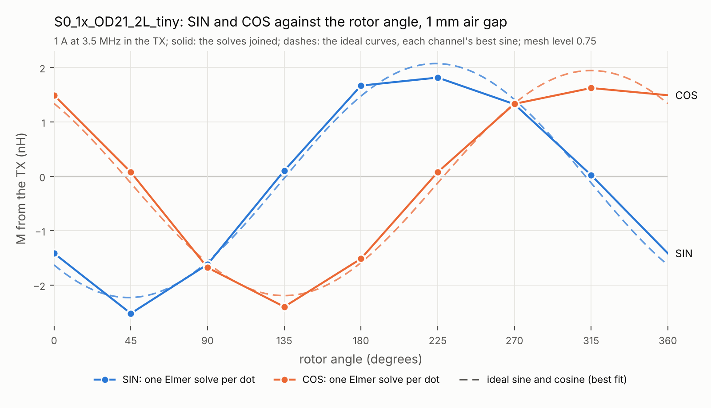

# S0_1x_OD21_2L_tiny: SIN and COS over the rotor's turn in Elmer

A coil set made with the [Sinusoidal Coil Generator](https://github.com/RolandThsive/Sinusoidal-Inductive-Encoders-Coil-Generator): 21 mm across, 2 copper layers, one electrical period per turn and a half-ring rotor. The TX carries 1 A at 3.5 MHz; the curves are the mutual inductance from the TX to SIN and to COS (1 nH is 22 mV of EMF). Each angle is one Elmer solve with its own mesh. This page is rewritten by `simulation.py` after every solve.

| Air gap | Angles solved | Amplitude SIN / COS | Angle error |
|---|---|---|---|
| 1 mm | 8 of 8 | 2.15 / 2.07 nH (47 / 45 mV) | 4.6° rms, 7.1° peak |

## 1 mm air gap

*Figure 1. SIN (blue) and COS (orange) at a 1 mm air gap: the mutual inductance from the TX against the rotor's angle, 8 of 8 angles solved. Each dot is one Elmer solve and the solid line joins them; the dashes are the ideal sine and cosine, each channel's best sine fit, which is what the angle error is measured against. SIN swings ±2.15 nH and COS ±2.07 nH, that is ±47 and ±45 mV of EMF.*

Best sine fit: SIN amplitude 2.151 nH, offset -0.077 nH, phase -133.8°; COS amplitude 2.069 nH, offset -0.124 nH, phase 135.0°. Angle error, with the offset and gain of each channel calibrated out (worked out as below): 4.6° rms and 7.1° at worst, in electrical degrees, the same as mechanical degrees here. SIN and COS are 91.2° apart, against 90° for perfect quadrature.

| Rotor | M SIN (nH) | M COS (nH) | Angle error | L TX (nH) | R TX (mΩ) | Iterations | Residual | Memory | Time |
|---|---|---|---|---|---|---|---|---|---|
| 0° | -1.4155 | 1.4914 | -7.07° | 103.084 | 358.78 | 1500 | 4.0e-04 | 11.4 GB | 25 min |
| 45° | -2.5211 | 0.0766 | -5.50° | 108.283 | 332.80 | 1500 | 2.8e-04 | 11.4 GB | 26 min |
| 90° | -1.6190 | -1.6767 | +0.69° | 107.701 | 333.28 | 1500 | 2.7e-04 | 11.5 GB | 24 min |
| 135° | 0.1041 | -2.3979 | +3.76° | 107.784 | 334.86 | 1500 | 2.7e-04 | 11.4 GB | 24 min |
| 180° | 1.6682 | -1.5147 | +4.73° | 106.140 | 329.85 | 1500 | 2.9e-04 | 11.3 GB | 25 min |
| 225° | 1.8161 | 0.0767 | +5.65° | 101.053 | 365.87 | 1500 | 4.8e-04 | 11.3 GB | 25 min |
| 270° | 1.3267 | 1.3324 | +1.52° | 101.022 | 326.93 | 1500 | 4.3e-04 | 11.3 GB | 25 min |
| 315° | 0.0230 | 1.6238 | -3.79° | 98.618 | 318.65 | 1500 | 4.7e-04 | 11.4 GB | 25 min |

8 of 8 solves stopped at the 1500-iteration cap, with the residual between 2.7e-04 and 4.8e-04 rather than the 1e-07 asked for. The TX is round, so turning the rotor should not change its inductance: its spread here, 98.6 to 108.3 nH, is a measure of what the solver leaves.

## Against the expectation

The generator estimates the TX at 132 nH with the rotor away and 109 nH with it (its drop with the rotor is an upper estimate). Elmer gives 98.6 to 108.3 nH with the rotor at 1 mm. The expected values are in [expected_results.json](expected_results.json).

## How the angle error is worked out

Each channel gets its best sine over the rotor's period, M = offset + amplitude × sin(θ + phase). Each channel's offset is taken out and it is divided by its amplitude, so both swing between −1 and +1, as a decoder chip's offset and gain calibration does. The angle is read back as atan2(SIN, COS); the error at each angle is that reading less the true angle, less the average of all of them, since a fixed offset only moves where zero is. The rms and the worst of them are the angle error. The fit uses the same points as the error, so it measures how far the solves are from a perfect sine and cosine pair. [`angle_error.py`](../Elmer%20Simulation/angle_error.py) does it.

## The boards

*Drawn by the generator. Red is the top layer, blue the bottom; the dots are vias. In Elmer, SIN is opened at (97.74, 102.26) and COS at (97.74, 97.74), the TX at its ends at (109.8, 100) (KiCad mm). The [README](../README.md) has the board and how it was made.*
