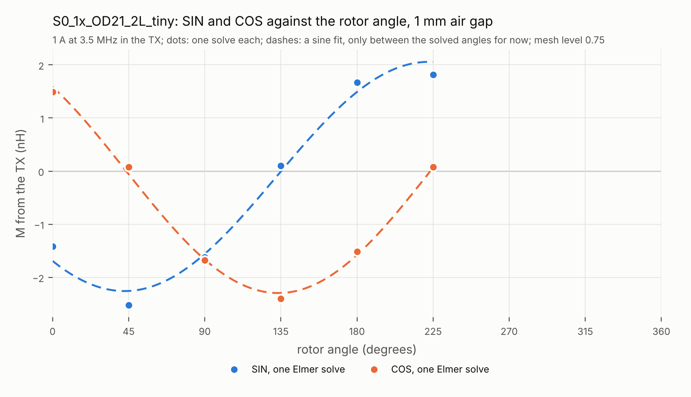
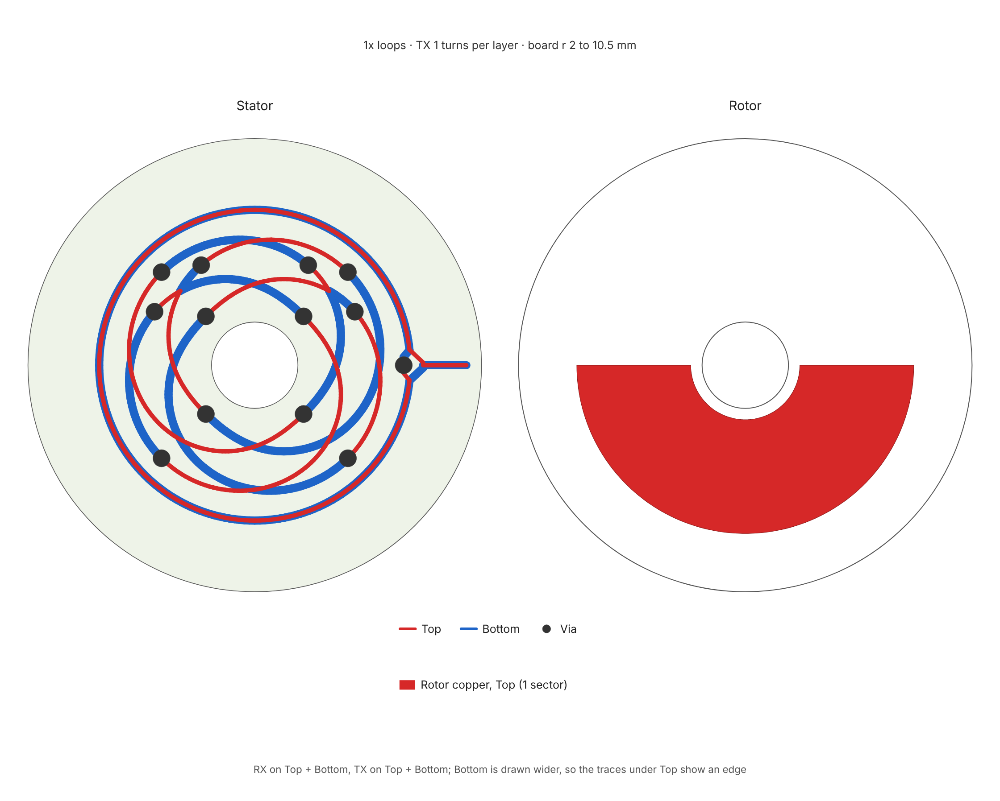

# S0_1x_OD21_2L_tiny: SIN and COS over the rotor's turn in Elmer

A coil set made with the [Sinusoidal Coil Generator](https://github.com/RolandThsive/Sinusoidal-Inductive-Encoders-Coil-Generator): 21 mm across, 2 copper layers, one electrical period per turn and a half-ring rotor. The TX carries 1 A at 3.5 MHz; the curves are the mutual inductance from the TX to SIN and to COS (1 nH is 22 mV of EMF). Each angle is one Elmer solve with its own mesh. This page is rewritten by `simulation.py` after every solve.

| Air gap | Angles solved | Amplitude SIN / COS | Angle error |
|---|---|---|---|
| 1 mm | 6 of 8 | 2.16 / 2.30 nH (47 / 51 mV) | 3.0° rms, 4.3° peak so far |

## 1 mm air gap

*Figure 1. SIN (blue) and COS (orange) at a 1 mm air gap: the mutual inductance from the TX against the rotor's angle, 6 of 8 angles solved. Each dot is one Elmer solve; the dashes are a sine fit, drawn only between the solved angles while few are in. SIN swings ±2.16 nH and COS ±2.30 nH, that is ±47 and ±51 mV of EMF.*

Best sine fit: SIN amplitude 2.158 nH, offset -0.100 nH, phase -132.5°; COS amplitude 2.299 nH, offset 0.004 nH, phase 136.5°. Angle error so far, with the offset and gain of each channel calibrated out: 3.0° rms and 4.3° at worst, in electrical degrees, the same as mechanical degrees here. SIN and COS are 91.0° apart, against 90° for perfect quadrature.

| Rotor | M SIN (nH) | M COS (nH) | L TX (nH) | R TX (mΩ) | Iterations | Residual | Memory | Time |
|---|---|---|---|---|---|---|---|---|
| 0° | -1.4155 | 1.4914 | 103.084 | 358.78 | 1500 | 4.0e-04 | 11.4 GB | 25 min |
| 45° | -2.5211 | 0.0766 | 108.283 | 332.80 | 1500 | 2.8e-04 | 11.4 GB | 26 min |
| 90° | -1.6190 | -1.6767 | 107.701 | 333.28 | 1500 | 2.7e-04 | 11.5 GB | 24 min |
| 135° | 0.1041 | -2.3979 | 107.784 | 334.86 | 1500 | 2.7e-04 | 11.4 GB | 24 min |
| 180° | 1.6682 | -1.5147 | 106.140 | 329.85 | 1500 | 2.9e-04 | 11.3 GB | 25 min |
| 225° | 1.8161 | 0.0767 | 101.053 | 365.87 | 1500 | 4.8e-04 | 11.3 GB | 25 min |

6 of 6 solves stopped at the 1500-iteration cap, with the residual between 2.7e-04 and 4.8e-04 rather than the 1e-07 asked for. The TX is round, so turning the rotor should not change its inductance: its spread here, 101.1 to 108.3 nH, is a measure of what the solver leaves.

## The boards

*Drawn by the generator. Red is the top layer, blue the bottom; the dots are vias. In Elmer, SIN is opened at (97.74, 102.26) and COS at (97.74, 97.74), the TX at its ends at (109.8, 100) (KiCad mm). The [README](README.md) has the board and how it was made.*
