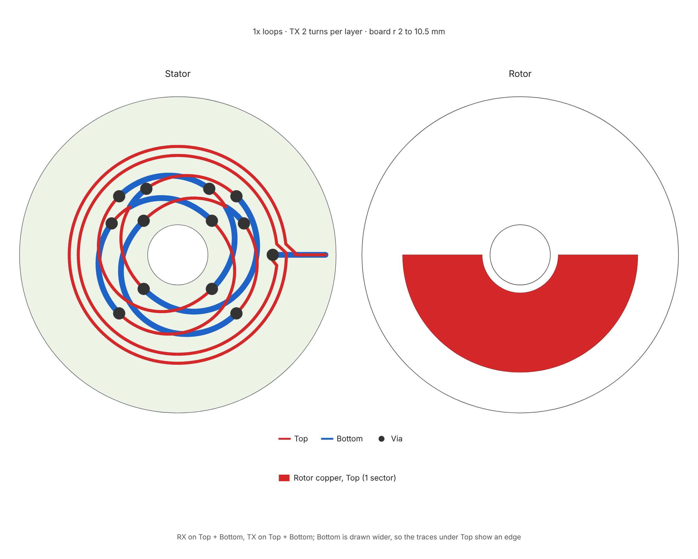
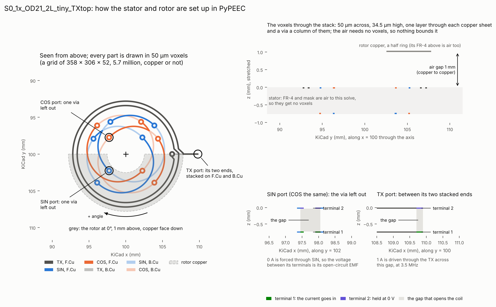
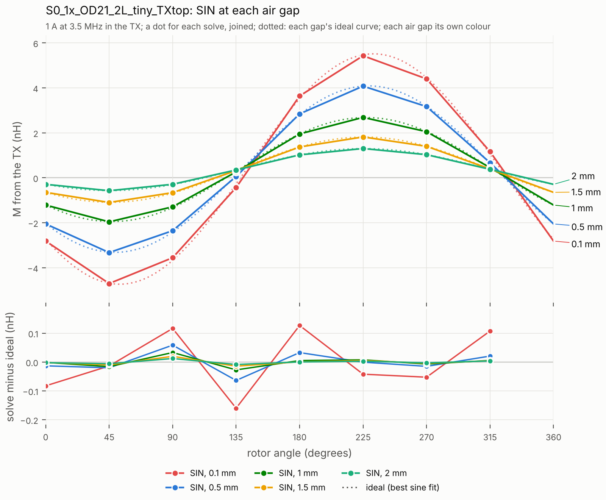

# S0_1x_OD21_2L_tiny_TXtop

A coil set from the [Sinusoidal Coil Generator](https://github.com/RolandThsive/Sinusoidal-Inductive-Encoders-Coil-Generator) (`Coil_2_10.5_1_1_2_Single_SteppedDiagonal`), set up for PyPEEC by [`../new_coil.py`](../new_coil.py). The steps that made it are in [S0's README](../S0_1x_OD21_2L_tiny/README.md#the-workflow-for-any-generated-coil).

**What differs from S0.** Only the TX, as Roland asked: two turns, both on the top layer (F.Cu, r = 6.6 and 7.2 mm), instead of S0's one turn on each layer. The parameter files differ from S0's in three values of `TX_Parameters.py`: `TX_TURNS = 2`, `TX_WIRING = "single"`, `TX_LAYER_A = 1`. A spiral of two turns needs its inner end brought back out, so a short tail runs under the turns on B.Cu to the terminal, where the two ends sit stacked as on S0. The generator keeps the board edge, so it narrows the RX band to make room for the second turn (r = 3.2 to 5.5 mm, against 3.2 to 6.1 on S0); the rotor is S0's, file for file.

## The board

Bore and outer radius 2 and 10.5 mm, 2 copper layers, board 0.8 mm, air gap 1 mm by default (any other with `--gap`). 1 electrical period per turn; the rotor has 1 sector and repeats itself every 360°.

*Drawn by the generator.*

*How the boards sit in PyPEEC, drawn by `rig_picture.py` from the voxels simulation.py solves: the rotor copper side down over the stator, every piece of copper in voxels of 50 µm across and about 35 µm high, each receiver opened at a left-out via (its voxels that border the gap are its two terminals, held at 0 A, so the voltage between them is the open-circuit EMF), and the TX opened between its two stacked ends, where 1 A is driven.*

| Coil | Net | Opened at (KiCad mm) | How |
|---|---|---|---|
| TX | `TX` | (109.8, 100), F.Cu and B.Cu | its two stacked ends |
| SIN | `2` | via at (97.737, 102.263) | the generator found no cut spot; the layer-change via farthest from the TX copper (3.40 mm), of those the farthest from the TX ends; the via is left out |
| COS | `1` | via at (97.737, 97.737) | the generator found no cut spot; the layer-change via farthest from the TX copper (3.40 mm), of those the farthest from the TX ends; the via is left out |

The generator's estimate for the TX: 0.13 µH with the rotor away and 0.11 µH with it, 0.23 Ω DC. Its warnings for this board:

* a via sits only 0.088 mm from other copper (wanted 0.2 mm); phase/node (0, 10)
* the tank's parallel resistance at the nominal air gap may be as low as 12 ohm (if the AC resistance is 2 x the DC value); the IPS2550 needs at least 250 ohm.  More TX turns, wider TX traces, thicker copper or a higher EXCITATION_FREQ_HZ raise it
* no spot on 2 within 30 deg of 0 deg, 4 mm from the other marks, has room for two vias (layers F.Cu, B.Cu); widen SILKSCREEN_SEARCH_SPAN_DEG, lower SILKSCREEN_BREAK_SEPARATION_MM, or cut the coil by hand
* no spot on 1 within 30 deg of 0 deg, 4 mm from the other marks, has room for two vias (layers F.Cu, B.Cu); widen SILKSCREEN_SEARCH_SPAN_DEG, lower SILKSCREEN_BREAK_SEPARATION_MM, or cut the coil by hand

## Results at each air gap

Every angle at every gap, one PyPEEC solve each: 8 angles at each of 5 gaps, and the rotor taken away once (with the 1 mm results). Each gap's curves, fits and angle error are in [`Results/SINCOS_Results.md`](Results/SINCOS_Results.md).

| Air gap | Amplitude SIN / COS | Angle error | Solves passing both checks | L TX over the turn |
|---|---|---|---|---|
| 2 mm | 0.93 / 0.94 nH (21 / 21 mV) | 0.4° rms, 0.7° peak | 8 of 8 | 128.6 to 128.8 nH |
| 1.5 mm | 1.45 / 1.45 nH (32 / 32 mV) | 0.4° rms, 0.8° peak | 8 of 8 | 126.9 to 127.2 nH |
| 1 mm | 2.31 / 2.32 nH (51 / 51 mV) | 0.5° rms, 0.9° peak | 8 of 8 | 122.6 to 123.2 nH |
| 0.5 mm | 3.70 / 3.71 nH (81 / 82 mV) | 0.8° rms, 1.2° peak | 8 of 8 | 114.8 to 116.0 nH |
| 0.1 mm | 5.12 / 5.13 nH (113 / 113 mV) | 1.6° rms, 1.9° peak | 8 of 8 | 101.6 to 104.0 nH |

*SIN at each air gap, one dot per solve; a ring would mark a solve that fails the two checks (none does). [`SINCOS_gaps_COS.webp`](Results/SINCOS_gaps_COS.webp) is the same for COS, and [`SINCOS_gaps.webp`](Results/SINCOS_gaps.webp) has both.*

Every solve passes both checks: the TX's L and R from its voltage agree with the L from the stored energy and the R from the losses within 0.001 %, where 1 % is allowed. At every gap SIN and COS are within 0.3 % of each other in amplitude and 89.7° to 90.3° apart. The signal is 5.12 nH for SIN at 0.1 mm and falls to 3.70, 2.31, 1.45 and 0.93 nH at 0.5, 1, 1.5 and 2 mm (113 down to 21 mV of EMF at 1 A). The angle error is 1.6° rms at 0.1 mm, 0.8° at 0.5 mm, 0.5° at 1 mm and 0.4° from 1.5 to 2 mm. At 0.1 mm it alternates in sign from one angle to the next: a ripple at four periods per electrical period, the fastest eight angles can show, from higher harmonics of the coupling, which fade with the gap faster than the sine. L TX moves by 2.4 nH at most over the turn and rises from 102.8 nH at 0.1 mm to 128.7 nH at 2 mm; with the rotor away it is 133.3 nH, where the generator estimated 106 nH with the rotor and 130 nH without.

Against the Elmer branch, which solves the same board from the same export ([`../Comparisons`](../Comparisons/)): SIN's amplitude differs by +1.3 %, -0.1 %, -1.4 %, -2.4 % and -3.2 % at 0.1, 0.5, 1, 1.5 and 2 mm, and the angle error is 1.6° against 1.5°, 0.8° against 0.7°, 0.5° against 0.4°, 0.4° against 0.4° and 0.4° against 0.4° rms. L TX is 10 to 12 % higher here than in Elmer at every gap; [S0](../S0_1x_OD21_2L_tiny/README.md#results-at-each-air-gap) checks its TX against a hand calculation, which sides with PyPEEC.

## The folder

| Folder | What is in it |
|---|---|
| [`Boards/`](Boards/) | straight from the generator: the stator and rotor boards, `Parameters.txt`, the pictures and the parameter files it was run with |
| [`3D_Geometry/`](3D_Geometry/) | KESE's export of the stator and rotor (STL solids, `materials.json`, STEP, KESE's report), written by the first run; `source.json` records the board's hash, so a changed board is exported again |
| [`PyPEEC Simulation/`](PyPEEC%20Simulation/) | `test_spec.json` (every board fact the simulation needs), `simulation.py`, `angle_error.py`, `make_charts.py`, `rig_picture.py` and `angle_setup.py` (S0's, unchanged), [`RotorStator_AngleSetup/`](PyPEEC%20Simulation/RotorStator_AngleSetup/) (the rotor over the stator at each angle), and the runs under `case/`, which git ignores |
| [`Results/`](Results/) | `expected_results.json` (the generator's estimates), [`SINCOS_Results.md`](Results/SINCOS_Results.md) with every gap on one page, the charts of every gap together (`SINCOS_gaps.webp`, and `_SIN` and `_COS` apart), and a folder for each air gap (`0d1mm_AirGap`, `0d5mm_AirGap`, `1mm_AirGap`, `1d5mm_AirGap`, `2mm_AirGap`, the point written as d) with the runs' `results_gap<gap>mm.json`, `.csv` and `.webp` |

Beside this README, `S0_1x_OD21_2L_tiny_TXtop_stator_and_rotor.webp` is the generator's picture of the boards and `S0_1x_OD21_2L_tiny_TXtop_pypeec_setup.webp` shows how they sit in PyPEEC.

## Running it

| Air gap | Grid (voxels of 50 µm) | dz | Memory a solve | Time a solve |
|---|---|---|---|---|
| 0.1 mm | 358 × 306 × 33 = 3.6 million | 26.9 µm | 1.2 to 1.3 GB | 3 to 4 min |
| 0.5 mm | 358 × 306 × 34 = 3.7 million | 38.2 µm | 1.2 to 1.3 GB | 2 to 3 min |
| 1 mm | 358 × 306 × 52 = 5.7 million | 34.5 µm | 1.7 to 1.8 GB | 3 to 4 min |
| 1.5 mm | 358 × 306 × 79 = 8.7 million | 29.0 µm | 2.5 to 2.6 GB | 6 to 8 min |
| 2 mm | 358 × 306 × 81 = 8.9 million | 34.5 µm | 2.5 to 2.6 GB | 5 to 6 min |

Each solve is PyPEEC's, on 4 cores, at PyPEEC's default tolerances: GMRES in 2 to 4 iterations. The grid grows taller with the gap, and the memory and time with it; a machine with 8 GB runs every gap. Voxels of 50 µm read M and L TX to about half a percent (see the [coils' README](../README.md)); `--voxel 0.035` tries smaller ones as a trial, kept in `case/`.

    cd "PyPEEC Simulation"
    python simulation.py                   # the rotor away, then 0, 45, 90, 135, 180, 225, 270, 315 degrees
    python simulation.py --gap 0.5         # the same at a 0.5 mm air gap
    python simulation.py --voxel 0.035     # smaller voxels, a trial kept in case/
    python simulation.py --plot            # redraw the table, the curves and SINCOS_Results.md
    python angle_error.py                  # print the angle error at each angle, and rewrite SINCOS_Results.md
    python make_charts.py                  # redraw every chart (WebP) and rewrite SINCOS_Results.md
    python rig_picture.py                  # redraw how the boards sit in PyPEEC, voxel by voxel
    python angle_setup.py                  # redraw the rotor at each angle

Use the Python of the branch's `.venv` (`bash bridge/setup_machine.sh` makes it). `SINCOS_Results.md` is rewritten after every solve: each gap's graph with a caption, the fit, the angle error at each angle and every solve. `--merge` adds the solves of the same gap from other machines' results files, which is how these were run.

## Licence

These boards are output of the Sinusoidal Coil Generator, for non-commercial use only. See [../LICENSE.md](../LICENSE.md); this branch's GPL-3.0 covers `simulation.py`, `angle_error.py`, `make_charts.py`, `rig_picture.py` and `angle_setup.py` only.
