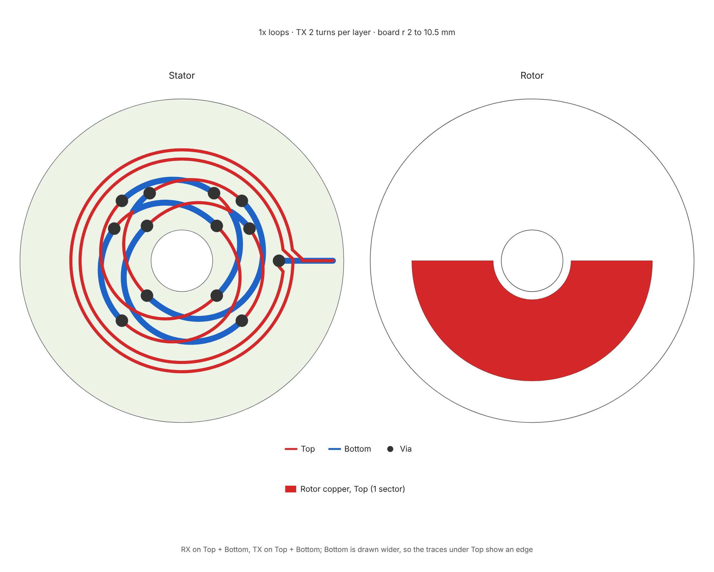
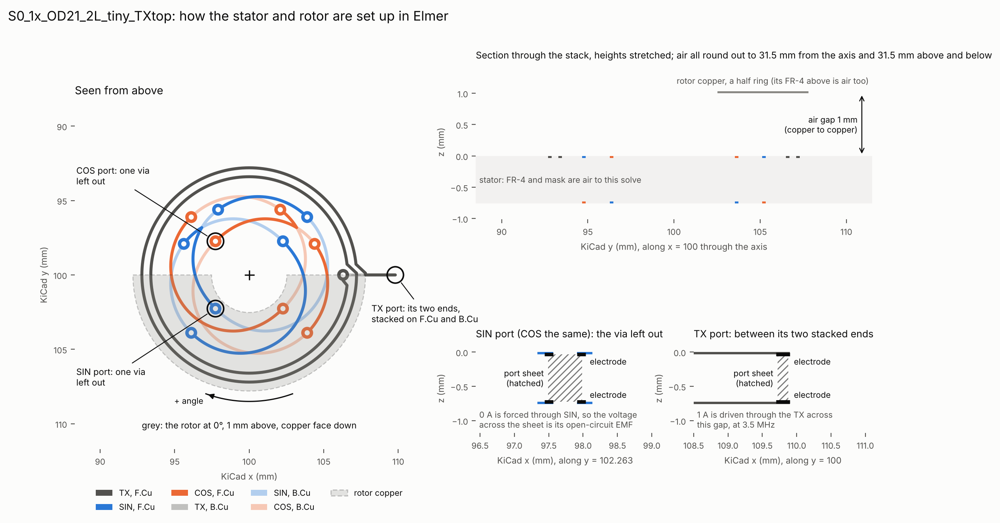

# S0_1x_OD21_2L_tiny_TXtop: SIN and COS over the rotor's turn in Elmer

A coil set made with the [Sinusoidal Coil Generator](https://github.com/RolandThsive/Sinusoidal-Inductive-Encoders-Coil-Generator): 21 mm across, 2 copper layers, one electrical period per turn and a half-ring rotor. The TX carries 1 A at 3.5 MHz; the curves are the mutual inductance from the TX to SIN and to COS (1 nH is 22 mV of EMF). Each angle is one Elmer solve with its own mesh, checked by working the TX's L and R out two ways: from its voltage, and from the field energy and the eddy power (the L and R checks in each table give how far apart they are; a solve is read when both are within 1 %). This page is rewritten by `simulation.py` after every solve.

| Air gap | Angles solved | Amplitude SIN / COS | Angle error |
|---|---|---|---|
| 2 mm | 8 of 8 | 0.96 / 0.96 nH (21 / 21 mV) | 0.4° rms, 0.7° peak |
| 1.5 mm | 8 of 8 | 1.49 / 1.49 nH (33 / 33 mV) | 0.4° rms, 0.5° peak |
| 1 mm | 8 of 8 | 2.35 / 2.35 nH (52 / 52 mV) | 0.4° rms, 0.6° peak |
| 0.5 mm | 8 of 8 | 3.71 / 3.71 nH (82 / 82 mV) | 0.7° rms, 0.9° peak |
| 0.1 mm | 8 of 8 | 5.06 / 5.06 nH (111 / 111 mV) | 1.5° rms, 1.8° peak |

## 2 mm air gap

*Figure 1. SIN (blue) and COS (orange) at a 2 mm air gap: the mutual inductance from the TX against the rotor's angle, 8 of 8 angles solved. Each dot is one Elmer solve and the solid line joins them; the dotted lines are the ideal sine and cosine, each channel's best sine fit, which is what the angle error is measured against. SIN swings ±0.96 nH and COS ±0.96 nH, that is ±21 and ±21 mV of EMF.*

Best sine fit: SIN amplitude 0.965 nH, offset 0.120 nH, phase -135.5°; COS amplitude 0.963 nH, offset -0.006 nH, phase 134.7°. Angle error, with the offset and gain of each channel calibrated out (worked out as below): 0.4° rms and 0.7° at worst, in electrical degrees, the same as mechanical degrees here. SIN and COS are 89.8° apart, against 90° for perfect quadrature.

| Rotor | M SIN (nH) | M COS (nH) | Angle error | L TX (nH) | R TX (mΩ) | Solve | L and R checks | Memory | Time |
|---|---|---|---|---|---|---|---|---|---|
| 0° | -0.5620 | 0.6677 | +0.65° | 117.003 | 260.61 | direct | L -0.002 %, R +0.000 % | 13.3 GB | 4 min |
| 45° | -0.8495 | 0.0061 | -0.35° | 117.084 | 260.60 | direct | L -0.002 %, R +0.000 % | 13.3 GB | 4 min |
| 90° | -0.5562 | -0.6811 | +0.38° | 117.091 | 260.63 | direct | L -0.002 %, R +0.000 % | 13.3 GB | 4 min |
| 135° | 0.1043 | -0.9750 | -0.56° | 117.042 | 260.45 | direct | L -0.001 %, R +0.000 % | 13.2 GB | 4 min |
| 180° | 0.7979 | -0.6866 | +0.19° | 117.082 | 260.46 | direct | L -0.004 %, R +0.000 % | 13.2 GB | 4 min |
| 225° | 1.0844 | -0.0137 | -0.09° | 117.096 | 260.54 | direct | L -0.002 %, R +0.000 % | 13.3 GB | 4 min |
| 270° | 0.8069 | 0.6765 | +0.25° | 116.999 | 260.46 | direct | L -0.002 %, R +0.000 % | 13.2 GB | 4 min |
| 315° | 0.1342 | 0.9581 | -0.48° | 117.079 | 260.62 | direct | L -0.003 %, R +0.000 % | 13.3 GB | 4 min |

## 1.5 mm air gap

*Figure 2. SIN (blue) and COS (orange) at a 1.5 mm air gap: the mutual inductance from the TX against the rotor's angle, 8 of 8 angles solved. Each dot is one Elmer solve and the solid line joins them; the dotted lines are the ideal sine and cosine, each channel's best sine fit, which is what the angle error is measured against. SIN swings ±1.49 nH and COS ±1.49 nH, that is ±33 and ±33 mV of EMF.*

Best sine fit: SIN amplitude 1.486 nH, offset 0.115 nH, phase -135.9°; COS amplitude 1.485 nH, offset -0.003 nH, phase 134.3°. Angle error, with the offset and gain of each channel calibrated out (worked out as below): 0.4° rms and 0.5° at worst, in electrical degrees, the same as mechanical degrees here. SIN and COS are 89.8° apart, against 90° for perfect quadrature.

| Rotor | M SIN (nH) | M COS (nH) | Angle error | L TX (nH) | R TX (mΩ) | Solve | L and R checks | Memory | Time |
|---|---|---|---|---|---|---|---|---|---|
| 0° | -0.9246 | 1.0474 | +0.47° | 114.953 | 262.46 | direct | L -0.002 %, R +0.000 % | 13.3 GB | 3 min |
| 45° | -1.3822 | 0.0260 | -0.32° | 115.054 | 262.42 | direct | L -0.002 %, R +0.000 % | 13.3 GB | 4 min |
| 90° | -0.9341 | -1.0381 | +0.42° | 115.058 | 262.40 | direct | L -0.003 %, R +0.000 % | 13.3 GB | 3 min |
| 135° | 0.0821 | -1.4988 | -0.47° | 115.022 | 262.18 | direct | L -0.002 %, R +0.000 % | 13.3 GB | 3 min |
| 180° | 1.1515 | -1.0565 | +0.30° | 115.078 | 262.14 | direct | L -0.002 %, R +0.000 % | 13.3 GB | 3 min |
| 225° | 1.6012 | -0.0281 | -0.18° | 115.076 | 262.25 | direct | L -0.002 %, R +0.000 % | 13.3 GB | 3 min |
| 270° | 1.1765 | 1.0399 | +0.29° | 114.972 | 262.19 | direct | L -0.001 %, R +0.000 % | 13.3 GB | 3 min |
| 315° | 0.1488 | 1.4845 | -0.52° | 115.050 | 262.41 | direct | L -0.003 %, R +0.000 % | 13.2 GB | 3 min |

## 1 mm air gap

*Figure 3. SIN (blue) and COS (orange) at a 1 mm air gap: the mutual inductance from the TX against the rotor's angle, 8 of 8 angles solved. Each dot is one Elmer solve and the solid line joins them; the dotted lines are the ideal sine and cosine, each channel's best sine fit, which is what the angle error is measured against. SIN swings ±2.35 nH and COS ±2.35 nH, that is ±52 and ±52 mV of EMF.*

Best sine fit: SIN amplitude 2.346 nH, offset 0.113 nH, phase -136.8°; COS amplitude 2.346 nH, offset 0.008 nH, phase 133.3°. Angle error, with the offset and gain of each channel calibrated out (worked out as below): 0.4° rms and 0.6° at worst, in electrical degrees, the same as mechanical degrees here. SIN and COS are 89.9° apart, against 90° for perfect quadrature.

| Rotor | M SIN (nH) | M COS (nH) | Angle error | L TX (nH) | R TX (mΩ) | Solve | L and R checks | Memory | Time |
|---|---|---|---|---|---|---|---|---|---|
| 0° | -1.4968 | 1.6988 | +0.37° | 111.499 | 265.39 | direct | L -0.002 %, R +0.000 % | 13.3 GB | 3 min |
| 45° | -2.2533 | 0.0962 | -0.36° | 111.627 | 265.31 | direct | L -0.001 %, R +0.000 % | 13.3 GB | 3 min |
| 90° | -1.5695 | -1.6005 | +0.48° | 111.627 | 265.23 | direct | L -0.001 %, R +0.000 % | 13.3 GB | 3 min |
| 135° | 0.0223 | -2.3553 | -0.43° | 111.608 | 264.97 | direct | L -0.001 %, R +0.000 % | 13.3 GB | 3 min |
| 180° | 1.7232 | -1.6783 | +0.44° | 111.694 | 264.83 | direct | L -0.002 %, R +0.000 % | 13.3 GB | 3 min |
| 225° | 2.4578 | -0.0755 | -0.29° | 111.668 | 264.99 | direct | L -0.001 %, R +0.000 % | 13.3 GB | 3 min |
| 270° | 1.8116 | 1.6265 | +0.37° | 111.555 | 264.94 | direct | L -0.001 %, R +0.000 % | 13.3 GB | 3 min |
| 315° | 0.2091 | 2.3560 | -0.58° | 111.630 | 265.24 | direct | L -0.001 %, R +0.000 % | 13.3 GB | 3 min |

## 0.5 mm air gap

*Figure 4. SIN (blue) and COS (orange) at a 0.5 mm air gap: the mutual inductance from the TX against the rotor's angle, 8 of 8 angles solved. Each dot is one Elmer solve and the solid line joins them; the dotted lines are the ideal sine and cosine, each channel's best sine fit, which is what the angle error is measured against. SIN swings ±3.71 nH and COS ±3.71 nH, that is ±82 and ±82 mV of EMF.*

Best sine fit: SIN amplitude 3.708 nH, offset 0.131 nH, phase -138.9°; COS amplitude 3.709 nH, offset 0.047 nH, phase 131.2°. Angle error, with the offset and gain of each channel calibrated out (worked out as below): 0.7° rms and 0.9° at worst, in electrical degrees, the same as mechanical degrees here. SIN and COS are 89.9° apart, against 90° for perfect quadrature.

| Rotor | M SIN (nH) | M COS (nH) | Angle error | L TX (nH) | R TX (mΩ) | Solve | L and R checks | Memory | Time |
|---|---|---|---|---|---|---|---|---|---|
| 0° | -2.3231 | 2.8108 | +0.51° | 104.833 | 271.44 | direct | L -0.002 %, R +0.000 % | 13.3 GB | 2 min |
| 45° | -3.6020 | 0.3415 | -0.62° | 104.985 | 271.42 | direct | L -0.001 %, R +0.000 % | 13.3 GB | 2 min |
| 90° | -2.6143 | -2.4109 | +0.72° | 104.986 | 271.20 | direct | L -0.002 %, R +0.000 % | 13.3 GB | 2 min |
| 135° | -0.1623 | -3.6817 | -0.61° | 104.979 | 270.99 | direct | L -0.002 %, R +0.000 % | 13.3 GB | 2 min |
| 180° | 2.5944 | -2.6994 | +0.78° | 105.124 | 270.67 | direct | L -0.001 %, R +0.000 % | 13.3 GB | 2 min |
| 225° | 3.8182 | -0.2395 | -0.56° | 105.069 | 270.88 | direct | L -0.001 %, R +0.000 % | 13.3 GB | 2 min |
| 270° | 2.8990 | 2.5197 | +0.64° | 104.949 | 270.78 | direct | L -0.001 %, R +0.000 % | 13.3 GB | 2 min |
| 315° | 0.4377 | 3.7393 | -0.86° | 105.020 | 271.22 | direct | L -0.001 %, R +0.000 % | 13.3 GB | 2 min |

## 0.1 mm air gap

*Figure 5. SIN (blue) and COS (orange) at a 0.1 mm air gap: the mutual inductance from the TX against the rotor's angle, 8 of 8 angles solved. Each dot is one Elmer solve and the solid line joins them; the dotted lines are the ideal sine and cosine, each channel's best sine fit, which is what the angle error is measured against. SIN swings ±5.06 nH and COS ±5.06 nH, that is ±111 and ±111 mV of EMF.*

Best sine fit: SIN amplitude 5.060 nH, offset 0.187 nH, phase -142.5°; COS amplitude 5.060 nH, offset 0.123 nH, phase 127.6°. Angle error, with the offset and gain of each channel calibrated out (worked out as below): 1.5° rms and 1.8° at worst, in electrical degrees, the same as mechanical degrees here. SIN and COS are 89.9° apart, against 90° for perfect quadrature.

| Rotor | M SIN (nH) | M COS (nH) | Angle error | L TX (nH) | R TX (mΩ) | Solve | L and R checks | Memory | Time |
|---|---|---|---|---|---|---|---|---|---|
| away | 0.1219 | 0.0008 |  | 121.159 | 259.40 | direct | L -0.003 %, R +0.000 % | 13.3 GB | 2 min |
| 0° | -2.9773 | 4.0551 | +1.23° | 91.970 | 290.59 | direct | L -0.003 %, R +0.000 % | 13.3 GB | 2 min |
| 45° | -4.8719 | 0.9111 | -1.45° | 92.053 | 291.28 | direct | L -0.004 %, R +0.000 % | 13.3 GB | 2 min |
| 90° | -3.7156 | -3.0524 | +1.54° | 92.117 | 290.40 | direct | L -0.002 %, R +0.000 % | 13.3 GB | 2 min |
| 135° | -0.5943 | -4.9310 | -1.38° | 92.058 | 290.80 | direct | L -0.002 %, R +0.000 % | 13.3 GB | 2 min |
| 180° | 3.3792 | -3.7740 | +1.74° | 92.313 | 289.99 | direct | L -0.001 %, R +0.000 % | 13.3 GB | 2 min |
| 225° | 5.1589 | -0.6506 | -1.43° | 92.241 | 290.48 | direct | L -0.002 %, R +0.000 % | 13.3 GB | 2 min |
| 270° | 4.1228 | 3.3231 | +1.53° | 92.160 | 289.80 | direct | L -0.002 %, R +0.000 % | 13.2 GB | 2 min |
| 315° | 0.9923 | 5.0991 | -1.78° | 92.183 | 290.83 | direct | L -0.002 %, R +0.000 % | 13.3 GB | 2 min |

## The air gaps together

*Figure 6. Every air gap on one chart, the 0.1 mm gap in full colour, the solves of each joined by a solid line, and each gap's ideal sine and cosine dotted. Going from 2 to 0.1 mm makes SIN 5.24 times and COS 5.26 times larger.*

## Against the expectation

The generator estimates the TX at 130 nH with the rotor away and 106 nH with it (its drop with the rotor is an upper estimate). Elmer gives 121.2 nH with the rotor away, and 117.0 to 117.1 nH with the rotor at 2 mm, and 115.0 to 115.1 nH with the rotor at 1.5 mm, and 111.5 to 111.7 nH with the rotor at 1 mm, and 104.8 to 105.1 nH with the rotor at 0.5 mm, and 92.0 to 92.3 nH with the rotor at 0.1 mm. The expected values are in [expected_results.json](expected_results.json).

## How the angle error is worked out

Each channel gets its best sine over the rotor's period, M = offset + amplitude × sin(θ + phase). Each channel's offset is taken out and it is divided by its amplitude, so both swing between −1 and +1, as a decoder chip's offset and gain calibration does. The angle is read back as atan2(SIN, COS); the error at each angle is that reading less the true angle, less the average of all of them, since a fixed offset only moves where zero is. The rms and the worst of them are the angle error. The fit uses the same points as the error, so it measures how far the solves are from a perfect sine and cosine pair. [`angle_error.py`](../Elmer%20Simulation/angle_error.py) does it.

## The boards

*Drawn by the generator. Red is the top layer, blue the bottom; the dots are vias. In Elmer, SIN is opened at (97.74, 102.26) and COS at (97.74, 97.74), the TX at its ends at (109.8, 100) (KiCad mm). The [README](../README.md) has the board and how it was made.*

*How the boards are set up in Elmer, drawn by [`rig_picture.py`](../Elmer%20Simulation/rig_picture.py) from the geometry the mesh is built from: the rotor copper side down over the stator, each receiver opened at a left-out via (its two pads and the gap between them are the terminal, held at 0 A, so the voltage across it is the open-circuit EMF), and the TX opened between its two stacked ends, where 1 A is driven.*
