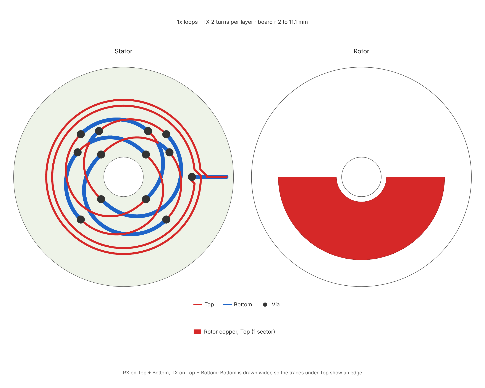
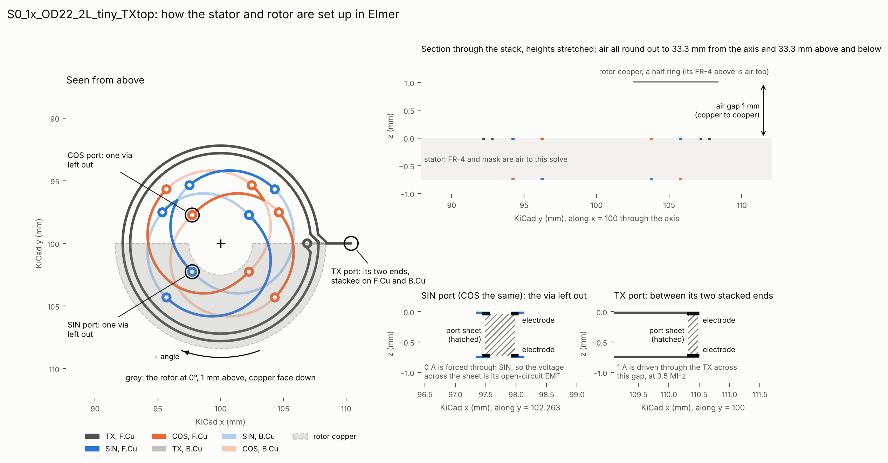
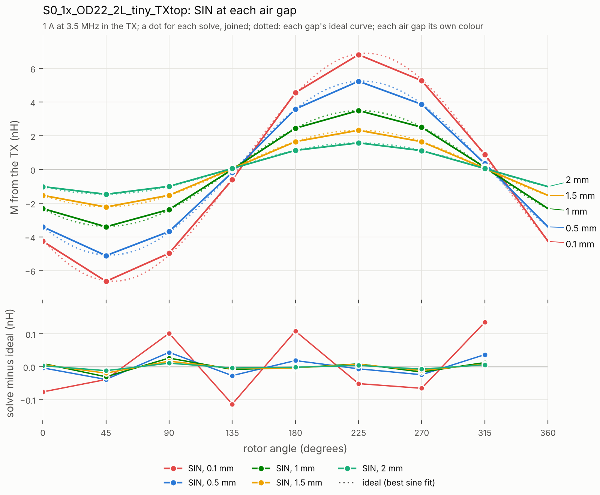

# S0_1x_OD22_2L_tiny_TXtop

A coil set from the [Sinusoidal Coil Generator](https://github.com/RolandThsive/Sinusoidal-Inductive-Encoders-Coil-Generator) (`Coil_2_11.1_1_1_2_Single_SteppedDiagonal`), set up for Elmer by [`../new_coil.py`](../new_coil.py). The steps that made it are in [S0's README](../S0_1x_OD21_2L_tiny/README.md#the-workflow-for-any-generated-coil).

**What differs from S0.** The TX, as Roland asked: two turns, both on the top layer (F.Cu, r = 7.2 and 7.8 mm), instead of S0's one turn on each layer. S0's RX coils are kept exactly (band r = 3.2 to 6.1 mm), so the board grows to make room for the second turn: 22.2 mm across instead of 21, and the generator's rotor, fitted to the stator, now reaches r = 8.4 mm instead of 7.8. The parameter files differ from S0's in `TX_Parameters.py` (`TX_TURNS = 2`, `TX_WIRING = "single"`, `TX_LAYER_A = 1`), `RX_Parameters.py` (`INSIDE_RADIUS_MM = 3.2`, `OUTSIDE_RADIUS_MM = 6.1`: S0's band, fixed) and `Board_Parameters.py` (`OUTER_EDGE_RADIUS_MM = None`: the edge fitted to the TX). A spiral of two turns needs its inner end brought back out, so a short tail runs under the turns on B.Cu to the terminal, where the two ends sit stacked as on S0.

## The board

Bore and outer radius 2 and 11.1 mm, 2 copper layers, board 0.8 mm, air gap 1 mm by default (any other with `--gap`). 1 electrical period per turn; the rotor has 1 sector and repeats itself every 360°.

*Drawn by the generator.*

*How the boards sit in Elmer, drawn by `rig_picture.py` from the geometry the mesh is built from: the rotor copper side down over the stator, each receiver opened at a left-out via (0 A, so the voltage across it is the open-circuit EMF), and the TX opened between its two stacked ends, where 1 A is driven.*

| Coil | Net | Opened at (KiCad mm) | How |
|---|---|---|---|
| TX | `TX` | (110.4, 100), F.Cu and B.Cu | its two stacked ends |
| SIN | `2` | via at (97.737, 102.263) | the generator found no cut spot; the layer-change via farthest from the TX copper (4.00 mm), of those the farthest from the TX ends; the via is left out |
| COS | `1` | via at (97.737, 97.737) | the generator found no cut spot; the layer-change via farthest from the TX copper (4.00 mm), of those the farthest from the TX ends; the via is left out |

The generator's estimate for the TX: 0.14 µH with the rotor away and 0.12 µH with it, 0.25 Ω DC. Its warnings for this board:

* the tank's parallel resistance at the nominal air gap may be as low as 13 ohm (if the AC resistance is 2 x the DC value); the IPS2550 needs at least 250 ohm.  More TX turns, wider TX traces, thicker copper or a higher EXCITATION_FREQ_HZ raise it
* no spot on 2 within 30 deg of 0 deg, 4 mm from the other marks, has room for two vias (layers F.Cu, B.Cu); widen SILKSCREEN_SEARCH_SPAN_DEG, lower SILKSCREEN_BREAK_SEPARATION_MM, or cut the coil by hand
* no spot on 1 within 30 deg of 0 deg, 4 mm from the other marks, has room for two vias (layers F.Cu, B.Cu); widen SILKSCREEN_SEARCH_SPAN_DEG, lower SILKSCREEN_BREAK_SEPARATION_MM, or cut the coil by hand

## Results at each air gap

Every angle at every gap, one Elmer solve each: 8 angles at each of 5 gaps, and the rotor taken away once (with the 0.1 mm results). Each gap's curves, fits and angle error are in [`Results/SINCOS_Results.md`](Results/SINCOS_Results.md).

| Air gap | Amplitude SIN / COS | Angle error | Solves passing both checks | L TX over the turn |
|---|---|---|---|---|
| 2 mm | 1.44 / 1.44 nH (32 / 32 mV) | 0.3° rms, 0.6° peak | 8 of 8 | 129.1 to 129.2 nH |
| 1.5 mm | 2.15 / 2.15 nH (47 / 47 mV) | 0.2° rms, 0.5° peak | 8 of 8 | 126.6 to 126.8 nH |
| 1 mm | 3.26 / 3.26 nH (72 / 72 mV) | 0.2° rms, 0.4° peak | 8 of 8 | 122.6 to 122.8 nH |
| 0.5 mm | 4.92 / 4.92 nH (108 / 108 mV) | 0.4° rms, 0.5° peak | 8 of 8 | 115.1 to 115.3 nH |
| 0.1 mm | 6.47 / 6.47 nH (142 / 142 mV) | 1.1° rms, 1.3° peak | 8 of 8 | 100.7 to 101.1 nH |

*SIN at each air gap, one dot per solve; a ring would mark a solve that fails the two checks (none does). [`SINCOS_gaps_COS.webp`](Results/SINCOS_gaps_COS.webp) is the same for COS, and [`SINCOS_gaps.webp`](Results/SINCOS_gaps.webp) has both.*

Each solve is direct (MUMPS), and every one passes both checks: the TX's L and R from its voltage agree with the L from the field energy and the R from the eddy power within 0.004 %, where 1 % is allowed. At every gap the curves are close to a sine and cosine, with SIN and COS within 0.2 % of each other in amplitude. The angle error is 0.2° to 0.4° rms from 0.5 to 2 mm and 1.1° at 0.1 mm, where it alternates in sign from one angle to the next: a ripple at four periods per turn, the fastest eight angles can show, which third or fifth harmonics of the coupling would give, and those fade faster with the gap than the sine. The signal is 6.47 nH for SIN at 0.1 mm and falls to 4.92, 3.26, 2.15 and 1.44 nH at 0.5, 1, 1.5 and 2 mm (142 down to 32 mV of EMF at 1 A). L TX moves by 0.4 nH at most over the turn and rises from 100.9 nH at 0.1 mm to 129.1 nH at 2 mm; with the rotor away it is 134.6 nH, where the generator estimated 116 nH with the rotor and 144 nH without.

## The folder

| Folder | What is in it |
|---|---|
| [`Boards/`](Boards/) | straight from the generator: the stator and rotor boards, `Parameters.txt`, the pictures and the parameter files it was run with |
| [`3D_Geometry/`](3D_Geometry/) | KESE's export of the stator and rotor (STL solids, `materials.json`, STEP, KESE's report), written by the first run; `source.json` records the board's hash, so a changed board is exported again |
| [`Elmer Simulation/`](Elmer%20Simulation/) | `test_spec.json` (every board fact the simulation needs), `simulation.py`, `angle_error.py`, `make_charts.py`, `rig_picture.py` and `angle_setup.py` (S0's, unchanged), [`RotorStator_AngleSetup/`](Elmer%20Simulation/RotorStator_AngleSetup/) (the rotor over the stator at each angle), and the runs under `case/`, which git ignores |
| [`Results/`](Results/) | `expected_results.json` (the generator's estimates), [`SINCOS_Results.md`](Results/SINCOS_Results.md) with every gap on one page, the charts of every gap together (`SINCOS_gaps.webp`, and `_SIN` and `_COS` apart), and a folder for each air gap (`0d1mm_AirGap`, `0d5mm_AirGap`, `1mm_AirGap`, `1d5mm_AirGap`, `2mm_AirGap`, the point written as d) with the runs' `results_gap<gap>mm.json`, `.csv` and `.webp` |

Beside this README, `S0_1x_OD22_2L_tiny_TXtop_stator_and_rotor.webp` is the generator's picture of the boards and `S0_1x_OD22_2L_tiny_TXtop_elmer_setup.webp` shows how they sit in Elmer.

## Running it

| Air gap | Mesh level | Nodes | Layers through the gap | Time a solve |
|---|---|---|---|---|
| 0.1 mm | 0.25 | 88,587 to 89,238 | 10 | 2 to 3 min |
| 0.5 mm | 0.25 | 96,335 to 97,039 | 11 | 2 to 3 min |
| 1 mm | 0.25 | 104,083 to 104,840 | 12 | 3 min |
| 1.5 mm | 0.25 | 111,831 to 112,643 | 13 | 4 min |
| 2 mm | 0.25 | 119,579 to 120,446 | 14 | 5 to 6 min |

Each solve is direct (MUMPS) and needs more than 13 GB: every one here held 13.3 GB in memory and put the rest in a 12 GB swap file, so on a 16 GB machine add one first (on Linux, `sudo fallocate -l 12G /swapfile && sudo chmod 600 /swapfile && sudo mkswap /swapfile && sudo swapon /swapfile`). Level 0.25 reads M and the angle to a few tenths of a percent and of a degree; L TX reads about 1 % low against level 0.4. `--level` above 0.25 makes the mesh finer at more memory, and `--solver iterative` (GCR) needs far less memory, about 57 kB a node, but on this board at 3.5 MHz it converges too slowly to read M.

    cd "Elmer Simulation"
    python simulation.py                   # the rotor away, then 0, 45, 90, 135, 180, 225, 270, 315 degrees
    python simulation.py --gap 0.5         # the same at a 0.5 mm air gap
    python simulation.py --level 0.4       # a finer mesh, at more memory
    python simulation.py --plot            # redraw the table, the curves and SINCOS_Results.md
    python angle_error.py                  # print the angle error at each angle, and rewrite SINCOS_Results.md
    python make_charts.py                  # redraw every chart (WebP) and rewrite SINCOS_Results.md
    python rig_picture.py                  # redraw how the boards sit in Elmer
    python angle_setup.py                  # redraw the rotor at each angle

`SINCOS_Results.md` is rewritten after every solve: each gap's graph with a caption, the fit, the angle error at each angle and every solve.

## Licence

These boards are output of the Sinusoidal Coil Generator, for non-commercial use only. See [../LICENSE.md](../LICENSE.md); this branch's GPL-3.0 covers `simulation.py`, `angle_error.py`, `make_charts.py`, `rig_picture.py` and `angle_setup.py` only.
