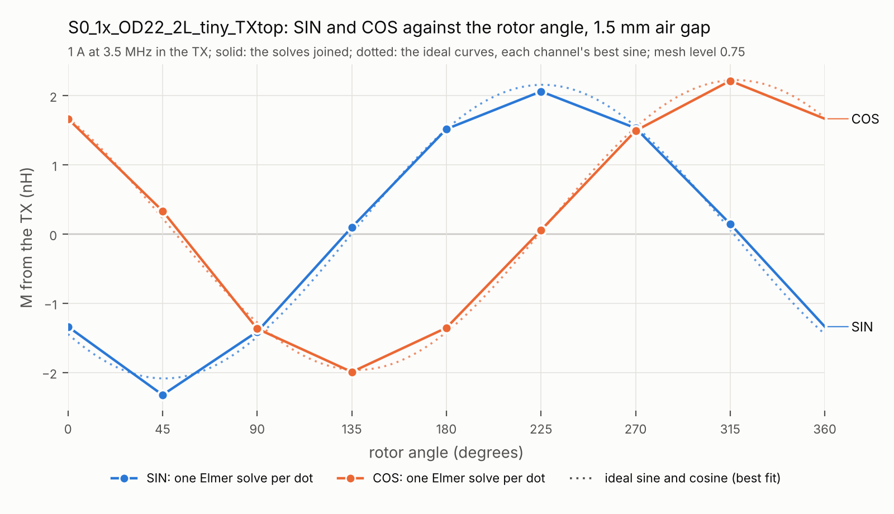

# S0_1x_OD22_2L_tiny_TXtop: SIN and COS over the rotor's turn in Elmer

A coil set made with the [Sinusoidal Coil Generator](https://github.com/RolandThsive/Sinusoidal-Inductive-Encoders-Coil-Generator): 22.2 mm across, 2 copper layers, one electrical period per turn and a half-ring rotor. The TX carries 1 A at 3.5 MHz; the curves are the mutual inductance from the TX to SIN and to COS (1 nH is 22 mV of EMF). Each angle is one Elmer solve with its own mesh. This page is rewritten by `simulation.py` after every solve.

| Air gap | Angles solved | Amplitude SIN / COS | Angle error |
|---|---|---|---|
| 1.5 mm | 8 of 8 | 2.12 / 2.09 nH (47 / 46 mV) | 2.2° rms, 3.3° peak |
| 1 mm | 8 of 8 | 3.25 / 3.14 nH (72 / 69 mV) | 3.0° rms, 4.7° peak |
| 0.5 mm | 8 of 8 | 4.62 / 4.59 nH (102 / 101 mV) | 2.3° rms, 4.6° peak |
| 0.1 mm | 8 of 8 | 3.82 / 6.46 nH (84 / 142 mV) | 58.5° rms, 159.3° peak |

## 1.5 mm air gap

*Figure 1. SIN (blue) and COS (orange) at a 1.5 mm air gap: the mutual inductance from the TX against the rotor's angle, 8 of 8 angles solved. Each dot is one Elmer solve and the solid line joins them; the dotted lines are the ideal sine and cosine, each channel's best sine fit, which is what the angle error is measured against. SIN swings ±2.12 nH and COS ±2.09 nH, that is ±47 and ±46 mV of EMF.*

Best sine fit: SIN amplitude 2.121 nH, offset 0.036 nH, phase -135.7°; COS amplitude 2.094 nH, offset 0.132 nH, phase 132.3°. Angle error, with the offset and gain of each channel calibrated out (worked out as below): 2.2° rms and 3.3° at worst, in electrical degrees, the same as mechanical degrees here. SIN and COS are 91.9° apart, against 90° for perfect quadrature.

| Rotor | M SIN (nH) | M COS (nH) | Angle error | L TX (nH) | R TX (mΩ) | Iterations | Residual | Memory | Time |
|---|---|---|---|---|---|---|---|---|---|
| 0° | -1.3373 | 1.6664 | -1.88° | 122.482 | 322.68 | 1500 | 2.7e-04 | 13.3 GB | 27 min |
| 45° | -2.3239 | 0.3345 | -3.30° | 125.382 | 304.39 | 1500 | 3.3e-04 | 13.3 GB | 26 min |
| 90° | -1.4103 | -1.3670 | +3.07° | 124.114 | 326.04 | 1500 | 2.2e-04 | 13.3 GB | 26 min |
| 135° | 0.0985 | -1.9923 | +3.34° | 123.918 | 332.07 | 1500 | 2.0e-04 | 13.3 GB | 25 min |
| 180° | 1.5177 | -1.3538 | +1.23° | 123.741 | 330.76 | 1500 | 1.9e-04 | 13.3 GB | 26 min |
| 225° | 2.0615 | 0.0571 | -0.46° | 122.386 | 330.74 | 1500 | 2.2e-04 | 13.3 GB | 27 min |
| 270° | 1.5315 | 1.4934 | -0.64° | 122.661 | 321.96 | 1500 | 2.4e-04 | 13.3 GB | 29 min |
| 315° | 0.1475 | 2.2155 | -1.36° | 122.436 | 317.61 | 1500 | 2.7e-04 | 13.3 GB | 25 min |

8 of 8 solves stopped at the 1500-iteration cap, with the residual between 1.9e-04 and 3.3e-04 rather than the 1e-07 asked for. The TX is round, so turning the rotor should not change its inductance: its spread here, 122.4 to 125.4 nH, is a measure of what the solver leaves.

## 1 mm air gap

*Figure 2. SIN (blue) and COS (orange) at a 1 mm air gap: the mutual inductance from the TX against the rotor's angle, 8 of 8 angles solved. Each dot is one Elmer solve and the solid line joins them; the dotted lines are the ideal sine and cosine, each channel's best sine fit, which is what the angle error is measured against. SIN swings ±3.25 nH and COS ±3.14 nH, that is ±72 and ±69 mV of EMF.*

Best sine fit: SIN amplitude 3.252 nH, offset -0.038 nH, phase -136.2°; COS amplitude 3.141 nH, offset 0.178 nH, phase 131.2°. Angle error, with the offset and gain of each channel calibrated out (worked out as below): 3.0° rms and 4.7° at worst, in electrical degrees, the same as mechanical degrees here. SIN and COS are 92.6° apart, against 90° for perfect quadrature.

| Rotor | M SIN (nH) | M COS (nH) | Angle error | L TX (nH) | R TX (mΩ) | Iterations | Residual | Memory | Time |
|---|---|---|---|---|---|---|---|---|---|
| away | 0.1975 | 0.1600 |  | 129.733 | 329.78 | 1500 | 2.9e-04 | 12.7 GB | 27 min |
| 0° | -2.0914 | 2.5177 | -2.30° | 119.086 | 321.91 | 1500 | 2.7e-04 | 12.7 GB | 24 min |
| 45° | -3.7977 | 0.6223 | -4.56° | 123.352 | 246.30 | 1500 | 6.1e-04 | 12.8 GB | 27 min |
| 90° | -2.1877 | -2.0750 | +4.75° | 120.499 | 328.39 | 1500 | 2.1e-04 | 12.8 GB | 26 min |
| 135° | 0.0661 | -3.0214 | +4.22° | 120.032 | 337.67 | 1500 | 1.9e-04 | 12.8 GB | 25 min |
| 180° | 2.2027 | -2.0828 | +1.17° | 119.652 | 338.34 | 1500 | 2.1e-04 | 12.7 GB | 25 min |
| 225° | 3.0105 | 0.0248 | -0.55° | 117.828 | 333.89 | 1500 | 2.2e-04 | 12.7 GB | 25 min |
| 270° | 2.2801 | 2.1917 | -0.61° | 118.609 | 324.74 | 1500 | 2.4e-04 | 12.7 GB | 24 min |
| 315° | 0.2134 | 3.2436 | -2.11° | 118.213 | 315.22 | 1500 | 2.5e-04 | 12.7 GB | 26 min |

8 of 8 solves stopped at the 1500-iteration cap, with the residual between 1.9e-04 and 6.1e-04 rather than the 1e-07 asked for. The TX is round, so turning the rotor should not change its inductance: its spread here, 117.8 to 123.4 nH, is a measure of what the solver leaves.

**Not converged enough to read:** 1 of 8 solves (45°) stopped above a residual of 5e-04 or give the TX a negative resistance. On S0, every 1 mm solve stopped below it and the 0.5 mm solves above it are the ones that fall off the sine. Read this gap's curve with that in mind.

## 0.5 mm air gap

*Figure 3. SIN (blue) and COS (orange) at a 0.5 mm air gap: the mutual inductance from the TX against the rotor's angle, 8 of 8 angles solved. Each dot is one Elmer solve and the solid line joins them; the dotted lines are the ideal sine and cosine, each channel's best sine fit, which is what the angle error is measured against. SIN swings ±4.62 nH and COS ±4.59 nH, that is ±102 and ±101 mV of EMF.*

Best sine fit: SIN amplitude 4.620 nH, offset -0.058 nH, phase -138.5°; COS amplitude 4.587 nH, offset 0.099 nH, phase 132.3°. Angle error, with the offset and gain of each channel calibrated out (worked out as below): 2.3° rms and 4.6° at worst, in electrical degrees, the same as mechanical degrees here. SIN and COS are 89.2° apart, against 90° for perfect quadrature.

| Rotor | M SIN (nH) | M COS (nH) | Angle error | L TX (nH) | R TX (mΩ) | Iterations | Residual | Memory | Time |
|---|---|---|---|---|---|---|---|---|---|
| 0° | -3.3981 | 3.9626 | -1.27° | 114.906 | 319.12 | 1500 | 3.4e-04 | 12.0 GB | 24 min |
| 45° | -4.4681 | 0.2419 | +1.22° | 113.543 | 311.95 | 1500 | 5.4e-04 | 12.0 GB | 24 min |
| 90° | -3.8296 | -3.2204 | -0.37° | 117.227 | 383.16 | 1500 | 4.8e-04 | 12.1 GB | 23 min |
| 135° | -0.0734 | -4.4790 | +2.89° | 112.221 | 361.02 | 1500 | 2.2e-04 | 12.0 GB | 25 min |
| 180° | 3.1234 | -3.0906 | +2.81° | 110.837 | 363.39 | 1500 | 2.4e-04 | 12.0 GB | 21 min |
| 225° | 4.2326 | -0.1195 | +0.15° | 107.287 | 361.01 | 1500 | 3.1e-04 | 12.0 GB | 23 min |
| 270° | 3.4289 | 3.1146 | -0.86° | 110.299 | 338.91 | 1500 | 2.7e-04 | 12.0 GB | 27 min |
| 315° | 0.5229 | 4.3824 | -4.58° | 107.501 | 330.19 | 1500 | 3.1e-04 | 12.0 GB | 24 min |

8 of 8 solves stopped at the 1500-iteration cap, with the residual between 2.2e-04 and 5.4e-04 rather than the 1e-07 asked for. The TX is round, so turning the rotor should not change its inductance: its spread here, 107.3 to 117.2 nH, is a measure of what the solver leaves.

**Not converged enough to read:** 1 of 8 solves (45°) stopped above a residual of 5e-04 or give the TX a negative resistance. On S0, every 1 mm solve stopped below it and the 0.5 mm solves above it are the ones that fall off the sine. Read this gap's curve with that in mind.

## 0.1 mm air gap

*Figure 4. SIN (blue) and COS (orange) at a 0.1 mm air gap: the mutual inductance from the TX against the rotor's angle, 8 of 8 angles solved. Each dot is one Elmer solve and the solid line joins them; the dotted lines are the ideal sine and cosine, each channel's best sine fit, which is what the angle error is measured against. SIN swings ±3.82 nH and COS ±6.46 nH, that is ±84 and ±142 mV of EMF.*

Best sine fit: SIN amplitude 3.818 nH, offset -0.827 nH, phase -160.6°; COS amplitude 6.456 nH, offset 0.430 nH, phase 133.4°. Angle error, with the offset and gain of each channel calibrated out (worked out as below): 58.5° rms and 159.3° at worst, in electrical degrees, the same as mechanical degrees here. SIN and COS are 66.0° apart, against 90° for perfect quadrature.

| Rotor | M SIN (nH) | M COS (nH) | Angle error | L TX (nH) | R TX (mΩ) | Iterations | Residual | Memory | Time |
|---|---|---|---|---|---|---|---|---|---|
| 0° | -2.5514 | 4.9203 | +0.38° | 93.393 | 301.52 | 1500 | 4.1e-04 | 11.2 GB | 22 min |
| 45° | -6.0232 | -0.3623 | +17.53° | 99.049 | 415.19 | 1500 | 1.0e-03 | 11.3 GB | 23 min |
| 90° | -4.9876 | -3.4961 | -3.46° | 110.749 | 532.38 | 1500 | 1.2e-03 | 11.3 GB | 21 min |
| 135° | -0.5510 | -5.8787 | +16.61° | 101.342 | 409.13 | 1500 | 5.7e-04 | 11.3 GB | 22 min |
| 180° | 3.3318 | -3.8467 | +26.08° | 94.977 | 426.42 | 1500 | 6.2e-04 | 11.2 GB | 23 min |
| 225° | -4.3247 | -0.4347 | -159.31° | 43.494 | -2060.56 | 1500 | 5.8e-03 | 11.2 GB | 22 min |
| 270° | 6.2075 | 4.3431 | -14.41° | 111.998 | -647.30 | 1500 | 2.9e-03 | 11.2 GB | 22 min |
| 315° | 2.2834 | 8.1924 | -21.74° | 117.564 | 53.50 | 1500 | 1.3e-03 | 11.2 GB | 22 min |

8 of 8 solves stopped at the 1500-iteration cap, with the residual between 4.1e-04 and 5.8e-03 rather than the 1e-07 asked for. The TX is round, so turning the rotor should not change its inductance: its spread here, 43.5 to 117.6 nH, is a measure of what the solver leaves.

**Not converged enough to read:** 7 of 8 solves (45°, 90°, 135°, 180°, 225°, 270°, 315°) stopped above a residual of 5e-04 or give the TX a negative resistance. On S0, every 1 mm solve stopped below it and the 0.5 mm solves above it are the ones that fall off the sine. Read this gap's curve with that in mind.

## The air gaps together

*Figure 5. Every air gap on one chart, the 0.1 mm gap in full colour, the solves of each joined by a solid line, and each gap's ideal sine and cosine dotted. Going from 1.5 to 0.1 mm makes SIN 1.80 times and COS 3.08 times larger.*

## Against the expectation

The generator estimates the TX at 144 nH with the rotor away and 116 nH with it (its drop with the rotor is an upper estimate). Elmer gives 129.7 nH with the rotor away, and 122.4 to 125.4 nH with the rotor at 1.5 mm, and 117.8 to 123.4 nH with the rotor at 1 mm, and 107.3 to 117.2 nH with the rotor at 0.5 mm, and 43.5 to 117.6 nH with the rotor at 0.1 mm. The expected values are in [expected_results.json](expected_results.json).

## How the angle error is worked out

Each channel gets its best sine over the rotor's period, M = offset + amplitude × sin(θ + phase). Each channel's offset is taken out and it is divided by its amplitude, so both swing between −1 and +1, as a decoder chip's offset and gain calibration does. The angle is read back as atan2(SIN, COS); the error at each angle is that reading less the true angle, less the average of all of them, since a fixed offset only moves where zero is. The rms and the worst of them are the angle error. The fit uses the same points as the error, so it measures how far the solves are from a perfect sine and cosine pair. [`angle_error.py`](../Elmer%20Simulation/angle_error.py) does it.

## The boards

*Drawn by the generator. Red is the top layer, blue the bottom; the dots are vias. In Elmer, SIN is opened at (97.74, 102.26) and COS at (97.74, 97.74), the TX at its ends at (110.4, 100) (KiCad mm). The [README](../README.md) has the board and how it was made.*

*How the boards are set up in Elmer, drawn by [`rig_picture.py`](../Elmer%20Simulation/rig_picture.py) from the geometry the mesh is built from: the rotor copper side down over the stator, each receiver opened at a left-out via (its two pads and the gap between them are the terminal, held at 0 A, so the voltage across it is the open-circuit EMF), and the TX opened between its two stacked ends, where 1 A is driven.*
