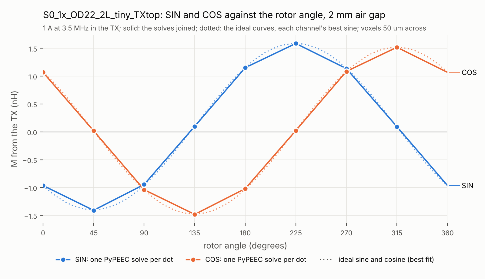
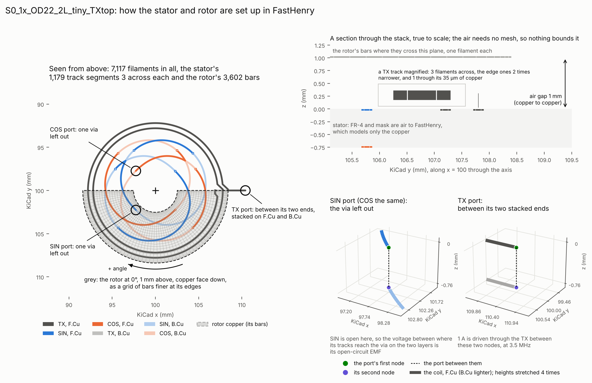

# S0_1x_OD22_2L_tiny_TXtop: SIN and COS over the rotor's turn in FastHenry

A coil set made with the [Sinusoidal Coil Generator](https://github.com/RolandThsive/Sinusoidal-Inductive-Encoders-Coil-Generator): 22.2 mm across, 2 copper layers, one electrical period per turn and a half-ring rotor. The TX carries 1 A at 3.5 MHz; the curves are the mutual inductance from the TX to SIN and to COS (1 nH is 22 mV of EMF). Each angle is one FastHenry solve: the stator's tracks as filaments and the rotor's copper as a grid of bars turned to that angle, solved directly, so each solve is the exact answer of its model. Each is checked by reciprocity: the M from the TX to a receiver and the M from the receiver back to the TX must agree (the Reciprocity column gives how far apart they are, as a part of the larger receiver's M; a solve is read when it is within 1 %). This page is rewritten by `simulation.py` after every solve.

| Air gap | Angles solved | Amplitude SIN / COS | Angle error |
|---|---|---|---|
| 2 mm | 8 of 8 | 1.52 / 1.52 nH (33 / 33 mV) | 0.2° rms, 0.2° peak |
| 1.5 mm | 8 of 8 | 2.27 / 2.27 nH (50 / 50 mV) | 0.2° rms, 0.2° peak |
| 1 mm | 8 of 8 | 3.43 / 3.44 nH (75 / 76 mV) | 0.2° rms, 0.3° peak |
| 0.5 mm | 8 of 8 | 5.16 / 5.17 nH (114 / 114 mV) | 0.4° rms, 0.5° peak |
| 0.1 mm | 8 of 8 | 6.76 / 6.77 nH (149 / 149 mV) | 1.1° rms, 1.3° peak |

## 2 mm air gap

*Figure 1. SIN (blue) and COS (orange) at a 2 mm air gap: the mutual inductance from the TX against the rotor's angle, 8 of 8 angles solved. Each dot is one FastHenry solve and the solid line joins them; the dotted lines are the ideal sine and cosine, each channel's best sine fit, which is what the angle error is measured against. SIN swings ±1.52 nH and COS ±1.52 nH, that is ±33 and ±33 mV of EMF.*

Best sine fit: SIN amplitude 1.518 nH, offset 0.062 nH, phase -134.7°; COS amplitude 1.522 nH, offset 0.058 nH, phase 135.3°. Angle error, with the offset and gain of each channel calibrated out (worked out as below): 0.2° rms and 0.2° at worst, in electrical degrees, the same as mechanical degrees here. SIN and COS are 90.0° apart, against 90° for perfect quadrature.

| Rotor | M SIN (nH) | M COS (nH) | Angle error | L TX (nH) | R TX (mΩ) | Filaments | Reciprocity | Memory | Time |
|---|---|---|---|---|---|---|---|---|---|
| 0° | -1.0134 | 1.1224 | +0.08° | 140.751 | 269.66 | 7,117 | exact | 0.7 GB | 5 min |
| 45° | -1.4681 | 0.0550 | -0.17° | 140.788 | 269.62 | 7,117 | exact | 0.7 GB | 5 min |
| 90° | -0.9960 | -1.0215 | +0.22° | 140.793 | 269.61 | 7,117 | exact | 0.7 GB | 5 min |
| 135° | 0.0649 | -1.4741 | -0.16° | 140.798 | 269.61 | 7,117 | exact | 0.7 GB | 3 min |
| 180° | 1.1382 | -1.0028 | +0.23° | 140.832 | 269.56 | 7,117 | exact | 0.7 GB | 3 min |
| 225° | 1.5836 | 0.0610 | -0.16° | 140.796 | 269.61 | 7,117 | exact | 0.7 GB | 4 min |
| 270° | 1.1227 | 1.1405 | +0.21° | 140.783 | 269.61 | 7,117 | exact | 0.7 GB | 2 min |
| 315° | 0.0607 | 1.5829 | -0.25° | 140.768 | 269.62 | 7,117 | exact | 0.7 GB | 2 min |

## 1.5 mm air gap

*Figure 2. SIN (blue) and COS (orange) at a 1.5 mm air gap: the mutual inductance from the TX against the rotor's angle, 8 of 8 angles solved. Each dot is one FastHenry solve and the solid line joins them; the dotted lines are the ideal sine and cosine, each channel's best sine fit, which is what the angle error is measured against. SIN swings ±2.27 nH and COS ±2.27 nH, that is ±50 and ±50 mV of EMF.*

Best sine fit: SIN amplitude 2.265 nH, offset 0.060 nH, phase -135.1°; COS amplitude 2.271 nH, offset 0.058 nH, phase 135.0°. Angle error, with the offset and gain of each channel calibrated out (worked out as below): 0.2° rms and 0.2° at worst, in electrical degrees, the same as mechanical degrees here. SIN and COS are 90.0° apart, against 90° for perfect quadrature.

| Rotor | M SIN (nH) | M COS (nH) | Angle error | L TX (nH) | R TX (mΩ) | Filaments | Reciprocity | Memory | Time |
|---|---|---|---|---|---|---|---|---|---|
| 0° | -1.5328 | 1.6548 | +0.06° | 138.200 | 271.55 | 7,117 | exact | 0.7 GB | 3 min |
| 45° | -2.2241 | 0.0663 | -0.16° | 138.252 | 271.49 | 7,117 | exact | 0.7 GB | 3 min |
| 90° | -1.5262 | -1.5415 | +0.21° | 138.256 | 271.48 | 7,117 | exact | 0.7 GB | 3 min |
| 135° | 0.0528 | -2.2301 | -0.14° | 138.261 | 271.48 | 7,117 | exact | 0.7 GB | 3 min |
| 180° | 1.6569 | -1.5331 | +0.23° | 138.313 | 271.42 | 7,117 | exact | 0.7 GB | 3 min |
| 225° | 2.3329 | 0.0489 | -0.17° | 138.262 | 271.49 | 7,117 | exact | 0.7 GB | 3 min |
| 270° | 1.6531 | 1.6620 | +0.19° | 138.246 | 271.49 | 7,117 | exact | 0.7 GB | 2 min |
| 315° | 0.0713 | 2.3337 | -0.22° | 138.228 | 271.50 | 7,117 | exact | 0.7 GB | 2 min |

## 1 mm air gap

*Figure 3. SIN (blue) and COS (orange) at a 1 mm air gap: the mutual inductance from the TX against the rotor's angle, 8 of 8 angles solved. Each dot is one FastHenry solve and the solid line joins them; the dotted lines are the ideal sine and cosine, each channel's best sine fit, which is what the angle error is measured against. SIN swings ±3.43 nH and COS ±3.44 nH, that is ±75 and ±76 mV of EMF.*

Best sine fit: SIN amplitude 3.433 nH, offset 0.065 nH, phase -135.8°; COS amplitude 3.439 nH, offset 0.063 nH, phase 134.2°. Angle error, with the offset and gain of each channel calibrated out (worked out as below): 0.2° rms and 0.3° at worst, in electrical degrees, the same as mechanical degrees here. SIN and COS are 90.0° apart, against 90° for perfect quadrature.

| Rotor | M SIN (nH) | M COS (nH) | Angle error | L TX (nH) | R TX (mΩ) | Filaments | Reciprocity | Memory | Time |
|---|---|---|---|---|---|---|---|---|---|
| away | 0.0753 | 0.0683 |  | 146.898 | 264.07 | 3,515 | exact | 0.2 GB | 40 s |
| 0° | -2.3162 | 2.5156 | +0.05° | 133.988 | 274.49 | 7,117 | exact | 0.7 GB | 5 min |
| 45° | -3.3977 | 0.1252 | -0.19° | 134.062 | 274.40 | 7,117 | exact | 0.7 GB | 5 min |
| 90° | -2.3716 | -2.3256 | +0.21° | 134.066 | 274.38 | 7,117 | exact | 0.7 GB | 5 min |
| 135° | 0.0061 | -3.4036 | -0.13° | 134.071 | 274.39 | 7,117 | exact | 0.7 GB | 5 min |
| 180° | 2.4528 | -2.3780 | +0.27° | 134.154 | 274.29 | 7,117 | exact | 0.7 GB | 5 min |
| 225° | 3.5059 | 0.0008 | -0.19° | 134.077 | 274.40 | 7,117 | exact | 0.7 GB | 5 min |
| 270° | 2.5117 | 2.4604 | +0.20° | 134.059 | 274.40 | 7,117 | exact | 0.7 GB | 3 min |
| 315° | 0.1285 | 3.5080 | -0.22° | 134.038 | 274.41 | 7,117 | exact | 0.7 GB | 3 min |

## 0.5 mm air gap

*Figure 4. SIN (blue) and COS (orange) at a 0.5 mm air gap: the mutual inductance from the TX against the rotor's angle, 8 of 8 angles solved. Each dot is one FastHenry solve and the solid line joins them; the dotted lines are the ideal sine and cosine, each channel's best sine fit, which is what the angle error is measured against. SIN swings ±5.16 nH and COS ±5.17 nH, that is ±114 and ±114 mV of EMF.*

Best sine fit: SIN amplitude 5.164 nH, offset 0.088 nH, phase -137.5°; COS amplitude 5.171 nH, offset 0.087 nH, phase 132.5°. Angle error, with the offset and gain of each channel calibrated out (worked out as below): 0.4° rms and 0.5° at worst, in electrical degrees, the same as mechanical degrees here. SIN and COS are 90.0° apart, against 90° for perfect quadrature.

| Rotor | M SIN (nH) | M COS (nH) | Angle error | L TX (nH) | R TX (mΩ) | Filaments | Reciprocity | Memory | Time |
|---|---|---|---|---|---|---|---|---|---|
| 0° | -3.4016 | 3.8788 | +0.20° | 126.074 | 280.19 | 7,117 | exact | 0.7 GB | 4 min |
| 45° | -5.1092 | 0.3534 | -0.39° | 126.173 | 280.09 | 7,117 | exact | 0.7 GB | 4 min |
| 90° | -3.6773 | -3.4107 | +0.38° | 126.176 | 280.07 | 7,117 | exact | 0.7 GB | 4 min |
| 135° | -0.1668 | -5.1151 | -0.28° | 126.181 | 280.08 | 7,117 | exact | 0.7 GB | 4 min |
| 180° | 3.5938 | -3.6806 | +0.51° | 126.321 | 279.93 | 7,117 | exact | 0.7 GB | 4 min |
| 225° | 5.2411 | -0.1751 | -0.38° | 126.211 | 280.08 | 7,117 | exact | 0.7 GB | 4 min |
| 270° | 3.8736 | 3.6028 | +0.38° | 126.192 | 280.08 | 7,117 | exact | 0.7 GB | 3 min |
| 315° | 0.3536 | 5.2446 | -0.41° | 126.166 | 280.09 | 7,117 | exact | 0.7 GB | 3 min |

## 0.1 mm air gap

*Figure 5. SIN (blue) and COS (orange) at a 0.1 mm air gap: the mutual inductance from the TX against the rotor's angle, 8 of 8 angles solved. Each dot is one FastHenry solve and the solid line joins them; the dotted lines are the ideal sine and cosine, each channel's best sine fit, which is what the angle error is measured against. SIN swings ±6.76 nH and COS ±6.77 nH, that is ±149 and ±149 mV of EMF.*

Best sine fit: SIN amplitude 6.764 nH, offset 0.137 nH, phase -140.3°; COS amplitude 6.769 nH, offset 0.136 nH, phase 129.7°. Angle error, with the offset and gain of each channel calibrated out (worked out as below): 1.1° rms and 1.3° at worst, in electrical degrees, the same as mechanical degrees here. SIN and COS are 90.0° apart, against 90° for perfect quadrature.

| Rotor | M SIN (nH) | M COS (nH) | Angle error | L TX (nH) | R TX (mΩ) | Filaments | Reciprocity | Memory | Time |
|---|---|---|---|---|---|---|---|---|---|
| 0° | -4.2559 | 5.2810 | +0.86° | 111.641 | 297.70 | 7,117 | exact | 0.7 GB | 3 min |
| 45° | -6.6364 | 0.9045 | -1.12° | 111.728 | 297.69 | 7,117 | exact | 0.7 GB | 3 min |
| 90° | -4.9693 | -4.2636 | +1.08° | 111.731 | 297.68 | 7,117 | exact | 0.7 GB | 3 min |
| 135° | -0.6073 | -6.6424 | -0.92° | 111.735 | 297.68 | 7,117 | exact | 0.7 GB | 3 min |
| 180° | 4.5610 | -4.9645 | +1.30° | 111.938 | 297.65 | 7,117 | exact | 0.7 GB | 3 min |
| 225° | 6.8196 | -0.6180 | -1.09° | 111.834 | 297.69 | 7,117 | exact | 0.7 GB | 3 min |
| 270° | 5.2787 | 4.5694 | +1.09° | 111.813 | 297.72 | 7,117 | exact | 0.7 GB | 98 s |
| 315° | 0.9023 | 6.8241 | -1.19° | 111.787 | 297.71 | 7,117 | exact | 0.7 GB | 92 s |

## The air gaps together

*Figure 6. Every air gap on one chart, the 0.1 mm gap in full colour, the solves of each joined by a solid line, and each gap's ideal sine and cosine dotted. Going from 2 to 0.1 mm makes SIN 4.46 times and COS 4.45 times larger.*

## Against the expectation

The generator estimates the TX at 144 nH with the rotor away and 116 nH with it (its drop with the rotor is an upper estimate). FastHenry gives 146.9 nH with the rotor away, and 140.8 to 140.8 nH with the rotor at 2 mm, and 138.2 to 138.3 nH with the rotor at 1.5 mm, and 134.0 to 134.2 nH with the rotor at 1 mm, and 126.1 to 126.3 nH with the rotor at 0.5 mm, and 111.6 to 111.9 nH with the rotor at 0.1 mm. The expected values are in [expected_results.json](expected_results.json).

## How the angle error is worked out

Each channel gets its best sine over the rotor's period, M = offset + amplitude × sin(θ + phase). Each channel's offset is taken out and it is divided by its amplitude, so both swing between −1 and +1, as a decoder chip's offset and gain calibration does. The angle is read back as atan2(SIN, COS); the error at each angle is that reading less the true angle, less the average of all of them, since a fixed offset only moves where zero is. The rms and the worst of them are the angle error. The fit uses the same points as the error, so it measures how far the solves are from a perfect sine and cosine pair. [`angle_error.py`](../FastHenry%20Simulation/angle_error.py) does it.

## The boards

*Drawn by the generator. Red is the top layer, blue the bottom; the dots are vias. In FastHenry, SIN is opened at (97.74, 102.26) and COS at (97.74, 97.74), the TX at its ends at (110.4, 100) (KiCad mm). The [README](../README.md) has the board and how it was made.*

*How the boards are set up in FastHenry, drawn by [`rig_picture.py`](../FastHenry%20Simulation/rig_picture.py) from the model simulation.py solves: the stator's tracks as segments split into filaments, the rotor copper side down over the stator as a grid of bars, each receiver opened at a left-out via (the port is between where its tracks reach the via on the two layers, and the receiver is open there, so the voltage across it is the open-circuit EMF), and the TX opened between its two stacked ends, where 1 A is driven.*
