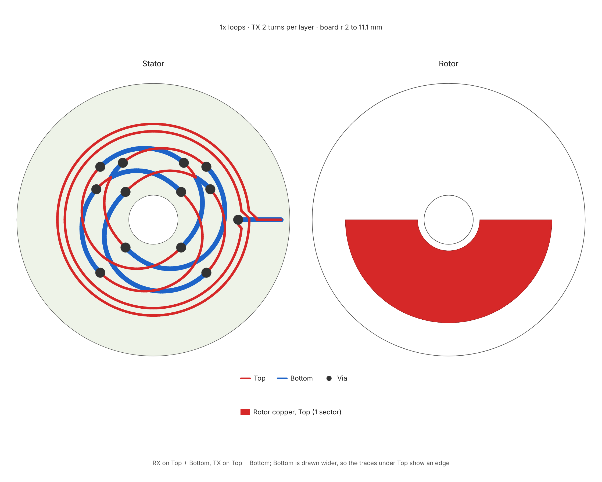
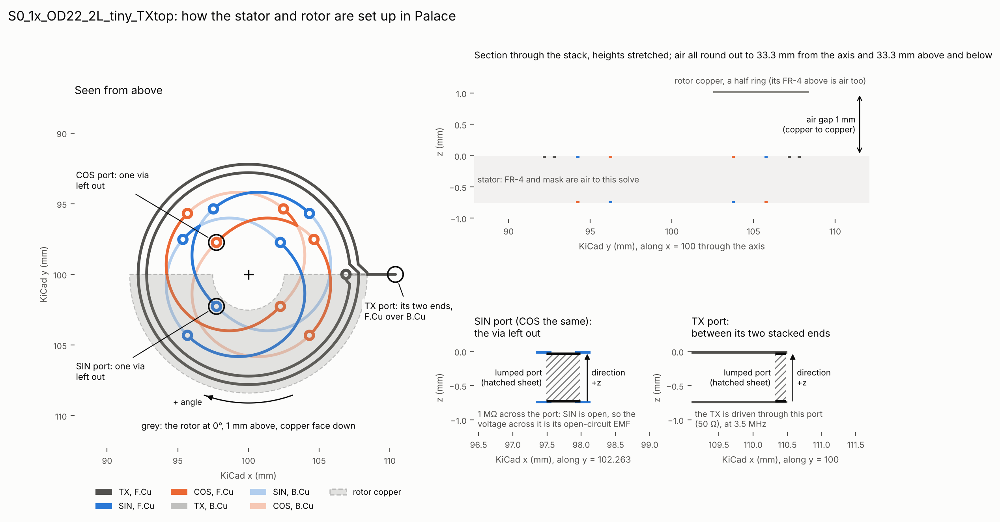

# S0_1x_OD22_2L_tiny_TXtop: SIN and COS over the rotor's turn in Palace

A coil set made with the [Sinusoidal Coil Generator](https://github.com/RolandThsive/Sinusoidal-Inductive-Encoders-Coil-Generator): 22.2 mm across, 2 copper layers, one electrical period per turn and a half-ring rotor. The TX is driven at 3.5 MHz; the curves are the mutual inductance from the TX to SIN and to COS (1 nH is 22 mV of EMF for 1 A in the TX). Each angle is one Palace solve with its own mesh, checked by working the TX's L out two ways: from its port's voltage, and from the magnetic energy in the whole field (the Checks column gives how far apart they are; a solve is read when the linear solve converged and the two are within 1 %). At the first angle of each gap SIN and COS are driven too, and the M from each back to the TX is checked against the M from the TX to it (reciprocity, in the same column). This page is rewritten by `simulation.py` after every solve.

| Air gap | Angles solved | Amplitude SIN / COS | Angle error |
|---|---|---|---|
| 2 mm | 8 of 8 | 1.49 / 1.50 nH (33 / 33 mV) | 0.2° rms, 0.3° peak |
| 1.5 mm | 8 of 8 | 2.23 / 2.23 nH (49 / 49 mV) | 0.2° rms, 0.3° peak |
| 1 mm | 8 of 8 | 3.37 / 3.37 nH (74 / 74 mV) | 0.2° rms, 0.3° peak |
| 0.5 mm | 8 of 8 | 5.07 / 5.07 nH (111 / 112 mV) | 0.4° rms, 0.5° peak |
| 0.1 mm | 8 of 8 | 6.66 / 6.66 nH (146 / 146 mV) | 1.1° rms, 1.3° peak |

## 2 mm air gap

*Figure 1. SIN (blue) and COS (orange) at a 2 mm air gap: the mutual inductance from the TX against the rotor's angle, 8 of 8 angles solved. Each dot is one Palace solve and the solid line joins them; the dotted lines are the ideal sine and cosine, each channel's best sine fit, which is what the angle error is measured against. SIN swings ±1.49 nH and COS ±1.50 nH, that is ±33 and ±33 mV of EMF.*

Best sine fit: SIN amplitude 1.495 nH, offset 0.083 nH, phase -134.6°; COS amplitude 1.498 nH, offset -0.004 nH, phase 135.5°. Angle error, with the offset and gain of each channel calibrated out (worked out as below): 0.2° rms and 0.3° at worst, in electrical degrees, the same as mechanical degrees here. SIN and COS are 89.9° apart, against 90° for perfect quadrature.

| Rotor | M SIN (nH) | M COS (nH) | Angle error | L TX (nH) | R TX (mΩ) | Solve | Checks | Memory | Time |
|---|---|---|---|---|---|---|---|---|---|
| 0° | -0.9776 | 1.0408 | +0.09° | 132.943 | 287.36 | 122 + 161 + 125 iterations, 8e-09 | L -0.002 %, reciprocity 0.00018 % | 10.0 GB | 9 min |
| 45° | -1.4242 | -0.0122 | -0.10° | 132.961 | 287.49 | 117 iterations, 8e-09 | L -0.002 % | 7.6 GB | 3 min |
| 90° | -0.9552 | -1.0690 | +0.24° | 132.950 | 287.43 | 117 iterations, 9e-09 | L -0.002 % | 7.6 GB | 3 min |
| 135° | 0.0908 | -1.5099 | -0.14° | 132.957 | 287.32 | 117 iterations, 8e-09 | L -0.002 % | 7.6 GB | 3 min |
| 180° | 1.1454 | -1.0461 | +0.19° | 132.979 | 287.28 | 119 iterations, 1e-08 | L -0.002 % | 7.6 GB | 3 min |
| 225° | 1.5803 | 0.0020 | -0.19° | 132.944 | 287.39 | 127 iterations, 1e-08 | L -0.002 % | 7.7 GB | 3 min |
| 270° | 1.1275 | 1.0654 | +0.19° | 132.946 | 287.37 | 118 iterations, 9e-09 | L -0.002 % | 7.6 GB | 3 min |
| 315° | 0.0795 | 1.4978 | -0.28° | 132.929 | 287.51 | 117 iterations, 9e-09 | L -0.002 % | 7.6 GB | 3 min |

## 1.5 mm air gap

*Figure 2. SIN (blue) and COS (orange) at a 1.5 mm air gap: the mutual inductance from the TX against the rotor's angle, 8 of 8 angles solved. Each dot is one Palace solve and the solid line joins them; the dotted lines are the ideal sine and cosine, each channel's best sine fit, which is what the angle error is measured against. SIN swings ±2.23 nH and COS ±2.23 nH, that is ±49 and ±49 mV of EMF.*

Best sine fit: SIN amplitude 2.226 nH, offset 0.079 nH, phase -135.0°; COS amplitude 2.230 nH, offset -0.001 nH, phase 135.1°. Angle error, with the offset and gain of each channel calibrated out (worked out as below): 0.2° rms and 0.3° at worst, in electrical degrees, the same as mechanical degrees here. SIN and COS are 90.0° apart, against 90° for perfect quadrature.

| Rotor | M SIN (nH) | M COS (nH) | Angle error | L TX (nH) | R TX (mΩ) | Solve | Checks | Memory | Time |
|---|---|---|---|---|---|---|---|---|---|
| 0° | -1.4902 | 1.5634 | +0.07° | 130.447 | 289.47 | 139 + 173 + 143 iterations, 9e-09 | L -0.001 %, reciprocity 0.00013 % | 9.4 GB | 9 min |
| 45° | -2.1671 | 0.0000 | -0.11° | 130.482 | 289.59 | 112 iterations, 9e-09 | L -0.001 % | 6.9 GB | 3 min |
| 90° | -1.4758 | -1.5757 | +0.22° | 130.475 | 289.48 | 134 iterations, 9e-09 | L -0.001 % | 7.2 GB | 3 min |
| 135° | 0.0783 | -2.2463 | -0.10° | 130.485 | 289.37 | 110 iterations, 9e-09 | L -0.001 % | 6.9 GB | 3 min |
| 180° | 1.6504 | -1.5604 | +0.21° | 130.531 | 289.25 | 122 iterations, 8e-09 | L -0.002 % | 7.0 GB | 3 min |
| 225° | 2.3097 | -0.0067 | -0.21° | 130.478 | 289.40 | 122 iterations, 8e-09 | L -0.002 % | 7.0 GB | 3 min |
| 270° | 1.6426 | 1.5788 | +0.18° | 130.476 | 289.38 | 112 iterations, 9e-09 | L -0.002 % | 6.9 GB | 2 min |
| 315° | 0.0866 | 2.2350 | -0.26° | 130.451 | 289.58 | 116 iterations, 8e-09 | L -0.002 % | 7.0 GB | 3 min |

## 1 mm air gap

*Figure 3. SIN (blue) and COS (orange) at a 1 mm air gap: the mutual inductance from the TX against the rotor's angle, 8 of 8 angles solved. Each dot is one Palace solve and the solid line joins them; the dotted lines are the ideal sine and cosine, each channel's best sine fit, which is what the angle error is measured against. SIN swings ±3.37 nH and COS ±3.37 nH, that is ±74 and ±74 mV of EMF.*

Best sine fit: SIN amplitude 3.369 nH, offset 0.080 nH, phase -135.7°; COS amplitude 3.374 nH, offset 0.008 nH, phase 134.3°. Angle error, with the offset and gain of each channel calibrated out (worked out as below): 0.2° rms and 0.3° at worst, in electrical degrees, the same as mechanical degrees here. SIN and COS are 90.0° apart, against 90° for perfect quadrature.

| Rotor | M SIN (nH) | M COS (nH) | Angle error | L TX (nH) | R TX (mΩ) | Solve | Checks | Memory | Time |
|---|---|---|---|---|---|---|---|---|---|
| away | 0.0934 | 0.0085 |  | 138.867 | 281.65 | 107 iterations, 1e-08 | L -0.002 % | 6.0 GB | 120 s |
| 0° | -2.2640 | 2.4093 | +0.07° | 126.160 | 292.02 | 110 + 147 + 113 iterations, 9e-09 | L -0.001 %, reciprocity 1.4e-05 % | 8.0 GB | 6 min |
| 45° | -3.3204 | 0.0594 | -0.15° | 126.216 | 292.14 | 120 iterations, 9e-09 | L -0.001 % | 6.1 GB | 2 min |
| 90° | -2.3060 | -2.3402 | +0.22° | 126.216 | 291.93 | 111 iterations, 1e-08 | L -0.001 % | 6.0 GB | 2 min |
| 135° | 0.0322 | -3.3900 | -0.09° | 126.228 | 291.84 | 109 iterations, 8e-09 | L -0.001 % | 6.0 GB | 2 min |
| 180° | 2.4266 | -2.3803 | +0.26° | 126.315 | 291.60 | 121 iterations, 8e-09 | L -0.001 % | 6.1 GB | 2 min |
| 225° | 3.4532 | -0.0476 | -0.23° | 126.236 | 291.81 | 118 iterations, 9e-09 | L -0.002 % | 6.1 GB | 2 min |
| 270° | 2.4779 | 2.3664 | +0.19° | 126.229 | 291.77 | 113 iterations, 9e-09 | L -0.002 % | 6.1 GB | 2 min |
| 315° | 0.1376 | 3.3891 | -0.27° | 126.193 | 292.06 | 112 iterations, 1e-08 | L -0.001 % | 6.0 GB | 2 min |

## 0.5 mm air gap

*Figure 4. SIN (blue) and COS (orange) at a 0.5 mm air gap: the mutual inductance from the TX against the rotor's angle, 8 of 8 angles solved. Each dot is one Palace solve and the solid line joins them; the dotted lines are the ideal sine and cosine, each channel's best sine fit, which is what the angle error is measured against. SIN swings ±5.07 nH and COS ±5.07 nH, that is ±111 and ±112 mV of EMF.*

Best sine fit: SIN amplitude 5.069 nH, offset 0.099 nH, phase -137.4°; COS amplitude 5.074 nH, offset 0.041 nH, phase 132.6°. Angle error, with the offset and gain of each channel calibrated out (worked out as below): 0.4° rms and 0.5° at worst, in electrical degrees, the same as mechanical degrees here. SIN and COS are 90.0° apart, against 90° for perfect quadrature.

| Rotor | M SIN (nH) | M COS (nH) | Angle error | L TX (nH) | R TX (mΩ) | Solve | Checks | Memory | Time |
|---|---|---|---|---|---|---|---|---|---|
| 0° | -3.3379 | 3.7552 | +0.21° | 118.374 | 298.27 | 106 + 140 + 109 iterations, 8e-09 | L -0.001 %, reciprocity 4.1e-05 % | 7.1 GB | 5 min |
| 45° | -5.0057 | 0.2869 | -0.35° | 118.444 | 298.52 | 101 iterations, 9e-09 | L -0.001 % | 5.3 GB | 105 s |
| 90° | -3.5913 | -3.4001 | +0.39° | 118.458 | 298.14 | 102 iterations, 8e-09 | L -0.001 % | 5.4 GB | 104 s |
| 135° | -0.1369 | -5.0618 | -0.23° | 118.463 | 298.15 | 103 iterations, 1e-08 | L -0.001 % | 5.3 GB | 106 s |
| 180° | 3.5446 | -3.6478 | +0.49° | 118.624 | 297.71 | 111 iterations, 8e-09 | L -0.001 % | 5.4 GB | 106 s |
| 225° | 5.1524 | -0.2083 | -0.41° | 118.510 | 297.99 | 106 iterations, 1e-08 | L -0.002 % | 5.4 GB | 105 s |
| 270° | 3.8099 | 3.4994 | +0.36° | 118.508 | 297.84 | 98 iterations, 9e-09 | L -0.002 % | 5.3 GB | 97 s |
| 315° | 0.3529 | 5.1030 | -0.47° | 118.450 | 298.31 | 117 iterations, 1e-08 | L -0.001 % | 5.5 GB | 113 s |

## 0.1 mm air gap

*Figure 5. SIN (blue) and COS (orange) at a 0.1 mm air gap: the mutual inductance from the TX against the rotor's angle, 8 of 8 angles solved. Each dot is one Palace solve and the solid line joins them; the dotted lines are the ideal sine and cosine, each channel's best sine fit, which is what the angle error is measured against. SIN swings ±6.66 nH and COS ±6.66 nH, that is ±146 and ±146 mV of EMF.*

Best sine fit: SIN amplitude 6.659 nH, offset 0.147 nH, phase -140.2°; COS amplitude 6.661 nH, offset 0.099 nH, phase 129.8°. Angle error, with the offset and gain of each channel calibrated out (worked out as below): 1.1° rms and 1.3° at worst, in electrical degrees, the same as mechanical degrees here. SIN and COS are 90.0° apart, against 90° for perfect quadrature.

| Rotor | M SIN (nH) | M COS (nH) | Angle error | L TX (nH) | R TX (mΩ) | Solve | Checks | Memory | Time |
|---|---|---|---|---|---|---|---|---|---|
| 0° | -4.1920 | 5.1554 | +0.87° | 103.873 | 318.02 | 114 + 150 + 117 iterations, 8e-09 | L -0.002 %, reciprocity 1e-05 % | 6.4 GB | 5 min |
| 45° | -6.5213 | 0.8333 | -1.06° | 103.867 | 319.02 | 101 iterations, 1e-08 | L -0.002 % | 4.7 GB | 93 s |
| 90° | -4.8738 | -4.2423 | +1.07° | 103.955 | 317.94 | 99 iterations, 9e-09 | L -0.002 % | 4.7 GB | 89 s |
| 135° | -0.5668 | -6.5665 | -0.89° | 103.887 | 318.59 | 99 iterations, 9e-09 | L -0.002 % | 4.7 GB | 93 s |
| 180° | 4.5095 | -4.9124 | +1.27° | 104.178 | 317.67 | 108 iterations, 9e-09 | L -0.002 % | 4.8 GB | 95 s |
| 225° | 6.7237 | -0.6306 | -1.11° | 104.029 | 318.28 | 112 iterations, 8e-09 | L -0.002 % | 4.8 GB | 100 s |
| 270° | 5.2033 | 4.4738 | +1.08° | 104.091 | 317.40 | 101 iterations, 8e-09 | L -0.002 % | 4.8 GB | 92 s |
| 315° | 0.8915 | 6.6847 | -1.23° | 103.954 | 318.61 | 104 iterations, 7e-09 | L -0.002 % | 4.8 GB | 93 s |

## The air gaps together

*Figure 6. Every air gap on one chart, the 0.1 mm gap in full colour, the solves of each joined by a solid line, and each gap's ideal sine and cosine dotted. Going from 2 to 0.1 mm makes SIN 4.46 times and COS 4.45 times larger.*

## Against the expectation

The generator estimates the TX at 144 nH with the rotor away and 116 nH with it (its drop with the rotor is an upper estimate). Palace gives 138.9 nH with the rotor away, and 132.9 to 133.0 nH with the rotor at 2 mm, and 130.4 to 130.5 nH with the rotor at 1.5 mm, and 126.2 to 126.3 nH with the rotor at 1 mm, and 118.4 to 118.6 nH with the rotor at 0.5 mm, and 103.9 to 104.2 nH with the rotor at 0.1 mm. The expected values are in [expected_results.json](expected_results.json).

## How the angle error is worked out

Each channel gets its best sine over the rotor's period, M = offset + amplitude × sin(θ + phase). Each channel's offset is taken out and it is divided by its amplitude, so both swing between −1 and +1, as a decoder chip's offset and gain calibration does. The angle is read back as atan2(SIN, COS); the error at each angle is that reading less the true angle, less the average of all of them, since a fixed offset only moves where zero is. The rms and the worst of them are the angle error. The fit uses the same points as the error, so it measures how far the solves are from a perfect sine and cosine pair. [`angle_error.py`](../Palace%20Simulation/angle_error.py) does it.

## The boards

*Drawn by the generator. Red is the top layer, blue the bottom; the dots are vias. In Palace, SIN is opened at (97.74, 102.26) and COS at (97.74, 97.74), the TX at its ends at (110.4, 100) (KiCad mm). The [README](../README.md) has the board and how it was made.*

*How the boards are set up in Palace, drawn by [`rig_picture.py`](../Palace%20Simulation/rig_picture.py) from the geometry the mesh is built from: the rotor copper side down over the stator, each receiver opened at a left-out via (its lumped port, a sheet standing between the via's two pads, has 1 MΩ across it, so the voltage across it is the open-circuit EMF), and the TX opened between its two stacked ends, where its port drives it.*
