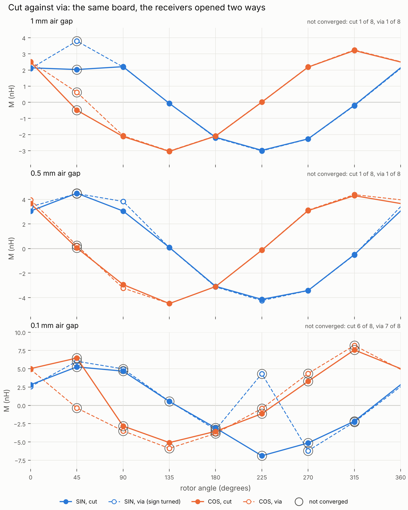

# S0_1x_OD22_2L_tiny_TXtop_Cut

The board of [`../S0_1x_OD22_2L_tiny_TXtop`](../S0_1x_OD22_2L_tiny_TXtop) (22 mm across, the TX two turns on the top layer, S0's RX coils), with one change in how the receivers are opened for their terminals: **SIN and COS are each opened by a 0.2 mm cut across a top trace**, as E01 opens its loop, instead of by leaving out a via. The voltage across each cut is the receiver's open-circuit EMF, reported as the mutual inductance M = V / (jωI) with 1 A in the TX.

**The boards are not edited.** `Boards/` and `3D_Geometry/` are copies of the board without cuts. The cut is made in the model: `test_spec.json` sets `"rx_port": "cut"` and gives each receiver a `cut` (where, which way the trace runs, 0.2 mm long, 0.4 mm across), and `simulation.py` takes the copper inside that box out of the top copper. The layer-change via that the other folder leaves out stays in. The TX keeps its port between its two stacked ends, as before.

## Where the cuts are

*Each cut is the spot on the receiver's top trace nearest its old port via where a 0.2 mm cut has at least 0.45 mm of free board round it and sits at least 0.75 mm from any via centre: 0.86 mm from the via on both receivers, with 0.46 mm of free board. The two spots are a quarter turn apart about the axis, as SIN and COS are.*

| Coil | Net | Opened at (KiCad mm) | How |
|---|---|---|---|
| TX | `TX` | (110.4, 100), F.Cu and B.Cu | its two stacked ends, unchanged |
| SIN | `2` | cut at (97.160, 101.626), F.Cu | a 0.2 mm gap across the top trace, running (-0.63, -0.78); the via at (97.737, 102.263) stays |
| COS | `1` | cut at (98.374, 97.160), F.Cu | a 0.2 mm gap across the top trace, running (0.78, -0.63); the via at (97.737, 97.737) stays |

## How the cut is the port

*Drawn by `rig_picture.py` from the geometry the mesh is built from. The copper inside each cut box is air. The two copper faces that border the gap are the terminal's electrodes, and the port sheet spans the gap at the copper's lower face, as in Elmer's E01 example. SIN and COS carry 0 A, so the voltage across the gap is the open-circuit EMF. The outline of each cut is drawn into the 2D mesh, so both cut faces are meshed exactly.*

[`Elmer Simulation/RotorStator_AngleSetup/`](Elmer%20Simulation/RotorStator_AngleSetup/) has the rotor over the stator at each of the 8 angles, with the two cuts and the TX port ringed (`python angle_setup.py`).

## The board

Bore and outer radius 2 and 11.1 mm, 2 copper layers, board 0.8 mm, air gap 1 mm by default (any other with `--gap`). Everything about the board itself, its generator settings and warnings, is in [the other folder's README](../S0_1x_OD22_2L_tiny_TXtop/README.md).

*Drawn by the generator.*

## Results: the cut against the via

Every angle at every gap, one Elmer solve each on the same mesh as the board opened at a via, run in parallel: 25 machines for 1, 0.5 and 0.1 mm (24 angles and the rotor taken away), and 16 more for 1.5 and 2 mm. Each gap's curves, fits and angle errors are in [`Results/SINCOS_Results.md`](Results/SINCOS_Results.md); `python compare_ports.py` prints the table below and draws the chart.

*Solve by solve: the cut solid and filled, the via dashed and hollow. Which cut face counts as plus is a convention, so the via board's SIN is drawn with its sign turned, which moves its curve by half a turn and changes nothing else. Rings: solves that stopped above a residual of 5e-4 or give the TX a negative resistance.*

| Air gap | Port | Amplitude SIN / COS, all solves | Converged solves only | Angle error | SIN to COS | L TX over the turn | Not converged |
|---|---|---|---|---|---|---|---|
| 2 mm | via | 1.41 / 1.41 nH (31 / 31 mV) | 1.41 / 1.41 nH | 1.8° rms, 2.8° peak | 92.0° | 124 to 127 nH | 0 of 8 |
| 2 mm | cut | 1.42 / 1.42 nH (31 / 31 mV) | 1.42 / 1.42 nH | 2.2° rms, 3.4° peak | 87.7° | 125 to 127 nH | 0 of 8 |
| 1.5 mm | via | 2.12 / 2.09 nH (47 / 46 mV) | 2.12 / 2.09 nH | 2.2° rms, 3.3° peak | 91.9° | 122 to 125 nH | 0 of 8 |
| 1.5 mm | cut | 2.21 / 2.10 nH (49 / 46 mV) | 2.21 / 2.10 nH | 3.2° rms, 5.9° peak | 88.0° | 122 to 126 nH | 0 of 8 |
| 1 mm | via | 3.25 / 3.14 nH (72 / 69 mV) | 3.05 / 3.14 nH | 3.0° rms, 4.7° peak | 92.6° | 118 to 123 nH | 1 of 8 |
| 1 mm | cut | 2.81 / 3.14 nH (62 / 69 mV) | 3.05 / 3.14 nH | 4.8° rms, 11.3° peak | 92.6° | 117 to 121 nH | 1 of 8 |
| 0.5 mm | via | 4.62 / 4.59 nH (102 / 101 mV) | 4.70 / 4.59 nH | 2.3° rms, 4.6° peak | 89.2° | 107 to 117 nH | 1 of 8 |
| 0.5 mm | cut | 4.39 / 4.46 nH (97 / 98 mV) | 4.32 / 4.46 nH | 1.8° rms, 3.5° peak | 90.4° | 107 to 113 nH | 1 of 8 |
| 0.1 mm | via | 3.82 / 6.46 nH (84 / 142 mV) | too few converged | 58.5° rms, 159.3° peak | 66.0° | 43 to 118 nH | 7 of 8 |
| 0.1 mm | cut | 5.98 / 6.22 nH (131 / 137 mV) | too few converged | 10.9° rms, 24.6° peak | 81.1° | 91 to 122 nH | 6 of 8 |

* **At 1.5 and 2 mm the two ports agree at every angle.** All 16 solves converged on each board, and the cut and the via differ on average by 3.4 % (SIN) and 1.7 % (COS) of the amplitude at 1.5 mm, and by 1.7 % and 1.8 % at 2 mm. SIN to COS reads 88° on the cut and 92° on the via: the same 2° from a quarter turn, mirrored because the cut's SIN has the opposite sign.
* **At 1 mm the two ports give the same answer.** At the 7 angles where both converged, the cut and the via differ by 0.8 % (SIN) and 0.7 % (COS) of the amplitude on average, and the fits through those 7 angles are the same to the hundredth: 3.05 / 3.14 nH. The one angle that differs is 45°, which is not converged in either and falls off the sine the opposite way in each. That one solve alone pulls the cut's all-solve SIN amplitude down to 2.81 nH and its angle error up to 4.8° rms.
* **At 0.5 mm they agree within 2 % at 5 of the 7 angles both converged** (135° to 315°). At 0° and 90° they differ by up to 0.8 nH although both are below the limit, so the solver's scatter at this gap is about that big. The cut's curve comes out a little cleaner: 1.8° rms against 2.3°.
* **At 0.1 mm both still stall:** 6 of 8 cut solves and 7 of 8 via solves are not converged, so neither curve can be read yet. The cut's looks less wild (10.9° rms against 58.5°), but with that many unconverged solves this says nothing about the port. It waits for the solver fix.
* **The rotor taken away** gives L TX 130.2 nH with the cut and 129.7 nH with the via.

## The folder

| Folder | What is in it |
|---|---|
| [`Boards/`](Boards/) | the generator's boards, copied unchanged from the folder without cuts |
| [`3D_Geometry/`](3D_Geometry/) | KESE's export of the stator and rotor, copied unchanged |
| [`Elmer Simulation/`](Elmer%20Simulation/) | `test_spec.json` (with `"rx_port": "cut"` and each receiver's `cut`), `simulation.py`, `angle_error.py`, `make_charts.py`, `rig_picture.py` and `angle_setup.py` (the same files as in the other S0 folders), `compare_ports.py` (this board against the via board), `RotorStator_AngleSetup/`, and the runs under `case/`, which git ignores |
| [`Results/`](Results/) | `expected_results.json` (the generator's estimates), [`SINCOS_Results.md`](Results/SINCOS_Results.md) with every gap on one page, `SINCOS_cut_vs_via.webp`, the charts of every gap together (`SINCOS_gaps.webp`, and `_SIN` and `_COS` apart), and a folder for each air gap (`0d1mm_AirGap`, `0d5mm_AirGap`, `1mm_AirGap`, `1d5mm_AirGap`, `2mm_AirGap`) with the runs' `results_gap<gap>mm.json`, `.csv` and `.webp` |

## Running it

| Air gap | Mesh level | Nodes | Memory a solve |
|---|---|---|---|
| 1 mm | 0.75 | 227,569 | about 13.0 GB (at 57 kB a node) |
| 1.5 mm | 0.75 | about 242,000 | more than a 15 GB machine gives one process: the solves ran with an 8 GB swapfile, on the same mesh |
| 2 mm | 0.75 | about 256,000 | as for 1.5 mm |

    cd "Elmer Simulation"
    python simulation.py                   # the rotor away, then 0, 45, 90, 135, 180, 225, 270, 315 degrees
    python simulation.py --gap 0.5         # the same at a 0.5 mm air gap
    python rig_picture.py                  # redraw how the boards sit in Elmer
    python angle_setup.py                  # redraw the rotor at each angle
    python make_charts.py                  # redraw every chart (WebP) and rewrite SINCOS_Results.md
    python compare_ports.py                # the cut against the via board: the table above and the chart

## Licence

These boards are output of the Sinusoidal Coil Generator, for non-commercial use only. See [../LICENSE.md](../LICENSE.md); this branch's GPL-3.0 covers `simulation.py`, `angle_error.py`, `make_charts.py`, `rig_picture.py`, `angle_setup.py` and `compare_ports.py` only.
