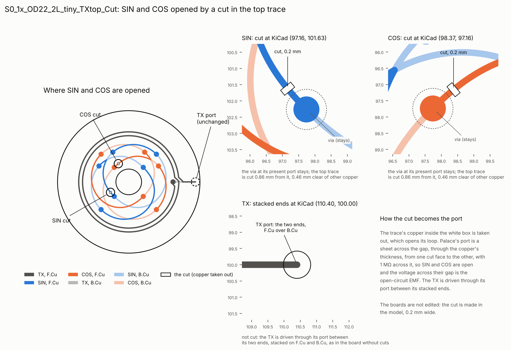
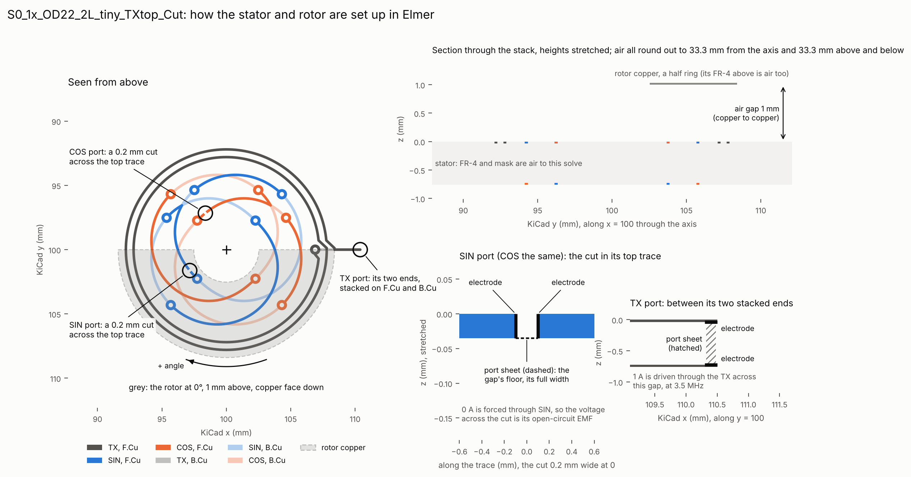
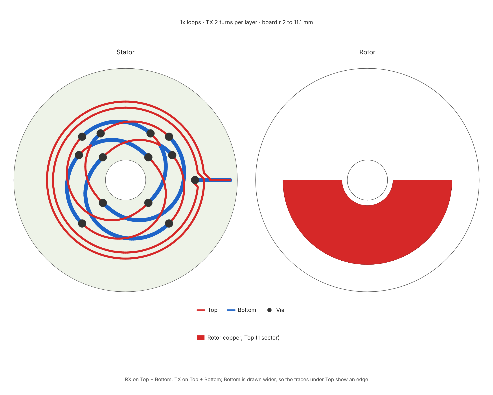

# S0_1x_OD22_2L_tiny_TXtop_Cut

The board of [`../S0_1x_OD22_2L_tiny_TXtop`](../S0_1x_OD22_2L_tiny_TXtop) (22 mm across, the TX two turns on the top layer, S0's RX coils), with one change in how the receivers are opened for their terminals: **SIN and COS are each opened by a 0.2 mm cut across a top trace**, as E01 opens its loop, instead of by leaving out a via. The voltage across each cut is the receiver's open-circuit EMF, reported as the mutual inductance M = V / (jωI) with 1 A in the TX.

**The boards are not edited.** `Boards/` and `3D_Geometry/` are copies of the board without cuts. The cut is made in the model: `test_spec.json` sets `"rx_port": "cut"` and gives each receiver a `cut` (where, which way the trace runs, 0.2 mm long, 0.4 mm across), and `simulation.py` takes the copper inside that box out of the top copper. The layer-change via that the other folder leaves out stays in. The TX keeps its port between its two stacked ends, as before.

## Where the cuts are

*Each cut is the spot on the receiver's top trace nearest its old port via where a 0.2 mm cut has at least 0.45 mm of free board round it and sits at least 0.75 mm from any via centre: 0.86 mm from the via on both receivers, with 0.46 mm of free board. The two spots are a quarter turn apart about the axis, as SIN and COS are.*

| Coil | Net | Opened at (KiCad mm) | How |
|---|---|---|---|
| TX | `TX` | (110.4, 100), F.Cu and B.Cu | its two stacked ends, unchanged |
| SIN | `2` | cut at (97.160, 101.626), F.Cu | a 0.2 mm gap across the top trace, running (-0.63, -0.78); the via at (97.737, 102.263) stays |
| COS | `1` | cut at (98.374, 97.160), F.Cu | a 0.2 mm gap across the top trace, running (0.78, -0.63); the via at (97.737, 97.737) stays |

## How the cut is the port

*Drawn by `rig_picture.py` from the geometry the mesh is built from. The copper inside each cut box is air. The two copper faces that border the gap are the terminal's electrodes, and the port sheet spans the gap at the copper's lower face, as in Elmer's E01 example. SIN and COS carry 0 A, so the voltage across the gap is the open-circuit EMF. The outline of each cut is drawn into the 2D mesh, so both cut faces are meshed exactly.*

[`Elmer Simulation/RotorStator_AngleSetup/`](Elmer%20Simulation/RotorStator_AngleSetup/) has the rotor over the stator at each of the 8 angles, with the two cuts and the TX port ringed (`python angle_setup.py`).

## The board

Bore and outer radius 2 and 11.1 mm, 2 copper layers, board 0.8 mm, air gap 1 mm by default (any other with `--gap`). Everything about the board itself, its generator settings and warnings, is in [the other folder's README](../S0_1x_OD22_2L_tiny_TXtop/README.md).

*Drawn by the generator.*

## Results

The sweep at 1, 0.5 and 0.1 mm is being solved; this section gets its numbers, set against the board opened at a via, when it lands.

## The folder

| Folder | What is in it |
|---|---|
| [`Boards/`](Boards/) | the generator's boards, copied unchanged from the folder without cuts |
| [`3D_Geometry/`](3D_Geometry/) | KESE's export of the stator and rotor, copied unchanged |
| [`Elmer Simulation/`](Elmer%20Simulation/) | `test_spec.json` (with `"rx_port": "cut"` and each receiver's `cut`), `simulation.py`, `angle_error.py`, `make_charts.py`, `rig_picture.py` and `angle_setup.py` (the same files as in the other S0 folders), `RotorStator_AngleSetup/`, and the runs under `case/`, which git ignores |
| [`Results/`](Results/) | `expected_results.json` (the generator's estimates), and the sweep's results once it lands |

## Running it

| Mesh level | Nodes | Memory a solve |
|---|---|---|
| 0.75 | 227,569 | about 13.0 GB (at 57 kB a node) |

    cd "Elmer Simulation"
    python simulation.py                   # the rotor away, then 0, 45, 90, 135, 180, 225, 270, 315 degrees
    python simulation.py --gap 0.5         # the same at a 0.5 mm air gap
    python rig_picture.py                  # redraw how the boards sit in Elmer
    python angle_setup.py                  # redraw the rotor at each angle
    python make_charts.py                  # redraw every chart (WebP) and rewrite SINCOS_Results.md

## Licence

These boards are output of the Sinusoidal Coil Generator, for non-commercial use only. See [../LICENSE.md](../LICENSE.md); this branch's GPL-3.0 covers `simulation.py`, `angle_error.py`, `make_charts.py`, `rig_picture.py` and `angle_setup.py` only.
