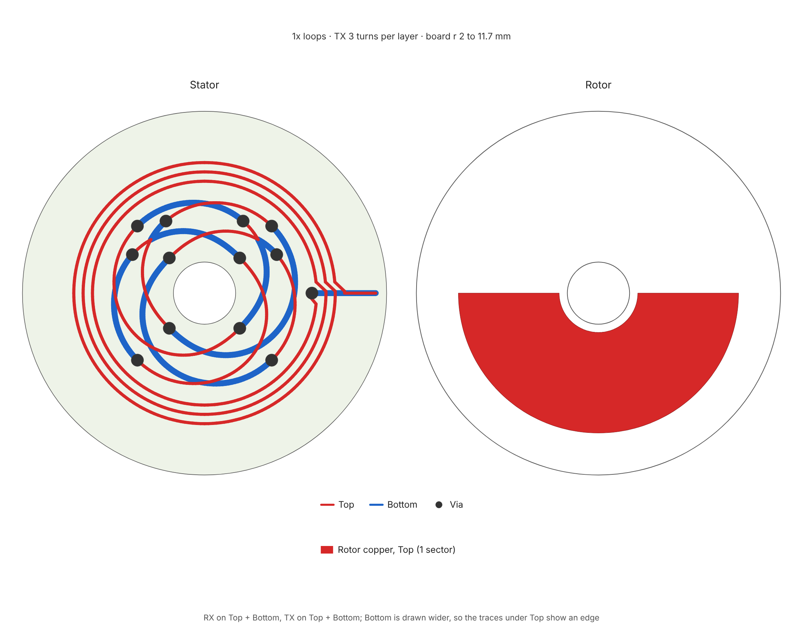
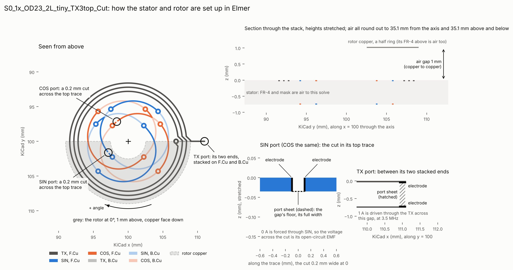
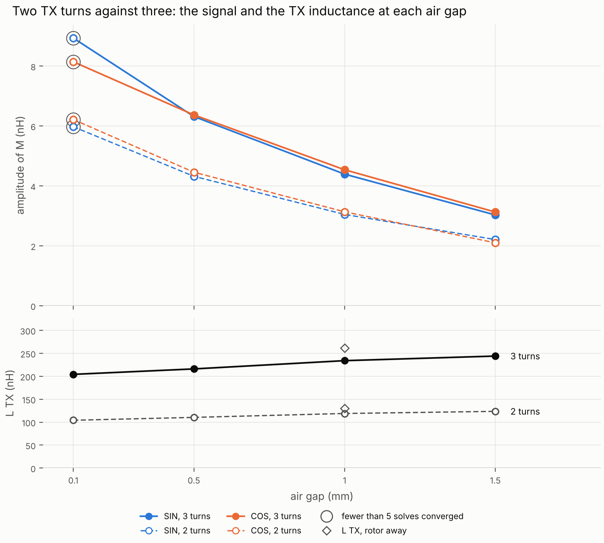

# S0_1x_OD23_2L_tiny_TX3top_Cut

A coil set from the [Sinusoidal Coil Generator](https://github.com/RolandThsive/Sinusoidal-Inductive-Encoders-Coil-Generator) (`Coil_2_11.7_1_1_3_Single_SteppedDiagonal`), set up for Elmer by [`../new_coil.py`](../new_coil.py). The steps that made it are in [S0's README](../S0_1x_OD21_2L_tiny/README.md#the-workflow-for-any-generated-coil).

**What differs from the 22 mm board.** The TX has **three turns, all on the top layer** (F.Cu, r = 7.2, 7.8 and 8.4 mm), where [`../S0_1x_OD22_2L_tiny_TXtop`](../S0_1x_OD22_2L_tiny_TXtop) has two. Everything else is that board's: S0's RX coils kept exactly (band r = 3.2 to 6.1 mm), the board edge fitted to the TX, and the rotor fitted to the stator. So the board grows again to make room for the third turn: 23.4 mm across instead of 22.2, and the rotor copper now reaches r = 9.0 mm instead of 8.4. The parameter files are the 22 mm board's with one change, `TX_TURNS = 3` in `TX_Parameters.py`, run with the generator at commit 32bf9cb. As on the 22 mm board, a short tail runs under the turns on B.Cu to bring the spiral's inner end back out to the terminal, where the two ends sit stacked.

**SIN and COS are opened by a 0.2 mm cut across a top trace**, as on [`../S0_1x_OD22_2L_tiny_TXtop_Cut`](../S0_1x_OD22_2L_tiny_TXtop_Cut), because that is how the real board is opened and routed to the IC. On the 22 mm board the cut and a left-out via gave the same curves within 1 % at 1 mm. The cut is made in the model; the board files are as the generator wrote them. The RX coils are the same as on the 22 mm board, so the cuts sit at exactly the same spots.

## The board

Bore and outer radius 2 and 11.7 mm, 2 copper layers, board 0.8 mm, air gap 1 mm by default (any other with `--gap`). 1 electrical period per turn; the rotor has 1 sector and repeats itself every 360°.

*Drawn by the generator.*

*Each cut is the spot on the receiver's top trace nearest its layer-change via where a 0.2 mm cut has at least 0.45 mm of free board round it and sits at least 0.75 mm from any via centre: 0.86 mm from the via on both receivers.*

*How the boards sit in Elmer, drawn by `rig_picture.py` from the geometry the mesh is built from: the rotor copper side down over the stator, each receiver opened by the cut (the two cut faces are the terminal, held at 0 A, so the voltage across the cut is the open-circuit EMF), and the TX opened between its two stacked ends, where 1 A is driven. [`Elmer Simulation/RotorStator_AngleSetup/`](Elmer%20Simulation/RotorStator_AngleSetup/) has the rotor over the stator at each of the 8 angles (`python angle_setup.py`).*

| Coil | Net | Opened at (KiCad mm) | How |
|---|---|---|---|
| TX | `TX` | (111, 100), F.Cu and B.Cu | its two stacked ends |
| SIN | `2` | cut at (97.160, 101.626), F.Cu | a 0.2 mm gap across the top trace, running (-0.63, -0.78); the via at (97.737, 102.263) stays |
| COS | `1` | cut at (98.374, 97.160), F.Cu | a 0.2 mm gap across the top trace, running (0.78, -0.63); the via at (97.737, 97.737) stays |

The generator's estimate for the TX: 0.29 µH with the rotor away and 0.23 µH with it (the 22 mm board: 0.13 and 0.11 µH), 0.38 Ω DC. Its warnings for this board:

* the tank's parallel resistance at the nominal air gap may be as low as 32 ohm (if the AC resistance is 2 x the DC value); the IPS2550 needs at least 250 ohm.  More TX turns, wider TX traces, thicker copper or a higher EXCITATION_FREQ_HZ raise it
* no spot on 2 within 30 deg of 0 deg, 4 mm from the other marks, has room for two vias (layers F.Cu, B.Cu); widen SILKSCREEN_SEARCH_SPAN_DEG, lower SILKSCREEN_BREAK_SEPARATION_MM, or cut the coil by hand
* no spot on 1 within 30 deg of 0 deg, 4 mm from the other marks, has room for two vias (layers F.Cu, B.Cu); widen SILKSCREEN_SEARCH_SPAN_DEG, lower SILKSCREEN_BREAK_SEPARATION_MM, or cut the coil by hand

## Results: three TX turns against two

Every angle at every gap, one Elmer solve each, run in parallel on 41 machines (8 angles at each of 5 gaps, and the rotor taken away at 1 mm). Each gap's curves, fits and angle errors are in [`Results/SINCOS_Results.md`](Results/SINCOS_Results.md); `python compare_turns.py` prints the table below and draws the chart, against the two-turn board [`../S0_1x_OD22_2L_tiny_TXtop_Cut`](../S0_1x_OD22_2L_tiny_TXtop_Cut), which has the same RX coils and the same cuts.

*Above, the amplitude of SIN and COS at each air gap; below, the TX inductance over the turn. This board solid and filled, the two-turn board dashed and hollow. Each amplitude is the best sine through the converged solves; at 0.1 mm fewer than five converged on either board, so those points are fitted through all the solves and ringed, as not to be read. Diamonds: L TX with the rotor away.*

| Air gap | TX | Amplitude SIN / COS | Fitted through | Angle error | L TX over the turn | Not converged |
|---|---|---|---|---|---|---|
| 2 mm | 2 turns | 1.42 / 1.42 nH (31 / 31 mV) | the converged solves | 2.2° rms, 3.4° peak | 125 to 127 nH | 0 of 8 |
| 2 mm | 3 turns | 2.18 / 2.19 nH (48 / 48 mV) | the converged solves | 1.7° rms, 2.6° peak | 248 to 252 nH | 0 of 8 |
| 1.5 mm | 2 turns | 2.21 / 2.10 nH (49 / 46 mV) | the converged solves | 3.2° rms, 5.9° peak | 122 to 126 nH | 0 of 8 |
| 1.5 mm | 3 turns | 3.03 / 3.13 nH (67 / 69 mV) | the converged solves | 2.8° rms, 4.3° peak | 241 to 250 nH | 2 of 8 |
| 1 mm | 2 turns | 3.05 / 3.14 nH (67 / 69 mV) | the converged solves | 4.8° rms, 11.3° peak | 117 to 121 nH | 1 of 8 |
| 1 mm | 3 turns | 4.39 / 4.54 nH (97 / 100 mV) | the converged solves | 3.5° rms, 6.8° peak | 229 to 243 nH | 2 of 8 |
| 0.5 mm | 2 turns | 4.32 / 4.46 nH (95 / 98 mV) | the converged solves | 1.8° rms, 3.5° peak | 107 to 113 nH | 1 of 8 |
| 0.5 mm | 3 turns | 6.32 / 6.37 nH (139 / 140 mV) | the converged solves | 2.9° rms, 5.4° peak | 205 to 231 nH | 2 of 8 |
| 0.1 mm | 2 turns | 5.98 / 6.22 nH (131 / 137 mV) | all solves (fewer than 5 converged) | 10.9° rms, 24.6° peak | 91 to 122 nH | 6 of 8 |
| 0.1 mm | 3 turns | 8.94 / 8.15 nH (197 / 179 mV) | all solves (fewer than 5 converged) | 7.4° rms, 10.6° peak | 177 to 291 nH | 7 of 8 |

* **The third turn raises the signal by about half.** From 0.5 to 2 mm, where at least six of the eight solves converged on both boards, SIN and COS are 1.37 to 1.55 times the two-turn board's: 6.3 nH against 4.4 at 0.5 mm, 4.4 to 4.5 against 3.1 at 1 mm, and 2.2 against 1.4 at 2 mm (48 mV of EMF at 1 A against 31).
* **L TX doubles:** 1.96 to 1.98 times the two-turn board's at every gap from 0.5 to 2 mm, and 261.4 nH against 130.2 nH with the rotor away. The generator estimated 292 nH with the rotor away and 226 nH with it; Elmer gives 261 nH, and 229 to 252 nH with the rotor between 1 and 2 mm.
* **So per ampere in the TX the signal grows by half, but per volt across it, it shrinks:** at a fixed TX voltage the current falls with L (V = 2πf L I), so the EMF goes with M / L, about 1.5 / 2.0 = 0.75 of the two-turn board's. Which of the two counts depends on what the drive holds fixed.
* **The curves are clean from 0.5 mm out:** 2.9° rms of angle error at 0.5 mm, 3.5° at 1 mm, 2.8° at 1.5 mm and 1.7° at 2 mm. Two of the eight solves stop just above 5e-4 at 0.5, 1 and 1.5 mm (none above 7.2e-4), and every 2 mm solve is below it.
* **At 0.1 mm the solver stalls** on 7 of the 8 solves, as on every other board, so that curve waits for the solver fix.

## The folder

| Folder | What is in it |
|---|---|
| [`Boards/`](Boards/) | straight from the generator: the stator and rotor boards, `Parameters.txt`, the pictures and the parameter files it was run with |
| [`3D_Geometry/`](3D_Geometry/) | KESE's export of the stator and rotor (STL solids, `materials.json`, STEP, KESE's report), written by the first run; `source.json` records the board's hash, so a changed board is exported again |
| [`Elmer Simulation/`](Elmer%20Simulation/) | `test_spec.json` (every board fact the simulation needs, with `"rx_port": "cut"` and each receiver's `cut`), `simulation.py`, `angle_error.py`, `make_charts.py`, `rig_picture.py` and `angle_setup.py` (the same files as in the other S0 folders), `compare_turns.py` (this board against the two-turn board), `RotorStator_AngleSetup/`, and the runs under `case/`, which git ignores |
| [`Results/`](Results/) | `expected_results.json` (the generator's estimates), [`SINCOS_Results.md`](Results/SINCOS_Results.md) with every gap on one page, `SINCOS_2_vs_3_turns.webp`, the charts of every gap together (`SINCOS_gaps.webp`, and `_SIN` and `_COS` apart), and a folder for each air gap (`0d1mm_AirGap`, `0d5mm_AirGap`, `1mm_AirGap`, `1d5mm_AirGap`, `2mm_AirGap`) with the runs' `results_gap<gap>mm.json`, `.csv` and `.webp` |

## Running it

| Air gap | Mesh level | Nodes | Memory a solve |
|---|---|---|---|
| 1 mm | 0.75 | 257,362 | about 14.7 GB (at 57 kB a node) |
| 2 mm | 0.75 | 288,278 | about 16.4 GB |

A larger gap adds air layers to the mesh, so it needs more memory. Where that does not fit, a swapfile lets the solve finish on the same mesh, which is how every solve here ran: on 15 GB machines each held 13.3 GB in memory and put the rest in an 8 GB swapfile; `--level` below 0.75 makes the mesh coarser and the solve smaller, but then it no longer matches the other boards' mesh.

    cd "Elmer Simulation"
    python simulation.py                   # the rotor away, then 0, 45, 90, 135, 180, 225, 270, 315 degrees
    python simulation.py --gap 0.5         # the same at a 0.5 mm air gap
    python rig_picture.py                  # redraw how the boards sit in Elmer
    python angle_setup.py                  # redraw the rotor at each angle
    python make_charts.py                  # redraw every chart (WebP) and rewrite SINCOS_Results.md
    python compare_turns.py                # this board against the two-turn board: the table above and the chart

## Licence

These boards are output of the Sinusoidal Coil Generator, for non-commercial use only. See [../LICENSE.md](../LICENSE.md); this branch's GPL-3.0 covers `simulation.py`, `angle_error.py`, `make_charts.py`, `rig_picture.py`, `angle_setup.py` and `compare_turns.py` only.
