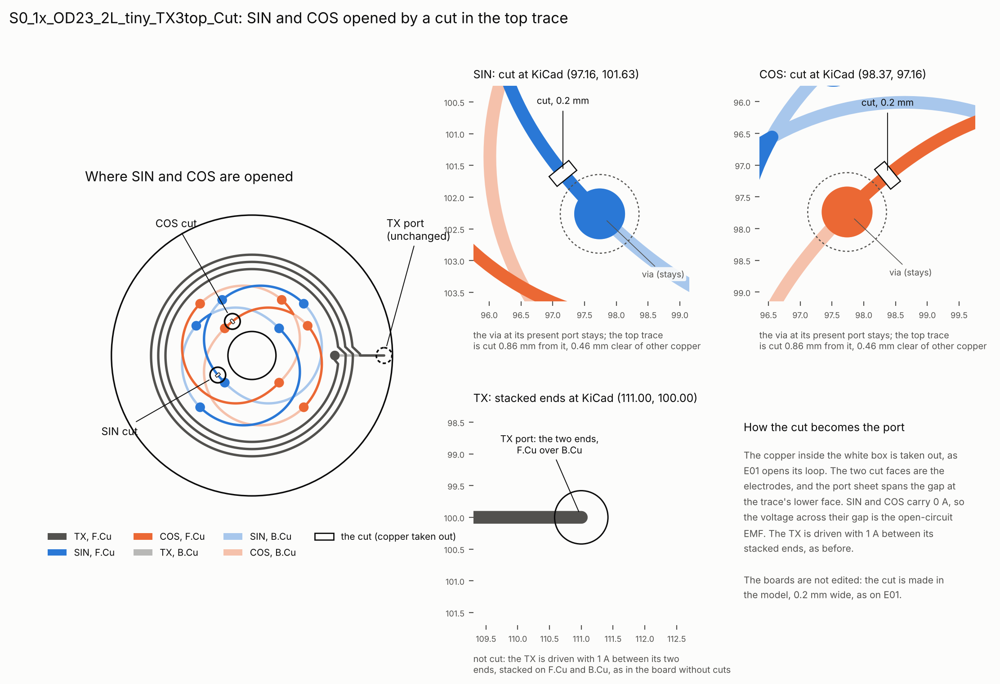
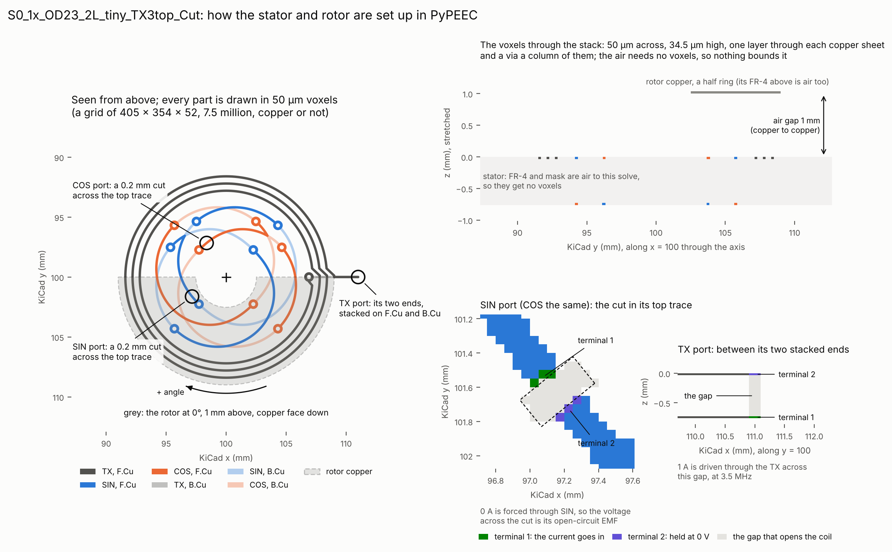
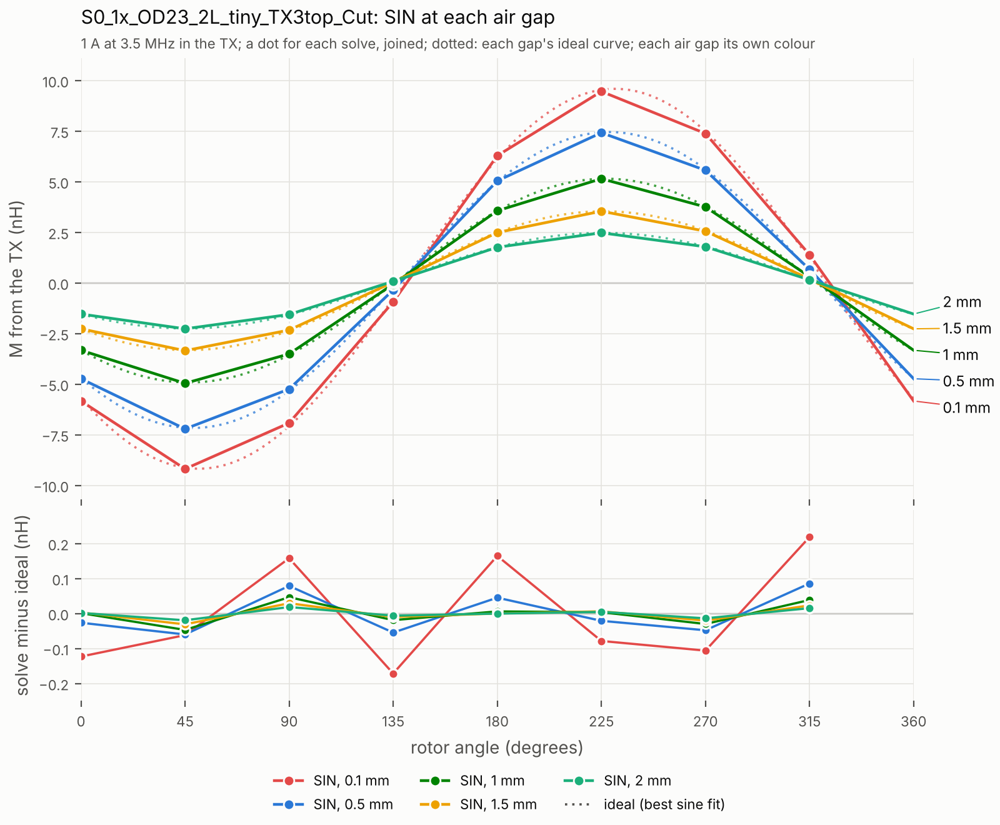

# S0_1x_OD23_2L_tiny_TX3top_Cut

A coil set from the [Sinusoidal Coil Generator](https://github.com/RolandThsive/Sinusoidal-Inductive-Encoders-Coil-Generator) (`Coil_2_11.7_1_1_3_Single_SteppedDiagonal`), set up for PyPEEC by [`../new_coil.py`](../new_coil.py). The steps that made it are in [S0's README](../S0_1x_OD21_2L_tiny/README.md#the-workflow-for-any-generated-coil).

**What differs from S0.** The TX: three turns, all on the top layer (F.Cu, r = 7.2, 7.8 and 8.4 mm), instead of S0's one turn on each layer. S0's RX coils are kept exactly (band r = 3.2 to 6.1 mm), the board edge is fitted to the TX and the rotor to the stator, so the board grows to make room for the turns: 23.4 mm across instead of 21, and the rotor copper reaches r = 9.0 mm instead of 7.8. The parameter files are those of [`../S0_1x_OD22_2L_tiny_TXtop`](../S0_1x_OD22_2L_tiny_TXtop) (the same board with two TX turns) with one change, `TX_TURNS = 3` in `TX_Parameters.py`, run with the generator at commit 32bf9cb. A spiral needs its inner end brought back out, so a short tail runs under the turns on B.Cu to the terminal, where the two ends sit stacked as on S0.

**SIN and COS are opened by a 0.2 mm cut across a top trace**, because that is how the real board is opened and routed to the IC. The voltage across each cut is the receiver's open-circuit EMF, reported as the mutual inductance M = V / (jωI) with 1 A in the TX. The cut is made in the model; the board files are as the generator wrote them. `test_spec.json` sets `"rx_port": "cut"` and gives each receiver a `cut` (where, which way the trace runs, 0.2 mm long, 0.4 mm across), and `simulation.py` takes the voxels inside that box out of the top copper. The receivers' layer-change vias all stay in.

## The board

Bore and outer radius 2 and 11.7 mm, 2 copper layers, board 0.8 mm, air gap 1 mm by default (any other with `--gap`). 1 electrical period per turn; the rotor has 1 sector and repeats itself every 360°.

*Drawn by the generator.*

*Each cut is the spot on the receiver's top trace nearest its layer-change via where a 0.2 mm cut has at least 0.45 mm of free board round it and sits at least 0.75 mm from any via centre: 0.86 mm from the via on both receivers. The two spots are a quarter turn apart about the axis, as SIN and COS are.*

*How the boards sit in PyPEEC, drawn by `rig_picture.py` from the voxels simulation.py solves: the rotor copper side down over the stator, every piece of copper in voxels of 50 µm across and about 35 µm high, each receiver opened by the cut, and the TX opened between its two stacked ends, where 1 A is driven. The voxels of the top copper inside each cut box are taken out. The receiver's voxels on the two faces of the cut are its terminals; SIN and COS carry 0 A between them, so the voltage across the cut is the open-circuit EMF. [`PyPEEC Simulation/RotorStator_AngleSetup/`](PyPEEC%20Simulation/RotorStator_AngleSetup/) has the rotor over the stator at each of the 8 angles, with the two cuts and the TX port ringed (`python angle_setup.py`).*

| Coil | Net | Opened at (KiCad mm) | How |
|---|---|---|---|
| TX | `TX` | (111, 100), F.Cu and B.Cu | its two stacked ends |
| SIN | `2` | cut at (97.160, 101.626), F.Cu | a 0.2 mm gap across the top trace, running (-0.63, -0.78); the via at (97.737, 102.263) stays |
| COS | `1` | cut at (98.374, 97.160), F.Cu | a 0.2 mm gap across the top trace, running (0.78, -0.63); the via at (97.737, 97.737) stays |

The generator's estimate for the TX: 0.29 µH with the rotor away and 0.23 µH with it, 0.38 Ω DC. Its warnings for this board:

* the tank's parallel resistance at the nominal air gap may be as low as 32 ohm (if the AC resistance is 2 x the DC value); the IPS2550 needs at least 250 ohm.  More TX turns, wider TX traces, thicker copper or a higher EXCITATION_FREQ_HZ raise it
* no spot on 2 within 30 deg of 0 deg, 4 mm from the other marks, has room for two vias (layers F.Cu, B.Cu); widen SILKSCREEN_SEARCH_SPAN_DEG, lower SILKSCREEN_BREAK_SEPARATION_MM, or cut the coil by hand
* no spot on 1 within 30 deg of 0 deg, 4 mm from the other marks, has room for two vias (layers F.Cu, B.Cu); widen SILKSCREEN_SEARCH_SPAN_DEG, lower SILKSCREEN_BREAK_SEPARATION_MM, or cut the coil by hand

## Results at each air gap

Every angle at every gap, one PyPEEC solve each: 8 angles at each of 5 gaps, and the rotor taken away once (with the 1 mm results). Each gap's curves, fits and angle error are in [`Results/SINCOS_Results.md`](Results/SINCOS_Results.md).

| Air gap | Amplitude SIN / COS | Angle error | Solves passing both checks | L TX over the turn |
|---|---|---|---|---|
| 2 mm | 2.33 / 2.33 nH (51 / 51 mV) | 0.3° rms, 0.4° peak | 8 of 8 | 281.4 to 281.6 nH |
| 1.5 mm | 3.39 / 3.39 nH (74 / 74 mV) | 0.3° rms, 0.4° peak | 8 of 8 | 276.4 to 276.6 nH |
| 1 mm | 4.98 / 4.99 nH (110 / 110 mV) | 0.3° rms, 0.5° peak | 8 of 8 | 266.2 to 266.5 nH |
| 0.5 mm | 7.25 / 7.26 nH (160 / 160 mV) | 0.5° rms, 0.7° peak | 8 of 8 | 249.1 to 249.7 nH |
| 0.1 mm | 9.28 / 9.28 nH (204 / 204 mV) | 1.2° rms, 1.5° peak | 8 of 8 | 224.6 to 225.3 nH |

*SIN at each air gap, one dot per solve; a ring would mark a solve that fails the two checks (none does). [`SINCOS_gaps_COS.webp`](Results/SINCOS_gaps_COS.webp) is the same for COS, and [`SINCOS_gaps.webp`](Results/SINCOS_gaps.webp) has both.*

Every solve passes both checks: the TX's L and R from its voltage agree with the L from the stored energy and the R from the losses within 0.001 %, where 1 % is allowed. At every gap SIN and COS are within 0.1 % of each other in amplitude and 90.0° apart. The signal is 9.28 nH for SIN at 0.1 mm and falls to 7.25, 4.98, 3.39 and 2.33 nH at 0.5, 1, 1.5 and 2 mm (204 down to 51 mV of EMF at 1 A). The angle error is 1.2° rms at 0.1 mm, 0.5° at 0.5 mm and 0.3° from 1 to 2 mm. At 0.1 mm it alternates in sign from one angle to the next: a ripple at four periods per electrical period, the fastest that eight angles a period can show. It is the fourth harmonic that sensors with two receiver coils typically show, which the third and fifth harmonics of the sine and cosine both give (Kuntz, Gerlach and Fella, arXiv 2503.14627), and those fade with the gap faster than the sine itself. L TX moves by 0.7 nH at most over the turn and rises from 224.9 nH at 0.1 mm to 281.5 nH at 2 mm; with the rotor away it is 296.7 nH, where the generator estimated 226 nH with the rotor and 292 nH without.

Against the Elmer branch, which solves the same board from the same export ([`../Comparisons`](../Comparisons/)): SIN's amplitude differs by +1.7 %, +2.2 %, +2.1 %, +1.9 % and +1.9 % at 0.1, 0.5, 1, 1.5 and 2 mm, and the angle error is 1.2° against 1.2°, 0.5° against 0.6°, 0.3° against 0.3°, 0.3° against 0.3° and 0.3° against 0.3° rms. L TX is 8 to 11 % higher here than in Elmer at every gap; [S0](../S0_1x_OD21_2L_tiny/README.md#results-at-each-air-gap) checks its TX against a hand calculation, which sides with PyPEEC.

## The folder

| Folder | What is in it |
|---|---|
| [`Boards/`](Boards/) | straight from the generator: the stator and rotor boards, `Parameters.txt`, the pictures and the parameter files it was run with |
| [`3D_Geometry/`](3D_Geometry/) | KESE's export of the stator and rotor (STL solids, `materials.json`, STEP, KESE's report), written by the first run; `source.json` records the board's hash, so a changed board is exported again |
| [`PyPEEC Simulation/`](PyPEEC%20Simulation/) | `test_spec.json` (every board fact the simulation needs, with `"rx_port": "cut"` and each receiver's `cut`), `simulation.py`, `angle_error.py`, `make_charts.py`, `rig_picture.py` and `angle_setup.py` (S0's, unchanged), [`RotorStator_AngleSetup/`](PyPEEC%20Simulation/RotorStator_AngleSetup/) (the rotor over the stator at each angle), and the runs under `case/`, which git ignores |
| [`Results/`](Results/) | `expected_results.json` (the generator's estimates), [`SINCOS_Results.md`](Results/SINCOS_Results.md) with every gap on one page, the charts of every gap together (`SINCOS_gaps.webp`, and `_SIN` and `_COS` apart), and a folder for each air gap (`0d1mm_AirGap`, `0d5mm_AirGap`, `1mm_AirGap`, `1d5mm_AirGap`, `2mm_AirGap`, the point written as d) with the runs' `results_gap<gap>mm.json`, `.csv` and `.webp` |

Beside this README, `S0_1x_OD23_2L_tiny_TX3top_Cut_stator_and_rotor.webp` is the generator's picture of the boards, `S0_1x_OD23_2L_tiny_TX3top_Cut_pypeec_setup.webp` shows how they sit in PyPEEC, and `S0_1x_OD23_2L_tiny_TX3top_Cut_cuts.webp` shows where SIN and COS are opened.

## Running it

| Air gap | Grid (voxels of 50 µm) | dz | Memory a solve | Time a solve |
|---|---|---|---|---|
| 0.1 mm | 405 × 354 × 33 = 4.7 million | 26.9 µm | 1.6 GB | 3 to 4 min |
| 0.5 mm | 405 × 354 × 34 = 4.9 million | 38.2 µm | 1.6 to 1.7 GB | 5 to 8 min |
| 1 mm | 405 × 354 × 52 = 7.5 million | 34.5 µm | 2.2 to 2.3 GB | 4 to 7 min |
| 1.5 mm | 405 × 354 × 79 = 11.3 million | 29.0 µm | 3.2 to 3.4 GB | 9 to 12 min |
| 2 mm | 405 × 354 × 81 = 11.6 million | 34.5 µm | 3.2 to 3.4 GB | 8 to 13 min |

Each solve is PyPEEC's, on 4 cores, at PyPEEC's default tolerances: GMRES in 3 iterations. The grid grows taller with the gap, and the memory and time with it; a machine with 8 GB runs every gap. Voxels of 50 µm read M and L TX to about half a percent (see the [coils' README](../README.md)); `--voxel 0.035` tries smaller ones as a trial, kept in `case/`.

    cd "PyPEEC Simulation"
    python simulation.py                   # the rotor away, then 0, 45, 90, 135, 180, 225, 270, 315 degrees
    python simulation.py --gap 0.5         # the same at a 0.5 mm air gap
    python simulation.py --voxel 0.035     # smaller voxels, a trial kept in case/
    python simulation.py --plot            # redraw the table, the curves and SINCOS_Results.md
    python angle_error.py                  # print the angle error at each angle, and rewrite SINCOS_Results.md
    python make_charts.py                  # redraw every chart (WebP) and rewrite SINCOS_Results.md
    python rig_picture.py                  # redraw how the boards sit in PyPEEC, voxel by voxel
    python angle_setup.py                  # redraw the rotor at each angle

Use the Python of the branch's `.venv` (`bash bridge/setup_machine.sh` makes it). `SINCOS_Results.md` is rewritten after every solve: each gap's graph with a caption, the fit, the angle error at each angle and every solve. `--merge` adds the solves of the same gap from other machines' results files, which is how these were run.

## Licence

These boards are output of the Sinusoidal Coil Generator, for non-commercial use only. See [../LICENSE.md](../LICENSE.md); this branch's GPL-3.0 covers `simulation.py`, `angle_error.py`, `make_charts.py`, `rig_picture.py` and `angle_setup.py` only.
