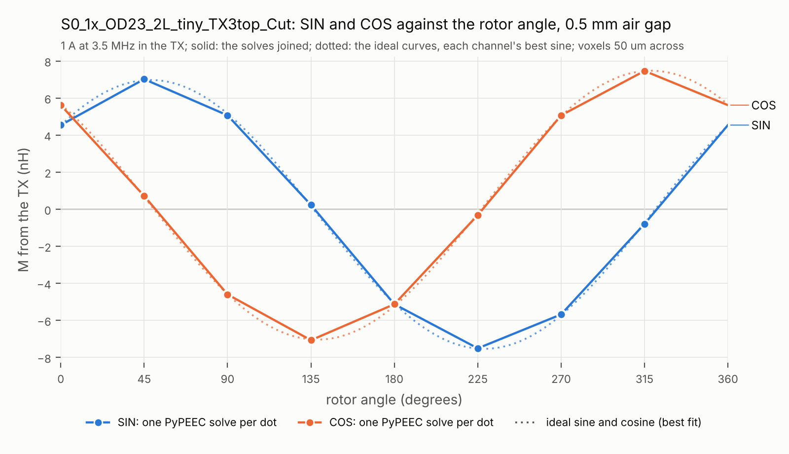

# S0_1x_OD23_2L_tiny_TX3top_Cut: SIN and COS over the rotor's turn in Elmer

A coil set made with the [Sinusoidal Coil Generator](https://github.com/RolandThsive/Sinusoidal-Inductive-Encoders-Coil-Generator): 23.4 mm across, 2 copper layers, one electrical period per turn and a half-ring rotor. The TX carries 1 A at 3.5 MHz; the curves are the mutual inductance from the TX to SIN and to COS (1 nH is 22 mV of EMF). Each angle is one Elmer solve with its own mesh. This page is rewritten by `simulation.py` after every solve.

| Air gap | Angles solved | Amplitude SIN / COS | Angle error |
|---|---|---|---|
| 1 mm | 8 of 8 | 4.28 / 4.62 nH (94 / 102 mV) | 3.5° rms, 6.8° peak |
| 0.5 mm | 8 of 8 | 6.43 / 6.27 nH (141 / 138 mV) | 2.9° rms, 5.4° peak |
| 0.1 mm | 8 of 8 | 8.94 / 8.15 nH (197 / 179 mV) | 7.4° rms, 10.6° peak |

## 1 mm air gap

*Figure 1. SIN (blue) and COS (orange) at a 1 mm air gap: the mutual inductance from the TX against the rotor's angle, 8 of 8 angles solved. Each dot is one Elmer solve and the solid line joins them; the dotted lines are the ideal sine and cosine, each channel's best sine fit, which is what the angle error is measured against. SIN swings ±4.28 nH and COS ±4.62 nH, that is ±94 and ±102 mV of EMF.*

Best sine fit: SIN amplitude 4.278 nH, offset -0.114 nH, phase 41.1°; COS amplitude 4.618 nH, offset -0.008 nH, phase 134.9°. Angle error, with the offset and gain of each channel calibrated out (worked out as below): 3.5° rms and 6.8° at worst, in electrical degrees, the same as mechanical degrees here. SIN and COS are 93.8° apart, against 90° for perfect quadrature.

| Rotor | M SIN (nH) | M COS (nH) | Angle error | L TX (nH) | R TX (mΩ) | Iterations | Residual | Memory | Time |
|---|---|---|---|---|---|---|---|---|---|
| away | -0.2635 | 0.0642 |  | 261.378 | 524.68 | 1500 | 3.9e-04 | 13.3 GB | 26 min |
| 0° | 3.0850 | 3.6516 | +0.05° | 235.286 | 516.64 | 1500 | 4.2e-04 | 13.3 GB | 29 min |
| 45° | 3.3158 | -0.3406 | +6.85° | 229.948 | 543.89 | 1500 | 7.1e-04 | 13.3 GB | 30 min |
| 90° | 3.8573 | -3.3358 | -5.46° | 243.414 | 540.82 | 1500 | 5.1e-04 | 13.3 GB | 30 min |
| 135° | 0.0010 | -4.5175 | +0.14° | 235.795 | 563.17 | 1500 | 2.9e-04 | 13.3 GB | 29 min |
| 180° | -3.0998 | -3.1173 | +2.74° | 233.527 | 561.88 | 1500 | 3.1e-04 | 13.3 GB | 30 min |
| 225° | -4.2712 | -0.1030 | +0.50° | 228.738 | 554.27 | 1500 | 3.7e-04 | 13.3 GB | 34 min |
| 270° | -3.3725 | 3.0386 | -2.39° | 232.903 | 544.55 | 1500 | 3.5e-04 | 13.3 GB | 31 min |
| 315° | -0.4264 | 4.6606 | -2.42° | 232.774 | 528.95 | 1500 | 3.9e-04 | 13.3 GB | 27 min |

8 of 8 solves stopped at the 1500-iteration cap, with the residual between 2.9e-04 and 7.1e-04 rather than the 1e-07 asked for. The TX is round, so turning the rotor should not change its inductance: its spread here, 228.7 to 243.4 nH, is a measure of what the solver leaves.

**Not converged enough to read:** 2 of 8 solves (45°, 90°) stopped above a residual of 5e-04 or give the TX a negative resistance. On S0, every 1 mm solve stopped below it and the 0.5 mm solves above it are the ones that fall off the sine. Read this gap's curve with that in mind.

## 0.5 mm air gap

*Figure 2. SIN (blue) and COS (orange) at a 0.5 mm air gap: the mutual inductance from the TX against the rotor's angle, 8 of 8 angles solved. Each dot is one Elmer solve and the solid line joins them; the dotted lines are the ideal sine and cosine, each channel's best sine fit, which is what the angle error is measured against. SIN swings ±6.43 nH and COS ±6.27 nH, that is ±141 and ±138 mV of EMF.*

Best sine fit: SIN amplitude 6.426 nH, offset 0.160 nH, phase 38.7°; COS amplitude 6.268 nH, offset 0.130 nH, phase 132.2°. Angle error, with the offset and gain of each channel calibrated out (worked out as below): 2.9° rms and 5.4° at worst, in electrical degrees, the same as mechanical degrees here. SIN and COS are 93.4° apart, against 90° for perfect quadrature.

| Rotor | M SIN (nH) | M COS (nH) | Angle error | L TX (nH) | R TX (mΩ) | Iterations | Residual | Memory | Time |
|---|---|---|---|---|---|---|---|---|---|
| 0° | 4.2736 | 5.2461 | -2.35° | 220.489 | 596.52 | 1500 | 4.2e-04 | 13.3 GB | 27 min |
| 45° | 6.6340 | 0.5375 | +0.84° | 223.243 | 528.83 | 1500 | 4.0e-04 | 13.3 GB | 26 min |
| 90° | 5.5562 | -4.4594 | +0.62° | 230.956 | 681.25 | 1500 | 7.2e-04 | 13.3 GB | 27 min |
| 135° | 0.2614 | -6.3450 | +3.66° | 218.498 | 624.62 | 1500 | 3.4e-04 | 13.3 GB | 26 min |
| 180° | -3.8736 | -3.8835 | +3.97° | 206.699 | 624.58 | 1500 | 6.1e-04 | 13.3 GB | 27 min |
| 225° | -5.7691 | -0.3748 | -0.45° | 205.075 | 595.07 | 1500 | 4.9e-04 | 13.3 GB | 29 min |
| 270° | -4.8879 | 4.2001 | -0.88° | 214.247 | 584.73 | 1500 | 4.0e-04 | 13.3 GB | 26 min |
| 315° | -0.9173 | 6.1165 | -5.41° | 209.211 | 584.28 | 1500 | 4.7e-04 | 13.3 GB | 29 min |

8 of 8 solves stopped at the 1500-iteration cap, with the residual between 3.4e-04 and 7.2e-04 rather than the 1e-07 asked for. The TX is round, so turning the rotor should not change its inductance: its spread here, 205.1 to 231.0 nH, is a measure of what the solver leaves.

**Not converged enough to read:** 2 of 8 solves (90°, 180°) stopped above a residual of 5e-04 or give the TX a negative resistance. On S0, every 1 mm solve stopped below it and the 0.5 mm solves above it are the ones that fall off the sine. Read this gap's curve with that in mind.

## 0.1 mm air gap

*Figure 3. SIN (blue) and COS (orange) at a 0.1 mm air gap: the mutual inductance from the TX against the rotor's angle, 8 of 8 angles solved. Each dot is one Elmer solve and the solid line joins them; the dotted lines are the ideal sine and cosine, each channel's best sine fit, which is what the angle error is measured against. SIN swings ±8.94 nH and COS ±8.15 nH, that is ±197 and ±179 mV of EMF.*

Best sine fit: SIN amplitude 8.939 nH, offset -1.354 nH, phase 34.4°; COS amplitude 8.146 nH, offset 0.820 nH, phase 115.7°. Angle error, with the offset and gain of each channel calibrated out (worked out as below): 7.4° rms and 10.6° at worst, in electrical degrees, the same as mechanical degrees here. SIN and COS are 81.3° apart, against 90° for perfect quadrature.

| Rotor | M SIN (nH) | M COS (nH) | Angle error | L TX (nH) | R TX (mΩ) | Iterations | Residual | Memory | Time |
|---|---|---|---|---|---|---|---|---|---|
| 0° | 4.2546 | 7.1833 | +9.37° | 195.002 | 612.52 | 1500 | 4.8e-04 | 12.7 GB | 24 min |
| 45° | 6.7909 | 4.2193 | -9.01° | 192.867 | 231.57 | 1500 | 1.1e-03 | 12.8 GB | 23 min |
| 90° | 5.1211 | -3.8147 | +8.75° | 186.185 | 556.79 | 1500 | 6.1e-04 | 12.7 GB | 24 min |
| 135° | 0.9591 | -6.8910 | +0.31° | 184.367 | 740.22 | 1500 | 6.3e-04 | 12.8 GB | 28 min |
| 180° | -4.1666 | -5.0020 | -5.64° | 178.967 | 716.59 | 1500 | 7.7e-04 | 12.7 GB | 25 min |
| 225° | -13.7903 | -2.4449 | -0.48° | 291.151 | -299.06 | 1500 | 3.6e-03 | 12.7 GB | 28 min |
| 270° | -7.0621 | 2.5896 | -10.62° | 177.078 | -2043.60 | 1500 | 5.3e-03 | 12.7 GB | 26 min |
| 315° | -2.9373 | 10.7237 | +7.31° | 228.042 | -164.47 | 1500 | 1.4e-03 | 12.7 GB | 29 min |

8 of 8 solves stopped at the 1500-iteration cap, with the residual between 4.8e-04 and 5.3e-03 rather than the 1e-07 asked for. The TX is round, so turning the rotor should not change its inductance: its spread here, 177.1 to 291.2 nH, is a measure of what the solver leaves.

**Not converged enough to read:** 7 of 8 solves (45°, 90°, 135°, 180°, 225°, 270°, 315°) stopped above a residual of 5e-04 or give the TX a negative resistance. On S0, every 1 mm solve stopped below it and the 0.5 mm solves above it are the ones that fall off the sine. Read this gap's curve with that in mind.

## The air gaps together

*Figure 4. Every air gap on one chart, the 0.1 mm gap in full colour, the solves of each joined by a solid line, and each gap's ideal sine and cosine dotted. Going from 1 to 0.1 mm makes SIN 2.09 times and COS 1.76 times larger.*

## Against the expectation

The generator estimates the TX at 292 nH with the rotor away and 226 nH with it (its drop with the rotor is an upper estimate). Elmer gives 261.4 nH with the rotor away, and 228.7 to 243.4 nH with the rotor at 1 mm, and 205.1 to 231.0 nH with the rotor at 0.5 mm, and 177.1 to 291.2 nH with the rotor at 0.1 mm. The expected values are in [expected_results.json](expected_results.json).

## How the angle error is worked out

Each channel gets its best sine over the rotor's period, M = offset + amplitude × sin(θ + phase). Each channel's offset is taken out and it is divided by its amplitude, so both swing between −1 and +1, as a decoder chip's offset and gain calibration does. The angle is read back as atan2(SIN, COS); the error at each angle is that reading less the true angle, less the average of all of them, since a fixed offset only moves where zero is. The rms and the worst of them are the angle error. The fit uses the same points as the error, so it measures how far the solves are from a perfect sine and cosine pair. [`angle_error.py`](../Elmer%20Simulation/angle_error.py) does it.

## The boards

*Drawn by the generator. Red is the top layer, blue the bottom; the dots are vias. In Elmer, SIN is opened by a cut in its top trace at (97.16, 101.63) and COS at (98.37, 97.16), the TX at its ends at (111, 100) (KiCad mm). The [README](../README.md) has the board and how it was made.*

*How the boards are set up in Elmer, drawn by [`rig_picture.py`](../Elmer%20Simulation/rig_picture.py) from the geometry the mesh is built from: the rotor copper side down over the stator, each receiver opened by a 0.2 mm cut across a top trace (the two cut faces are the terminal, held at 0 A, so the voltage across the cut is the open-circuit EMF), and the TX opened between its two stacked ends, where 1 A is driven.*
