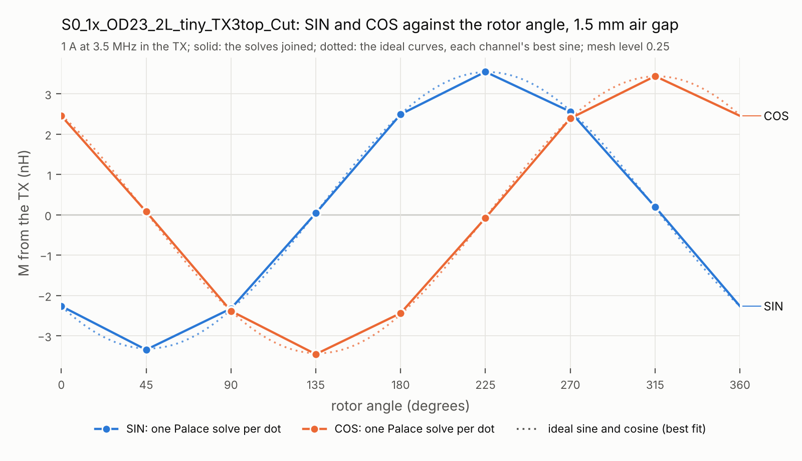

# S0_1x_OD23_2L_tiny_TX3top_Cut: SIN and COS over the rotor's turn in Elmer

A coil set made with the [Sinusoidal Coil Generator](https://github.com/RolandThsive/Sinusoidal-Inductive-Encoders-Coil-Generator): 23.4 mm across, 2 copper layers, one electrical period per turn and a half-ring rotor. The TX carries 1 A at 3.5 MHz; the curves are the mutual inductance from the TX to SIN and to COS (1 nH is 22 mV of EMF). Each angle is one Elmer solve with its own mesh, checked by working the TX's L and R out two ways: from its voltage, and from the field energy and the eddy power (the L and R checks in each table give how far apart they are; a solve is read when both are within 1 %). This page is rewritten by `simulation.py` after every solve.

| Air gap | Angles solved | Amplitude SIN / COS | Angle error |
|---|---|---|---|
| 2 mm | 8 of 8 | 2.29 / 2.29 nH (50 / 50 mV) | 0.3° rms, 0.6° peak |
| 1.5 mm | 8 of 8 | 3.32 / 3.32 nH (73 / 73 mV) | 0.3° rms, 0.5° peak |
| 1 mm | 8 of 8 | 4.88 / 4.88 nH (107 / 107 mV) | 0.3° rms, 0.6° peak |
| 0.5 mm | 8 of 8 | 7.10 / 7.10 nH (156 / 156 mV) | 0.6° rms, 0.8° peak |
| 0.1 mm | 8 of 8 | 9.12 / 9.12 nH (201 / 201 mV) | 1.2° rms, 1.5° peak |

## 2 mm air gap

*Figure 1. SIN (blue) and COS (orange) at a 2 mm air gap: the mutual inductance from the TX against the rotor's angle, 8 of 8 angles solved. Each dot is one Elmer solve and the solid line joins them; the dotted lines are the ideal sine and cosine, each channel's best sine fit, which is what the angle error is measured against. SIN swings ±2.29 nH and COS ±2.29 nH, that is ±50 and ±50 mV of EMF.*

Best sine fit: SIN amplitude 2.286 nH, offset -0.109 nH, phase 44.4°; COS amplitude 2.287 nH, offset -0.012 nH, phase 134.5°. Angle error, with the offset and gain of each channel calibrated out (worked out as below): 0.3° rms and 0.6° at worst, in electrical degrees, the same as mechanical degrees here. SIN and COS are 90.1° apart, against 90° for perfect quadrature.

| Rotor | M SIN (nH) | M COS (nH) | Angle error | L TX (nH) | R TX (mΩ) | Solve | L and R checks | Memory | Time |
|---|---|---|---|---|---|---|---|---|---|
| 0° | 1.4900 | 1.6094 | +0.18° | 260.091 | 446.01 | direct | L -0.004 %, R +0.000 % | 13.3 GB | 7 min |
| 45° | 2.1976 | 0.0233 | -0.31° | 260.303 | 445.89 | direct | L -0.002 %, R +0.000 % | 13.3 GB | 7 min |
| 90° | 1.5089 | -1.6118 | +0.22° | 260.253 | 445.80 | direct | L -0.002 %, R +0.000 % | 13.3 GB | 7 min |
| 135° | -0.0853 | -2.3160 | -0.01° | 259.969 | 445.35 | direct | L -0.003 %, R +0.000 % | 13.3 GB | 6 min |
| 180° | -1.7019 | -1.6337 | +0.09° | 259.969 | 444.92 | direct | L -0.003 %, R +0.000 % | 13.3 GB | 6 min |
| 225° | -2.4004 | -0.0402 | -0.12° | 260.036 | 445.25 | direct | L -0.003 %, R +0.000 % | 13.3 GB | 7 min |
| 270° | -1.7257 | 1.6018 | +0.50° | 260.081 | 445.60 | direct | L -0.003 %, R +0.000 % | 13.3 GB | 6 min |
| 315° | -0.1540 | 2.2676 | -0.56° | 260.051 | 445.66 | direct | L -0.002 %, R +0.000 % | 13.3 GB | 7 min |

## 1.5 mm air gap

*Figure 2. SIN (blue) and COS (orange) at a 1.5 mm air gap: the mutual inductance from the TX against the rotor's angle, 8 of 8 angles solved. Each dot is one Elmer solve and the solid line joins them; the dotted lines are the ideal sine and cosine, each channel's best sine fit, which is what the angle error is measured against. SIN swings ±3.32 nH and COS ±3.32 nH, that is ±73 and ±73 mV of EMF.*

Best sine fit: SIN amplitude 3.321 nH, offset -0.106 nH, phase 44.0°; COS amplitude 3.324 nH, offset -0.006 nH, phase 134.1°. Angle error, with the offset and gain of each channel calibrated out (worked out as below): 0.3° rms and 0.5° at worst, in electrical degrees, the same as mechanical degrees here. SIN and COS are 90.1° apart, against 90° for perfect quadrature.

| Rotor | M SIN (nH) | M COS (nH) | Angle error | L TX (nH) | R TX (mΩ) | Solve | L and R checks | Memory | Time |
|---|---|---|---|---|---|---|---|---|---|
| 0° | 2.2000 | 2.3662 | +0.18° | 254.232 | 449.97 | direct | L -0.004 %, R +0.000 % | 13.3 GB | 6 min |
| 45° | 3.2468 | 0.0673 | -0.29° | 254.494 | 449.82 | direct | L -0.002 %, R +0.000 % | 13.3 GB | 5 min |
| 90° | 2.2562 | -2.3136 | +0.27° | 254.456 | 449.65 | direct | L -0.006 %, R +0.000 % | 13.3 GB | 5 min |
| 135° | -0.0453 | -3.3554 | -0.08° | 254.189 | 449.15 | direct | L -0.002 %, R +0.000 % | 13.3 GB | 6 min |
| 180° | -2.4070 | -2.3713 | +0.19° | 254.218 | 448.57 | direct | L -0.002 %, R +0.000 % | 13.3 GB | 7 min |
| 225° | -3.4349 | -0.0716 | -0.17° | 254.255 | 448.95 | direct | L -0.005 %, R +0.000 % | 13.3 GB | 6 min |
| 270° | -2.4723 | 2.3194 | +0.44° | 254.290 | 449.31 | direct | L -0.003 %, R +0.000 % | 13.3 GB | 6 min |
| 315° | -0.1928 | 3.3119 | -0.54° | 254.231 | 449.48 | direct | L -0.003 %, R +0.000 % | 13.3 GB | 6 min |

## 1 mm air gap

*Figure 3. SIN (blue) and COS (orange) at a 1 mm air gap: the mutual inductance from the TX against the rotor's angle, 8 of 8 angles solved. Each dot is one Elmer solve and the solid line joins them; the dotted lines are the ideal sine and cosine, each channel's best sine fit, which is what the angle error is measured against. SIN swings ±4.88 nH and COS ±4.88 nH, that is ±107 and ±107 mV of EMF.*

Best sine fit: SIN amplitude 4.879 nH, offset -0.111 nH, phase 43.2°; COS amplitude 4.882 nH, offset 0.012 nH, phase 133.3°. Angle error, with the offset and gain of each channel calibrated out (worked out as below): 0.3° rms and 0.6° at worst, in electrical degrees, the same as mechanical degrees here. SIN and COS are 90.1° apart, against 90° for perfect quadrature.

| Rotor | M SIN (nH) | M COS (nH) | Angle error | L TX (nH) | R TX (mΩ) | Solve | L and R checks | Memory | Time |
|---|---|---|---|---|---|---|---|---|---|
| 0° | 3.2297 | 3.5445 | +0.20° | 244.977 | 455.96 | direct | L -0.002 %, R +0.000 % | 13.3 GB | 4 min |
| 45° | 4.8134 | 0.1931 | -0.32° | 245.303 | 455.81 | direct | L -0.002 %, R +0.000 % | 13.3 GB | 5 min |
| 90° | 3.4027 | -3.3304 | +0.33° | 245.283 | 455.50 | direct | L -0.002 %, R +0.000 % | 13.3 GB | 5 min |
| 135° | 0.0557 | -4.9084 | -0.16° | 245.033 | 455.00 | direct | L -0.004 %, R +0.000 % | 13.3 GB | 5 min |
| 180° | -3.4488 | -3.5024 | +0.31° | 245.119 | 454.18 | direct | L -0.003 %, R +0.000 % | 13.3 GB | 4 min |
| 225° | -4.9949 | -0.1602 | -0.25° | 245.103 | 454.63 | direct | L -0.003 %, R +0.000 % | 13.3 GB | 5 min |
| 270° | -3.6362 | 3.3787 | +0.44° | 245.133 | 454.94 | direct | L -0.002 %, R +0.000 % | 13.3 GB | 5 min |
| 315° | -0.3099 | 4.8851 | -0.56° | 245.035 | 455.31 | direct | L -0.003 %, R +0.000 % | 13.3 GB | 4 min |

## 0.5 mm air gap

*Figure 4. SIN (blue) and COS (orange) at a 0.5 mm air gap: the mutual inductance from the TX against the rotor's angle, 8 of 8 angles solved. Each dot is one Elmer solve and the solid line joins them; the dotted lines are the ideal sine and cosine, each channel's best sine fit, which is what the angle error is measured against. SIN swings ±7.10 nH and COS ±7.10 nH, that is ±156 and ±156 mV of EMF.*

Best sine fit: SIN amplitude 7.099 nH, offset -0.141 nH, phase 41.5°; COS amplitude 7.101 nH, offset 0.061 nH, phase 131.6°. Angle error, with the offset and gain of each channel calibrated out (worked out as below): 0.6° rms and 0.8° at worst, in electrical degrees, the same as mechanical degrees here. SIN and COS are 90.1° apart, against 90° for perfect quadrature.

| Rotor | M SIN (nH) | M COS (nH) | Angle error | L TX (nH) | R TX (mΩ) | Solve | L and R checks | Memory | Time |
|---|---|---|---|---|---|---|---|---|---|
| 0° | 4.5952 | 5.3309 | +0.39° | 228.789 | 467.44 | direct | L -0.004 %, R +0.000 % | 13.3 GB | 4 min |
| 45° | 7.0037 | 0.5580 | -0.55° | 229.167 | 467.47 | direct | L -0.002 %, R +0.000 % | 13.3 GB | 4 min |
| 90° | 5.0962 | -4.6782 | +0.56° | 229.186 | 466.90 | direct | L -0.003 %, R +0.000 % | 13.3 GB | 3 min |
| 135° | 0.3369 | -7.0828 | -0.40° | 228.935 | 466.57 | direct | L -0.002 %, R +0.000 % | 13.3 GB | 4 min |
| 180° | -4.8832 | -5.1714 | +0.63° | 229.141 | 465.36 | direct | L -0.004 %, R +0.000 % | 13.3 GB | 3 min |
| 225° | -7.2117 | -0.4232 | -0.48° | 229.029 | 465.92 | direct | L -0.002 %, R +0.000 % | 13.3 GB | 3 min |
| 270° | -5.4038 | 4.8359 | +0.64° | 229.085 | 465.98 | direct | L -0.002 %, R +0.000 % | 13.3 GB | 3 min |
| 315° | -0.6625 | 7.1190 | -0.79° | 228.918 | 466.71 | direct | L -0.002 %, R +0.000 % | 13.3 GB | 4 min |

## 0.1 mm air gap

*Figure 5. SIN (blue) and COS (orange) at a 0.1 mm air gap: the mutual inductance from the TX against the rotor's angle, 8 of 8 angles solved. Each dot is one Elmer solve and the solid line joins them; the dotted lines are the ideal sine and cosine, each channel's best sine fit, which is what the angle error is measured against. SIN swings ±9.12 nH and COS ±9.12 nH, that is ±201 and ±201 mV of EMF.*

Best sine fit: SIN amplitude 9.123 nH, offset -0.204 nH, phase 39.0°; COS amplitude 9.125 nH, offset 0.137 nH, phase 129.1°. Angle error, with the offset and gain of each channel calibrated out (worked out as below): 1.2° rms and 1.5° at worst, in electrical degrees, the same as mechanical degrees here. SIN and COS are 90.1° apart, against 90° for perfect quadrature.

| Rotor | M SIN (nH) | M COS (nH) | Angle error | L TX (nH) | R TX (mΩ) | Solve | L and R checks | Memory | Time |
|---|---|---|---|---|---|---|---|---|---|
| away | -0.1357 | 0.0032 |  | 273.310 | 438.41 | direct | L -0.005 %, R +0.000 % | 13.3 GB | 3 min |
| 0° | 5.6598 | 7.1241 | +1.00° | 202.819 | 498.64 | direct | L -0.006 %, R +0.000 % | 13.3 GB | 3 min |
| 45° | 8.9295 | 1.2904 | -1.21° | 203.113 | 499.74 | direct | L -0.004 %, R +0.000 % | 13.3 GB | 3 min |
| 90° | 6.7331 | -5.7308 | +1.21° | 203.286 | 497.84 | direct | L -0.003 %, R +0.000 % | 13.3 GB | 3 min |
| 135° | 0.9204 | -9.0008 | -1.03° | 202.910 | 498.87 | direct | L -0.003 %, R +0.000 % | 13.3 GB | 3 min |
| 180° | -6.0933 | -6.7854 | +1.39° | 203.333 | 496.66 | direct | L -0.003 %, R +0.000 % | 13.3 GB | 3 min |
| 225° | -9.2082 | -0.9921 | -1.15° | 203.030 | 498.03 | direct | L -0.002 %, R +0.000 % | 13.3 GB | 3 min |
| 270° | -7.1852 | 6.0613 | +1.30° | 203.258 | 496.55 | direct | L -0.003 %, R +0.000 % | 13.3 GB | 3 min |
| 315° | -1.3885 | 9.1284 | -1.51° | 202.897 | 498.81 | direct | L -0.002 %, R +0.000 % | 13.3 GB | 3 min |

## The air gaps together

*Figure 6. Every air gap on one chart, the 0.1 mm gap in full colour, the solves of each joined by a solid line, and each gap's ideal sine and cosine dotted. Going from 2 to 0.1 mm makes SIN 3.99 times and COS 3.99 times larger.*

## Against the expectation

The generator estimates the TX at 292 nH with the rotor away and 226 nH with it (its drop with the rotor is an upper estimate). Elmer gives 273.3 nH with the rotor away, and 260.0 to 260.3 nH with the rotor at 2 mm, and 254.2 to 254.5 nH with the rotor at 1.5 mm, and 245.0 to 245.3 nH with the rotor at 1 mm, and 228.8 to 229.2 nH with the rotor at 0.5 mm, and 202.8 to 203.3 nH with the rotor at 0.1 mm. The expected values are in [expected_results.json](expected_results.json).

## How the angle error is worked out

Each channel gets its best sine over the rotor's period, M = offset + amplitude × sin(θ + phase). Each channel's offset is taken out and it is divided by its amplitude, so both swing between −1 and +1, as a decoder chip's offset and gain calibration does. The angle is read back as atan2(SIN, COS); the error at each angle is that reading less the true angle, less the average of all of them, since a fixed offset only moves where zero is. The rms and the worst of them are the angle error. The fit uses the same points as the error, so it measures how far the solves are from a perfect sine and cosine pair. [`angle_error.py`](../Elmer%20Simulation/angle_error.py) does it.

## The boards

*Drawn by the generator. Red is the top layer, blue the bottom; the dots are vias. In Elmer, SIN is opened by a cut in its top trace at (97.16, 101.63) and COS at (98.37, 97.16), the TX at its ends at (111, 100) (KiCad mm). The [README](../README.md) has the board and how it was made.*

*How the boards are set up in Elmer, drawn by [`rig_picture.py`](../Elmer%20Simulation/rig_picture.py) from the geometry the mesh is built from: the rotor copper side down over the stator, each receiver opened by a 0.2 mm cut across a top trace (the two cut faces are the terminal, held at 0 A, so the voltage across the cut is the open-circuit EMF), and the TX opened between its two stacked ends, where 1 A is driven.*
