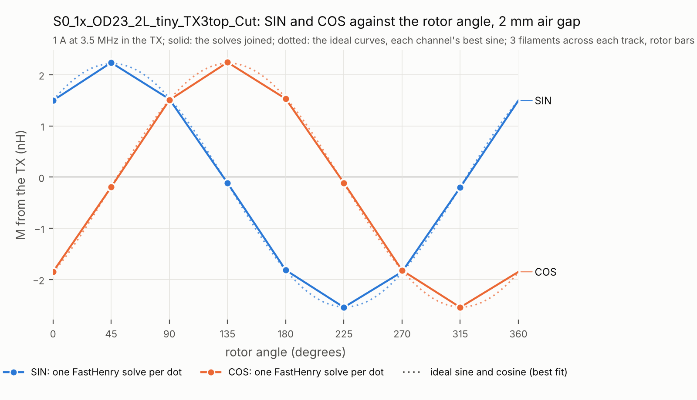
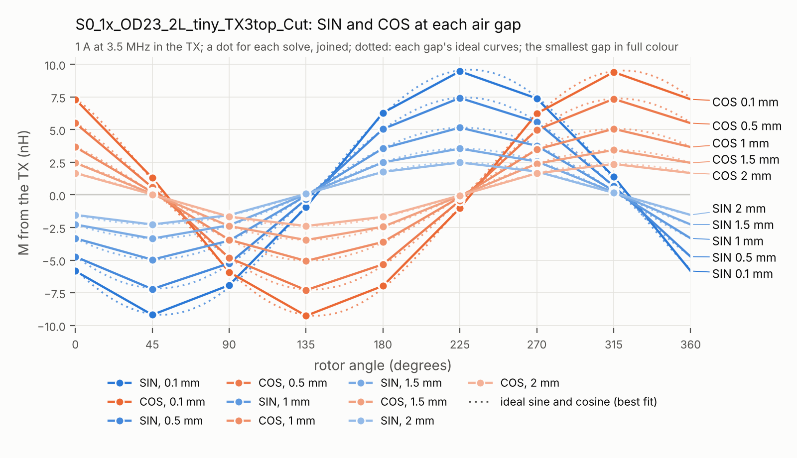

# S0_1x_OD23_2L_tiny_TX3top_Cut: SIN and COS over the rotor's turn in PyPEEC

A coil set made with the [Sinusoidal Coil Generator](https://github.com/RolandThsive/Sinusoidal-Inductive-Encoders-Coil-Generator): 23.4 mm across, 2 copper layers, one electrical period per turn and a half-ring rotor. The TX carries 1 A at 3.5 MHz; the curves are the mutual inductance from the TX to SIN and to COS (1 nH is 22 mV of EMF). Each angle is one PyPEEC solve with its own voxels, checked by working the TX's L and R out two ways: from its voltage, and from the stored energy and the losses (the L and R checks in each table give how far apart they are; a solve is read when both are within 1 %). This page is rewritten by `simulation.py` after every solve.

| Air gap | Angles solved | Amplitude SIN / COS | Angle error |
|---|---|---|---|
| 2 mm | 8 of 8 | 2.33 / 2.33 nH (51 / 51 mV) | 0.3° rms, 0.4° peak |
| 1.5 mm | 8 of 8 | 3.39 / 3.39 nH (74 / 74 mV) | 0.3° rms, 0.4° peak |
| 1 mm | 8 of 8 | 4.98 / 4.99 nH (110 / 110 mV) | 0.3° rms, 0.5° peak |
| 0.5 mm | 8 of 8 | 7.25 / 7.26 nH (160 / 160 mV) | 0.5° rms, 0.7° peak |
| 0.1 mm | 8 of 8 | 9.28 / 9.28 nH (204 / 204 mV) | 1.2° rms, 1.5° peak |

## 2 mm air gap

*Figure 1. SIN (blue) and COS (orange) at a 2 mm air gap: the mutual inductance from the TX against the rotor's angle, 8 of 8 angles solved. Each dot is one PyPEEC solve and the solid line joins them; the dotted lines are the ideal sine and cosine, each channel's best sine fit, which is what the angle error is measured against. SIN swings ±2.33 nH and COS ±2.33 nH, that is ±51 and ±51 mV of EMF.*

Best sine fit: SIN amplitude 2.329 nH, offset -0.217 nH, phase 44.3°; COS amplitude 2.330 nH, offset 0.126 nH, phase 134.2°. Angle error, with the offset and gain of each channel calibrated out (worked out as below): 0.3° rms and 0.4° at worst, in electrical degrees, the same as mechanical degrees here. SIN and COS are 90.0° apart, against 90° for perfect quadrature.

| Rotor | M SIN (nH) | M COS (nH) | Angle error | L TX (nH) | R TX (mΩ) | Solve | L and R checks | Memory | Time |
|---|---|---|---|---|---|---|---|---|---|
| 0° | 1.4070 | 1.7863 | +0.14° | 281.432 | 483.57 | 3 iterations, 1.8e-07 | L +0.000 %, R +0.000 % | 3.3 GB | 10 min |
| 45° | 2.1308 | 0.1628 | -0.14° | 281.523 | 483.96 | 3 iterations, 1.8e-07 | L +0.000 %, R +0.000 % | 3.3 GB | 13 min |
| 90° | 1.4300 | -1.4971 | +0.32° | 281.500 | 483.97 | 3 iterations, 2.0e-07 | L +0.000 %, R +0.000 % | 3.4 GB | 9 min |
| 135° | -0.1785 | -2.2157 | -0.19° | 281.594 | 483.93 | 3 iterations, 1.9e-07 | L +0.000 %, R +0.000 % | 3.3 GB | 10 min |
| 180° | -1.8431 | -1.5244 | +0.34° | 281.624 | 483.31 | 3 iterations, 1.8e-07 | L +0.000 %, R +0.000 % | 3.3 GB | 8 min |
| 225° | -2.5497 | 0.0788 | -0.41° | 281.644 | 483.00 | 3 iterations, 1.9e-07 | L +0.000 %, R +0.000 % | 3.2 GB | 8 min |
| 270° | -1.8753 | 1.7542 | +0.21° | 281.546 | 482.83 | 3 iterations, 2.1e-07 | L +0.000 %, R +0.000 % | 3.3 GB | 8 min |
| 315° | -0.2587 | 2.4654 | -0.26° | 281.486 | 483.13 | 3 iterations, 1.9e-07 | L +0.000 %, R +0.000 % | 3.2 GB | 9 min |

## 1.5 mm air gap

*Figure 2. SIN (blue) and COS (orange) at a 1.5 mm air gap: the mutual inductance from the TX against the rotor's angle, 8 of 8 angles solved. Each dot is one PyPEEC solve and the solid line joins them; the dotted lines are the ideal sine and cosine, each channel's best sine fit, which is what the angle error is measured against. SIN swings ±3.39 nH and COS ±3.39 nH, that is ±74 and ±74 mV of EMF.*

Best sine fit: SIN amplitude 3.386 nH, offset -0.219 nH, phase 43.9°; COS amplitude 3.387 nH, offset 0.136 nH, phase 133.9°. Angle error, with the offset and gain of each channel calibrated out (worked out as below): 0.3° rms and 0.4° at worst, in electrical degrees, the same as mechanical degrees here. SIN and COS are 90.0° apart, against 90° for perfect quadrature.

| Rotor | M SIN (nH) | M COS (nH) | Angle error | L TX (nH) | R TX (mΩ) | Solve | L and R checks | Memory | Time |
|---|---|---|---|---|---|---|---|---|---|
| 0° | 2.1237 | 2.5638 | +0.12° | 276.358 | 486.97 | 3 iterations, 2.0e-07 | L +0.000 %, R -0.001 % | 3.3 GB | 9 min |
| 45° | 3.1961 | 0.2110 | -0.13° | 276.481 | 487.47 | 3 iterations, 2.0e-07 | L +0.000 %, R -0.001 % | 3.3 GB | 12 min |
| 90° | 2.1880 | -2.2052 | +0.32° | 276.451 | 487.52 | 3 iterations, 1.9e-07 | L +0.000 %, R +0.000 % | 3.4 GB | 9 min |
| 135° | -0.1402 | -3.2706 | -0.21° | 276.569 | 487.53 | 3 iterations, 2.2e-07 | L +0.000 %, R -0.001 % | 3.3 GB | 12 min |
| 180° | -2.5667 | -2.2750 | +0.36° | 276.629 | 486.60 | 3 iterations, 2.0e-07 | L +0.000 %, R -0.001 % | 3.3 GB | 11 min |
| 225° | -3.6110 | 0.0442 | -0.43° | 276.642 | 486.28 | 3 iterations, 1.8e-07 | L +0.000 %, R +0.000 % | 3.2 GB | 11 min |
| 270° | -2.6443 | 2.4863 | +0.21° | 276.519 | 486.00 | 3 iterations, 2.0e-07 | L +0.000 %, R +0.000 % | 3.3 GB | 10 min |
| 315° | -0.3007 | 3.5373 | -0.25° | 276.436 | 486.44 | 3 iterations, 1.8e-07 | L +0.000 %, R +0.000 % | 3.2 GB | 12 min |

## 1 mm air gap

*Figure 3. SIN (blue) and COS (orange) at a 1 mm air gap: the mutual inductance from the TX against the rotor's angle, 8 of 8 angles solved. Each dot is one PyPEEC solve and the solid line joins them; the dotted lines are the ideal sine and cosine, each channel's best sine fit, which is what the angle error is measured against. SIN swings ±4.98 nH and COS ±4.99 nH, that is ±110 and ±110 mV of EMF.*

Best sine fit: SIN amplitude 4.984 nH, offset -0.234 nH, phase 43.1°; COS amplitude 4.986 nH, offset 0.161 nH, phase 133.1°. Angle error, with the offset and gain of each channel calibrated out (worked out as below): 0.3° rms and 0.5° at worst, in electrical degrees, the same as mechanical degrees here. SIN and COS are 90.0° apart, against 90° for perfect quadrature.

| Rotor | M SIN (nH) | M COS (nH) | Angle error | L TX (nH) | R TX (mΩ) | Solve | L and R checks | Memory | Time |
|---|---|---|---|---|---|---|---|---|---|
| away | -0.2401 | 0.1327 |  | 296.734 | 472.16 | 2 iterations, 2.4e-07 | L +0.000 %, R +0.000 % | 0.9 GB | 1 min |
| 0° | 3.1662 | 3.7799 | +0.14° | 266.156 | 492.78 | 3 iterations, 1.6e-07 | L +0.000 %, R +0.000 % | 2.3 GB | 5 min |
| 45° | 4.7937 | 0.3428 | -0.16° | 266.322 | 493.51 | 3 iterations, 1.8e-07 | L +0.000 %, R +0.000 % | 2.2 GB | 7 min |
| 90° | 3.3537 | -3.2370 | +0.35° | 266.281 | 493.67 | 3 iterations, 2.0e-07 | L +0.000 %, R +0.000 % | 2.3 GB | 4 min |
| 135° | -0.0429 | -4.8555 | -0.26° | 266.430 | 493.83 | 3 iterations, 2.0e-07 | L +0.000 %, R +0.000 % | 2.2 GB | 6 min |
| 180° | -3.6439 | -3.4302 | +0.45° | 266.546 | 492.29 | 3 iterations, 2.1e-07 | L +0.000 %, R +0.000 % | 2.3 GB | 5 min |
| 225° | -5.2220 | -0.0489 | -0.49° | 266.543 | 491.98 | 3 iterations, 2.0e-07 | L +0.000 %, R +0.000 % | 2.2 GB | 5 min |
| 270° | -3.8504 | 3.5735 | +0.25° | 266.388 | 491.46 | 3 iterations, 1.8e-07 | L +0.000 %, R +0.000 % | 2.3 GB | 5 min |
| 315° | -0.4246 | 5.1615 | -0.27° | 266.271 | 492.14 | 3 iterations, 2.0e-07 | L +0.000 %, R +0.000 % | 2.2 GB | 6 min |

## 0.5 mm air gap

*Figure 4. SIN (blue) and COS (orange) at a 0.5 mm air gap: the mutual inductance from the TX against the rotor's angle, 8 of 8 angles solved. Each dot is one PyPEEC solve and the solid line joins them; the dotted lines are the ideal sine and cosine, each channel's best sine fit, which is what the angle error is measured against. SIN swings ±7.25 nH and COS ±7.26 nH, that is ±160 and ±160 mV of EMF.*

Best sine fit: SIN amplitude 7.255 nH, offset -0.279 nH, phase 41.5°; COS amplitude 7.256 nH, offset 0.220 nH, phase 131.5°. Angle error, with the offset and gain of each channel calibrated out (worked out as below): 0.5° rms and 0.7° at worst, in electrical degrees, the same as mechanical degrees here. SIN and COS are 90.0° apart, against 90° for perfect quadrature.

| Rotor | M SIN (nH) | M COS (nH) | Angle error | L TX (nH) | R TX (mΩ) | Solve | L and R checks | Memory | Time |
|---|---|---|---|---|---|---|---|---|---|
| 0° | 4.5425 | 5.6188 | +0.31° | 249.110 | 503.37 | 3 iterations, 1.9e-07 | L +0.000 %, R +0.000 % | 1.6 GB | 6 min |
| 45° | 7.0213 | 0.7176 | -0.36° | 249.315 | 504.56 | 3 iterations, 1.6e-07 | L +0.000 %, R +0.000 % | 1.6 GB | 8 min |
| 90° | 5.0678 | -4.5994 | +0.56° | 249.264 | 504.98 | 3 iterations, 1.8e-07 | L +0.000 %, R +0.000 % | 1.7 GB | 6 min |
| 135° | 0.2341 | -7.0681 | -0.50° | 249.434 | 505.66 | 3 iterations, 2.3e-07 | L +0.000 %, R +0.000 % | 1.6 GB | 7 min |
| 180° | -5.1259 | -5.1255 | +0.73° | 249.667 | 502.92 | 3 iterations, 1.9e-07 | L +0.000 %, R +0.000 % | 1.6 GB | 7 min |
| 225° | -7.5078 | -0.3160 | -0.71° | 249.626 | 502.75 | 3 iterations, 1.9e-07 | L +0.000 %, R +0.000 % | 1.6 GB | 7 min |
| 270° | -5.6771 | 5.0684 | +0.46° | 249.447 | 501.59 | 3 iterations, 2.1e-07 | L +0.000 %, R +0.000 % | 1.6 GB | 5 min |
| 315° | -0.7884 | 7.4657 | -0.49° | 249.266 | 502.76 | 3 iterations, 1.9e-07 | L +0.000 %, R +0.000 % | 1.6 GB | 5 min |

## 0.1 mm air gap

*Figure 5. SIN (blue) and COS (orange) at a 0.1 mm air gap: the mutual inductance from the TX against the rotor's angle, 8 of 8 angles solved. Each dot is one PyPEEC solve and the solid line joins them; the dotted lines are the ideal sine and cosine, each channel's best sine fit, which is what the angle error is measured against. SIN swings ±9.28 nH and COS ±9.28 nH, that is ±204 and ±204 mV of EMF.*

Best sine fit: SIN amplitude 9.276 nH, offset -0.358 nH, phase 38.9°; COS amplitude 9.276 nH, offset 0.309 nH, phase 129.0°. Angle error, with the offset and gain of each channel calibrated out (worked out as below): 1.2° rms and 1.5° at worst, in electrical degrees, the same as mechanical degrees here. SIN and COS are 90.0° apart, against 90° for perfect quadrature.

| Rotor | M SIN (nH) | M COS (nH) | Angle error | L TX (nH) | R TX (mΩ) | Solve | L and R checks | Memory | Time |
|---|---|---|---|---|---|---|---|---|---|
| 0° | 5.5794 | 7.4253 | +0.88° | 224.648 | 530.83 | 3 iterations, 2.0e-07 | L +0.000 %, R +0.000 % | 1.6 GB | 3 min |
| 45° | 8.9304 | 1.4559 | -1.00° | 224.768 | 533.23 | 3 iterations, 2.0e-07 | L +0.000 %, R +0.000 % | 1.6 GB | 4 min |
| 90° | 6.6820 | -5.6286 | +1.19° | 224.800 | 533.30 | 3 iterations, 2.0e-07 | L +0.000 %, R +0.000 % | 1.6 GB | 3 min |
| 135° | 0.8121 | -8.9711 | -1.14° | 224.875 | 535.75 | 3 iterations, 1.9e-07 | L +0.000 %, R +0.000 % | 1.6 GB | 4 min |
| 180° | -6.3477 | -6.7199 | +1.48° | 225.304 | 531.07 | 3 iterations, 2.1e-07 | L +0.000 %, R +0.000 % | 1.6 GB | 3 min |
| 225° | -9.5194 | -0.8778 | -1.34° | 225.156 | 531.65 | 3 iterations, 2.1e-07 | L +0.000 %, R +0.000 % | 1.6 GB | 3 min |
| 270° | -7.4801 | 6.2978 | +1.10° | 225.066 | 528.68 | 3 iterations, 2.4e-07 | L +0.000 %, R +0.000 % | 1.6 GB | 4 min |
| 315° | -1.5203 | 9.4923 | -1.17° | 224.707 | 531.22 | 3 iterations, 2.3e-07 | L +0.000 %, R +0.000 % | 1.6 GB | 4 min |

## The air gaps together

*Figure 6. Every air gap on one chart, the 0.1 mm gap in full colour, the solves of each joined by a solid line, and each gap's ideal sine and cosine dotted. Going from 2 to 0.1 mm makes SIN 3.98 times and COS 3.98 times larger.*

## Against the expectation

The generator estimates the TX at 292 nH with the rotor away and 226 nH with it (its drop with the rotor is an upper estimate). PyPEEC gives 296.7 nH with the rotor away, and 281.4 to 281.6 nH with the rotor at 2 mm, and 276.4 to 276.6 nH with the rotor at 1.5 mm, and 266.2 to 266.5 nH with the rotor at 1 mm, and 249.1 to 249.7 nH with the rotor at 0.5 mm, and 224.6 to 225.3 nH with the rotor at 0.1 mm. The expected values are in [expected_results.json](expected_results.json).

## How the angle error is worked out

Each channel gets its best sine over the rotor's period, M = offset + amplitude × sin(θ + phase). Each channel's offset is taken out and it is divided by its amplitude, so both swing between −1 and +1, as a decoder chip's offset and gain calibration does. The angle is read back as atan2(SIN, COS); the error at each angle is that reading less the true angle, less the average of all of them, since a fixed offset only moves where zero is. The rms and the worst of them are the angle error. The fit uses the same points as the error, so it measures how far the solves are from a perfect sine and cosine pair. [`angle_error.py`](../PyPEEC%20Simulation/angle_error.py) does it.

## The boards

*Drawn by the generator. Red is the top layer, blue the bottom; the dots are vias. In PyPEEC, SIN is opened by a cut in its top trace at (97.16, 101.63) and COS at (98.37, 97.16), the TX at its ends at (111, 100) (KiCad mm). The [README](../README.md) has the board and how it was made.*

*How the boards are set up in PyPEEC, drawn by [`rig_picture.py`](../PyPEEC%20Simulation/rig_picture.py) from the voxels simulation.py solves from: the rotor copper side down over the stator, each receiver opened by a 0.2 mm cut across a top trace (the two cut faces are the terminal, held at 0 A, so the voltage across the cut is the open-circuit EMF), and the TX opened between its two stacked ends, where 1 A is driven.*
