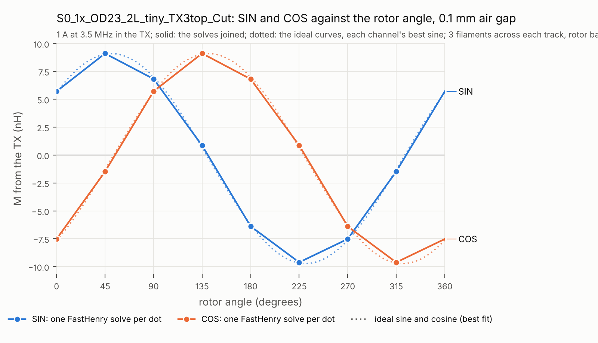
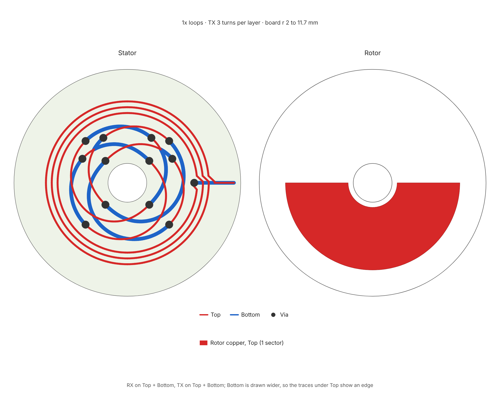
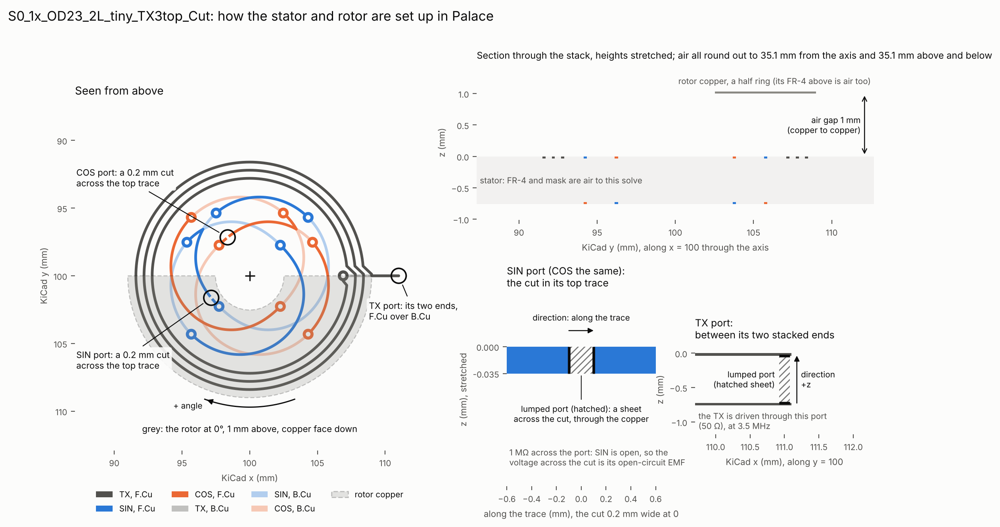

# S0_1x_OD23_2L_tiny_TX3top_Cut: SIN and COS over the rotor's turn in Palace

A coil set made with the [Sinusoidal Coil Generator](https://github.com/RolandThsive/Sinusoidal-Inductive-Encoders-Coil-Generator): 23.4 mm across, 2 copper layers, one electrical period per turn and a half-ring rotor. The TX is driven at 3.5 MHz; the curves are the mutual inductance from the TX to SIN and to COS (1 nH is 22 mV of EMF for 1 A in the TX). Each angle is one Palace solve with its own mesh, checked by working the TX's L out two ways: from its port's voltage, and from the magnetic energy in the whole field (the Checks column gives how far apart they are; a solve is read when the linear solve converged and the two are within 1 %). At the first angle of each gap SIN and COS are driven too, and the M from each back to the TX is checked against the M from the TX to it (reciprocity, in the same column). This page is rewritten by `simulation.py` after every solve.

| Air gap | Angles solved | Amplitude SIN / COS | Angle error |
|---|---|---|---|
| 2 mm | 8 of 8 | 2.36 / 2.37 nH (52 / 52 mV) | 0.3° rms, 0.4° peak |
| 1.5 mm | 8 of 8 | 3.43 / 3.43 nH (75 / 76 mV) | 0.3° rms, 0.4° peak |
| 1 mm | 8 of 8 | 5.03 / 5.04 nH (111 / 111 mV) | 0.3° rms, 0.5° peak |
| 0.5 mm | 8 of 8 | 7.31 / 7.32 nH (161 / 161 mV) | 0.6° rms, 0.7° peak |
| 0.1 mm | 8 of 8 | 9.38 / 9.39 nH (206 / 206 mV) | 1.2° rms, 1.5° peak |

## 2 mm air gap

*Figure 1. SIN (blue) and COS (orange) at a 2 mm air gap: the mutual inductance from the TX against the rotor's angle, 8 of 8 angles solved. Each dot is one Palace solve and the solid line joins them; the dotted lines are the ideal sine and cosine, each channel's best sine fit, which is what the angle error is measured against. SIN swings ±2.36 nH and COS ±2.37 nH, that is ±52 and ±52 mV of EMF.*

Best sine fit: SIN amplitude 2.360 nH, offset 0.113 nH, phase -135.7°; COS amplitude 2.366 nH, offset -0.007 nH, phase 134.4°. Angle error, with the offset and gain of each channel calibrated out (worked out as below): 0.3° rms and 0.4° at worst, in electrical degrees, the same as mechanical degrees here. SIN and COS are 90.0° apart, against 90° for perfect quadrature.

| Rotor | M SIN (nH) | M COS (nH) | Angle error | L TX (nH) | R TX (mΩ) | Solve | Checks | Memory | Time |
|---|---|---|---|---|---|---|---|---|---|
| 0° | -1.5351 | 1.6730 | +0.15° | 266.422 | 454.03 | 145 + 191 + 151 iterations, 8e-09 | L -0.004 %, reciprocity 0.00019 % | 11.4 GB | 12 min |
| 45° | -2.2665 | 0.0305 | -0.27° | 266.541 | 454.06 | 117 iterations, 9e-09 | L -0.004 % | 8.3 GB | 4 min |
| 90° | -1.5566 | -1.6632 | +0.34° | 266.530 | 453.85 | 116 iterations, 1e-08 | L -0.004 % | 8.2 GB | 7 min |
| 135° | 0.0796 | -2.3866 | -0.17° | 266.513 | 453.71 | 126 iterations, 1e-08 | L -0.004 % | 8.4 GB | 5 min |
| 180° | 1.7624 | -1.6792 | +0.31° | 266.570 | 453.49 | 115 iterations, 1e-08 | L -0.004 % | 8.2 GB | 3 min |
| 225° | 2.4778 | -0.0449 | -0.27° | 266.497 | 453.53 | 123 iterations, 9e-09 | L -0.004 % | 8.3 GB | 3 min |
| 270° | 1.7873 | 1.6513 | +0.30° | 266.511 | 453.56 | 118 iterations, 1e-08 | L -0.004 % | 8.2 GB | 3 min |
| 315° | 0.1555 | 2.3609 | -0.39° | 266.503 | 453.78 | 116 iterations, 1e-08 | L -0.004 % | 8.2 GB | 3 min |

## 1.5 mm air gap

*Figure 2. SIN (blue) and COS (orange) at a 1.5 mm air gap: the mutual inductance from the TX against the rotor's angle, 8 of 8 angles solved. Each dot is one Palace solve and the solid line joins them; the dotted lines are the ideal sine and cosine, each channel's best sine fit, which is what the angle error is measured against. SIN swings ±3.43 nH and COS ±3.43 nH, that is ±75 and ±76 mV of EMF.*

Best sine fit: SIN amplitude 3.427 nH, offset 0.111 nH, phase -136.0°; COS amplitude 3.434 nH, offset -0.001 nH, phase 134.0°. Angle error, with the offset and gain of each channel calibrated out (worked out as below): 0.3° rms and 0.4° at worst, in electrical degrees, the same as mechanical degrees here. SIN and COS are 90.0° apart, against 90° for perfect quadrature.

| Rotor | M SIN (nH) | M COS (nH) | Angle error | L TX (nH) | R TX (mΩ) | Solve | Checks | Memory | Time |
|---|---|---|---|---|---|---|---|---|---|
| 0° | -2.2657 | 2.4526 | +0.15° | 260.557 | 458.19 | 127 + 174 + 133 iterations, 1e-08 | L -0.004 %, reciprocity 2.6e-05 % | 10.2 GB | 9 min |
| 45° | -3.3469 | 0.0771 | -0.28° | 260.710 | 458.21 | 121 iterations, 9e-09 | L -0.004 % | 7.7 GB | 3 min |
| 90° | -2.3264 | -2.3861 | +0.34° | 260.702 | 457.88 | 122 iterations, 8e-09 | L -0.004 % | 7.7 GB | 3 min |
| 135° | 0.0394 | -3.4578 | -0.18° | 260.696 | 457.74 | 116 iterations, 1e-08 | L -0.004 % | 7.5 GB | 3 min |
| 180° | 2.4905 | -2.4403 | +0.35° | 260.797 | 457.38 | 119 iterations, 9e-09 | L -0.004 % | 7.6 GB | 3 min |
| 225° | 3.5440 | -0.0796 | -0.30° | 260.684 | 457.49 | 112 iterations, 9e-09 | L -0.004 % | 7.4 GB | 3 min |
| 270° | 2.5574 | 2.3901 | +0.31° | 260.692 | 457.50 | 112 iterations, 9e-09 | L -0.004 % | 7.5 GB | 3 min |
| 315° | 0.1957 | 3.4372 | -0.40° | 260.668 | 457.85 | 116 iterations, 1e-08 | L -0.004 % | 7.5 GB | 3 min |

## 1 mm air gap

*Figure 3. SIN (blue) and COS (orange) at a 1 mm air gap: the mutual inductance from the TX against the rotor's angle, 8 of 8 angles solved. Each dot is one Palace solve and the solid line joins them; the dotted lines are the ideal sine and cosine, each channel's best sine fit, which is what the angle error is measured against. SIN swings ±5.03 nH and COS ±5.04 nH, that is ±111 and ±111 mV of EMF.*

Best sine fit: SIN amplitude 5.031 nH, offset 0.116 nH, phase -136.8°; COS amplitude 5.037 nH, offset 0.017 nH, phase 133.2°. Angle error, with the offset and gain of each channel calibrated out (worked out as below): 0.3° rms and 0.5° at worst, in electrical degrees, the same as mechanical degrees here. SIN and COS are 90.0° apart, against 90° for perfect quadrature.

| Rotor | M SIN (nH) | M COS (nH) | Angle error | L TX (nH) | R TX (mΩ) | Solve | Checks | Memory | Time |
|---|---|---|---|---|---|---|---|---|---|
| away | 0.1235 | 0.0091 |  | 281.382 | 441.16 | 122 iterations, 1e-08 | L -0.004 % | 6.7 GB | 3 min |
| 0° | -3.3252 | 3.6630 | +0.19° | 251.008 | 463.47 | 121 + 164 + 124 iterations, 9e-09 | L -0.004 %, reciprocity 3.1e-05 % | 8.8 GB | 8 min |
| 45° | -4.9588 | 0.2060 | -0.33° | 251.202 | 463.50 | 117 iterations, 9e-09 | L -0.004 % | 6.6 GB | 2 min |
| 90° | -3.5053 | -3.4341 | +0.38° | 251.202 | 463.00 | 116 iterations, 9e-09 | L -0.004 % | 6.6 GB | 2 min |
| 135° | -0.0619 | -5.0569 | -0.21° | 251.203 | 462.89 | 123 iterations, 1e-08 | L -0.004 % | 6.7 GB | 3 min |
| 180° | 3.5651 | -3.6052 | +0.44° | 251.383 | 462.31 | 115 iterations, 1e-08 | L -0.004 % | 6.6 GB | 2 min |
| 225° | 5.1484 | -0.1739 | -0.36° | 251.207 | 462.50 | 107 iterations, 9e-09 | L -0.004 % | 6.4 GB | 2 min |
| 270° | 3.7548 | 3.4788 | +0.35° | 251.213 | 462.46 | 114 iterations, 1e-08 | L -0.004 % | 6.6 GB | 2 min |
| 315° | 0.3145 | 5.0553 | -0.45° | 251.163 | 463.00 | 112 iterations, 9e-09 | L -0.004 % | 6.5 GB | 2 min |

## 0.5 mm air gap

*Figure 4. SIN (blue) and COS (orange) at a 0.5 mm air gap: the mutual inductance from the TX against the rotor's angle, 8 of 8 angles solved. Each dot is one Palace solve and the solid line joins them; the dotted lines are the ideal sine and cosine, each channel's best sine fit, which is what the angle error is measured against. SIN swings ±7.31 nH and COS ±7.32 nH, that is ±161 and ±161 mV of EMF.*

Best sine fit: SIN amplitude 7.309 nH, offset 0.146 nH, phase -138.4°; COS amplitude 7.315 nH, offset 0.063 nH, phase 131.6°. Angle error, with the offset and gain of each channel calibrated out (worked out as below): 0.6° rms and 0.7° at worst, in electrical degrees, the same as mechanical degrees here. SIN and COS are 90.0° apart, against 90° for perfect quadrature.

| Rotor | M SIN (nH) | M COS (nH) | Angle error | L TX (nH) | R TX (mΩ) | Solve | Checks | Memory | Time |
|---|---|---|---|---|---|---|---|---|---|
| 0° | -4.7309 | 5.4907 | +0.38° | 234.659 | 474.94 | 110 + 148 + 113 iterations, 9e-09 | L -0.004 %, reciprocity 5e-05 % | 7.8 GB | 6 min |
| 45° | -7.2099 | 0.5746 | -0.56° | 234.880 | 475.14 | 103 iterations, 8e-09 | L -0.004 % | 5.8 GB | 2 min |
| 90° | -5.2427 | -4.8239 | +0.59° | 234.902 | 474.33 | 103 iterations, 9e-09 | L -0.004 % | 5.8 GB | 120 s |
| 135° | -0.3447 | -7.2917 | -0.41° | 234.889 | 474.43 | 109 iterations, 9e-09 | L -0.004 % | 5.9 GB | 2 min |
| 180° | 5.0419 | -5.3189 | +0.72° | 235.213 | 473.50 | 110 iterations, 1e-08 | L -0.004 % | 5.9 GB | 2 min |
| 225° | 7.4213 | -0.4454 | -0.59° | 234.931 | 473.81 | 101 iterations, 9e-09 | L -0.004 % | 5.7 GB | 115 s |
| 270° | 5.5658 | 4.9737 | +0.56° | 234.962 | 473.50 | 106 iterations, 9e-09 | L -0.004 % | 5.8 GB | 2 min |
| 315° | 0.6682 | 7.3466 | -0.69° | 234.866 | 474.40 | 103 iterations, 1e-08 | L -0.004 % | 5.8 GB | 2 min |

## 0.1 mm air gap

*Figure 5. SIN (blue) and COS (orange) at a 0.1 mm air gap: the mutual inductance from the TX against the rotor's angle, 8 of 8 angles solved. Each dot is one Palace solve and the solid line joins them; the dotted lines are the ideal sine and cosine, each channel's best sine fit, which is what the angle error is measured against. SIN swings ±9.38 nH and COS ±9.39 nH, that is ±206 and ±206 mV of EMF.*

Best sine fit: SIN amplitude 9.381 nH, offset 0.207 nH, phase -140.9°; COS amplitude 9.385 nH, offset 0.136 nH, phase 129.1°. Angle error, with the offset and gain of each channel calibrated out (worked out as below): 1.2° rms and 1.5° at worst, in electrical degrees, the same as mechanical degrees here. SIN and COS are 90.0° apart, against 90° for perfect quadrature.

| Rotor | M SIN (nH) | M COS (nH) | Angle error | L TX (nH) | R TX (mΩ) | Solve | Checks | Memory | Time |
|---|---|---|---|---|---|---|---|---|---|
| 0° | -5.8306 | 7.3146 | +0.97° | 208.553 | 505.55 | 111 + 150 + 115 iterations, 9e-09 | L -0.005 %, reciprocity 2.5e-05 % | 6.9 GB | 6 min |
| 45° | -9.1861 | 1.3087 | -1.22° | 208.667 | 506.76 | 106 iterations, 9e-09 | L -0.004 % | 5.2 GB | 106 s |
| 90° | -6.9169 | -5.9127 | +1.22° | 208.820 | 504.62 | 107 iterations, 8e-09 | L -0.005 % | 5.2 GB | 109 s |
| 135° | -0.9312 | -9.2577 | -1.02° | 208.660 | 506.09 | 115 iterations, 1e-08 | L -0.005 % | 5.3 GB | 110 s |
| 180° | 6.2864 | -6.9692 | +1.46° | 209.219 | 504.32 | 111 iterations, 8e-09 | L -0.005 % | 5.2 GB | 108 s |
| 225° | 9.4600 | -1.0214 | -1.23° | 208.742 | 505.39 | 99 iterations, 1e-08 | L -0.005 % | 5.1 GB | 95 s |
| 270° | 7.3829 | 6.2289 | +1.22° | 208.936 | 503.53 | 101 iterations, 9e-09 | L -0.005 % | 5.1 GB | 100 s |
| 315° | 1.3924 | 9.3998 | -1.40° | 208.683 | 505.89 | 113 iterations, 9e-09 | L -0.005 % | 5.3 GB | 111 s |

## The air gaps together

*Figure 6. Every air gap on one chart, the 0.1 mm gap in full colour, the solves of each joined by a solid line, and each gap's ideal sine and cosine dotted. Going from 2 to 0.1 mm makes SIN 3.97 times and COS 3.97 times larger.*

## Against the expectation

The generator estimates the TX at 292 nH with the rotor away and 226 nH with it (its drop with the rotor is an upper estimate). Palace gives 281.4 nH with the rotor away, and 266.4 to 266.6 nH with the rotor at 2 mm, and 260.6 to 260.8 nH with the rotor at 1.5 mm, and 251.0 to 251.4 nH with the rotor at 1 mm, and 234.7 to 235.2 nH with the rotor at 0.5 mm, and 208.6 to 209.2 nH with the rotor at 0.1 mm. The expected values are in [expected_results.json](expected_results.json).

## How the angle error is worked out

Each channel gets its best sine over the rotor's period, M = offset + amplitude × sin(θ + phase). Each channel's offset is taken out and it is divided by its amplitude, so both swing between −1 and +1, as a decoder chip's offset and gain calibration does. The angle is read back as atan2(SIN, COS); the error at each angle is that reading less the true angle, less the average of all of them, since a fixed offset only moves where zero is. The rms and the worst of them are the angle error. The fit uses the same points as the error, so it measures how far the solves are from a perfect sine and cosine pair. [`angle_error.py`](../Palace%20Simulation/angle_error.py) does it.

## The boards

*Drawn by the generator. Red is the top layer, blue the bottom; the dots are vias. In Palace, SIN is opened by a cut in its top trace at (97.16, 101.63) and COS at (98.37, 97.16), the TX at its ends at (111, 100) (KiCad mm). The [README](../README.md) has the board and how it was made.*

*How the boards are set up in Palace, drawn by [`rig_picture.py`](../Palace%20Simulation/rig_picture.py) from the geometry the mesh is built from: the rotor copper side down over the stator, each receiver opened by a 0.2 mm cut across a top trace (its lumped port, a sheet across the cut from one cut face to the other, has 1 MΩ across it, so the voltage across the cut is the open-circuit EMF), and the TX opened between its two stacked ends, where its port drives it.*
