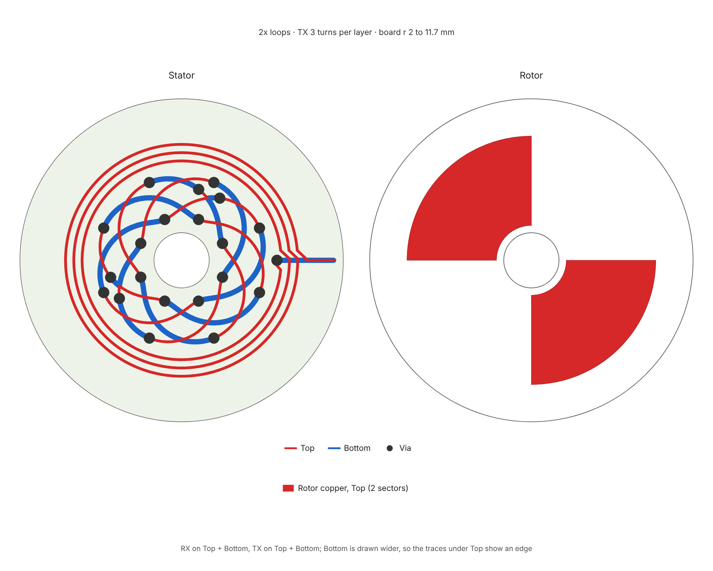
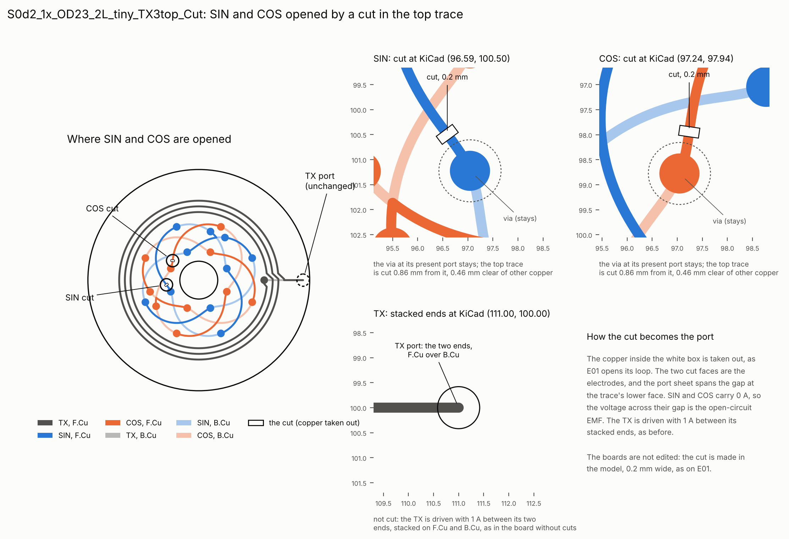
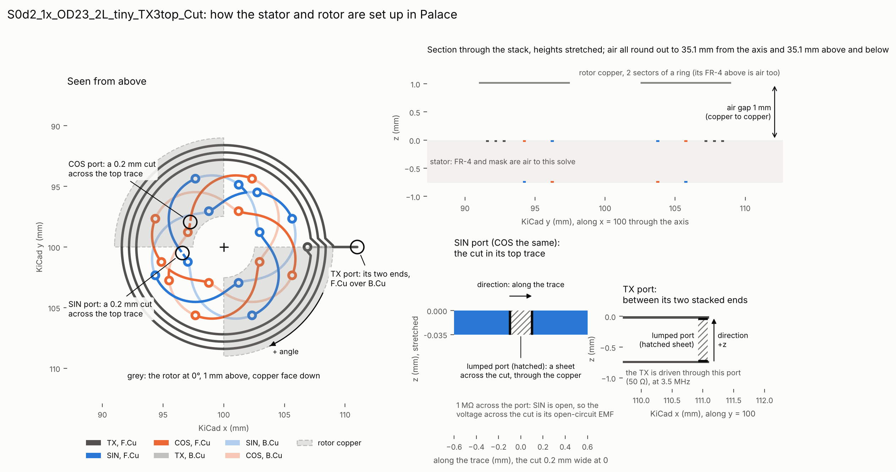
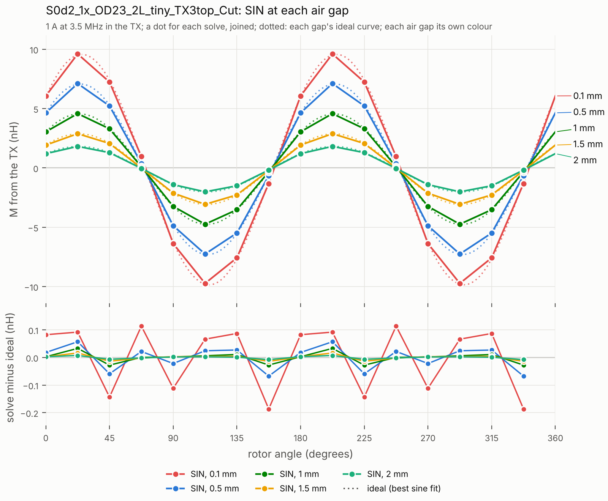

# S0d2_1x_OD23_2L_tiny_TX3top_Cut

A coil set from the [Sinusoidal Coil Generator](https://github.com/RolandThsive/Sinusoidal-Inductive-Encoders-Coil-Generator) (`Coil_2_11.7_2_1_3_Single_SteppedDiagonal`), set up for Palace by [`../new_coil.py`](../new_coil.py). The steps that made it are in [S0's README](../S0_1x_OD21_2L_tiny/README.md#the-workflow-for-any-generated-coil).

**What differs from S0.** Two electrical periods per turn instead of one, with a TX of three turns on the top layer. The RX coils keep S0's band (r = 3.2 to 6.1 mm) but each makes two sine periods per turn, and the rotor has two quarter-ring sectors, so the curves repeat every 180° and an angle reading covers half a turn. The TX is three turns, all on the top layer (F.Cu, r = 7.2, 7.8 and 8.4 mm), instead of S0's one turn on each layer; the board is 23.4 mm across and the rotor copper reaches r = 9.0 mm. The parameter files are those of [`../S0_1x_OD23_2L_tiny_TX3top_Cut`](../S0_1x_OD23_2L_tiny_TX3top_Cut) (the same board with one period per turn) with one change, `LOOPS = 2` in `RX_Parameters.py`, run with the generator at commit 32bf9cb. A spiral needs its inner end brought back out, so a short tail runs under the turns on B.Cu to the terminal, where the two ends sit stacked as on S0.

**SIN and COS are opened by a 0.2 mm cut across a top trace**, because that is how the real board is opened and routed to the IC. The voltage across each cut is the receiver's open-circuit EMF, reported as the mutual inductance M = V / (jωI) with 1 A in the TX. The cut is made in the model; the board files are as the generator wrote them. `test_spec.json` sets `"rx_port": "cut"` and gives each receiver a `cut` (where, which way the trace runs, 0.2 mm long, 0.4 mm across), and `simulation.py` takes the copper inside that box out of the top copper. The receivers' layer-change vias all stay in.

## The board

Bore and outer radius 2 and 11.7 mm, 2 copper layers, board 0.8 mm, air gap 1 mm by default (any other with `--gap`). 2 electrical periods per turn; the rotor has 2 sectors and repeats itself every 180°.

*Drawn by the generator.*

*Each cut is the spot on the receiver's top trace nearest its layer-change via where a 0.2 mm cut has at least 0.45 mm of free board round it and sits at least 0.75 mm from any via centre: 0.86 mm from the via on both receivers. The two spots are 45° apart about the axis, a quarter of the electrical period, as SIN and COS are.*

*How the boards sit in Palace, drawn by `rig_picture.py` from the geometry the mesh is built from: the rotor copper side down over the stator, each receiver opened by its cut and the TX between its two stacked ends. The copper inside each cut box is air, and a receiver's port is a sheet across the gap, through the copper's thickness, from one cut face to the other, with 1 MΩ across it; the outline of each cut is drawn into the 2D mesh, so both cut faces are meshed exactly. The TX's port, 0.16 mm wide, stands between its two ends with 50 Ω and the drive. 1 MΩ leaves a receiver open to a few parts in a million, so the voltage across its port is its open-circuit EMF. [`Palace Simulation/RotorStator_AngleSetup/`](Palace%20Simulation/RotorStator_AngleSetup/) has the rotor over the stator at each of the 16 angles, with the two cuts and the TX port ringed (`python angle_setup.py`).*

| Coil | Net | Opened at (KiCad mm) | How |
|---|---|---|---|
| TX | `TX` | (111, 100), F.Cu and B.Cu | its two stacked ends |
| SIN | `2` | cut at (96.591, 100.496), F.Cu | a 0.2 mm gap across the top trace, running (-0.60, -0.80); the via at (97.044, 101.225) stays |
| COS | `1` | cut at (97.239, 97.940), F.Cu | a 0.2 mm gap across the top trace, running (0.14, -0.99); the via at (97.044, 98.775) stays |

The generator's estimate for the TX: 0.29 µH with the rotor away and 0.23 µH with it, 0.38 Ω DC. Its warnings for this board:

* the tank's parallel resistance at the nominal air gap may be as low as 32 ohm (if the AC resistance is 2 x the DC value); the IPS2550 needs at least 250 ohm.  More TX turns, wider TX traces, thicker copper or a higher EXCITATION_FREQ_HZ raise it
* no spot on 2 within 30 deg of 0 deg, 4 mm from the other marks, has room for two vias (layers F.Cu, B.Cu); widen SILKSCREEN_SEARCH_SPAN_DEG, lower SILKSCREEN_BREAK_SEPARATION_MM, or cut the coil by hand
* no spot on 1 within 30 deg of 0 deg, 4 mm from the other marks, has room for two vias (layers F.Cu, B.Cu); widen SILKSCREEN_SEARCH_SPAN_DEG, lower SILKSCREEN_BREAK_SEPARATION_MM, or cut the coil by hand

## Results at each air gap

Every angle at every gap, one Palace solve each: 16 angles at each of 5 gaps, and the rotor taken away once (with the 1 mm results). Each gap's curves, fits and angle error are in [`Results/SINCOS_Results.md`](Results/SINCOS_Results.md).

| Air gap | Amplitude SIN / COS | Angle error | Solves passing the checks | L TX over the turn |
|---|---|---|---|---|
| 2 mm | 1.91 / 1.92 nH (42 / 42 mV) | 0.1° rms, 0.2° peak | 16 of 16 | 269.0 to 269.2 nH |
| 1.5 mm | 2.97 / 2.98 nH (65 / 65 mV) | 0.1° rms, 0.3° peak | 16 of 16 | 264.2 to 264.5 nH |
| 1 mm | 4.65 / 4.66 nH (102 / 102 mV) | 0.2° rms, 0.4° peak | 16 of 16 | 256.2 to 256.7 nH |
| 0.5 mm | 7.18 / 7.19 nH (158 / 158 mV) | 0.4° rms, 0.6° peak | 16 of 16 | 242.4 to 243.0 nH |
| 0.1 mm | 9.71 / 9.71 nH (213 / 213 mV) | 0.9° rms, 1.2° peak | 16 of 16 | 219.3 to 220.1 nH |

*SIN at each air gap, one dot per solve; a ring would mark a solve that fails the checks (none does). [`SINCOS_gaps_COS.webp`](Results/SINCOS_gaps_COS.webp) is the same for COS, and [`SINCOS_gaps.webp`](Results/SINCOS_gaps.webp) has both.*

Every solve converged and passes the checks: the TX's L from its port and from the field's energy agree within 0.01 %, where 1 % is allowed, and M back from SIN and COS to the TX, where they were driven too, equals M from the TX within 0.001 %. At every gap SIN and COS are within 0.2 % of each other in amplitude and 89.9° to 90.0° apart, and the angle error is 0.1° to 0.9° rms over the gaps. At 0.1 mm the angle error alternates in sign from one angle to the next: a ripple at four periods per electrical period, the fastest the angles can show, which third or fifth harmonics of the coupling would give, and those fade faster with the gap than the sine itself. SIN's amplitude is 9.71 nH at 0.1 mm, 7.18 nH at 0.5 mm, 4.65 nH at 1 mm, 2.97 nH at 1.5 mm and 1.91 nH at 2 mm (213 down to 42 mV of EMF at 1 A). L TX moves by 0.8 nH at most over the turn, and rises from 219.7 nH at 0.1 mm to 269.1 nH at 2 mm; with the rotor away it is 281.0 nH, where the generator estimated 226 nH with the rotor and 292 nH without. The meshes have 177,568 to 292,344 nodes, 12 to 21 element layers through the copper, board and gap, and each solve took 2 to 12 min and 6.0 to 12.9 GB on 4 MPI ranks.

## The folder

| Folder | What is in it |
|---|---|
| [`Boards/`](Boards/) | straight from the generator: the stator and rotor boards, `Parameters.txt`, the pictures and the parameter files it was run with |
| [`3D_Geometry/`](3D_Geometry/) | KESE's export of the stator and rotor (STL solids, `materials.json`, STEP, KESE's report), written by the first run; `source.json` records the board's hash, so a changed board is exported again |
| [`Palace Simulation/`](Palace%20Simulation/) | `test_spec.json` (every board fact the simulation needs, with `"rx_port": "cut"` and each receiver's `cut`), `simulation.py`, `angle_error.py`, `make_charts.py`, `rig_picture.py` and `angle_setup.py` (S0's, unchanged): `simulation.py` meshes and solves each angle and writes the results, [`RotorStator_AngleSetup/`](Palace%20Simulation/RotorStator_AngleSetup/) (the rotor over the stator at each angle), and the runs under `case/`, which git ignores |
| [`Results/`](Results/) | `expected_results.json` (the generator's estimates), [`SINCOS_Results.md`](Results/SINCOS_Results.md) with every gap on one page, the charts of every gap together (`SINCOS_gaps.webp`, and `_SIN` and `_COS` apart), and a folder for each air gap (`0d1mm_AirGap`, `0d5mm_AirGap`, `1mm_AirGap`, `1d5mm_AirGap`, `2mm_AirGap`, the point written as d) with the runs' `results_gap<gap>mm.json`, `.csv` and `.webp` |

Beside this README, `S0d2_1x_OD23_2L_tiny_TX3top_Cut_stator_and_rotor.webp` is the generator's picture of the boards, `S0d2_1x_OD23_2L_tiny_TX3top_Cut_palace_setup.webp` shows how they sit in Palace, and `S0d2_1x_OD23_2L_tiny_TX3top_Cut_cuts.webp` shows where SIN and COS are opened.

## Running it

| Air gap | Mesh level | Nodes | Element layers | MPI ranks | Memory a solve | Time a solve |
|---|---|---|---|---|---|---|
| 0.1 mm | 0.25 | 177,568 to 179,385 | 12 | 4 | 6.0 to 8.0 GB | 1.9 to 6.2 min |
| 0.5 mm | 0.25 | 202,416 to 204,487 | 14 | 4 | 6.8 to 9.0 GB | 2.9 to 9.5 min |
| 1 mm | 0.25 | 227,264 to 229,589 | 16 | 4 | 7.5 to 10.5 GB | 3 to 11 min |
| 1.5 mm | 0.25 | 264,536 to 267,242 | 19 | 4 | 8.7 to 11.7 GB | 4 to 11 min |
| 2 mm | 0.25 | 289,384 to 292,344 | 21 | 4 | 9.4 to 12.9 GB | 3 to 12 min |

Each solve is GMRES with hypre's AMS, at about 33 kB a mesh node, and 44 kB at the first angle of each gap, where the three coils are driven in turn (6.0 to 12.9 GB here), on 2 MPI ranks or 4 alike; a 16 GB machine runs two at once (`--jobs 2`) where a solve stays under 7 GB. Level 0.25 is the default (`--level` makes the copper's mesh finer); see [S0's README](../S0_1x_OD21_2L_tiny/README.md#what-the-solver-does) for what a finer mesh moves.

    cd "Palace Simulation"
    python simulation.py                      # the rotor away, then 0, 22.5, 45, 67.5, 90, 112.5, 135, 157.5, 180, 202.5, 225, 247.5, 270, 292.5, 315, 337.5 degrees, at a 1 mm gap
    python simulation.py --gap 0.5            # the same at a 0.5 mm air gap
    python simulation.py --step 10            # every 10 degrees
    python simulation.py --level 0.4          # a finer mesh, a trial kept in case/ (more memory and time)
    python simulation.py --jobs 2 --ranks 2   # two solves at once, each on 2 MPI ranks
    python simulation.py --mesh-only          # build the meshes and say their size, solve nothing
    python simulation.py --plot               # redraw the table, the curves and SINCOS_Results.md
    python angle_error.py                     # print the angle error at each angle, and rewrite SINCOS_Results.md
    python make_charts.py                     # redraw every chart (WebP) and rewrite SINCOS_Results.md
    python rig_picture.py                     # redraw how the boards sit in Palace
    python angle_setup.py                     # redraw the rotor at each angle

Use the Python of the branch's `.venv` (`bash bridge/setup_machine.sh` makes it, and installs what Palace runs with). `SINCOS_Results.md` is rewritten after every solve: each gap's graph with a caption, the fit, the angle error at each angle and every solve.

## Licence

These boards are output of the Sinusoidal Coil Generator, for non-commercial use only. See [../LICENSE.md](../LICENSE.md); this branch's GPL-3.0 covers `simulation.py`, `angle_error.py`, `make_charts.py`, `rig_picture.py` and `angle_setup.py` only.
