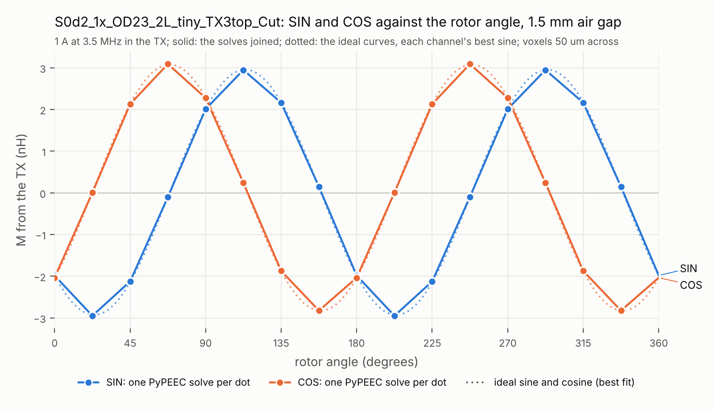
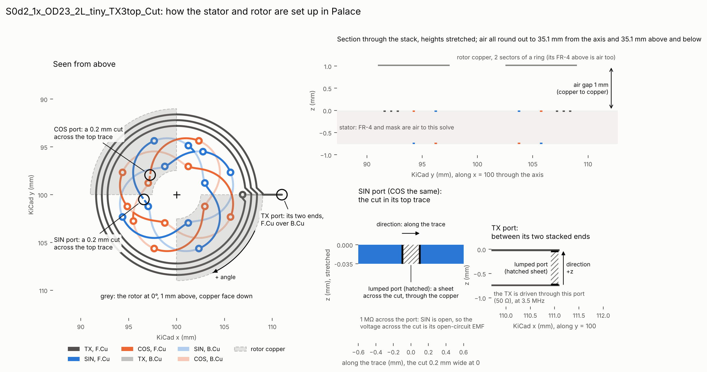

# S0d2_1x_OD23_2L_tiny_TX3top_Cut: SIN and COS over the rotor's turn in Palace

A coil set made with the [Sinusoidal Coil Generator](https://github.com/RolandThsive/Sinusoidal-Inductive-Encoders-Coil-Generator): 23.4 mm across, 2 copper layers, 2 electrical periods per turn and a rotor of 2 copper sectors. The TX is driven at 3.5 MHz; the curves are the mutual inductance from the TX to SIN and to COS (1 nH is 22 mV of EMF for 1 A in the TX). Each angle is one Palace solve with its own mesh, checked by working the TX's L out two ways: from its port's voltage, and from the magnetic energy in the whole field (the Checks column gives how far apart they are; a solve is read when the linear solve converged and the two are within 1 %). At the first angle of each gap SIN and COS are driven too, and the M from each back to the TX is checked against the M from the TX to it (reciprocity, in the same column). This page is rewritten by `simulation.py` after every solve.

| Air gap | Angles solved | Amplitude SIN / COS | Angle error |
|---|---|---|---|
| 2 mm | 16 of 16 | 1.91 / 1.92 nH (42 / 42 mV) | 0.1° rms, 0.2° peak |
| 1.5 mm | 16 of 16 | 2.97 / 2.98 nH (65 / 65 mV) | 0.1° rms, 0.3° peak |
| 1 mm | 16 of 16 | 4.65 / 4.66 nH (102 / 102 mV) | 0.2° rms, 0.4° peak |
| 0.5 mm | 16 of 16 | 7.18 / 7.19 nH (158 / 158 mV) | 0.4° rms, 0.6° peak |
| 0.1 mm | 16 of 16 | 9.71 / 9.71 nH (213 / 213 mV) | 0.9° rms, 1.2° peak |

## 2 mm air gap

*Figure 1. SIN (blue) and COS (orange) at a 2 mm air gap: the mutual inductance from the TX against the rotor's angle, 16 of 16 angles solved. Each dot is one Palace solve and the solid line joins them; the dotted lines are the ideal sine and cosine, each channel's best sine fit, which is what the angle error is measured against. SIN swings ±1.91 nH and COS ±1.92 nH, that is ±42 and ±42 mV of EMF.*

Best sine fit: SIN amplitude 1.915 nH, offset -0.104 nH, phase 43.0°; COS amplitude 1.918 nH, offset 0.036 nH, phase -47.0°. Angle error, with the offset and gain of each channel calibrated out (worked out as below): 0.1° rms and 0.2° at worst, in electrical degrees (0.5 of a mechanical degree each). SIN and COS are 90.0° apart, against 90° for perfect quadrature.

| Rotor | M SIN (nH) | M COS (nH) | Angle error | L TX (nH) | R TX (mΩ) | Solve | Checks | Memory | Time |
|---|---|---|---|---|---|---|---|---|---|
| 0° | 1.2045 | -1.3644 | +0.09° | 268.993 | 457.74 | 134 + 184 + 141 iterations, 9e-09 | L -0.004 %, reciprocity 0.00026 % | 12.9 GB | 12 min |
| 22.5° | 1.8171 | -0.0326 | -0.05° | 269.130 | 457.49 | 121 iterations, 8e-09 | L -0.004 % | 9.5 GB | 3 min |
| 45° | 1.2905 | 1.3449 | +0.14° | 269.158 | 457.27 | 122 iterations, 1e-08 | L -0.004 % | 9.5 GB | 3 min |
| 67.5° | -0.0379 | 1.9584 | +0.04° | 269.185 | 457.15 | 134 iterations, 9e-09 | L -0.004 % | 9.7 GB | 4 min |
| 90° | -1.4070 | 1.4320 | +0.09° | 269.227 | 457.22 | 123 iterations, 9e-09 | L -0.004 % | 9.5 GB | 4 min |
| 112.5° | -2.0144 | 0.1054 | -0.06° | 269.179 | 457.04 | 126 iterations, 9e-09 | L -0.004 % | 9.5 GB | 4 min |
| 135° | -1.5033 | -1.2715 | +0.01° | 269.091 | 457.22 | 122 iterations, 1e-08 | L -0.004 % | 9.4 GB | 4 min |
| 157.5° | -0.1788 | -1.8809 | -0.25° | 269.057 | 457.31 | 120 iterations, 1e-08 | L -0.004 % | 9.5 GB | 4 min |
| 180° | 1.2045 | -1.3644 | +0.09° | 268.993 | 457.74 | 134 iterations, 9e-09 | L -0.004 % | 9.7 GB | 4 min |
| 202.5° | 1.8171 | -0.0326 | -0.05° | 269.130 | 457.49 | 121 iterations, 8e-09 | L -0.004 % | 9.5 GB | 3 min |
| 225° | 1.2904 | 1.3449 | +0.14° | 269.159 | 457.27 | 125 iterations, 1e-08 | L -0.004 % | 9.6 GB | 4 min |
| 247.5° | -0.0379 | 1.9584 | +0.04° | 269.185 | 457.15 | 134 iterations, 9e-09 | L -0.004 % | 9.7 GB | 4 min |
| 270° | -1.4070 | 1.4320 | +0.09° | 269.227 | 457.22 | 123 iterations, 9e-09 | L -0.004 % | 9.5 GB | 4 min |
| 292.5° | -2.0144 | 0.1054 | -0.06° | 269.179 | 457.04 | 126 iterations, 9e-09 | L -0.004 % | 9.5 GB | 4 min |
| 315° | -1.5035 | -1.2715 | +0.01° | 269.088 | 457.22 | 126 iterations, 9e-09 | L -0.004 % | 9.5 GB | 4 min |
| 337.5° | -0.1788 | -1.8809 | -0.25° | 269.057 | 457.31 | 120 iterations, 1e-08 | L -0.004 % | 9.5 GB | 4 min |

## 1.5 mm air gap

*Figure 2. SIN (blue) and COS (orange) at a 1.5 mm air gap: the mutual inductance from the TX against the rotor's angle, 16 of 16 angles solved. Each dot is one Palace solve and the solid line joins them; the dotted lines are the ideal sine and cosine, each channel's best sine fit, which is what the angle error is measured against. SIN swings ±2.97 nH and COS ±2.98 nH, that is ±65 and ±65 mV of EMF.*

Best sine fit: SIN amplitude 2.973 nH, offset -0.101 nH, phase 43.0°; COS amplitude 2.978 nH, offset 0.030 nH, phase -47.0°. Angle error, with the offset and gain of each channel calibrated out (worked out as below): 0.1° rms and 0.3° at worst, in electrical degrees (0.5 of a mechanical degree each). SIN and COS are 90.0° apart, against 90° for perfect quadrature.

| Rotor | M SIN (nH) | M COS (nH) | Angle error | L TX (nH) | R TX (mΩ) | Solve | Checks | Memory | Time |
|---|---|---|---|---|---|---|---|---|---|
| 0° | 1.9275 | -2.1431 | +0.09° | 264.200 | 462.28 | 130 + 177 + 137 iterations, 9e-09 | L -0.004 %, reciprocity 6.7e-05 % | 11.7 GB | 11 min |
| 22.5° | 2.8868 | -0.0799 | -0.08° | 264.376 | 461.94 | 122 iterations, 1e-08 | L -0.004 % | 8.8 GB | 4 min |
| 45° | 2.0615 | 2.0602 | +0.17° | 264.404 | 461.66 | 127 iterations, 9e-09 | L -0.004 % | 8.8 GB | 4 min |
| 67.5° | 0.0030 | 3.0179 | +0.02° | 264.452 | 461.44 | 130 iterations, 1e-08 | L -0.004 % | 8.9 GB | 4 min |
| 90° | -2.1241 | 2.1933 | +0.15° | 264.521 | 461.44 | 129 iterations, 9e-09 | L -0.004 % | 8.8 GB | 4 min |
| 112.5° | -3.0690 | 0.1405 | -0.10° | 264.457 | 461.24 | 125 iterations, 1e-08 | L -0.004 % | 8.7 GB | 4 min |
| 135° | -2.2729 | -1.9999 | +0.05° | 264.338 | 461.52 | 124 iterations, 9e-09 | L -0.004 % | 8.7 GB | 4 min |
| 157.5° | -0.2212 | -2.9480 | -0.29° | 264.292 | 461.66 | 126 iterations, 9e-09 | L -0.004 % | 8.8 GB | 4 min |
| 180° | 1.9275 | -2.1431 | +0.09° | 264.200 | 462.28 | 130 iterations, 9e-09 | L -0.004 % | 8.9 GB | 4 min |
| 202.5° | 2.8868 | -0.0799 | -0.08° | 264.376 | 461.94 | 122 iterations, 1e-08 | L -0.004 % | 8.8 GB | 4 min |
| 225° | 2.0614 | 2.0602 | +0.17° | 264.406 | 461.66 | 125 iterations, 9e-09 | L -0.004 % | 8.8 GB | 4 min |
| 247.5° | 0.0030 | 3.0179 | +0.02° | 264.452 | 461.44 | 130 iterations, 1e-08 | L -0.004 % | 8.9 GB | 4 min |
| 270° | -2.1241 | 2.1933 | +0.15° | 264.521 | 461.44 | 129 iterations, 9e-09 | L -0.004 % | 8.8 GB | 4 min |
| 292.5° | -3.0690 | 0.1405 | -0.10° | 264.457 | 461.24 | 125 iterations, 1e-08 | L -0.004 % | 8.7 GB | 4 min |
| 315° | -2.2731 | -1.9998 | +0.04° | 264.335 | 461.52 | 126 iterations, 9e-09 | L -0.004 % | 8.7 GB | 4 min |
| 337.5° | -0.2212 | -2.9480 | -0.29° | 264.292 | 461.66 | 126 iterations, 9e-09 | L -0.004 % | 8.8 GB | 4 min |

## 1 mm air gap

*Figure 3. SIN (blue) and COS (orange) at a 1 mm air gap: the mutual inductance from the TX against the rotor's angle, 16 of 16 angles solved. Each dot is one Palace solve and the solid line joins them; the dotted lines are the ideal sine and cosine, each channel's best sine fit, which is what the angle error is measured against. SIN swings ±4.65 nH and COS ±4.66 nH, that is ±102 and ±102 mV of EMF.*

Best sine fit: SIN amplitude 4.652 nH, offset -0.101 nH, phase 42.5°; COS amplitude 4.657 nH, offset 0.017 nH, phase -47.4°. Angle error, with the offset and gain of each channel calibrated out (worked out as below): 0.2° rms and 0.4° at worst, in electrical degrees (0.5 of a mechanical degree each). SIN and COS are 90.0° apart, against 90° for perfect quadrature.

| Rotor | M SIN (nH) | M COS (nH) | Angle error | L TX (nH) | R TX (mΩ) | Solve | Checks | Memory | Time |
|---|---|---|---|---|---|---|---|---|---|
| away | -0.1003 | 0.0288 |  | 281.009 | 444.67 | 123 iterations, 1e-08 | L -0.004 % | 7.6 GB | 3 min |
| 0° | 3.0448 | -3.4023 | +0.11° | 256.246 | 468.44 | 144 + 195 + 153 iterations, 1e-08 | L -0.004 %, reciprocity 6.4e-05 % | 10.5 GB | 11 min |
| 22.5° | 4.5786 | -0.1960 | -0.14° | 256.470 | 468.05 | 119 iterations, 9e-09 | L -0.004 % | 7.6 GB | 3 min |
| 45° | 3.2994 | 3.1656 | +0.23° | 256.506 | 467.64 | 127 iterations, 1e-08 | L -0.004 % | 7.7 GB | 3 min |
| 67.5° | 0.1003 | 4.6948 | -0.01° | 256.569 | 467.34 | 125 iterations, 9e-09 | L -0.004 % | 7.6 GB | 3 min |
| 90° | -3.2432 | 3.4154 | +0.24° | 256.701 | 467.14 | 122 iterations, 1e-08 | L -0.004 % | 7.6 GB | 3 min |
| 112.5° | -4.7424 | 0.2310 | -0.18° | 256.599 | 466.97 | 119 iterations, 9e-09 | L -0.004 % | 7.5 GB | 3 min |
| 135° | -3.5191 | -3.1345 | +0.11° | 256.450 | 467.33 | 127 iterations, 1e-08 | L -0.004 % | 7.6 GB | 3 min |
| 157.5° | -0.3303 | -4.6390 | -0.36° | 256.377 | 467.57 | 151 iterations, 1e-08 | L -0.004 % | 8.0 GB | 4 min |
| 180° | 3.0448 | -3.4023 | +0.11° | 256.246 | 468.44 | 144 iterations, 1e-08 | L -0.004 % | 7.9 GB | 4 min |
| 202.5° | 4.5786 | -0.1960 | -0.14° | 256.470 | 468.05 | 119 iterations, 9e-09 | L -0.004 % | 7.6 GB | 3 min |
| 225° | 3.2993 | 3.1656 | +0.23° | 256.507 | 467.64 | 122 iterations, 1e-08 | L -0.004 % | 7.6 GB | 3 min |
| 247.5° | 0.1003 | 4.6948 | -0.01° | 256.569 | 467.34 | 125 iterations, 9e-09 | L -0.004 % | 7.6 GB | 3 min |
| 270° | -3.2432 | 3.4154 | +0.24° | 256.701 | 467.14 | 122 iterations, 1e-08 | L -0.004 % | 7.6 GB | 3 min |
| 292.5° | -4.7424 | 0.2310 | -0.18° | 256.599 | 466.97 | 119 iterations, 9e-09 | L -0.004 % | 7.5 GB | 3 min |
| 315° | -3.5192 | -3.1343 | +0.11° | 256.446 | 467.33 | 127 iterations, 1e-08 | L -0.004 % | 7.6 GB | 3 min |
| 337.5° | -0.3303 | -4.6390 | -0.36° | 256.377 | 467.57 | 151 iterations, 1e-08 | L -0.004 % | 8.0 GB | 4 min |

## 0.5 mm air gap

*Figure 4. SIN (blue) and COS (orange) at a 0.5 mm air gap: the mutual inductance from the TX against the rotor's angle, 16 of 16 angles solved. Each dot is one Palace solve and the solid line joins them; the dotted lines are the ideal sine and cosine, each channel's best sine fit, which is what the angle error is measured against. SIN swings ±7.18 nH and COS ±7.19 nH, that is ±158 and ±158 mV of EMF.*

Best sine fit: SIN amplitude 7.183 nH, offset -0.113 nH, phase 41.3°; COS amplitude 7.188 nH, offset -0.013 nH, phase -48.7°. Angle error, with the offset and gain of each channel calibrated out (worked out as below): 0.4° rms and 0.6° at worst, in electrical degrees (0.5 of a mechanical degree each). SIN and COS are 90.0° apart, against 90° for perfect quadrature.

| Rotor | M SIN (nH) | M COS (nH) | Angle error | L TX (nH) | R TX (mΩ) | Solve | Checks | Memory | Time |
|---|---|---|---|---|---|---|---|---|---|
| 0° | 4.6421 | -5.3864 | +0.24° | 242.373 | 482.00 | 120 + 167 + 130 iterations, 9e-09 | L -0.004 %, reciprocity 2.4e-05 % | 9.0 GB | 10 min |
| 22.5° | 7.1116 | -0.5242 | -0.33° | 242.618 | 481.75 | 126 iterations, 9e-09 | L -0.004 % | 6.9 GB | 3 min |
| 45° | 5.2274 | 4.7458 | +0.40° | 242.700 | 480.99 | 121 iterations, 9e-09 | L -0.004 % | 6.8 GB | 3 min |
| 67.5° | 0.3771 | 7.2074 | -0.17° | 242.732 | 480.85 | 125 iterations, 9e-09 | L -0.004 % | 6.9 GB | 3 min |
| 90° | -4.8722 | 5.3168 | +0.50° | 243.016 | 480.19 | 123 iterations, 9e-09 | L -0.004 % | 6.9 GB | 3 min |
| 112.5° | -7.2568 | 0.4991 | -0.38° | 242.818 | 480.17 | 117 iterations, 9e-09 | L -0.004 % | 6.8 GB | 3 min |
| 135° | -5.4858 | -4.7839 | +0.31° | 242.676 | 480.36 | 121 iterations, 9e-09 | L -0.004 % | 6.8 GB | 3 min |
| 157.5° | -0.6493 | -7.1766 | -0.56° | 242.536 | 480.93 | 117 iterations, 9e-09 | L -0.004 % | 6.8 GB | 3 min |
| 180° | 4.6421 | -5.3864 | +0.24° | 242.373 | 482.00 | 120 iterations, 9e-09 | L -0.004 % | 6.8 GB | 3 min |
| 202.5° | 7.1116 | -0.5242 | -0.33° | 242.618 | 481.75 | 126 iterations, 9e-09 | L -0.004 % | 6.9 GB | 3 min |
| 225° | 5.2274 | 4.7457 | +0.40° | 242.701 | 480.99 | 121 iterations, 9e-09 | L -0.004 % | 6.8 GB | 3 min |
| 247.5° | 0.3771 | 7.2074 | -0.17° | 242.732 | 480.85 | 125 iterations, 9e-09 | L -0.004 % | 6.9 GB | 3 min |
| 270° | -4.8722 | 5.3168 | +0.50° | 243.016 | 480.19 | 123 iterations, 9e-09 | L -0.004 % | 6.9 GB | 3 min |
| 292.5° | -7.2568 | 0.4991 | -0.38° | 242.818 | 480.17 | 117 iterations, 9e-09 | L -0.004 % | 6.8 GB | 3 min |
| 315° | -5.4860 | -4.7834 | +0.30° | 242.672 | 480.36 | 120 iterations, 1e-08 | L -0.004 % | 6.8 GB | 3 min |
| 337.5° | -0.6493 | -7.1766 | -0.56° | 242.536 | 480.93 | 117 iterations, 9e-09 | L -0.004 % | 6.8 GB | 3 min |

## 0.1 mm air gap

*Figure 5. SIN (blue) and COS (orange) at a 0.1 mm air gap: the mutual inductance from the TX against the rotor's angle, 16 of 16 angles solved. Each dot is one Palace solve and the solid line joins them; the dotted lines are the ideal sine and cosine, each channel's best sine fit, which is what the angle error is measured against. SIN swings ±9.71 nH and COS ±9.71 nH, that is ±213 and ±213 mV of EMF.*

Best sine fit: SIN amplitude 9.706 nH, offset -0.141 nH, phase 39.2°; COS amplitude 9.706 nH, offset -0.052 nH, phase -50.8°. Angle error, with the offset and gain of each channel calibrated out (worked out as below): 0.9° rms and 1.2° at worst, in electrical degrees (0.5 of a mechanical degree each). SIN and COS are 89.9° apart, against 90° for perfect quadrature.

| Rotor | M SIN (nH) | M COS (nH) | Angle error | L TX (nH) | R TX (mΩ) | Solve | Checks | Memory | Time |
|---|---|---|---|---|---|---|---|---|---|
| 0° | 6.0719 | -7.4880 | +0.68° | 219.283 | 517.07 | 118 + 165 + 128 iterations, 9e-09 | L -0.005 %, reciprocity 2.8e-05 % | 8.0 GB | 6 min |
| 22.5° | 9.6069 | -1.1904 | -0.86° | 219.305 | 518.85 | 117 iterations, 1e-08 | L -0.005 % | 6.0 GB | 119 s |
| 45° | 7.2412 | 6.1640 | +0.90° | 219.663 | 515.72 | 122 iterations, 1e-08 | L -0.005 % | 6.1 GB | 2 min |
| 67.5° | 0.9592 | 9.6878 | -0.64° | 219.409 | 517.92 | 119 iterations, 1e-08 | L -0.005 % | 6.0 GB | 117 s |
| 90° | -6.3826 | 7.3031 | +1.12° | 220.062 | 515.22 | 119 iterations, 9e-09 | L -0.005 % | 6.1 GB | 2 min |
| 112.5° | -9.7303 | 1.0766 | -0.91° | 219.572 | 516.97 | 117 iterations, 9e-09 | L -0.005 % | 6.0 GB | 116 s |
| 135° | -7.5790 | -6.3036 | +0.85° | 219.685 | 514.77 | 122 iterations, 9e-09 | L -0.005 % | 6.0 GB | 2 min |
| 157.5° | -1.3138 | -9.6648 | -1.15° | 219.254 | 517.74 | 115 iterations, 8e-09 | L -0.005 % | 6.0 GB | 115 s |
| 180° | 6.0719 | -7.4880 | +0.68° | 219.283 | 517.07 | 118 iterations, 9e-09 | L -0.005 % | 6.0 GB | 2 min |
| 202.5° | 9.6069 | -1.1904 | -0.86° | 219.305 | 518.85 | 117 iterations, 1e-08 | L -0.005 % | 6.0 GB | 2 min |
| 225° | 7.2413 | 6.1640 | +0.90° | 219.664 | 515.72 | 123 iterations, 1e-08 | L -0.005 % | 6.1 GB | 2 min |
| 247.5° | 0.9592 | 9.6878 | -0.64° | 219.409 | 517.92 | 119 iterations, 1e-08 | L -0.005 % | 6.0 GB | 2 min |
| 270° | -6.3826 | 7.3031 | +1.12° | 220.062 | 515.22 | 119 iterations, 9e-09 | L -0.005 % | 6.1 GB | 2 min |
| 292.5° | -9.7303 | 1.0766 | -0.91° | 219.572 | 516.97 | 117 iterations, 9e-09 | L -0.005 % | 6.0 GB | 2 min |
| 315° | -7.5790 | -6.3029 | +0.85° | 219.684 | 514.76 | 136 iterations, 9e-09 | L -0.005 % | 6.2 GB | 3 min |
| 337.5° | -1.3138 | -9.6648 | -1.15° | 219.254 | 517.74 | 115 iterations, 8e-09 | L -0.005 % | 6.0 GB | 2 min |

## The air gaps together

*Figure 6. Every air gap on one chart, the 0.1 mm gap in full colour, the solves of each joined by a solid line, and each gap's ideal sine and cosine dotted. Going from 2 to 0.1 mm makes SIN 5.07 times and COS 5.06 times larger.*

## Against the expectation

The generator estimates the TX at 292 nH with the rotor away and 226 nH with it (its drop with the rotor is an upper estimate). Palace gives 281.0 nH with the rotor away, and 269.0 to 269.2 nH with the rotor at 2 mm, and 264.2 to 264.5 nH with the rotor at 1.5 mm, and 256.2 to 256.7 nH with the rotor at 1 mm, and 242.4 to 243.0 nH with the rotor at 0.5 mm, and 219.3 to 220.1 nH with the rotor at 0.1 mm. The expected values are in [expected_results.json](expected_results.json).

## How the angle error is worked out

Each channel gets its best sine over the rotor's period, M = offset + amplitude × sin(θ + phase). Each channel's offset is taken out and it is divided by its amplitude, so both swing between −1 and +1, as a decoder chip's offset and gain calibration does. The angle is read back as atan2(SIN, COS); the error at each angle is that reading less the true angle, less the average of all of them, since a fixed offset only moves where zero is. The rms and the worst of them are the angle error. The fit uses the same points as the error, so it measures how far the solves are from a perfect sine and cosine pair. [`angle_error.py`](../Palace%20Simulation/angle_error.py) does it.

## The boards

*Drawn by the generator. Red is the top layer, blue the bottom; the dots are vias. In Palace, SIN is opened by a cut in its top trace at (96.59, 100.5) and COS at (97.24, 97.94), the TX at its ends at (111, 100) (KiCad mm). The [README](../README.md) has the board and how it was made.*

*How the boards are set up in Palace, drawn by [`rig_picture.py`](../Palace%20Simulation/rig_picture.py) from the geometry the mesh is built from: the rotor copper side down over the stator, each receiver opened by a 0.2 mm cut across a top trace (its lumped port, a sheet across the cut from one cut face to the other, has 1 MΩ across it, so the voltage across the cut is the open-circuit EMF), and the TX opened between its two stacked ends, where its port drives it.*
