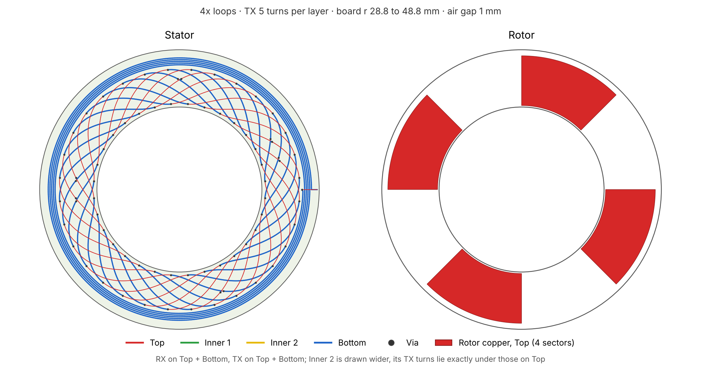

# S5_4x_OD98_cosine_r_2subcoils_spiralTX

Coil board 6 of 10 in this branch's order. Single coil set board. 4x, cosine_r RX profile, 2 sub-coils, spiral TX (5 turns), large (OD 98).

## The board

Outline 97.6 mm, bore 57.6 mm, 2 copper layers, board 1.6 mm, air gap 1.0 mm. Stator copper: 3.41 m of trace in all. One coil set: a TX coil and two RX coils, SIN and COS. The rotor, a second board with copper sectors, sits 1.0 mm above the stator, copper to copper, and its eddy currents make the TX to RX coupling follow the sine and cosine of its angle.



| Coil set | TX | SIN | COS | Frequency | Periods per revolution (N) | Electrical period |
|---|---|---|---|---|---|---|
| 1 | TX | SIN (net `2`) | COS (net `1`) | 3.5 MHz | 4 | 90° mechanical |

| Rotor copper ring | Sectors | Metal fraction |
|---|---|---|
| 29.33 to 46.7 mm | 4 | 0.50 |

Where each coil is opened for its terminals (KiCad coordinates, mm; the rotation axis is at (100, 100)):

| Net | Kind | Where | Terminals |
|---|---|---|---|
| `TX` (TX) | TX ends | (148.1, 100), F.Cu and B.Cu | the two coil ends, stacked at one point on two layers: their end faces are the terminals |
| `2` (SIN) | RX cut | (133.695, 108.215), F.Cu | the trace is cut there with a 0.2 mm gap: the two cut faces are the terminals |
| `1` (COS) | RX cut | (134.65, 101.484), F.Cu | the trace is cut there with a 0.2 mm gap: the two cut faces are the terminals |

Both boards are built by KESE with solder mask on both faces, stator and rotor: 20 µm, εr 3.8, tan δ 0.02, vias tented (`test_spec.json` → `solder_mask`). These KiCad stack-ups set no mask, so the bridge sets it.

## Why it is here

The other RX profile, sub-coils, a spiral TX and a big board.

Elmer is the main solver of these encoder boards: at 3 to 5 MHz the boards are about 1/2000 of a wavelength across, so the physics is magneto-quasi-static, which is exactly what Elmer's time-harmonic A-V solver does.

## What the solver checks

Elmer, magnetic (WhitneyAVHarmonicSolver with edge elements), every coil a massive coil of the circuit module: the driven TX carries 1 A, every other coil is open. One solve gives the TX's impedance (L and R, with skin, proximity and the rotor's loss) and each open coil's voltage, so its mutual inductance M. The rotor's 35 µm copper is meshed through its thickness (the skin depth at these frequencies is 32 to 38 µm).

Solves: 9. Per coil set, the rotor away (C1, C3), the rotor at the eight angles of C4 (set 1: 0, 11.25, 22.5, 33.75, 45, 56.25, 67.5, 78.75° mechanical) (C2, C4 to C6, C10). The rotor repeats itself after 360/N, so the coupling's period is exact by construction and needs no solve of its own. The stator's mesh is the same in every solve; only the air between the boards is meshed again for each angle.

The checks are the Elmer brief's (`../Things to test in ELMER.md`, section 5), with the five pass marks reviewed on 16 November (see `../README.md`): C0 (the mesh study, on S1), C1 to C6, C7 on the dual boards, and C10. C9 (air gap sweep), C11 (rotor off-centre and tilted) and C12 (surface-impedance rotor) are optional.

Size: about 35 GB of memory, a first guess from its 3.41 m of copper; it runs on a PC with 64 GB. The S2 mesh study measures the real figure and this line is corrected then.

## Results

Not run yet. When it runs, `results.md` in this folder gets every number, the runs' CSV and the plots, and this table gets the Got and Pass columns.

| Check | Quantity | Expected | Got | Pass |
|---|---|---|---|---|
| C1 | TX: L, rotor away | 6.192 µH (reference; generator 6.197 µH) | | within 3 % |
| C2 | TX: L with the rotor at 0°, and the drop | 5.786 µH, -6.6 % (reference); 5.032 µH, -18.8 % (generator) | | reported: the open question |
| C2 | TX: spread of L over the eight C4 angles | none, by symmetry | | within 0.5 % of their mean |
| C3 | TX: M0 to SIN / COS, rotor away | +0.427 nH / +2.191 nH | | M0 / A below 3 %; the sign judged only where resolved |
| C4 | TX: amplitude A to SIN / COS | 206.33 / 206.33 nH | | within 15 % |
| C4 | TX: even harmonic h2 (SIN / COS) | below 1 % of A | | below 1 % of A |
| C4 | TX: third harmonic h3 (SIN / COS) | 0.18 % / 0.18 % | | within 2×, or within 0.3 % of A |
| C5 | TX: phase difference SIN − COS | +90.0° (either sign) | | 90 ± 1° |
| C5 | TX: amplitude ratio SIN / COS | 1.000 | | 1.00 ± 0.02 |
| C6 | TX: peak angle error, offsets removed (raw) | 0.10 (0.68) electrical degrees | | within 3×, or below 0.5° |
| C10 | TX: resistance, DC / at 3.5 MHz rotor away / with the rotor; rotor loss | 3.47 Ω DC; the generator says up to about 2× at 3.5 MHz | | reported |

Expected numbers: the generator pack's quasi-static reference (`tools/quasistatic_reference.py` of the generator pack: Neumann integrals and a thin-sheet eddy-current model of the rotor) and the generator's own estimates, from `test_spec.json` → `expected` and `expected_results.json`. The sign of the phase difference depends on the rotation sense; either is right if consistent.

## How to run

```
python run_simulation.py "Examples/Inductive Coils/S5_4x_OD98_cosine_r_2subcoils_spiralTX"
```

## Files

| File | What it is |
|---|---|
| `Stator.kicad_pcb`, `Rotor.kicad_pcb` (and their `.kicad_pro`) | the two boards, KiCad 7 format, as the generator wrote them |
| `test_spec.json` | what the bridge reads: stack-up, rotor placement and angles, solder mask, terminals, expected values |
| `expected_results.json`, `expected_results.txt`, `expected_coupling.png` | every predicted number, with the coupling curves against the rotor angle |
| `Parameters.txt`, `parameter_files/`, `run_log.txt` | the generator's full record of this board |
| `S5_4x_OD98_cosine_r_2subcoils_spiralTX_stator_and_rotor.png`, `*_Actual.svg`, `*_Representative.svg` | pictures of the board and its coils |

## Licence

This board is output of the [Sinusoidal Coil Generator](https://github.com/RolandThsive/Sinusoidal-Inductive-Encoders-Coil-Generator), for non-commercial use only; see `../LICENSE.md`. It is not covered by this branch's GPL-3.0.
