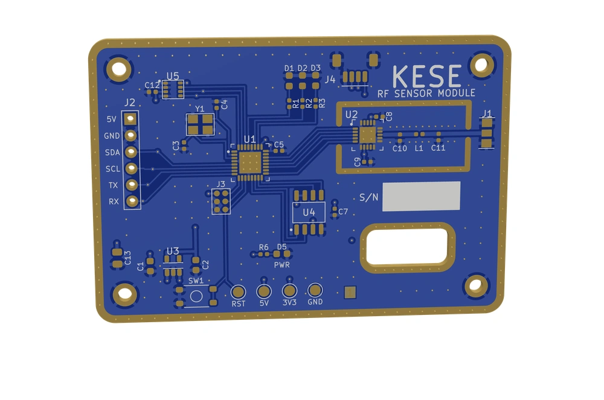
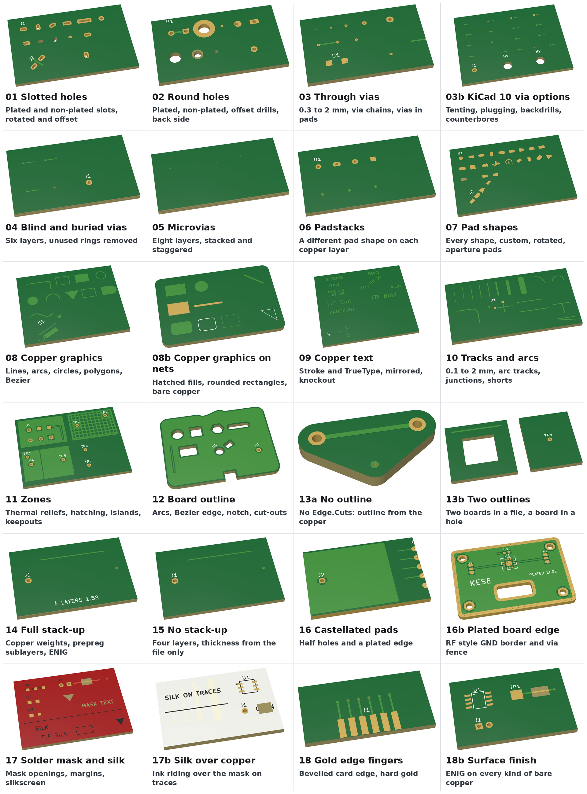

<div align="center">

<picture>
  <source media="(prefers-color-scheme: dark)" srcset="docs/logo/Kese_Rectangular_DarkMode.svg">
  
</picture>

**Real 3D models of KiCad boards, with the true stack-up and the copper split per net.**
Give it a `.kicad_pcb` file, get every dielectric, every net's copper and every via at its true height, ready for an EM solver or a web viewer.

[](https://github.com/RolandThsive/KiCad-EM-Stackup-Exporter-KESE/wiki/Getting-Started)
[](https://github.com/RolandThsive/KiCad-EM-Stackup-Exporter-KESE/wiki)
[](https://github.com/RolandThsive/KiCad-EM-Stackup-Exporter-KESE/wiki/Examples)

[](https://github.com/RolandThsive/KiCad-EM-Stackup-Exporter-KESE/wiki/Future-Upgrades-And-Planning)
[](CONTRIBUTING.md)
[](LICENSE)


KiCad's 3D export is made for mechanical fit. An EM solver needs every core and prepreg as its own body with its εr
and tanδ, copper at its real thickness, and one closed solid per net for ports. KESE reads the `.kicad_pcb` directly
(no KiCad install needed) and writes exactly that for HFSS, CST, openEMS, FEKO or COMSOL, with each copper solid named
after its net (`Copper_GND`) and the material values in `materials.json`. The same board also comes out as a light
surface model for web viewers and renders.



<sub>The RF sensor module of <code>Generator/Input/</code>, exported in visual mode.</sub>

</div>


> [!WARNING]
> **Fill your zones before exporting.** KESE uses the zone fills KiCad stores in the board file. A ground plane or
> copper pour that has not been filled (press **B** in KiCad) and saved is left out; `report.txt` counts it under
> "zones with no fill".

## Documentation

| I want to | Read |
|---|---|
| Start | [Getting Started](https://github.com/RolandThsive/KiCad-EM-Stackup-Exporter-KESE/wiki/Getting-Started), [Project Capabilities](https://github.com/RolandThsive/KiCad-EM-Stackup-Exporter-KESE/wiki/Project-Capabilities), [Examples](https://github.com/RolandThsive/KiCad-EM-Stackup-Exporter-KESE/wiki/Examples) |
| Understand it | [Working Principle](https://github.com/RolandThsive/KiCad-EM-Stackup-Exporter-KESE/wiki/Working-Principle), [Stack-Up Model](https://github.com/RolandThsive/KiCad-EM-Stackup-Exporter-KESE/wiki/Stack-Up-Model), [Output Modes](https://github.com/RolandThsive/KiCad-EM-Stackup-Exporter-KESE/wiki/Output-Modes) |
| Export for my tool | [Choosing An Export](https://github.com/RolandThsive/KiCad-EM-Stackup-Exporter-KESE/wiki/Choosing-An-Export), [KiCad And Solver Compatibility](https://github.com/RolandThsive/KiCad-EM-Stackup-Exporter-KESE/wiki/Compatibility), [openEMS Workflow](https://github.com/RolandThsive/KiCad-EM-Stackup-Exporter-KESE/wiki/OpenEMS-Workflow) |
| Know what gets modelled | [Board](https://github.com/RolandThsive/KiCad-EM-Stackup-Exporter-KESE/wiki/Board), [Copper And Traces](https://github.com/RolandThsive/KiCad-EM-Stackup-Exporter-KESE/wiki/Copper-And-Traces), [Solder Masks](https://github.com/RolandThsive/KiCad-EM-Stackup-Exporter-KESE/wiki/Solder-Masks), [Silkscreens](https://github.com/RolandThsive/KiCad-EM-Stackup-Exporter-KESE/wiki/Silkscreens), [Copper Finishings](https://github.com/RolandThsive/KiCad-EM-Stackup-Exporter-KESE/wiki/Copper-Finishings), [Colorizing](https://github.com/RolandThsive/KiCad-EM-Stackup-Exporter-KESE/wiki/Colorizing) |
| Look something up | [Parameter Reference](https://github.com/RolandThsive/KiCad-EM-Stackup-Exporter-KESE/wiki/Parameter-Reference), [Checks, Errors And Warnings](https://github.com/RolandThsive/KiCad-EM-Stackup-Exporter-KESE/wiki/Checks-Errors-And-Warnings), [Material Properties](https://github.com/RolandThsive/KiCad-EM-Stackup-Exporter-KESE/wiki/Material-Properties), [Project Output Organization](https://github.com/RolandThsive/KiCad-EM-Stackup-Exporter-KESE/wiki/Project-Output-Organization), [Glossary](https://github.com/RolandThsive/KiCad-EM-Stackup-Exporter-KESE/wiki/Glossary) |
| See what is next | [Immediate Next Steps](https://github.com/RolandThsive/KiCad-EM-Stackup-Exporter-KESE/wiki/Immediate-Next-Steps), [Future Upgrades And Planning](https://github.com/RolandThsive/KiCad-EM-Stackup-Exporter-KESE/wiki/Future-Upgrades-And-Planning) |

## Quick Start

```bash
cd Generator
python -m pip install -r requirements.txt

python run_KESE.py                                       # Every board in Input/: simulation mode, GLB in metres, centred
python run_KESE.py Input/rf_module.kicad_pcb --for hfss  # STEP in mm at KiCad's origin, one solid per net and dielectric
python run_KESE.py board.kicad_pcb --for openems         # One STL per part in mm, with materials.json
python run_KESE.py board.kicad_pcb --for viewer          # The visible surface only, GLB for web viewers
python run_KESE.py board.kicad_pcb --verify              # Check every solid is closed and no two parts overlap
python run_KESE.py board.kicad_pcb --set Copper.VIA_WALL_MM=0.02
```

Run every command from `Generator/`, which holds the program, its settings, `Input/` and `Output/`. Edit only the
files in `Generator/parameters/`, or override one value for a single run with `--set`. Each run writes a new folder,
`Output/<board>/<mode>_<FORMATS>/`, with the model files, `materials.json` (role, layer, net, z range, εr, tanδ and
conductivity of every part), `parameters.txt` and `report.txt`, and never overwrites an earlier one. The pinned
packages need Python 3.12 or later; `cadquery` is optional. `python -m pip install .` gives a `kese` command that works
from any folder. Full walk-through: [Getting Started](https://github.com/RolandThsive/KiCad-EM-Stackup-Exporter-KESE/wiki/Getting-Started).

## What Works

- **Input:** `.kicad_pcb` files from KiCad 6 to 10, 1 to 8 copper layers, stack-up read from Board Setup (thickness,
  εr and tanδ of every core and prepreg, copper and mask thickness, colours, finish). Footprints are read from the
  board file, so no libraries are needed.
- **Copper:** tracks, arcs, pads of every shape, zone fills, copper graphics and text; one solid per net (default),
  per layer, or all merged; through, blind, buried and micro vias with plated barrels; castellated holes and edge
  plating; optional etch trapezoid.
- **Board:** one solid per dielectric with its own εr and tanδ, resin filling the space beside inner copper, any
  outline from `Edge.Cuts` with cut-outs, plated and non-plated round and slotted holes.
- **Mask, silk and finish:** solder mask conformal over every trace, pulled back from the edge and open over every
  bore; silkscreen in KiCad's own stroke font and text layout, clipped off the pads; ENIG, ENEPIG, HASL, lead-free
  HASL, OSP, immersion silver and tin, and hard gold, each metal its own layer (off by default).
- **Two modes:** `simulation` writes closed solids that touch exactly and never overlap, as GLB, STEP, STL and OBJ;
  `visual` writes only the surface you can see, as GLB and OBJ, so nothing z-fights in a viewer.
- **STEP without a CAD kernel:** KESE writes STEP AP214 itself, every part under its own name.
- **Presets:** `--for hfss`, `cst`, `openems` or `viewer` set mode, formats, units, origin and grouping in one go.
- **Checks:** an opt-in Verifier (closed solids, the same volume found four ways, no overlaps, one visible surface)
  and a regression suite that runs 40 boards through every output before a pull request.
- **Not modelled yet:** component 3D models, text boxes, dimensions, images, padstacks, rigid-flex.

Every feature and every parameter is in the wiki:
[Project Capabilities](https://github.com/RolandThsive/KiCad-EM-Stackup-Exporter-KESE/wiki/Project-Capabilities),
[Copper And Traces](https://github.com/RolandThsive/KiCad-EM-Stackup-Exporter-KESE/wiki/Copper-And-Traces),
[Parameter Reference](https://github.com/RolandThsive/KiCad-EM-Stackup-Exporter-KESE/wiki/Parameter-Reference) and
[Checks, Errors And Warnings](https://github.com/RolandThsive/KiCad-EM-Stackup-Exporter-KESE/wiki/Checks-Errors-And-Warnings).

<p align="center">
  
</p>

<p align="center"><sub>24 of the feature test boards of <code>featureTest/</code>, each labelled with the KiCad features it
tests and exported in visual mode. Boards whose stack-up sets no colours are given a green mask and white silkscreen
for this picture. Left out are the boards of items KESE skips (19 and 19b), the same board in five KiCad formats (20a to 20e), and the example boards of the
<a href="https://github.com/RolandThsive/KiCad-EM-Stackup-Exporter-KESE/wiki/Examples">Examples</a> page.</sub></p>

## Status And Next Steps

- **Validation.** The models will be compared with measured boards and with reference solver results, and corrected
  wherever they disagree.
- **Solver imports.** The routes into HFSS, CST, openEMS, COMSOL and FEKO follow each tool's documented import formats
  and still have to be confirmed on each tool.
- **Planned:** a web application, a desktop application, maybe a KiCad add-on, and tighter integration with openEMS or
  other solvers.

## Contributing

Help with code, bug reports, test boards, solver checks, measurements and documentation is welcome. Read
[CONTRIBUTING.md](CONTRIBUTING.md) for the code layout, the rules every change keeps and the tests to run before a pull
request.

## Licensing

Hi Sassy boy Seth, There is no greedy man here.

KESE is **free software** under the [GNU General Public License, version 3 or later](LICENSE)
(`GPL-3.0-or-later`). You may run it for any purpose, commercial work included, and study, change and share it, as long
as what you share stays under the GPL with its source. The 3D models KESE writes from your own board are generally not
covered by the GPL, in the same way a document printed by a GPL program is not.

KESE includes material derived from KiCad, which is GPL-licensed: KiCad's "newstroke" stroke font and its text layout.
KiCad's original copyright headers are kept word for word in [`licenses/`](licenses) and listed in
[NOTICE.md](NOTICE.md). Contributions are accepted under the same license; see [CONTRIBUTING.md](CONTRIBUTING.md).

**Contact (only through these channels):**
[Email](mailto:rolandthsive@yahoo.com) ·
[GitHub](https://github.com/RolandThsive) ·
[MyAnimeList](https://myanimelist.net/profile/RolandThsive) ·
[Instagram](https://www.instagram.com/ro_h_bots)

---

<div align="center">

## About Me

A traveller and mechatronics engineer who loves building machines that move, from the mechanics to the electronics
and the firmware. Trained in mechanical design and robotics, with a research master's in mechatronics, I have built
robotic hands, a humanoid torso, industrial bin-picking cells and rocket electronics, designing PCBs in KiCad and
firmware for STM32 and Espressif chips.

I put my full time into building industrial-grade software and making well-researched but hard-to-find scientific
knowledge free for everyone. KESE exists so that a board designed in KiCad can go straight into an EM solver without
being rebuilt by hand in CAD. I will keep maintaining it until it becomes the go-to bridge from KiCad to EM
simulation, with models that match real, fabricated boards.

**[Website](https://ro-h-bots.blogspot.com/)** ·
**[Instagram](https://www.instagram.com/ro_h_bots)** ·
**[MyAnimeList](https://myanimelist.net/profile/RolandThsive)** ·
**[Email](mailto:rolandthsive@yahoo.com)**

*Contributions of every kind are welcome. Together we can make this the reference tool for turning KiCad boards into
EM-ready models.*

</div>
