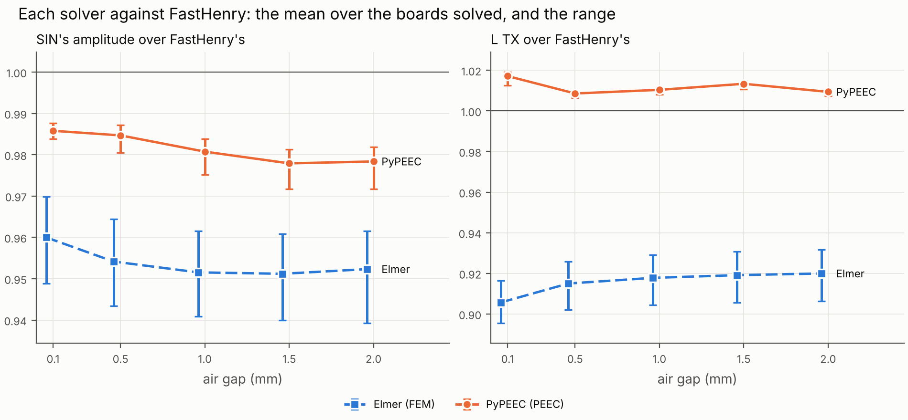
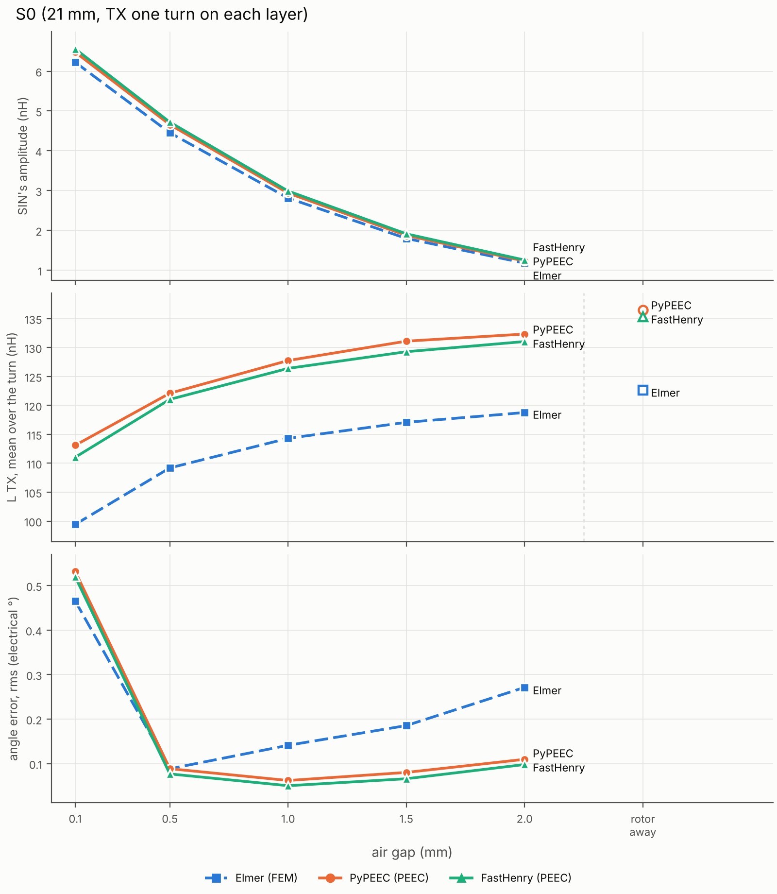
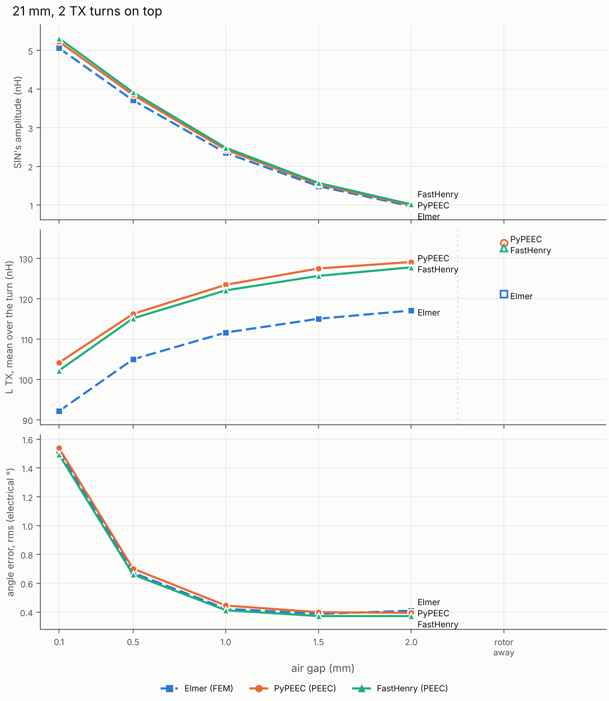
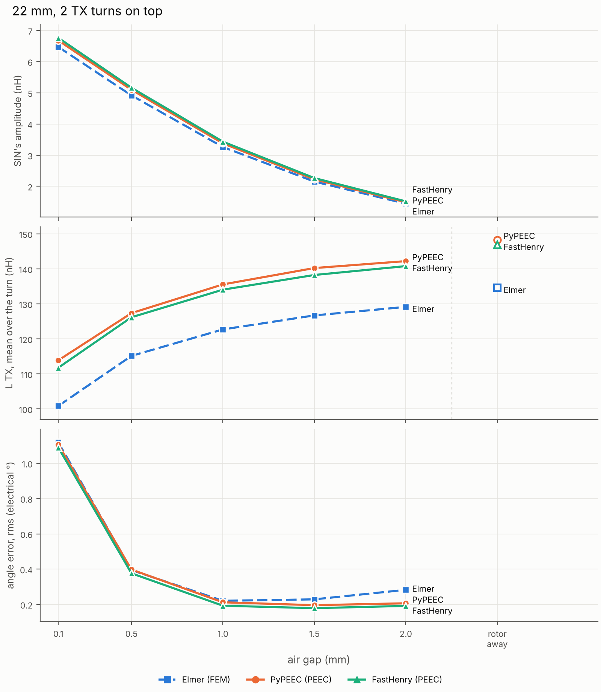
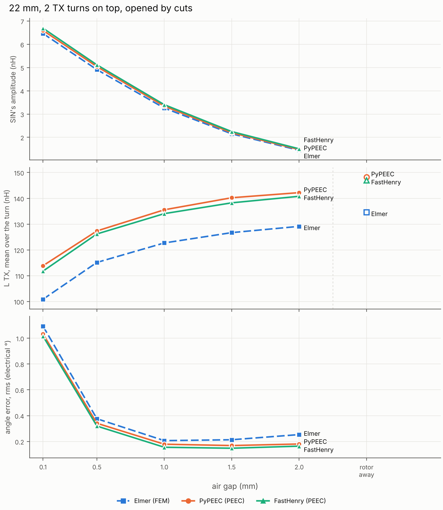
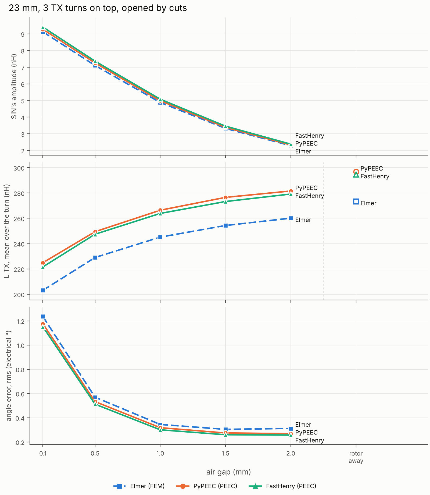
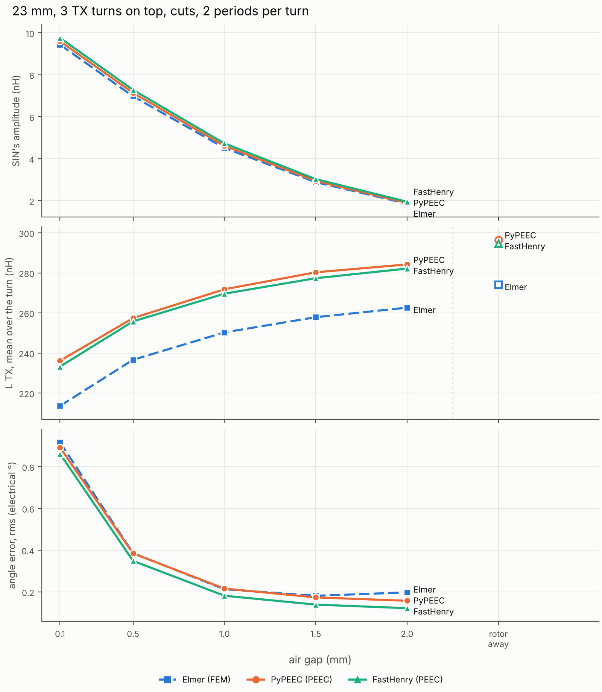
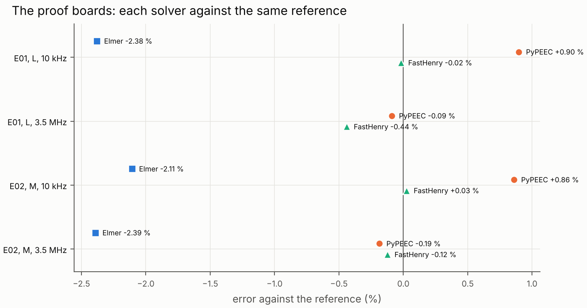

# Solvers comparison: the KESE inductive-coil examples

KESE exports a KiCad board's copper and stackup for electromagnetic solvers. Four free, open-source solvers were run on the same six inductive position-sensor boards (a TX coil that drives the rotor, and SIN and COS receivers that read it), each on its own branch, with the same boards, the same air gaps (0.1, 0.5, 1, 1.5 and 2 mm), the same rotor angles and the same frequency (3.5 MHz, copper at 58 MS/m). This branch reads their results and compares them. It solves nothing itself.

| Solver | Method | Branch | Coil boards finished (of 6) | Solves | Passing their own checks |
|---|---|---|---|---|---|
| Elmer | FEM (finite elements, the A-V eddy-current formulation) | `Elmer_Integration` | 6 | 280 | 280 |
| PyPEEC | PEEC (partial elements on voxels, FFT-accelerated) | `PyPEEC_Integration` | 6 | 280 | 280 |
| FastHenry | PEEC (partial elements on filaments, direct solve) | `FastHenry_Integration` | 6 | 280 | 280 |
| Palace | FEM (finite elements, the frequency-domain Maxwell solver) | `Palace_Integration` | 2 (still solving; 10 of 30 gaps) | 80 | 80 |

Each integration branch keeps its own solver's results, settings and checks, and knows nothing of the others. The numbers here are read from those branches unchanged by `scripts/collect.py`. The two FEM solvers mesh the air around the copper and close it at an outer boundary; the two PEEC solvers model only the copper, and the air's field comes from the free-space formulas, with no mesh and no boundary.

## The short answer

- **FastHenry is the yardstick.** On the two proof boards it lands within 0.03 % of the reference at 10 kHz, the closest of the four (the table under "The proof boards"). Every ratio below is against FastHenry, board by board and gap by gap.
- **Elmer** (FEM): the coupling (the amplitude of SIN and COS) is 4.7 % under FastHenry's on average (−6.1 to −3.0 % over the 30 board-gaps both have finished); L TX is 8.4 % under (−10.5 to −6.8 %); the rms angle error is within 0.17° of FastHenry's, 0.05° typically (electrical degrees).
- **PyPEEC** (PEEC): the coupling (the amplitude of SIN and COS) is 1.9 % under FastHenry's on average (−2.8 to −1.2 % over the 30 board-gaps both have finished); L TX is 1.2 % over (+0.6 to +1.9 %); the rms angle error is within 0.04° of FastHenry's, 0.02° typically (electrical degrees).
- **Palace** (FEM): the coupling (the amplitude of SIN and COS) is 2.2 % under FastHenry's on average (−2.5 to −1.7 % over the 10 board-gaps both have finished); L TX is 6.3 % under (−7.1 to −5.7 %); the rms angle error is within 0.06° of FastHenry's, 0.02° typically (electrical degrees).

So the two PEEC solvers agree within about 2 %, and the angle error, which is what a position sensor is for, agrees best of all: it is set by the coils' shapes, which every solver sees alike. The FEM solvers read the coupling and L TX low on the meshes they were run with, by an amount that shrinks as the mesh is refined ("Why they differ" below).

The generator's own estimates of L TX (from each board's `Parameters.txt`) against FastHenry:

| Board | Generator, rotor away (nH) | FastHenry, rotor away (nH) | Generator, with the rotor (nH) | FastHenry, rotor at 1 mm (nH) |
|---|---|---|---|---|
| S0 | 132 | 135.3 | 109 | 126.4 |
| S0 TXtop | 130 | 132.5 | 106 | 122.1 |
| OD22 TXtop | 144 | 146.9 | 116 | 134.1 |
| OD22 Cut | 144 | 146.9 | 116 | 134.1 |
| OD23 Cut | 292 | 294.6 | 226 | 263.8 |
| S0d2 | 292 | 294.6 | 226 | 269.6 |

The generator's estimates are formulas, not field solves. With the rotor away they land within a few percent of FastHenry. Its value with the rotor is close to what the solvers give at 0.1 mm, not at 1 mm: the generator calls it an upper estimate of the drop the rotor causes.

## How close the solvers are, all boards together



Each solver's value over FastHenry's on the same board and gap: the mean over the boards both have finished, and in brackets the lowest and the highest.

**SIN's amplitude**

| Air gap | Elmer | PyPEEC | Palace |
|---|---|---|---|
| 0.1 mm | 0.960 (0.949 to 0.970) | 0.986 (0.984 to 0.988) | 0.980 (0.979 to 0.981) |
| 0.5 mm | 0.954 (0.943 to 0.964) | 0.985 (0.981 to 0.987) | 0.977 (0.975 to 0.979) |
| 1 mm | 0.952 (0.941 to 0.962) | 0.981 (0.975 to 0.984) | 0.977 (0.975 to 0.979) |
| 1.5 mm | 0.951 (0.940 to 0.961) | 0.978 (0.972 to 0.981) | 0.979 (0.977 to 0.981) |
| 2 mm | 0.952 (0.939 to 0.962) | 0.978 (0.972 to 0.982) | 0.981 (0.980 to 0.983) |

**L TX, mean over the turn**

| Air gap | Elmer | PyPEEC | Palace |
|---|---|---|---|
| 0.1 mm | 0.906 (0.895 to 0.916) | 1.017 (1.013 to 1.019) | 0.929 (0.929 to 0.929) |
| 0.5 mm | 0.915 (0.902 to 0.926) | 1.009 (1.006 to 1.010) | 0.936 (0.934 to 0.938) |
| 1 mm | 0.918 (0.904 to 0.929) | 1.010 (1.008 to 1.011) | 0.938 (0.936 to 0.941) |
| 1.5 mm | 0.919 (0.906 to 0.931) | 1.013 (1.011 to 1.015) | 0.940 (0.938 to 0.943) |
| 2 mm | 0.920 (0.906 to 0.932) | 1.009 (1.007 to 1.010) | 0.941 (0.939 to 0.943) |

**R TX, mean over the turn**

| Air gap | Elmer | PyPEEC | Palace |
|---|---|---|---|
| 0.1 mm | 1.057 (1.053 to 1.073) | 1.132 (1.128 to 1.136) | 1.071 (1.071 to 1.071) |
| 0.5 mm | 1.049 (1.046 to 1.058) | 1.136 (1.129 to 1.141) | 1.069 (1.066 to 1.071) |
| 1 mm | 1.048 (1.044 to 1.055) | 1.139 (1.131 to 1.144) | 1.069 (1.066 to 1.072) |
| 1.5 mm | 1.048 (1.044 to 1.055) | 1.141 (1.133 to 1.147) | 1.071 (1.068 to 1.073) |
| 2 mm | 1.048 (1.044 to 1.056) | 1.143 (1.135 to 1.148) | 1.071 (1.068 to 1.073) |

## Board by board

For each board, the first chart has SIN's amplitude, L TX (its mean over the turn, and on the right with the rotor taken away) and the rms angle error, all against the air gap. The second chart (linked under it) has the SIN and COS curves at 1 mm. The numbers are in the tables under each chart, and every gap is in data/summary.csv.

### S0: 21 mm, TX one turn on each layer



At 1 mm (the curves: [charts/S0_1x_OD21_2L_tiny_1mm.webp](charts/S0_1x_OD21_2L_tiny_1mm.webp)):

| Solver | SIN amplitude (nH) | COS amplitude (nH) | L TX (nH) | L TX, rotor away (nH) | R TX (mΩ) | Angle error, rms (°) | Angle error, peak (°) | Solves |
|---|---|---|---|---|---|---|---|---|
| Elmer | 2.812 | 2.820 | 114.3 | 122.6 | 271 | 0.141 | 0.289 | 8 |
| PyPEEC | 2.937 | 2.944 | 127.8 | 136.5 | 294 | 0.062 | 0.107 | 8 |
| FastHenry | 2.989 | 2.995 | 126.4 | 135.3 | 257 | 0.050 | 0.105 | 8 |
| Palace | 2.926 | 2.930 | 118.3 | 127.1 | 276 | 0.069 | 0.098 | 8 |

SIN's amplitude (nH) at every gap:

| Air gap | Elmer | PyPEEC | FastHenry | Palace |
|---|---|---|---|---|
| 0.1 mm | 6.225 | 6.478 | 6.561 | 6.437 |
| 0.5 mm | 4.452 | 4.657 | 4.720 | 4.618 |
| 1 mm | 2.812 | 2.937 | 2.989 | 2.926 |
| 1.5 mm | 1.798 | 1.874 | 1.913 | 1.875 |
| 2 mm | 1.178 | 1.230 | 1.255 | 1.233 |

### S0 TXtop: 21 mm, 2 TX turns on top



At 1 mm (the curves: [charts/S0_1x_OD21_2L_tiny_TXtop_1mm.webp](charts/S0_1x_OD21_2L_tiny_TXtop_1mm.webp)):

| Solver | SIN amplitude (nH) | COS amplitude (nH) | L TX (nH) | L TX, rotor away (nH) | R TX (mΩ) | Angle error, rms (°) | Angle error, peak (°) | Solves |
|---|---|---|---|---|---|---|---|---|
| Elmer | 2.346 | 2.346 | 111.6 | 121.2 | 265 | 0.423 | 0.579 | 8 |
| PyPEEC | 2.429 | 2.435 | 123.4 | 133.7 | 290 | 0.445 | 0.562 | 8 |
| FastHenry | 2.481 | 2.486 | 122.1 | 132.5 | 254 | 0.413 | 0.517 | 8 |
| Palace | 2.420 | 2.424 | 114.8 | 125.1 | 270 | 0.440 | 0.576 | 8 |

SIN's amplitude (nH) at every gap:

| Air gap | Elmer | PyPEEC | FastHenry | Palace |
|---|---|---|---|---|
| 0.1 mm | 5.060 | 5.229 | 5.314 | 5.202 |
| 0.5 mm | 3.708 | 3.848 | 3.915 | 3.818 |
| 1 mm | 2.346 | 2.429 | 2.481 | 2.420 |
| 1.5 mm | 1.486 | 1.533 | 1.570 | 1.534 |
| 2 mm | 0.965 | 0.993 | 1.016 | 0.995 |

### OD22 TXtop: 22 mm, 2 TX turns on top



At 1 mm (the curves: [charts/S0_1x_OD22_2L_tiny_TXtop_1mm.webp](charts/S0_1x_OD22_2L_tiny_TXtop_1mm.webp)):

| Solver | SIN amplitude (nH) | COS amplitude (nH) | L TX (nH) | L TX, rotor away (nH) | R TX (mΩ) | Angle error, rms (°) | Angle error, peak (°) | Solves |
|---|---|---|---|---|---|---|---|---|
| Elmer | 3.261 | 3.263 | 122.7 | 134.6 | 286 | 0.221 | 0.374 | 8 |
| PyPEEC | 3.377 | 3.383 | 135.6 | 148.2 | 312 | 0.212 | 0.298 | 8 |
| FastHenry | 3.433 | 3.439 | 134.1 | 146.9 | 274 | 0.193 | 0.268 | 8 |

SIN's amplitude (nH) at every gap:

| Air gap | Elmer | PyPEEC | FastHenry |
|---|---|---|---|
| 0.1 mm | 6.470 | 6.680 | 6.764 |
| 0.5 mm | 4.916 | 5.098 | 5.164 |
| 1 mm | 3.261 | 3.377 | 3.433 |
| 1.5 mm | 2.153 | 2.223 | 2.265 |
| 2 mm | 1.445 | 1.490 | 1.518 |

### OD22 Cut: 22 mm, 2 TX turns on top, opened by cuts



At 1 mm (the curves: [charts/S0_1x_OD22_2L_tiny_TXtop_Cut_1mm.webp](charts/S0_1x_OD22_2L_tiny_TXtop_Cut_1mm.webp)):

| Solver | SIN amplitude (nH) | COS amplitude (nH) | L TX (nH) | L TX, rotor away (nH) | R TX (mΩ) | Angle error, rms (°) | Angle error, peak (°) | Solves |
|---|---|---|---|---|---|---|---|---|
| Elmer | 3.257 | 3.267 | 122.7 | 134.6 | 286 | 0.207 | 0.304 | 8 |
| PyPEEC | 3.340 | 3.342 | 135.6 | 148.2 | 313 | 0.179 | 0.333 | 8 |
| FastHenry | 3.403 | 3.410 | 134.1 | 146.9 | 274 | 0.155 | 0.237 | 8 |

SIN's amplitude (nH) at every gap:

| Air gap | Elmer | PyPEEC | FastHenry |
|---|---|---|---|
| 0.1 mm | 6.466 | 6.600 | 6.695 |
| 0.5 mm | 4.912 | 5.040 | 5.117 |
| 1 mm | 3.257 | 3.340 | 3.403 |
| 1.5 mm | 2.149 | 2.198 | 2.246 |
| 2 mm | 1.441 | 1.473 | 1.504 |

### OD23 Cut: 23 mm, 3 TX turns on top, opened by cuts



At 1 mm (the curves: [charts/S0_1x_OD23_2L_tiny_TX3top_Cut_1mm.webp](charts/S0_1x_OD23_2L_tiny_TX3top_Cut_1mm.webp)):

| Solver | SIN amplitude (nH) | COS amplitude (nH) | L TX (nH) | L TX, rotor away (nH) | R TX (mΩ) | Angle error, rms (°) | Angle error, peak (°) | Solves |
|---|---|---|---|---|---|---|---|---|
| Elmer | 4.879 | 4.882 | 245.1 | 273.3 | 455 | 0.344 | 0.560 | 8 |
| PyPEEC | 4.984 | 4.986 | 266.4 | 296.7 | 493 | 0.318 | 0.489 | 8 |
| FastHenry | 5.074 | 5.081 | 263.8 | 294.6 | 436 | 0.300 | 0.418 | 8 |

SIN's amplitude (nH) at every gap:

| Air gap | Elmer | PyPEEC | FastHenry |
|---|---|---|---|
| 0.1 mm | 9.123 | 9.276 | 9.407 |
| 0.5 mm | 7.099 | 7.255 | 7.361 |
| 1 mm | 4.879 | 4.984 | 5.074 |
| 1.5 mm | 3.321 | 3.386 | 3.457 |
| 2 mm | 2.286 | 2.329 | 2.377 |

### S0d2: 23 mm, 3 TX turns on top, cuts, 2 periods per turn



At 1 mm (the curves: [charts/S0d2_1x_OD23_2L_tiny_TX3top_Cut_1mm.webp](charts/S0d2_1x_OD23_2L_tiny_TX3top_Cut_1mm.webp)):

| Solver | SIN amplitude (nH) | COS amplitude (nH) | L TX (nH) | L TX, rotor away (nH) | R TX (mΩ) | Angle error, rms (°) | Angle error, peak (°) | Solves |
|---|---|---|---|---|---|---|---|---|
| Elmer | 4.511 | 4.514 | 250.3 | 274.2 | 460 | 0.212 | 0.440 | 16 |
| PyPEEC | 4.613 | 4.627 | 271.8 | 296.4 | 496 | 0.216 | 0.434 | 16 |
| FastHenry | 4.730 | 4.736 | 269.6 | 294.6 | 436 | 0.181 | 0.331 | 16 |

SIN's amplitude (nH) at every gap:

| Air gap | Elmer | PyPEEC | FastHenry |
|---|---|---|---|
| 0.1 mm | 9.436 | 9.604 | 9.762 |
| 0.5 mm | 6.974 | 7.137 | 7.279 |
| 1 mm | 4.511 | 4.613 | 4.730 |
| 1.5 mm | 2.882 | 2.940 | 3.026 |
| 2 mm | 1.856 | 1.891 | 1.946 |

## The proof boards



Two boards whose answer is known from a formula, solved by every branch: E01, one open circular loop (its L), and E02, two coaxial open loops (their M). The references are the same for every solver: Neumann's double integral over the open arcs, averaged across the traces' widths. E01's at 3.5 MHz is an estimate, since the skin depth there equals the copper's thickness. Each branch's own README compares with its own choice of formula; here they all meet one.

| Solver | E01, L, 10 kHz | E01, L, 3.5 MHz | E02, M, 10 kHz | E02, M, 3.5 MHz | Run |
|---|---|---|---|---|---|
| Elmer | 54.267 nH (−2.38 %) | — | 23.383 nH (−2.11 %) | 23.315 nH (−2.39 %) | as each branch solves it |
| Elmer | — | — | 23.866 nH (−0.08 %) | — | `results_grade.json` (a finer mesh, kept by the branch) |
| Elmer | 55.731 nH (+0.25 %) | — | — | — | `results_grade2.json` (a finer mesh, kept by the branch) |
| PyPEEC | 56.089 nH (+0.90 %) | 54.990 nH (−0.09 %) | 24.091 nH (+0.86 %) | 23.841 nH (−0.19 %) | as each branch solves it |
| FastHenry | 55.580 nH (−0.02 %) | 54.797 nH (−0.44 %) | 23.892 nH (+0.03 %) | 23.856 nH (−0.12 %) | as each branch solves it |
| Palace | still to solve | | | | |

The references: E01 at 10 kHz 55.590 nH; E01 at 3.5 MHz 55.039 nH; E02 at 10 kHz 23.886 nH; E02 at 3.5 MHz 23.886 nH.

## Why they differ

**FEM against PEEC.** A FEM solver has to mesh the air, and on a coarse air mesh it stores too little magnetic energy, so L and M come out low and rise as the mesh is refined. Palace's mesh study on S0 at 1 mm shows it: at the bridges' default mesh L TX is 114.3 nH, with the air graded four times as finely and thinner layers 118.3 nH, and with the copper refined too 120.0 nH, against FastHenry's 126.3 nH at the same angle. The coupling moves less, 3 to 4 %, and had settled to 0.5 % at the mesh Palace's results use. The outer boundary also lowers L a little.

**Elmer and Palace agree on the same mesh.** On S0 at 1 mm and rotor angle 0, with the bridges' default mesh, Elmer gives L TX 114.27 nH and M 2.004 and 1.880 nH; Palace, two unrelated codes, gives 114.31 nH and 2.015 and 1.881 nH. So Elmer's 9 % deficit in L is its mesh, not its physics, and its branch's mesh ladder (which refines only the copper) cannot show it. Its proof board E01 says the same: −2.4 % at its default mesh, +0.25 % with the air graded finely.

**PyPEEC against FastHenry.** Both are PEEC, so the difference is how they cut up the copper. PyPEEC draws the tracks onto a grid of 50 µm voxels, which turns every arc into a staircase; FastHenry follows each track's centreline with straight filaments (3 across the width, 5° per segment at most). PyPEEC's coupling is about 2 % under FastHenry's and its L TX about 1 % over; on the proof boards PyPEEC is 0.9 % high at 10 kHz and settles towards the reference as its voxels shrink, while FastHenry is within 0.03 %.

**R TX is the least settled number.** At 3.5 MHz the skin depth in copper is 35 µm, the copper's own thickness, so R depends on how finely a solver resolves the current inside each track: FastHenry has one filament through the thickness, PyPEEC one voxel layer, the FEM meshes two element layers. FastHenry's R is the lowest, Elmer's about 5 % higher, PyPEEC's about 14 % higher. R does not enter M or the angle error.

**Palace's receiver port.** While setting Palace up, its receivers read M 11 to 13.5 % low whenever the mesh put a point inside the drill hole of the via that closes each receiver (KESE draws a via's pads with the hole, and Palace's port sheet stands across it). A via that a design leaves out is not drilled, so the Palace bridge now fills those pads over the hole, as PyPEEC's already did. Every Palace result compared here is solved with the fill. Elmer reads the pads' potentials, so it never saw this.

**The signs.** Where a receiver's plus terminal is on the other side in one branch than in another, its curve comes out turned over. The comparison turns it back (see "The data"); the amplitudes and the angle errors are the same either way.

## Time and memory

Each branch records the wall time and the peak memory of every solve. They all ran on the same machine (4 cores, 15 GB), often while another solver shared it, and each with its own process layout (FastHenry runs several single-threaded solves at once; Palace runs two MPI processes per solve). Read these as rough.

| Solver | Seconds per solve (median over the gaps) | Range | Peak memory of a solve, as the branch measured it (GB) |
|---|---|---|---|
| Elmer | 202 | 115 to 583 | 13.1 to 13.3 |
| PyPEEC | 288 | 138 to 678 | 1.3 to 3.5 |
| FastHenry | 180 | 78 to 279 | 0.7 to 1.1 |
| Palace | 186 | 117 to 305 | 5.9 to 9.7 |

## The data

| File | One row per | Columns |
|---|---|---|
| [data/solves.csv](data/solves.csv) | solve | solver, board, gap, rotor angle, M SIN and M COS (nH), L TX (nH), R TX (mΩ), whether it passed its branch's checks, seconds, peak memory |
| [data/summary.csv](data/summary.csv) | solver, board and gap | the best sine through SIN and COS (amplitude, offset, phase), the angle error (rms and peak, electrical degrees), L TX over the turn (mean, lowest, highest), R TX, L and R with the rotor away, seconds per solve, peak memory |
| [data/proof.csv](data/proof.csv) | proof-board value | solver, board, results file, frequency, value, reference, error (%), the run's settings |
| [data/generator.csv](data/generator.csv) | board | the generator's estimates of L TX (rotor away, with the rotor) and of R TX at DC |

A port's plus side is each branch's own convention, so a receiver can come out with the opposite sign. Where a solver's curve is more than 90° from FastHenry's, its sign is turned (the `sign_turned_SIN` and `sign_turned_COS` columns say so); amplitudes and angle errors do not depend on it. Turned here: Elmer COS, PyPEEC COS.

## Running it again

```
git fetch origin Elmer_Integration PyPEEC_Integration FastHenry_Integration Palace_Integration
python scripts/collect.py          # reads every branch into data/
python scripts/charts.py           # draws charts/
python scripts/report.py           # writes this README
```

It needs Python 3 with numpy and matplotlib (and Pillow for WebP). `collect.py --dir SOLVER=FOLDER` reads one solver from a checkout instead of git.

## Licence

The scripts are GPL-3.0 ([LICENSE](LICENSE)). The boards are the Sinusoidal Coil Generator's, and the data, charts and this README describe them, so they keep its non-commercial terms: see [LICENSE.md](LICENSE.md).
