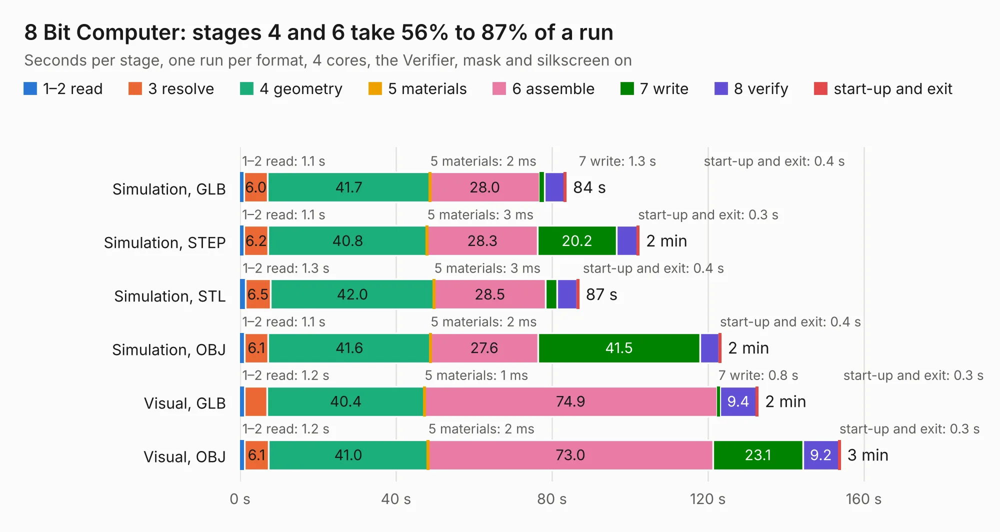

# 1. 8 Bit Computer

Board 1 of the 3,125 of [Corpus Testing](../Corpus-Testing.md), on [Corpus Page 1](../CorpusTestingPages/Corpus-Testing-01.md#1-8-bit-computer).

| Mode and format | 1–2 read | 3 resolve | 4 geometry | 5 materials | 6 assemble | 7 write | 8 verify | start-up and exit | Total |
|---|---:|---:|---:|---:|---:|---:|---:|---:|---:|
| Simulation, GLB | 1.1 | 6.0 | 41.7 | 2&nbsp;ms | 28.0 | 1.3 | 5.1 | 0.4 | 83.6 |
| Simulation, STEP | 1.1 | 6.2 | 40.8 | 3&nbsp;ms | 28.3 | 20.2 | 5.4 | 0.3 | 102.3 |
| Simulation, STL | 1.3 | 6.5 | 42.0 | 3&nbsp;ms | 28.5 | 2.9 | 5.2 | 0.4 | 86.8 |
| Simulation, OBJ | 1.1 | 6.1 | 41.6 | 2&nbsp;ms | 27.6 | 41.5 | 4.9 | 0.4 | 123.3 |
| Visual, GLB | 1.2 | 5.8 | 40.4 | 1&nbsp;ms | 74.9 | 0.8 | 9.4 | 0.3 | 132.8 |
| Visual, OBJ | 1.2 | 6.1 | 41.0 | 2&nbsp;ms | 73.0 | 23.1 | 9.2 | 0.3 | 153.9 |

<table align="center"><tr><td valign="top">

| Board | Repo: [01GOD/PCB-8-bit-Computer](https://github.com/01GOD/PCB-8-bit-Computer) Board: `8 Bit Computer.kicad_pcb` |
|---|---|
| Complexity | 254&nbsp;/&nbsp;1000 (size&nbsp;219, features&nbsp;35) |
| KESE&nbsp;features | through vias, filled zones |
| Tested | 9th November 2026 |
| Copper&nbsp;layers | 2 |
| File&nbsp;format | KiCad 5 (20171130) |
| Parts,&nbsp;tracks,&nbsp;vias | 319, 4,634, 117 |
| Triangles,&nbsp;simulation | 8,333,992 in 378 parts |
| Verifier | PASS in all six runs |

</td><td valign="top">

<table>
<tr><th>File type</th><th>File size</th><th>Peak memory used</th></tr>
<tr><th colspan="3" align="left">Simulation</th></tr>
<tr><td>GLB</td><td align="right">280&nbsp;MB</td><td align="right">2.5&nbsp;GB</td></tr>
<tr><td>STEP</td><td align="right">1.4&nbsp;GB</td><td align="right">3.2&nbsp;GB</td></tr>
<tr><td>STL</td><td align="right">417&nbsp;MB</td><td align="right">2.5&nbsp;GB</td></tr>
<tr><td>OBJ</td><td align="right">884&nbsp;MB</td><td align="right">5.2&nbsp;GB</td></tr>
<tr><th colspan="3" align="left">Visual</th></tr>
<tr><td>GLB</td><td align="right">180&nbsp;MB</td><td align="right">2.7&nbsp;GB</td></tr>
<tr><td>OBJ</td><td align="right">571&nbsp;MB</td><td align="right">3.5&nbsp;GB</td></tr>
</table>

</td></tr></table>

| Previous | Next |
|:---|---:|
| [Corpus Testing](../Corpus-Testing.md) | [2. Femto_frame](b0002b_FEMTO_Femto-frame.md) |
