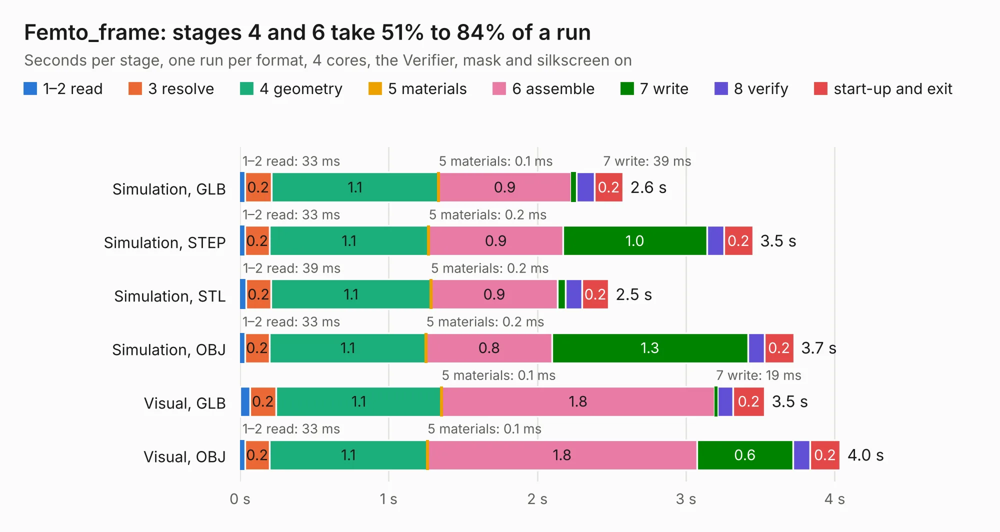

# 2 Femto_frame

Board 2 of the 3,138 of [Corpus Testing](../Corpus-Testing.md), on [Corpus Page 1](../CorpusTestingPages/Corpus-Testing-01.md#2-femto_frame).

| Mode and format | 1–2 read | 3 resolve | 4 geometry | 5 materials | 6 assemble | 7 write | 8 verify | start-up and exit | Total |
|---|---:|---:|---:|---:|---:|---:|---:|---:|---:|
| Simulation, GLB | 33&nbsp;ms | 0.2 | 1.1 | 0.1&nbsp;ms | 0.9 | 39&nbsp;ms | 0.1 | 0.2 | 2.6 |
| Simulation, STEP | 33&nbsp;ms | 0.2 | 1.1 | 0.2&nbsp;ms | 0.9 | 1.0 | 0.1 | 0.2 | 3.5 |
| Simulation, STL | 39&nbsp;ms | 0.2 | 1.1 | 0.2&nbsp;ms | 0.9 | 54&nbsp;ms | 0.1 | 0.2 | 2.5 |
| Simulation, OBJ | 33&nbsp;ms | 0.2 | 1.1 | 0.2&nbsp;ms | 0.8 | 1.3 | 0.1 | 0.2 | 3.7 |
| Visual, GLB | 66&nbsp;ms | 0.2 | 1.1 | 0.1&nbsp;ms | 1.8 | 19&nbsp;ms | 0.1 | 0.2 | 3.5 |
| Visual, OBJ | 33&nbsp;ms | 0.2 | 1.1 | 0.1&nbsp;ms | 1.8 | 0.6 | 0.1 | 0.2 | 4.0 |

<table align="center"><tr><td valign="top">

| Board | Repo: [32bitmicro/FEMTO](https://github.com/32bitmicro/FEMTO) Board: `Femto_frame.kicad_pcb` |
|---|---|
| Folder | source_files / Kicad / Frame |
| Complexity | 212&nbsp;/&nbsp;1000 (size&nbsp;167, features&nbsp;45) |
| KESE&nbsp;features | through vias, slotted holes, rounded, trapezoid or chamfered pads, curved board outline |
| Tested | 9th November 2026 |
| Copper&nbsp;layers | 2 |
| File&nbsp;format | KiCad 6 (20211014) |
| Parts,&nbsp;tracks,&nbsp;vias | 2, 0, 44 |
| Triangles,&nbsp;simulation | 246,284 in 14 parts |
| Verifier | PASS in all six runs |

</td><td valign="top">

<table>
<tr><th>File type</th><th>File size</th><th>Peak memory used</th></tr>
<tr><th colspan="3" align="left">Simulation</th></tr>
<tr><td>GLB</td><td align="right">8.6&nbsp;MB</td><td align="right">197&nbsp;MB</td></tr>
<tr><td>STEP</td><td align="right">34&nbsp;MB</td><td align="right">212&nbsp;MB</td></tr>
<tr><td>STL</td><td align="right">12&nbsp;MB</td><td align="right">206&nbsp;MB</td></tr>
<tr><td>OBJ</td><td align="right">25&nbsp;MB</td><td align="right">197&nbsp;MB</td></tr>
<tr><th colspan="3" align="left">Visual</th></tr>
<tr><td>GLB</td><td align="right">4.2&nbsp;MB</td><td align="right">162&nbsp;MB</td></tr>
<tr><td>OBJ</td><td align="right">12&nbsp;MB</td><td align="right">162&nbsp;MB</td></tr>
</table>

</td></tr></table>

| Previous | Next |
|:---|---:|
| [1 8 Bit Computer](b0001b_PCB-8-bit-Computer_8-Bit-Computer.md) | [3 Femto_v1](b0003b_FEMTO_Femto-v1.md) |
