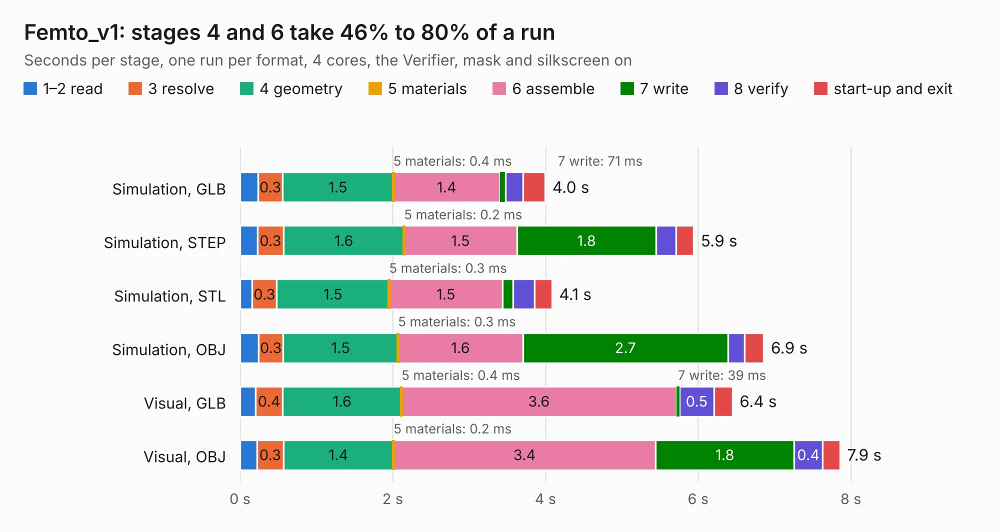

# 3. Femto_v1

Board 3 of the 3,132 of [Corpus Testing](../Corpus-Testing.md), on [Corpus Page 1](../CorpusTestingPages/Corpus-Testing-01.md#3-femto_v1).

| Mode and format | 1–2 read | 3 resolve | 4 geometry | 5 materials | 6 assemble | 7 write | 8 verify | start-up and exit | Total |
|---|---:|---:|---:|---:|---:|---:|---:|---:|---:|
| Simulation, GLB | 0.2 | 0.3 | 1.5 | 0.4&nbsp;ms | 1.4 | 71&nbsp;ms | 0.2 | 0.3 | 4.0 |
| Simulation, STEP | 0.2 | 0.3 | 1.6 | 0.2&nbsp;ms | 1.5 | 1.8 | 0.3 | 0.2 | 5.9 |
| Simulation, STL | 0.2 | 0.3 | 1.5 | 0.3&nbsp;ms | 1.5 | 0.1 | 0.3 | 0.2 | 4.1 |
| Simulation, OBJ | 0.2 | 0.3 | 1.5 | 0.3&nbsp;ms | 1.6 | 2.7 | 0.2 | 0.3 | 6.9 |
| Visual, GLB | 0.2 | 0.4 | 1.6 | 0.4&nbsp;ms | 3.6 | 39&nbsp;ms | 0.5 | 0.2 | 6.4 |
| Visual, OBJ | 0.2 | 0.3 | 1.4 | 0.2&nbsp;ms | 3.4 | 1.8 | 0.4 | 0.2 | 7.9 |

<table align="center"><tr><td valign="top">

| Board | Repo: [32bitmicro/FEMTO](https://github.com/32bitmicro/FEMTO) Board: `Femto_v1.kicad_pcb` |
|---|---|
| Folder | source_files / Kicad / Module |
| Complexity | 311&nbsp;/&nbsp;1000 (size&nbsp;226, features&nbsp;85) |
| KESE&nbsp;features | through vias, rounded, trapezoid or chamfered pads, filled zones, copper drawings, stack-up, dielectric εr and tanδ |
| Tested | 9th November 2026 |
| Copper&nbsp;layers | 4 |
| File&nbsp;format | KiCad 6 (20211014) |
| Parts,&nbsp;tracks,&nbsp;vias | 26, 484, 17 |
| Triangles,&nbsp;simulation | 381,090 in 64 parts |
| Verifier | PASS in all six runs |

</td><td valign="top">

<table>
<tr><th>File type</th><th>File size</th><th>Peak memory used</th></tr>
<tr><th colspan="3" align="left">Simulation</th></tr>
<tr><td>GLB</td><td align="right">13&nbsp;MB</td><td align="right">283&nbsp;MB</td></tr>
<tr><td>STEP</td><td align="right">75&nbsp;MB</td><td align="right">302&nbsp;MB</td></tr>
<tr><td>STL</td><td align="right">19&nbsp;MB</td><td align="right">279&nbsp;MB</td></tr>
<tr><td>OBJ</td><td align="right">39&nbsp;MB</td><td align="right">309&nbsp;MB</td></tr>
<tr><th colspan="3" align="left">Visual</th></tr>
<tr><td>GLB</td><td align="right">8.0&nbsp;MB</td><td align="right">257&nbsp;MB</td></tr>
<tr><td>OBJ</td><td align="right">24&nbsp;MB</td><td align="right">262&nbsp;MB</td></tr>
</table>

</td></tr></table>

| Previous | Next |
|:---|---:|
| [2. Femto_frame](b0002b_FEMTO_Femto-frame.md) | [4. Femto_tester_v1](b0004b_FEMTO_Femto-tester-v1.md) |
