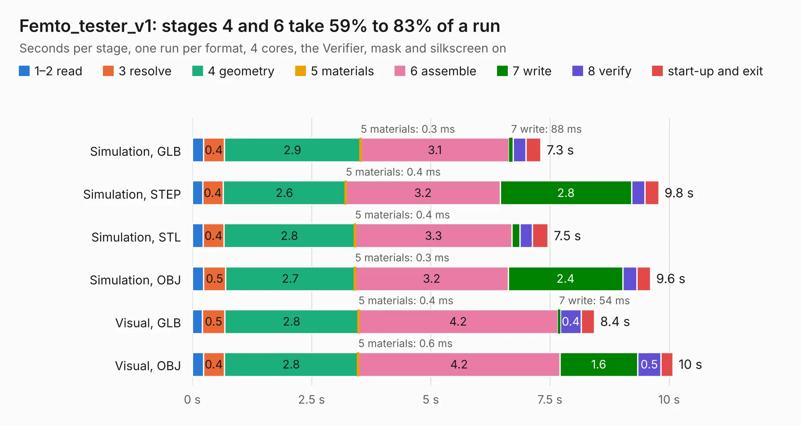

# 4. Femto_tester_v1

Board 4 of the 3,127 of [Corpus Testing](../Corpus-Testing.md), on [Corpus Page 1](../CorpusTestingPages/Corpus-Testing-01.md#4-femto_tester_v1).

| Mode and format | 1–2 read | 3 resolve | 4 geometry | 5 materials | 6 assemble | 7 write | 8 verify | start-up and exit | Total |
|---|---:|---:|---:|---:|---:|---:|---:|---:|---:|
| Simulation, GLB | 0.2 | 0.4 | 2.9 | 0.3&nbsp;ms | 3.1 | 88&nbsp;ms | 0.3 | 0.3 | 7.3 |
| Simulation, STEP | 0.2 | 0.4 | 2.6 | 0.4&nbsp;ms | 3.2 | 2.8 | 0.3 | 0.3 | 9.8 |
| Simulation, STL | 0.2 | 0.4 | 2.8 | 0.4&nbsp;ms | 3.3 | 0.2 | 0.3 | 0.3 | 7.5 |
| Simulation, OBJ | 0.2 | 0.5 | 2.7 | 0.3&nbsp;ms | 3.2 | 2.4 | 0.3 | 0.3 | 9.6 |
| Visual, GLB | 0.2 | 0.5 | 2.8 | 0.4&nbsp;ms | 4.2 | 54&nbsp;ms | 0.4 | 0.3 | 8.4 |
| Visual, OBJ | 0.2 | 0.4 | 2.8 | 0.6&nbsp;ms | 4.2 | 1.6 | 0.5 | 0.3 | 10.1 |

<table align="center"><tr><td valign="top">

| Board | Repo: [32bitmicro/FEMTO](https://github.com/32bitmicro/FEMTO) Board: `Femto_tester_v1.kicad_pcb` |
|---|---|
| Folder | source_files / Kicad / Tester |
| Complexity | 282&nbsp;/&nbsp;1000 (size&nbsp;162, features&nbsp;120) |
| KESE&nbsp;features | through vias, slotted holes, rounded, trapezoid or chamfered pads, arc tracks, filled zones, copper drawings, curved board outline, stack-up, dielectric εr and tanδ |
| Tested | 9th November 2026 |
| Copper&nbsp;layers | 2 |
| File&nbsp;format | KiCad 6 (20211014) |
| Parts,&nbsp;tracks,&nbsp;vias | 74, 381, 6 |
| Triangles,&nbsp;simulation | 503,506 in 88 parts |
| Verifier | PASS in all six runs |

</td><td valign="top">

<table>
<tr><th>File type</th><th>File size</th><th>Peak memory used</th></tr>
<tr><th colspan="3" align="left">Simulation</th></tr>
<tr><td>GLB</td><td align="right">18&nbsp;MB</td><td align="right">374&nbsp;MB</td></tr>
<tr><td>STEP</td><td align="right">99&nbsp;MB</td><td align="right">394&nbsp;MB</td></tr>
<tr><td>STL</td><td align="right">25&nbsp;MB</td><td align="right">349&nbsp;MB</td></tr>
<tr><td>OBJ</td><td align="right">52&nbsp;MB</td><td align="right">366&nbsp;MB</td></tr>
<tr><th colspan="3" align="left">Visual</th></tr>
<tr><td>GLB</td><td align="right">12&nbsp;MB</td><td align="right">379&nbsp;MB</td></tr>
<tr><td>OBJ</td><td align="right">34&nbsp;MB</td><td align="right">351&nbsp;MB</td></tr>
</table>

</td></tr></table>

| Previous | Next |
|:---|---:|
| [3. Femto_v1](b0003b_FEMTO_Femto-v1.md) | [5. Stroopwafel-LGA1151-CFL](b0005b_stroopwafel-lga1151-cfl_Stroopwafel-LGA1151-CFL.md) |
