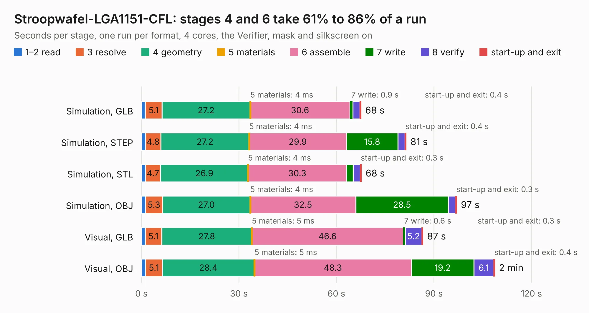

# 5. Stroopwafel-LGA1151-CFL

Board 5 of the 3,102 of [Corpus Testing](../Corpus-Testing.md), on [Corpus Page 1](../CorpusTestingPages/Corpus-Testing-01.md#5-stroopwafel-lga1151-cfl).

| Mode and format | 1–2 read | 3 resolve | 4 geometry | 5 materials | 6 assemble | 7 write | 8 verify | start-up and exit | Total |
|---|---:|---:|---:|---:|---:|---:|---:|---:|---:|
| Simulation, GLB | 1.2 | 5.1 | 27.2 | 4&nbsp;ms | 30.6 | 0.9 | 2.1 | 0.4 | 67.6 |
| Simulation, STEP | 1.2 | 4.8 | 27.2 | 4&nbsp;ms | 29.9 | 15.8 | 2.2 | 0.4 | 81.5 |
| Simulation, STL | 1.2 | 4.7 | 26.9 | 4&nbsp;ms | 30.3 | 2.1 | 2.2 | 0.3 | 67.7 |
| Simulation, OBJ | 1.2 | 5.3 | 27.0 | 4&nbsp;ms | 32.5 | 28.5 | 2.3 | 0.3 | 97.0 |
| Visual, GLB | 1.2 | 5.1 | 27.8 | 5&nbsp;ms | 46.6 | 0.6 | 5.2 | 0.3 | 86.6 |
| Visual, OBJ | 1.3 | 5.1 | 28.4 | 5&nbsp;ms | 48.3 | 19.2 | 6.1 | 0.4 | 108.7 |

<table align="center"><tr><td valign="top">

| Board | Repo: [a-little-wifi/stroopwafel-lga1151-cfl](https://github.com/a-little-wifi/stroopwafel-lga1151-cfl) Board: `Stroopwafel-LGA1151-CFL.kicad_pcb` |
|---|---|
| Complexity | 256&nbsp;/&nbsp;1000 (size&nbsp;211, features&nbsp;45) |
| KESE&nbsp;features | through vias, slotted holes, rounded, trapezoid or chamfered pads, curved board outline |
| Tested | 9th November 2026 |
| Copper&nbsp;layers | 2 |
| File&nbsp;format | KiCad 9 (20241229) |
| Parts,&nbsp;tracks,&nbsp;vias | 184, 55, 18 |
| Triangles,&nbsp;simulation | 5,009,250 in 1607 parts |
| Note | mostly unrouted |
| Verifier | PASS in all six runs |

</td><td valign="top">

<table>
<tr><th>File type</th><th>File size</th><th>Peak memory used</th></tr>
<tr><th colspan="3" align="left">Simulation</th></tr>
<tr><td>GLB</td><td align="right">162&nbsp;MB</td><td align="right">1.7&nbsp;GB</td></tr>
<tr><td>STEP</td><td align="right">677&nbsp;MB</td><td align="right">2.2&nbsp;GB</td></tr>
<tr><td>STL</td><td align="right">251&nbsp;MB</td><td align="right">1.7&nbsp;GB</td></tr>
<tr><td>OBJ</td><td align="right">524&nbsp;MB</td><td align="right">3.1&nbsp;GB</td></tr>
<tr><th colspan="3" align="left">Visual</th></tr>
<tr><td>GLB</td><td align="right">114&nbsp;MB</td><td align="right">2.2&nbsp;GB</td></tr>
<tr><td>OBJ</td><td align="right">362&nbsp;MB</td><td align="right">2.4&nbsp;GB</td></tr>
</table>

</td></tr></table>

| Previous | Next |
|:---|---:|
| [4. Femto_tester_v1](b0004b_FEMTO_Femto-tester-v1.md) | [6. iMX6_BareBones](b0006b_imx6-barebones_iMX6-BareBones.md) |
