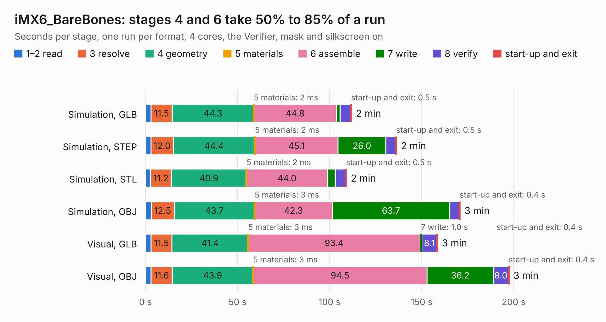

# 6. iMX6_BareBones

Board 6 of the 3,103 of [Corpus Testing](../Corpus-Testing.md), on [Corpus Page 1](../CorpusTestingPages/Corpus-Testing-01.md#6-imx6_barebones).

| Mode and format | 1–2 read | 3 resolve | 4 geometry | 5 materials | 6 assemble | 7 write | 8 verify | start-up and exit | Total |
|---|---:|---:|---:|---:|---:|---:|---:|---:|---:|
| Simulation, GLB | 3.0 | 11.5 | 44.3 | 2&nbsp;ms | 44.8 | 2.0 | 5.8 | 0.5 | 112.0 |
| Simulation, STEP | 3.0 | 12.0 | 44.4 | 2&nbsp;ms | 45.1 | 26.0 | 5.3 | 0.5 | 136.4 |
| Simulation, STL | 2.8 | 11.2 | 40.9 | 2&nbsp;ms | 44.0 | 4.1 | 5.7 | 0.5 | 109.2 |
| Simulation, OBJ | 3.1 | 12.5 | 43.7 | 3&nbsp;ms | 42.3 | 63.7 | 5.2 | 0.4 | 170.9 |
| Visual, GLB | 2.9 | 11.5 | 41.4 | 3&nbsp;ms | 93.4 | 1.0 | 8.1 | 0.4 | 158.7 |
| Visual, OBJ | 2.9 | 11.6 | 43.9 | 3&nbsp;ms | 94.5 | 36.2 | 8.0 | 0.4 | 197.5 |

<table align="center"><tr><td valign="top">

| Board | Repo: [a1wolfe/imx6-barebones](https://github.com/a1wolfe/imx6-barebones) Board: `iMX6_BareBones.kicad_pcb` |
|---|---|
| Folder | Kicad |
| Complexity | 449&nbsp;/&nbsp;1000 (size&nbsp;329, features&nbsp;120) |
| KESE&nbsp;features | through vias, rounded, trapezoid or chamfered pads, arc tracks, filled zones, curved board outline, knockout text, stack-up, dielectric εr and tanδ, mask and silkscreen colours |
| Tested | 9th November 2026 |
| Copper&nbsp;layers | 6 |
| File&nbsp;format | KiCad 9 (20241229) |
| Parts,&nbsp;tracks,&nbsp;vias | 498, 9,285, 1,155 |
| Triangles,&nbsp;simulation | 9,828,966 in 583 parts |
| Verifier | PASS in all six runs |

</td><td valign="top">

<table>
<tr><th>File type</th><th>File size</th><th>Peak memory used</th></tr>
<tr><th colspan="3" align="left">Simulation</th></tr>
<tr><td>GLB</td><td align="right">337&nbsp;MB</td><td align="right">2.2&nbsp;GB</td></tr>
<tr><td>STEP</td><td align="right">1.4&nbsp;GB</td><td align="right">3.1&nbsp;GB</td></tr>
<tr><td>STL</td><td align="right">491&nbsp;MB</td><td align="right">2.3&nbsp;GB</td></tr>
<tr><td>OBJ</td><td align="right">1.1&nbsp;GB</td><td align="right">6.3&nbsp;GB</td></tr>
<tr><th colspan="3" align="left">Visual</th></tr>
<tr><td>GLB</td><td align="right">190&nbsp;MB</td><td align="right">3.1&nbsp;GB</td></tr>
<tr><td>OBJ</td><td align="right">626&nbsp;MB</td><td align="right">3.9&nbsp;GB</td></tr>
</table>

</td></tr></table>

| Previous | Next |
|:---|---:|
| [5. Stroopwafel-LGA1151-CFL](b0005b_stroopwafel-lga1151-cfl_Stroopwafel-LGA1151-CFL.md) | [7. A4092](b0007b_A4092_A4092.md) |
