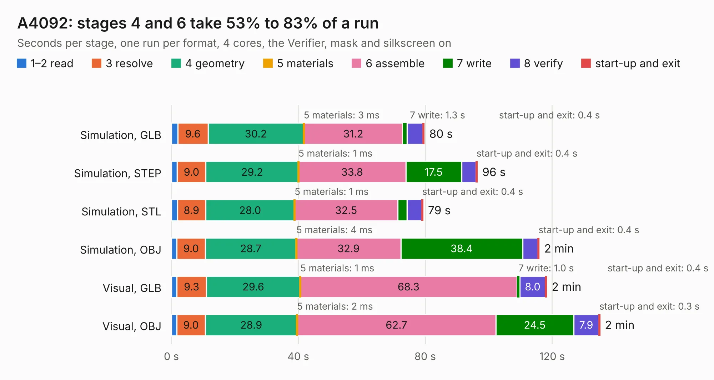

# 7 A4092

Board 7 of the 3,138 of [Corpus Testing](../Corpus-Testing.md), on [Corpus Page 1](../CorpusTestingPages/Corpus-Testing-01.md#7-a4092).

| Mode and format | 1–2 read | 3 resolve | 4 geometry | 5 materials | 6 assemble | 7 write | 8 verify | start-up and exit | Total |
|---|---:|---:|---:|---:|---:|---:|---:|---:|---:|
| Simulation, GLB | 2.0 | 9.6 | 30.2 | 3&nbsp;ms | 31.2 | 1.3 | 5.0 | 0.4 | 79.7 |
| Simulation, STEP | 1.8 | 9.0 | 29.2 | 1&nbsp;ms | 33.8 | 17.5 | 4.5 | 0.4 | 96.4 |
| Simulation, STL | 1.9 | 8.9 | 28.0 | 1&nbsp;ms | 32.5 | 2.9 | 4.7 | 0.4 | 79.3 |
| Simulation, OBJ | 1.7 | 9.0 | 28.7 | 4&nbsp;ms | 32.9 | 38.4 | 4.8 | 0.4 | 115.9 |
| Visual, GLB | 1.7 | 9.3 | 29.6 | 1&nbsp;ms | 68.3 | 1.0 | 8.0 | 0.4 | 118.3 |
| Visual, OBJ | 1.7 | 9.0 | 28.9 | 2&nbsp;ms | 62.7 | 24.5 | 7.9 | 0.3 | 135.0 |

<table align="center"><tr><td valign="top">

| Board | Repo: [A4091/A4092](https://github.com/A4091/A4092) Board: `A4092.kicad_pcb` |
|---|---|
| Folder | Kicad / A4092 |
| Complexity | 364&nbsp;/&nbsp;1000 (size&nbsp;279, features&nbsp;85) |
| KESE&nbsp;features | through vias, rounded, trapezoid or chamfered pads, filled zones, curved board outline, stack-up, dielectric εr and tanδ |
| Tested | 9th November 2026 |
| Copper&nbsp;layers | 4 |
| File&nbsp;format | KiCad 9 (20241229) |
| Parts,&nbsp;tracks,&nbsp;vias | 90, 5,116, 1,557 |
| Triangles,&nbsp;simulation | 6,808,994 in 302 parts |
| Verifier | PASS in all six runs |

</td><td valign="top">

<table>
<tr><th>File type</th><th>File size</th><th>Peak memory used</th></tr>
<tr><th colspan="3" align="left">Simulation</th></tr>
<tr><td>GLB</td><td align="right">232&nbsp;MB</td><td align="right">1.9&nbsp;GB</td></tr>
<tr><td>STEP</td><td align="right">888&nbsp;MB</td><td align="right">2.7&nbsp;GB</td></tr>
<tr><td>STL</td><td align="right">340&nbsp;MB</td><td align="right">1.9&nbsp;GB</td></tr>
<tr><td>OBJ</td><td align="right">727&nbsp;MB</td><td align="right">4.3&nbsp;GB</td></tr>
<tr><th colspan="3" align="left">Visual</th></tr>
<tr><td>GLB</td><td align="right">148&nbsp;MB</td><td align="right">2.4&nbsp;GB</td></tr>
<tr><td>OBJ</td><td align="right">490&nbsp;MB</td><td align="right">3.1&nbsp;GB</td></tr>
</table>

</td></tr></table>

| Previous | Next |
|:---|---:|
| [6 iMX6_BareBones](b0006b_imx6-barebones_iMX6-BareBones.md) | [8 A4092-backpanel](b0008b_A4092_A4092-backpanel.md) |
