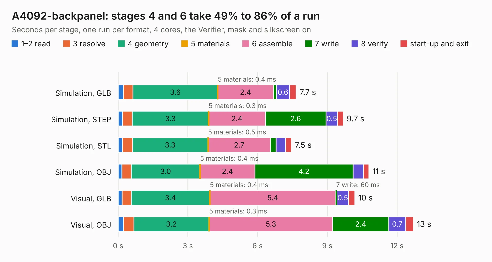

# 8. A4092-backpanel

Board 8 of the 3,101 of [Corpus Testing](../Corpus-Testing.md), on [Corpus Page 1](../CorpusTestingPages/Corpus-Testing-01.md#8-a4092-backpanel).

| Mode and format | 1–2 read | 3 resolve | 4 geometry | 5 materials | 6 assemble | 7 write | 8 verify | start-up and exit | Total |
|---|---:|---:|---:|---:|---:|---:|---:|---:|---:|
| Simulation, GLB | 0.2 | 0.4 | 3.6 | 0.4&nbsp;ms | 2.4 | 0.1 | 0.6 | 0.3 | 7.7 |
| Simulation, STEP | 0.2 | 0.4 | 3.3 | 0.3&nbsp;ms | 2.4 | 2.6 | 0.5 | 0.2 | 9.7 |
| Simulation, STL | 0.2 | 0.4 | 3.3 | 0.5&nbsp;ms | 2.7 | 0.2 | 0.4 | 0.2 | 7.5 |
| Simulation, OBJ | 0.2 | 0.4 | 3.0 | 0.4&nbsp;ms | 2.4 | 4.2 | 0.4 | 0.2 | 10.8 |
| Visual, GLB | 0.2 | 0.4 | 3.4 | 0.4&nbsp;ms | 5.4 | 60&nbsp;ms | 0.5 | 0.3 | 10.2 |
| Visual, OBJ | 0.2 | 0.4 | 3.2 | 0.3&nbsp;ms | 5.3 | 2.4 | 0.7 | 0.3 | 12.7 |

<table align="center"><tr><td valign="top">

| Board | Repo: [A4091/A4092](https://github.com/A4091/A4092) Board: `A4092-backpanel.kicad_pcb` |
|---|---|
| Folder | Kicad / Backpanel |
| Complexity | 163&nbsp;/&nbsp;1000 (size&nbsp;108, features&nbsp;55) |
| KESE&nbsp;features | through vias, rounded, trapezoid or chamfered pads, filled zones, curved board outline |
| Tested | 9th November 2026 |
| Copper&nbsp;layers | 2 |
| File&nbsp;format | KiCad 9 (20241229) |
| Parts,&nbsp;tracks,&nbsp;vias | 2, 118, 3 |
| Triangles,&nbsp;simulation | 641,034 in 37 parts |
| Note | panel |
| Verifier | PASS in all six runs |

</td><td valign="top">

<table>
<tr><th>File type</th><th>File size</th><th>Peak memory used</th></tr>
<tr><th colspan="3" align="left">Simulation</th></tr>
<tr><td>GLB</td><td align="right">22&nbsp;MB</td><td align="right">388&nbsp;MB</td></tr>
<tr><td>STEP</td><td align="right">96&nbsp;MB</td><td align="right">407&nbsp;MB</td></tr>
<tr><td>STL</td><td align="right">32&nbsp;MB</td><td align="right">373&nbsp;MB</td></tr>
<tr><td>OBJ</td><td align="right">65&nbsp;MB</td><td align="right">460&nbsp;MB</td></tr>
<tr><th colspan="3" align="left">Visual</th></tr>
<tr><td>GLB</td><td align="right">12&nbsp;MB</td><td align="right">391&nbsp;MB</td></tr>
<tr><td>OBJ</td><td align="right">36&nbsp;MB</td><td align="right">386&nbsp;MB</td></tr>
</table>

</td></tr></table>

| Previous | Next |
|:---|---:|
| [7. A4092](b0007b_A4092_A4092.md) | [9. Flipper](b0009b_A4092_Flipper.md) |
