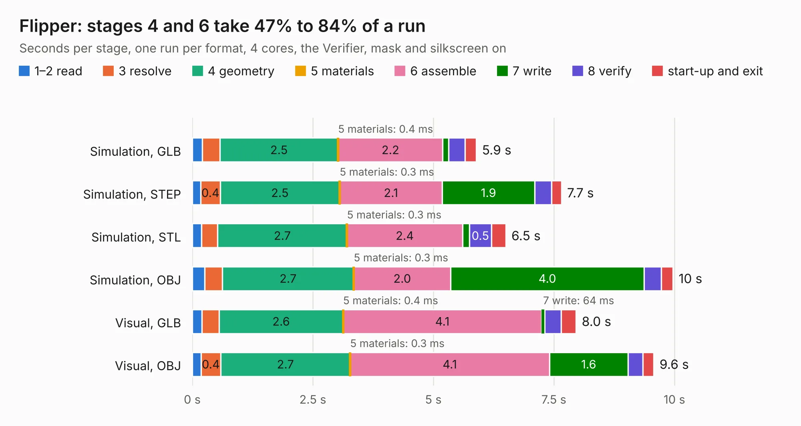

# 9. Flipper

Board 9 of the 3,130 of [Corpus Testing](../Corpus-Testing.md), on [Corpus Page 1](../CorpusTestingPages/Corpus-Testing-01.md#9-flipper).

| Mode and format | 1–2 read | 3 resolve | 4 geometry | 5 materials | 6 assemble | 7 write | 8 verify | start-up and exit | Total |
|---|---:|---:|---:|---:|---:|---:|---:|---:|---:|
| Simulation, GLB | 0.2 | 0.4 | 2.5 | 0.4&nbsp;ms | 2.2 | 0.1 | 0.3 | 0.2 | 5.9 |
| Simulation, STEP | 0.2 | 0.4 | 2.5 | 0.3&nbsp;ms | 2.1 | 1.9 | 0.4 | 0.2 | 7.7 |
| Simulation, STL | 0.2 | 0.3 | 2.7 | 0.3&nbsp;ms | 2.4 | 0.1 | 0.5 | 0.3 | 6.5 |
| Simulation, OBJ | 0.3 | 0.4 | 2.7 | 0.3&nbsp;ms | 2.0 | 4.0 | 0.4 | 0.2 | 10.0 |
| Visual, GLB | 0.2 | 0.4 | 2.6 | 0.4&nbsp;ms | 4.1 | 64&nbsp;ms | 0.3 | 0.3 | 8.0 |
| Visual, OBJ | 0.2 | 0.4 | 2.7 | 0.3&nbsp;ms | 4.1 | 1.6 | 0.3 | 0.2 | 9.6 |

<table align="center"><tr><td valign="top">

| Board | Repo: [A4091/A4092](https://github.com/A4091/A4092) Board: `Flipper.kicad_pcb` |
|---|---|
| Folder | Kicad / Flipper |
| Complexity | 169&nbsp;/&nbsp;1000 (size&nbsp;99, features&nbsp;70) |
| KESE&nbsp;features | rounded, trapezoid or chamfered pads, filled zones, curved board outline, stack-up, dielectric εr and tanδ |
| Tested | 9th November 2026 |
| Copper&nbsp;layers | 2 |
| File&nbsp;format | KiCad 9 (20241229) |
| Parts,&nbsp;tracks,&nbsp;vias | 2, 72, 0 |
| Triangles,&nbsp;simulation | 561,064 in 35 parts |
| Verifier | PASS in all six runs |

</td><td valign="top">

<table>
<tr><th>File type</th><th>File size</th><th>Peak memory used</th></tr>
<tr><th colspan="3" align="left">Simulation</th></tr>
<tr><td>GLB</td><td align="right">19&nbsp;MB</td><td align="right">319&nbsp;MB</td></tr>
<tr><td>STEP</td><td align="right">79&nbsp;MB</td><td align="right">372&nbsp;MB</td></tr>
<tr><td>STL</td><td align="right">28&nbsp;MB</td><td align="right">308&nbsp;MB</td></tr>
<tr><td>OBJ</td><td align="right">56&nbsp;MB</td><td align="right">416&nbsp;MB</td></tr>
<tr><th colspan="3" align="left">Visual</th></tr>
<tr><td>GLB</td><td align="right">10&nbsp;MB</td><td align="right">349&nbsp;MB</td></tr>
<tr><td>OBJ</td><td align="right">31&nbsp;MB</td><td align="right">344&nbsp;MB</td></tr>
</table>

</td></tr></table>

| Previous | Next |
|:---|---:|
| [8. A4092-backpanel](b0008b_A4092_A4092-backpanel.md) | [10. A4092-terminator-dev](b0010b_A4092_A4092-terminator-dev.md) |
