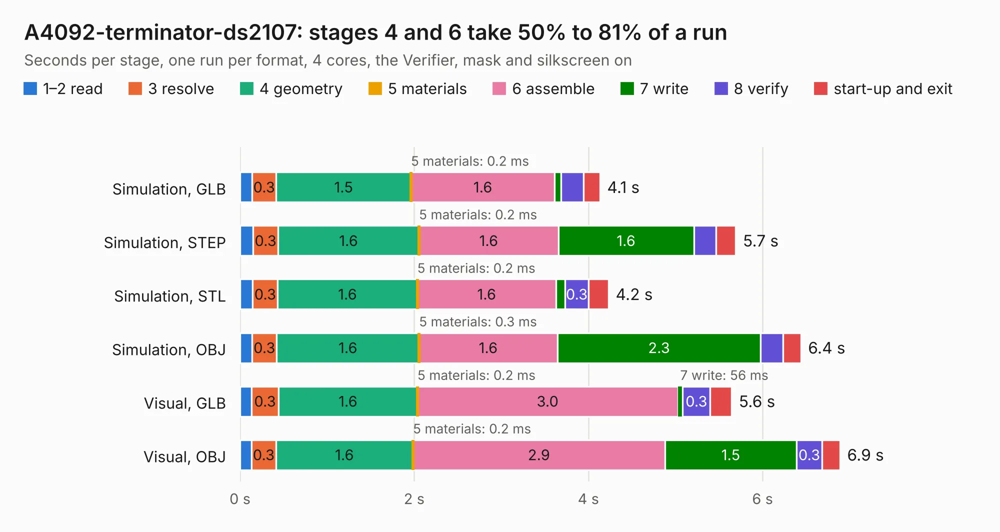

# 11. A4092-terminator-ds2107

Board 11 of the 3,124 of [Corpus Testing](../Corpus-Testing.md), on [Corpus Page 1](../CorpusTestingPages/Corpus-Testing-01.md#11-a4092-terminator-ds2107).

| Mode and format | 1–2 read | 3 resolve | 4 geometry | 5 materials | 6 assemble | 7 write | 8 verify | start-up and exit | Total |
|---|---:|---:|---:|---:|---:|---:|---:|---:|---:|
| Simulation, GLB | 0.1 | 0.3 | 1.5 | 0.2&nbsp;ms | 1.6 | 75&nbsp;ms | 0.3 | 0.2 | 4.1 |
| Simulation, STEP | 0.2 | 0.3 | 1.6 | 0.2&nbsp;ms | 1.6 | 1.6 | 0.3 | 0.2 | 5.7 |
| Simulation, STL | 0.1 | 0.3 | 1.6 | 0.2&nbsp;ms | 1.6 | 0.1 | 0.3 | 0.2 | 4.2 |
| Simulation, OBJ | 0.1 | 0.3 | 1.6 | 0.3&nbsp;ms | 1.6 | 2.3 | 0.3 | 0.2 | 6.4 |
| Visual, GLB | 0.1 | 0.3 | 1.6 | 0.2&nbsp;ms | 3.0 | 56&nbsp;ms | 0.3 | 0.2 | 5.6 |
| Visual, OBJ | 0.1 | 0.3 | 1.6 | 0.2&nbsp;ms | 2.9 | 1.5 | 0.3 | 0.2 | 6.9 |

<table align="center"><tr><td valign="top">

| Board | Repo: [A4091/A4092](https://github.com/A4091/A4092) Board: `A4092-terminator-ds2107.kicad_pcb` |
|---|---|
| Folder | Kicad / Terminator-DS21S07 |
| Complexity | 210&nbsp;/&nbsp;1000 (size&nbsp;135, features&nbsp;75) |
| KESE&nbsp;features | through vias, rounded, trapezoid or chamfered pads, filled zones, stack-up, dielectric εr and tanδ |
| Tested | 9th November 2026 |
| Copper&nbsp;layers | 2 |
| File&nbsp;format | KiCad 9 (20241229) |
| Parts,&nbsp;tracks,&nbsp;vias | 9, 201, 29 |
| Triangles,&nbsp;simulation | 441,348 in 35 parts |
| Verifier | PASS in all six runs |

</td><td valign="top">

<table>
<tr><th>File type</th><th>File size</th><th>Peak memory used</th></tr>
<tr><th colspan="3" align="left">Simulation</th></tr>
<tr><td>GLB</td><td align="right">15&nbsp;MB</td><td align="right">278&nbsp;MB</td></tr>
<tr><td>STEP</td><td align="right">76&nbsp;MB</td><td align="right">329&nbsp;MB</td></tr>
<tr><td>STL</td><td align="right">22&nbsp;MB</td><td align="right">282&nbsp;MB</td></tr>
<tr><td>OBJ</td><td align="right">45&nbsp;MB</td><td align="right">353&nbsp;MB</td></tr>
<tr><th colspan="3" align="left">Visual</th></tr>
<tr><td>GLB</td><td align="right">9.3&nbsp;MB</td><td align="right">309&nbsp;MB</td></tr>
<tr><td>OBJ</td><td align="right">27&nbsp;MB</td><td align="right">309&nbsp;MB</td></tr>
</table>

</td></tr></table>

| Previous | Next |
|:---|---:|
| [10. A4092-terminator-dev](b0010b_A4092_A4092-terminator-dev.md) | [12. A4092-terminator](b0012b_A4092_A4092-terminator.md) |
