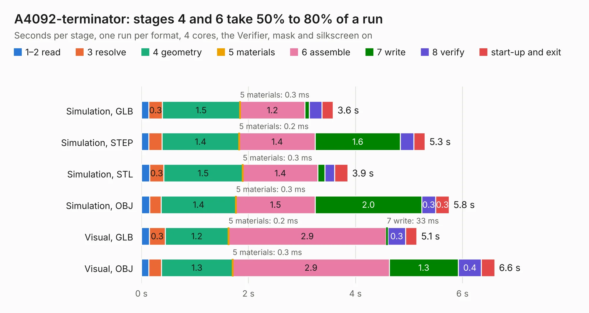

# 12. A4092-terminator

Board 12 of the 3,108 of [Corpus Testing](../Corpus-Testing.md), on [Corpus Page 1](../CorpusTestingPages/Corpus-Testing-01.md#12-a4092-terminator).

| Mode and format | 1–2 read | 3 resolve | 4 geometry | 5 materials | 6 assemble | 7 write | 8 verify | start-up and exit | Total |
|---|---:|---:|---:|---:|---:|---:|---:|---:|---:|
| Simulation, GLB | 0.1 | 0.3 | 1.5 | 0.3&nbsp;ms | 1.2 | 81&nbsp;ms | 0.2 | 0.2 | 3.6 |
| Simulation, STEP | 0.1 | 0.2 | 1.4 | 0.2&nbsp;ms | 1.4 | 1.6 | 0.3 | 0.2 | 5.3 |
| Simulation, STL | 0.2 | 0.3 | 1.5 | 0.3&nbsp;ms | 1.4 | 0.1 | 0.2 | 0.3 | 3.9 |
| Simulation, OBJ | 0.2 | 0.2 | 1.4 | 0.3&nbsp;ms | 1.5 | 2.0 | 0.3 | 0.3 | 5.8 |
| Visual, GLB | 0.1 | 0.3 | 1.2 | 0.2&nbsp;ms | 2.9 | 33&nbsp;ms | 0.3 | 0.2 | 5.1 |
| Visual, OBJ | 0.1 | 0.2 | 1.3 | 0.3&nbsp;ms | 2.9 | 1.3 | 0.4 | 0.3 | 6.6 |

<table align="center"><tr><td valign="top">

| Board | Repo: [A4091/A4092](https://github.com/A4091/A4092) Board: `A4092-terminator.kicad_pcb` |
|---|---|
| Folder | Kicad / Terminator-LT1118-2.85 |
| Complexity | 198&nbsp;/&nbsp;1000 (size&nbsp;123, features&nbsp;75) |
| KESE&nbsp;features | through vias, rounded, trapezoid or chamfered pads, filled zones, stack-up, dielectric εr and tanδ |
| Tested | 9th November 2026 |
| Copper&nbsp;layers | 2 |
| File&nbsp;format | KiCad 9 (20241229) |
| Parts,&nbsp;tracks,&nbsp;vias | 10, 115, 5 |
| Triangles,&nbsp;simulation | 381,136 in 37 parts |
| Verifier | PASS in all six runs |

</td><td valign="top">

<table>
<tr><th>File type</th><th>File size</th><th>Peak memory used</th></tr>
<tr><th colspan="3" align="left">Simulation</th></tr>
<tr><td>GLB</td><td align="right">13&nbsp;MB</td><td align="right">273&nbsp;MB</td></tr>
<tr><td>STEP</td><td align="right">66&nbsp;MB</td><td align="right">305&nbsp;MB</td></tr>
<tr><td>STL</td><td align="right">19&nbsp;MB</td><td align="right">266&nbsp;MB</td></tr>
<tr><td>OBJ</td><td align="right">38&nbsp;MB</td><td align="right">310&nbsp;MB</td></tr>
<tr><th colspan="3" align="left">Visual</th></tr>
<tr><td>GLB</td><td align="right">7.8&nbsp;MB</td><td align="right">275&nbsp;MB</td></tr>
<tr><td>OBJ</td><td align="right">23&nbsp;MB</td><td align="right">281&nbsp;MB</td></tr>
</table>

</td></tr></table>

| Previous | Next |
|:---|---:|
| [11. A4092-terminator-ds2107](b0011b_A4092_A4092-terminator-ds2107.md) | [13. A4770](b0013b_cheetah_A4770.md) |
