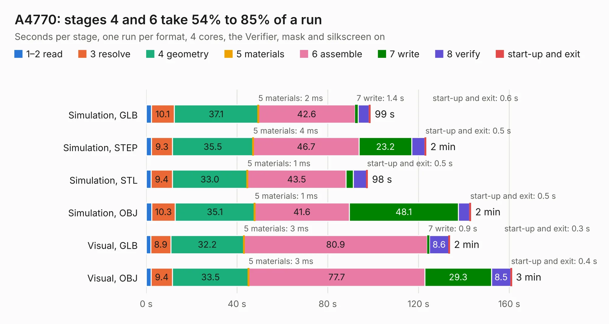

# 13. A4770

Board 13 of the 3,139 of [Corpus Testing](../Corpus-Testing.md), on [Corpus Page 1](../CorpusTestingPages/Corpus-Testing-01.md#13-a4770).

| Mode and format | 1–2 read | 3 resolve | 4 geometry | 5 materials | 6 assemble | 7 write | 8 verify | start-up and exit | Total |
|---|---:|---:|---:|---:|---:|---:|---:|---:|---:|
| Simulation, GLB | 2.2 | 10.1 | 37.1 | 2&nbsp;ms | 42.6 | 1.4 | 4.8 | 0.6 | 98.8 |
| Simulation, STEP | 2.3 | 9.3 | 35.5 | 4&nbsp;ms | 46.7 | 23.2 | 5.8 | 0.5 | 123.3 |
| Simulation, STL | 2.1 | 9.4 | 33.0 | 1&nbsp;ms | 43.5 | 3.2 | 5.8 | 0.5 | 97.6 |
| Simulation, OBJ | 2.4 | 10.3 | 35.1 | 1&nbsp;ms | 41.6 | 48.1 | 5.0 | 0.5 | 143.1 |
| Visual, GLB | 2.0 | 8.9 | 32.2 | 3&nbsp;ms | 80.9 | 0.9 | 8.6 | 0.3 | 133.7 |
| Visual, OBJ | 2.1 | 9.4 | 33.5 | 3&nbsp;ms | 77.7 | 29.3 | 8.5 | 0.4 | 161.0 |

<table align="center"><tr><td valign="top">

| Board | Repo: [A4091/cheetah](https://github.com/A4091/cheetah) Board: `A4770.kicad_pcb` |
|---|---|
| Folder | Kicad / A4770 |
| Complexity | 382&nbsp;/&nbsp;1000 (size&nbsp;282, features&nbsp;100) |
| KESE&nbsp;features | through vias, rounded, trapezoid or chamfered pads, filled zones, curved board outline, TrueType text, stack-up, dielectric εr and tanδ |
| Tested | 9th November 2026 |
| Copper&nbsp;layers | 4 |
| File&nbsp;format | KiCad 9 (20241229) |
| Parts,&nbsp;tracks,&nbsp;vias | 123, 5,754, 1,224 |
| Triangles,&nbsp;simulation | 6,769,822 in 344 parts |
| Verifier | PASS in all six runs |

</td><td valign="top">

<table>
<tr><th>File type</th><th>File size</th><th>Peak memory used</th></tr>
<tr><th colspan="3" align="left">Simulation</th></tr>
<tr><td>GLB</td><td align="right">232&nbsp;MB</td><td align="right">1.9&nbsp;GB</td></tr>
<tr><td>STEP</td><td align="right">977&nbsp;MB</td><td align="right">2.6&nbsp;GB</td></tr>
<tr><td>STL</td><td align="right">339&nbsp;MB</td><td align="right">1.8&nbsp;GB</td></tr>
<tr><td>OBJ</td><td align="right">725&nbsp;MB</td><td align="right">4.4&nbsp;GB</td></tr>
<tr><th colspan="3" align="left">Visual</th></tr>
<tr><td>GLB</td><td align="right">149&nbsp;MB</td><td align="right">2.4&nbsp;GB</td></tr>
<tr><td>OBJ</td><td align="right">486&nbsp;MB</td><td align="right">3.3&nbsp;GB</td></tr>
</table>

</td></tr></table>

| Previous | Next |
|:---|---:|
| [12. A4092-terminator](b0012b_A4092_A4092-terminator.md) | [14. FPGA-BOARD](b0014b_fpga-board_FPGA-BOARD.md) |
