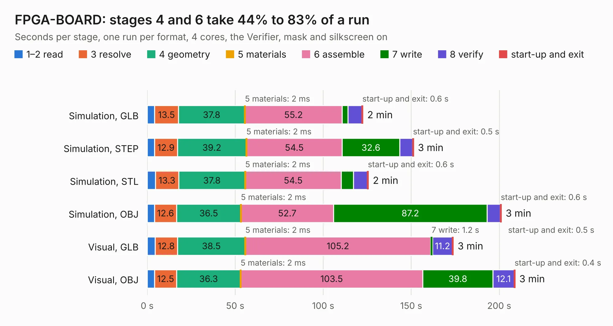

# 14. FPGA-BOARD

Board 14 of the 3,119 of [Corpus Testing](../Corpus-Testing.md), on [Corpus Page 1](../CorpusTestingPages/Corpus-Testing-01.md#14-fpga-board).

| Mode and format | 1–2 read | 3 resolve | 4 geometry | 5 materials | 6 assemble | 7 write | 8 verify | start-up and exit | Total |
|---|---:|---:|---:|---:|---:|---:|---:|---:|---:|
| Simulation, GLB | 4.2 | 13.5 | 37.8 | 2&nbsp;ms | 55.2 | 3.3 | 7.9 | 0.6 | 122.6 |
| Simulation, STEP | 4.3 | 12.9 | 39.2 | 2&nbsp;ms | 54.5 | 32.6 | 7.4 | 0.5 | 151.3 |
| Simulation, STL | 4.6 | 13.3 | 37.8 | 2&nbsp;ms | 54.5 | 7.0 | 7.9 | 0.6 | 125.7 |
| Simulation, OBJ | 4.2 | 12.6 | 36.5 | 2&nbsp;ms | 52.7 | 87.2 | 7.5 | 0.6 | 201.2 |
| Visual, GLB | 4.5 | 12.8 | 38.5 | 2&nbsp;ms | 105.2 | 1.2 | 11.2 | 0.5 | 173.9 |
| Visual, OBJ | 4.2 | 12.5 | 36.3 | 2&nbsp;ms | 103.5 | 39.8 | 12.1 | 0.4 | 208.9 |

<table align="center"><tr><td valign="top">

| Board | Repo: [abdulajadi1/fpga-board](https://github.com/abdulajadi1/fpga-board) Board: `FPGA-BOARD.kicad_pcb` |
|---|---|
| Complexity | 460&nbsp;/&nbsp;1000 (size&nbsp;330, features&nbsp;130) |
| KESE&nbsp;features | through vias, slotted holes, custom pads, rounded, trapezoid or chamfered pads, arc tracks, filled zones, copper drawings, stack-up, dielectric εr and tanδ, mask and silkscreen colours |
| Tested | 9th November 2026 |
| Copper&nbsp;layers | 8 |
| File&nbsp;format | KiCad 10 (20260206) |
| Parts,&nbsp;tracks,&nbsp;vias | 584, 10,158, 1,402 |
| Triangles,&nbsp;simulation | 13,826,402 in 647 parts |
| Verifier | PASS in all six runs |

</td><td valign="top">

<table>
<tr><th>File type</th><th>File size</th><th>Peak memory used</th></tr>
<tr><th colspan="3" align="left">Simulation</th></tr>
<tr><td>GLB</td><td align="right">462&nbsp;MB</td><td align="right">3.1&nbsp;GB</td></tr>
<tr><td>STEP</td><td align="right">1.6&nbsp;GB</td><td align="right">4.5&nbsp;GB</td></tr>
<tr><td>STL</td><td align="right">691&nbsp;MB</td><td align="right">3.1&nbsp;GB</td></tr>
<tr><td>OBJ</td><td align="right">1.5&nbsp;GB</td><td align="right">8.6&nbsp;GB</td></tr>
<tr><th colspan="3" align="left">Visual</th></tr>
<tr><td>GLB</td><td align="right">222&nbsp;MB</td><td align="right">3.7&nbsp;GB</td></tr>
<tr><td>OBJ</td><td align="right">741&nbsp;MB</td><td align="right">4.7&nbsp;GB</td></tr>
</table>

</td></tr></table>

| Previous | Next |
|:---|---:|
| [13. A4770](b0013b_cheetah_A4770.md) | [15. A4k-Replica-Acill](b0015b_A4000RevB_A4k-Replica-Acill.md) |
