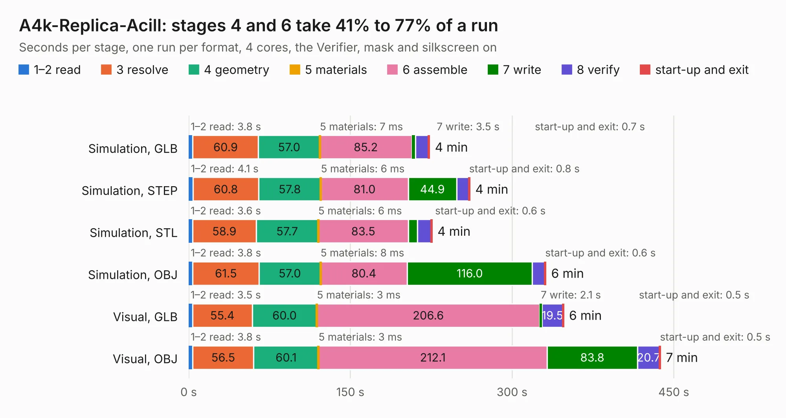

# 15. A4k-Replica-Acill

Board 15 of the 3,112 of [Corpus Testing](../Corpus-Testing.md), on [Corpus Page 1](../CorpusTestingPages/Corpus-Testing-01.md#15-a4k-replica-acill).

| Mode and format | 1–2 read | 3 resolve | 4 geometry | 5 materials | 6 assemble | 7 write | 8 verify | start-up and exit | Total |
|---|---:|---:|---:|---:|---:|---:|---:|---:|---:|
| Simulation, GLB | 3.8 | 60.9 | 57.0 | 7&nbsp;ms | 85.2 | 3.5 | 12.0 | 0.7 | 223.2 |
| Simulation, STEP | 4.1 | 60.8 | 57.8 | 6&nbsp;ms | 81.0 | 44.9 | 11.2 | 0.8 | 260.6 |
| Simulation, STL | 3.6 | 58.9 | 57.7 | 6&nbsp;ms | 83.5 | 8.3 | 12.9 | 0.6 | 225.6 |
| Simulation, OBJ | 3.8 | 61.5 | 57.0 | 8&nbsp;ms | 80.4 | 116.0 | 11.7 | 0.6 | 331.1 |
| Visual, GLB | 3.5 | 55.4 | 60.0 | 3&nbsp;ms | 206.6 | 2.1 | 19.5 | 0.5 | 347.6 |
| Visual, OBJ | 3.8 | 56.5 | 60.1 | 3&nbsp;ms | 212.1 | 83.8 | 20.7 | 0.5 | 437.5 |

<table align="center"><tr><td valign="top">

| Board | Repo: [Acill/A4000RevB](https://github.com/Acill/A4000RevB) Board: `A4k-Replica-Acill.kicad_pcb` |
|---|---|
| Folder | Kicad |
| Complexity | 381&nbsp;/&nbsp;1000 (size&nbsp;281, features&nbsp;100) |
| KESE&nbsp;features | through vias, padstacks, copper drawings, copper text, stack-up, dielectric εr and tanδ, mask and silkscreen colours |
| Tested | 9th November 2026 to 10th November 2026 |
| Copper&nbsp;layers | 4 |
| File&nbsp;format | KiCad 10 (20260206) |
| Parts,&nbsp;tracks,&nbsp;vias | 775, 37,504, 2,698 |
| Triangles,&nbsp;simulation | 16,912,844 in 896 parts |
| Verifier | PASS in all six runs |
| Run&nbsp;again | Simulation, GLB; Simulation, STEP; Simulation, STL; Simulation, OBJ: failed in the corpus run, run again with fixes to KESE made after the corpus run, and passed |

</td><td valign="top">

<table>
<tr><th>File type</th><th>File size</th><th>Peak memory used</th></tr>
<tr><th colspan="3" align="left">Simulation</th></tr>
<tr><td>GLB</td><td align="right">564&nbsp;MB</td><td align="right">5.4&nbsp;GB</td></tr>
<tr><td>STEP</td><td align="right">2.3&nbsp;GB</td><td align="right">5.7&nbsp;GB</td></tr>
<tr><td>STL</td><td align="right">846&nbsp;MB</td><td align="right">5.2&nbsp;GB</td></tr>
<tr><td>OBJ</td><td align="right">1.9&nbsp;GB</td><td align="right">11&nbsp;GB</td></tr>
<tr><th colspan="3" align="left">Visual</th></tr>
<tr><td>GLB</td><td align="right">424&nbsp;MB</td><td align="right">6.7&nbsp;GB</td></tr>
<tr><td>OBJ</td><td align="right">1.4&nbsp;GB</td><td align="right">8.6&nbsp;GB</td></tr>
</table>

</td></tr></table>

| Previous | Next |
|:---|---:|
| [14. FPGA-BOARD](b0014b_fpga-board_FPGA-BOARD.md) | [16. Backplane Helper](b0016b_6502_Backplane-Helper.md) |
