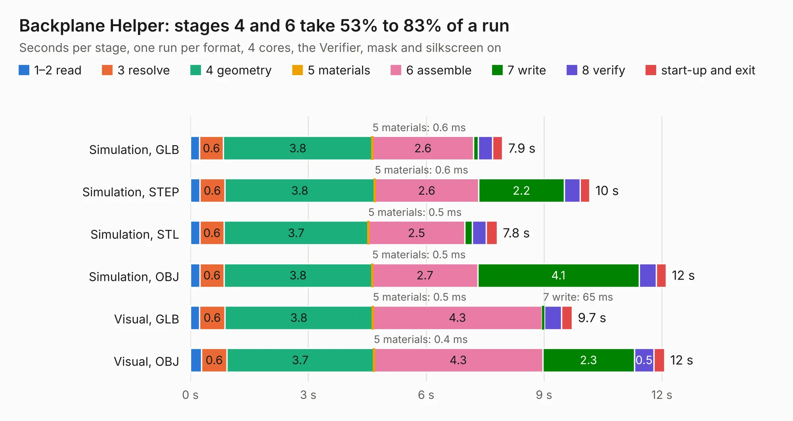

# 16. Backplane Helper

Board 16 of the 3,107 of [Corpus Testing](../Corpus-Testing.md), on [Corpus Page 1](../CorpusTestingPages/Corpus-Testing-01.md#16-backplane-helper).

| Mode and format | 1–2 read | 3 resolve | 4 geometry | 5 materials | 6 assemble | 7 write | 8 verify | start-up and exit | Total |
|---|---:|---:|---:|---:|---:|---:|---:|---:|---:|
| Simulation, GLB | 0.2 | 0.6 | 3.8 | 0.6&nbsp;ms | 2.6 | 0.1 | 0.4 | 0.3 | 7.9 |
| Simulation, STEP | 0.2 | 0.6 | 3.8 | 0.6&nbsp;ms | 2.6 | 2.2 | 0.4 | 0.2 | 10.2 |
| Simulation, STL | 0.2 | 0.6 | 3.7 | 0.5&nbsp;ms | 2.5 | 0.2 | 0.4 | 0.3 | 7.8 |
| Simulation, OBJ | 0.2 | 0.6 | 3.8 | 0.5&nbsp;ms | 2.7 | 4.1 | 0.4 | 0.3 | 12.1 |
| Visual, GLB | 0.2 | 0.6 | 3.8 | 0.5&nbsp;ms | 4.3 | 65&nbsp;ms | 0.4 | 0.3 | 9.7 |
| Visual, OBJ | 0.3 | 0.6 | 3.7 | 0.4&nbsp;ms | 4.3 | 2.3 | 0.5 | 0.3 | 12.1 |

<table align="center"><tr><td valign="top">

| Board | Repo: [acwright/6502](https://github.com/acwright/6502) Board: `Backplane Helper.kicad_pcb` |
|---|---|
| Folder | Hardware / Backplane Helper / Rev 1.0 |
| Complexity | 175&nbsp;/&nbsp;1000 (size&nbsp;130, features&nbsp;45) |
| KESE&nbsp;features | through vias, filled zones, curved board outline |
| Tested | 9th November 2026 |
| Copper&nbsp;layers | 2 |
| File&nbsp;format | KiCad 10 (20260206) |
| Parts,&nbsp;tracks,&nbsp;vias | 3, 395, 6 |
| Triangles,&nbsp;simulation | 746,688 in 48 parts |
| Verifier | PASS in all six runs |

</td><td valign="top">

<table>
<tr><th>File type</th><th>File size</th><th>Peak memory used</th></tr>
<tr><th colspan="3" align="left">Simulation</th></tr>
<tr><td>GLB</td><td align="right">25&nbsp;MB</td><td align="right">367&nbsp;MB</td></tr>
<tr><td>STEP</td><td align="right">107&nbsp;MB</td><td align="right">422&nbsp;MB</td></tr>
<tr><td>STL</td><td align="right">37&nbsp;MB</td><td align="right">363&nbsp;MB</td></tr>
<tr><td>OBJ</td><td align="right">75&nbsp;MB</td><td align="right">540&nbsp;MB</td></tr>
<tr><th colspan="3" align="left">Visual</th></tr>
<tr><td>GLB</td><td align="right">14&nbsp;MB</td><td align="right">404&nbsp;MB</td></tr>
<tr><td>OBJ</td><td align="right">40&nbsp;MB</td><td align="right">407&nbsp;MB</td></tr>
</table>

</td></tr></table>

| Previous | Next |
|:---|---:|
| [15. A4k-Replica-Acill](b0015b_A4000RevB_A4k-Replica-Acill.md) | [17. Backplane Pro](b0017b_6502_Hardware-Backplane-Pro-Rev-1-0_Backplane-Pro.md) |
