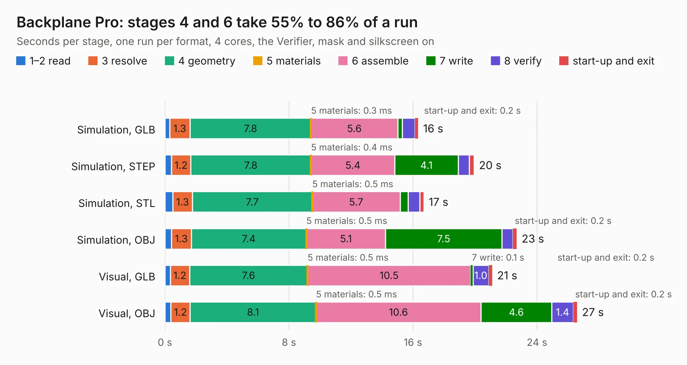

# 17. Backplane Pro

Board 17 of the 3,102 of [Corpus Testing](../Corpus-Testing.md), on [Corpus Page 1](../CorpusTestingPages/Corpus-Testing-01.md#17-backplane-pro).

| Mode and format | 1–2 read | 3 resolve | 4 geometry | 5 materials | 6 assemble | 7 write | 8 verify | start-up and exit | Total |
|---|---:|---:|---:|---:|---:|---:|---:|---:|---:|
| Simulation, GLB | 0.3 | 1.3 | 7.8 | 0.3&nbsp;ms | 5.6 | 0.3 | 0.8 | 0.2 | 16.3 |
| Simulation, STEP | 0.4 | 1.2 | 7.8 | 0.4&nbsp;ms | 5.4 | 4.1 | 0.7 | 0.3 | 19.9 |
| Simulation, STL | 0.5 | 1.3 | 7.7 | 0.5&nbsp;ms | 5.7 | 0.5 | 0.7 | 0.3 | 16.7 |
| Simulation, OBJ | 0.4 | 1.3 | 7.4 | 0.5&nbsp;ms | 5.1 | 7.5 | 0.7 | 0.2 | 22.7 |
| Visual, GLB | 0.3 | 1.2 | 7.6 | 0.5&nbsp;ms | 10.5 | 0.1 | 1.0 | 0.2 | 21.1 |
| Visual, OBJ | 0.4 | 1.2 | 8.1 | 0.5&nbsp;ms | 10.6 | 4.6 | 1.4 | 0.2 | 26.6 |

<table align="center"><tr><td valign="top">

| Board | Repo: [acwright/6502](https://github.com/acwright/6502) Board: `Backplane Pro.kicad_pcb` |
|---|---|
| Folder | Hardware / Backplane Pro / Rev 1.0 |
| Complexity | 262&nbsp;/&nbsp;1000 (size&nbsp;172, features&nbsp;90) |
| KESE&nbsp;features | through vias, slotted holes, custom pads, rounded, trapezoid or chamfered pads, filled zones, copper drawings, curved board outline |
| Tested | 9th November 2026 |
| Copper&nbsp;layers | 2 |
| File&nbsp;format | KiCad 10 (20260206) |
| Parts,&nbsp;tracks,&nbsp;vias | 39, 1,027, 31 |
| Triangles,&nbsp;simulation | 1,649,758 in 67 parts |
| Verifier | PASS in all six runs |

</td><td valign="top">

<table>
<tr><th>File type</th><th>File size</th><th>Peak memory used</th></tr>
<tr><th colspan="3" align="left">Simulation</th></tr>
<tr><td>GLB</td><td align="right">55&nbsp;MB</td><td align="right">644&nbsp;MB</td></tr>
<tr><td>STEP</td><td align="right">257&nbsp;MB</td><td align="right">754&nbsp;MB</td></tr>
<tr><td>STL</td><td align="right">82&nbsp;MB</td><td align="right">669&nbsp;MB</td></tr>
<tr><td>OBJ</td><td align="right">171&nbsp;MB</td><td align="right">1.1&nbsp;GB</td></tr>
<tr><th colspan="3" align="left">Visual</th></tr>
<tr><td>GLB</td><td align="right">32&nbsp;MB</td><td align="right">654&nbsp;MB</td></tr>
<tr><td>OBJ</td><td align="right">97&nbsp;MB</td><td align="right">802&nbsp;MB</td></tr>
</table>

</td></tr></table>

| Previous | Next |
|:---|---:|
| [16. Backplane Helper](b0016b_6502_Backplane-Helper.md) | [18. Backplane Pro](b0018b_6502_Hardware-Backplane-Pro-Rev-1-1_Backplane-Pro.md) |
