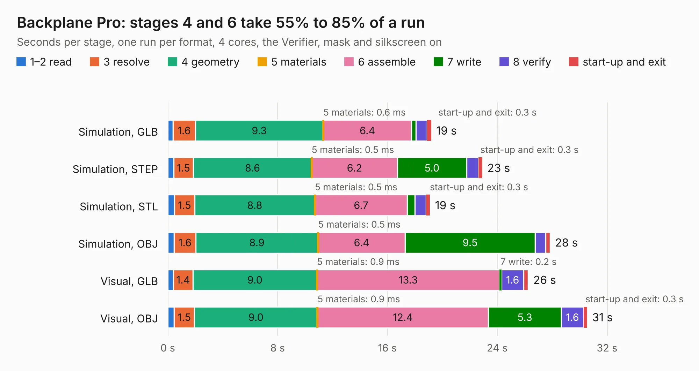

# 18. Backplane Pro

Board 18 of the 3,125 of [Corpus Testing](../Corpus-Testing.md), on [Corpus Page 1](../CorpusTestingPages/Corpus-Testing-01.md#18-backplane-pro).

| Mode and format | 1–2 read | 3 resolve | 4 geometry | 5 materials | 6 assemble | 7 write | 8 verify | start-up and exit | Total |
|---|---:|---:|---:|---:|---:|---:|---:|---:|---:|
| Simulation, GLB | 0.4 | 1.6 | 9.3 | 0.6&nbsp;ms | 6.4 | 0.3 | 0.8 | 0.3 | 19.2 |
| Simulation, STEP | 0.4 | 1.5 | 8.6 | 0.5&nbsp;ms | 6.2 | 5.0 | 0.9 | 0.3 | 22.9 |
| Simulation, STL | 0.5 | 1.5 | 8.8 | 0.5&nbsp;ms | 6.7 | 0.5 | 0.8 | 0.3 | 19.1 |
| Simulation, OBJ | 0.5 | 1.6 | 8.9 | 0.5&nbsp;ms | 6.4 | 9.5 | 0.8 | 0.3 | 27.9 |
| Visual, GLB | 0.4 | 1.4 | 9.0 | 0.9&nbsp;ms | 13.3 | 0.2 | 1.6 | 0.3 | 26.3 |
| Visual, OBJ | 0.5 | 1.5 | 9.0 | 0.9&nbsp;ms | 12.4 | 5.3 | 1.6 | 0.3 | 30.6 |

<table align="center"><tr><td valign="top">

| Board | Repo: [acwright/6502](https://github.com/acwright/6502) Board: `Backplane Pro.kicad_pcb` |
|---|---|
| Folder | Hardware / Backplane Pro / Rev 1.1 |
| Complexity | 256&nbsp;/&nbsp;1000 (size&nbsp;166, features&nbsp;90) |
| KESE&nbsp;features | through vias, slotted holes, custom pads, rounded, trapezoid or chamfered pads, filled zones, copper drawings, curved board outline |
| Tested | 9th November 2026 |
| Copper&nbsp;layers | 2 |
| File&nbsp;format | KiCad 10 (20260206) |
| Parts,&nbsp;tracks,&nbsp;vias | 24, 984, 33 |
| Triangles,&nbsp;simulation | 1,751,664 in 59 parts |
| Verifier | PASS in all six runs |

</td><td valign="top">

<table>
<tr><th>File type</th><th>File size</th><th>Peak memory used</th></tr>
<tr><th colspan="3" align="left">Simulation</th></tr>
<tr><td>GLB</td><td align="right">59&nbsp;MB</td><td align="right">617&nbsp;MB</td></tr>
<tr><td>STEP</td><td align="right">263&nbsp;MB</td><td align="right">778&nbsp;MB</td></tr>
<tr><td>STL</td><td align="right">88&nbsp;MB</td><td align="right">655&nbsp;MB</td></tr>
<tr><td>OBJ</td><td align="right">182&nbsp;MB</td><td align="right">1.2&nbsp;GB</td></tr>
<tr><th colspan="3" align="left">Visual</th></tr>
<tr><td>GLB</td><td align="right">33&nbsp;MB</td><td align="right">772&nbsp;MB</td></tr>
<tr><td>OBJ</td><td align="right">99&nbsp;MB</td><td align="right">767&nbsp;MB</td></tr>
</table>

</td></tr></table>

| Previous | Next |
|:---|---:|
| [17. Backplane Pro](b0017b_6502_Hardware-Backplane-Pro-Rev-1-0_Backplane-Pro.md) | [19. Backplane](b0019b_6502_Backplane.md) |
