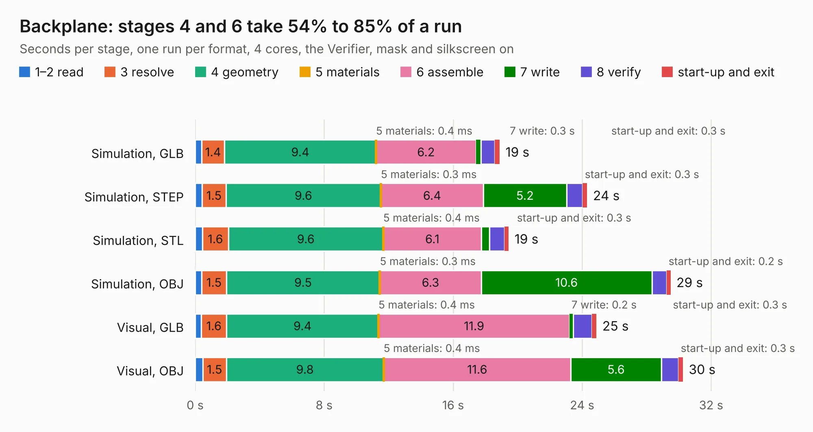

# 19. Backplane

Board 19 of the 3,112 of [Corpus Testing](../Corpus-Testing.md), on [Corpus Page 1](../CorpusTestingPages/Corpus-Testing-01.md#19-backplane).

| Mode and format | 1–2 read | 3 resolve | 4 geometry | 5 materials | 6 assemble | 7 write | 8 verify | start-up and exit | Total |
|---|---:|---:|---:|---:|---:|---:|---:|---:|---:|
| Simulation, GLB | 0.4 | 1.4 | 9.4 | 0.4&nbsp;ms | 6.2 | 0.3 | 0.9 | 0.3 | 18.9 |
| Simulation, STEP | 0.4 | 1.5 | 9.6 | 0.3&nbsp;ms | 6.4 | 5.2 | 1.0 | 0.3 | 24.3 |
| Simulation, STL | 0.4 | 1.6 | 9.6 | 0.4&nbsp;ms | 6.1 | 0.5 | 1.0 | 0.3 | 19.4 |
| Simulation, OBJ | 0.4 | 1.5 | 9.5 | 0.3&nbsp;ms | 6.3 | 10.6 | 0.9 | 0.2 | 29.5 |
| Visual, GLB | 0.4 | 1.6 | 9.4 | 0.4&nbsp;ms | 11.9 | 0.2 | 1.2 | 0.3 | 24.9 |
| Visual, OBJ | 0.5 | 1.5 | 9.8 | 0.4&nbsp;ms | 11.6 | 5.6 | 1.1 | 0.3 | 30.3 |

<table align="center"><tr><td valign="top">

| Board | Repo: [acwright/6502](https://github.com/acwright/6502) Board: `Backplane.kicad_pcb` |
|---|---|
| Folder | Hardware / Backplane / Rev 1.0 |
| Complexity | 201&nbsp;/&nbsp;1000 (size&nbsp;156, features&nbsp;45) |
| KESE&nbsp;features | through vias, filled zones, curved board outline |
| Tested | 9th November 2026 |
| Copper&nbsp;layers | 2 |
| File&nbsp;format | KiCad 10 (20260206) |
| Parts,&nbsp;tracks,&nbsp;vias | 7, 1,069, 52 |
| Triangles,&nbsp;simulation | 1,766,986 in 48 parts |
| Verifier | PASS in all six runs |

</td><td valign="top">

<table>
<tr><th>File type</th><th>File size</th><th>Peak memory used</th></tr>
<tr><th colspan="3" align="left">Simulation</th></tr>
<tr><td>GLB</td><td align="right">60&nbsp;MB</td><td align="right">643&nbsp;MB</td></tr>
<tr><td>STEP</td><td align="right">261&nbsp;MB</td><td align="right">772&nbsp;MB</td></tr>
<tr><td>STL</td><td align="right">88&nbsp;MB</td><td align="right">661&nbsp;MB</td></tr>
<tr><td>OBJ</td><td align="right">183&nbsp;MB</td><td align="right">1.2&nbsp;GB</td></tr>
<tr><th colspan="3" align="left">Visual</th></tr>
<tr><td>GLB</td><td align="right">34&nbsp;MB</td><td align="right">742&nbsp;MB</td></tr>
<tr><td>OBJ</td><td align="right">104&nbsp;MB</td><td align="right">842&nbsp;MB</td></tr>
</table>

</td></tr></table>

| Previous | Next |
|:---|---:|
| [18. Backplane Pro](b0018b_6502_Hardware-Backplane-Pro-Rev-1-1_Backplane-Pro.md) | [20. Blinkenlights Card](b0020b_6502_Blinkenlights-Card.md) |
