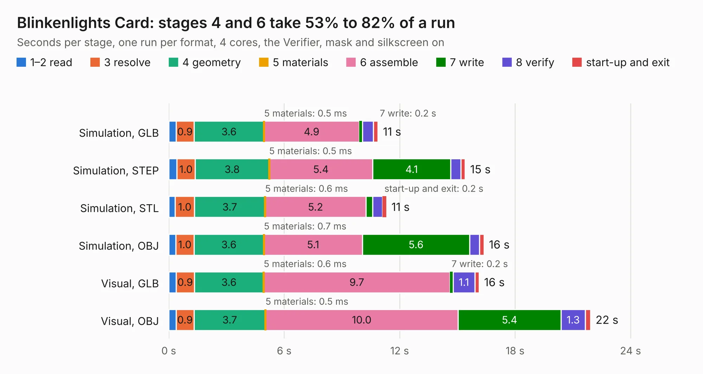

# 20. Blinkenlights Card

Board 20 of the 3,127 of [Corpus Testing](../Corpus-Testing.md), on [Corpus Page 1](../CorpusTestingPages/Corpus-Testing-01.md#20-blinkenlights-card).

| Mode and format | 1–2 read | 3 resolve | 4 geometry | 5 materials | 6 assemble | 7 write | 8 verify | start-up and exit | Total |
|---|---:|---:|---:|---:|---:|---:|---:|---:|---:|
| Simulation, GLB | 0.4 | 0.9 | 3.6 | 0.5&nbsp;ms | 4.9 | 0.2 | 0.6 | 0.2 | 10.9 |
| Simulation, STEP | 0.4 | 1.0 | 3.8 | 0.5&nbsp;ms | 5.4 | 4.1 | 0.5 | 0.2 | 15.4 |
| Simulation, STL | 0.3 | 1.0 | 3.7 | 0.6&nbsp;ms | 5.2 | 0.4 | 0.5 | 0.2 | 11.3 |
| Simulation, OBJ | 0.4 | 1.0 | 3.6 | 0.7&nbsp;ms | 5.1 | 5.6 | 0.5 | 0.2 | 16.4 |
| Visual, GLB | 0.4 | 0.9 | 3.6 | 0.6&nbsp;ms | 9.7 | 0.2 | 1.1 | 0.2 | 16.1 |
| Visual, OBJ | 0.4 | 0.9 | 3.7 | 0.5&nbsp;ms | 10.0 | 5.4 | 1.3 | 0.3 | 21.9 |

<table align="center"><tr><td valign="top">

| Board | Repo: [acwright/6502](https://github.com/acwright/6502) Board: `Blinkenlights Card.kicad_pcb` |
|---|---|
| Folder | Hardware / Blinkenlights Card / Rev 1.0 |
| Complexity | 234&nbsp;/&nbsp;1000 (size&nbsp;179, features&nbsp;55) |
| KESE&nbsp;features | through vias, rounded, trapezoid or chamfered pads, filled zones, curved board outline |
| Tested | 9th November 2026 |
| Copper&nbsp;layers | 2 |
| File&nbsp;format | KiCad 10 (20260206) |
| Parts,&nbsp;tracks,&nbsp;vias | 73, 630, 166 |
| Triangles,&nbsp;simulation | 1,095,960 in 109 parts |
| Verifier | PASS in all six runs |

</td><td valign="top">

<table>
<tr><th>File type</th><th>File size</th><th>Peak memory used</th></tr>
<tr><th colspan="3" align="left">Simulation</th></tr>
<tr><td>GLB</td><td align="right">38&nbsp;MB</td><td align="right">531&nbsp;MB</td></tr>
<tr><td>STEP</td><td align="right">200&nbsp;MB</td><td align="right">635&nbsp;MB</td></tr>
<tr><td>STL</td><td align="right">55&nbsp;MB</td><td align="right">518&nbsp;MB</td></tr>
<tr><td>OBJ</td><td align="right">112&nbsp;MB</td><td align="right">776&nbsp;MB</td></tr>
<tr><th colspan="3" align="left">Visual</th></tr>
<tr><td>GLB</td><td align="right">35&nbsp;MB</td><td align="right">855&nbsp;MB</td></tr>
<tr><td>OBJ</td><td align="right">105&nbsp;MB</td><td align="right">841&nbsp;MB</td></tr>
</table>

</td></tr></table>

| Previous | Next |
|:---|---:|
| [19. Backplane](b0019b_6502_Backplane.md) | [21. Breadboard Helper](b0021b_6502_Breadboard-Helper.md) |
